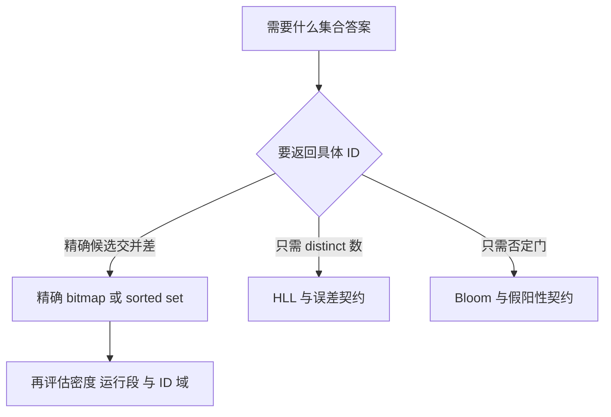
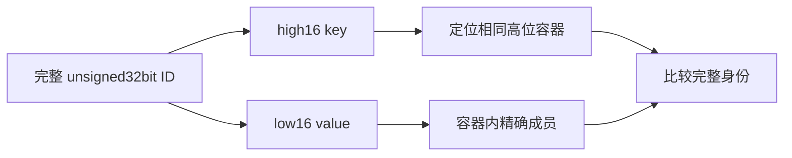
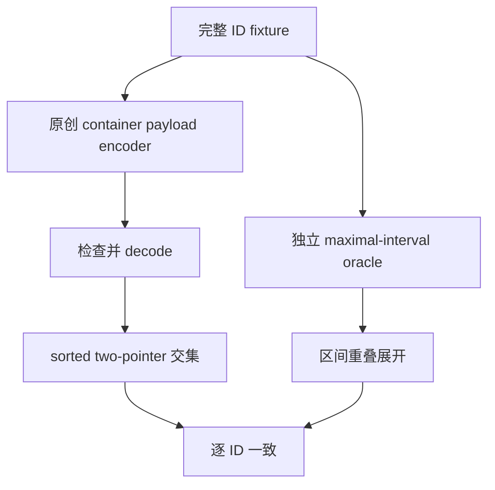

# AI Infra 压缩位图选型 FAQ：Roaring Array / Bitset / Run、4096 边界与高位身份

> **语言**：中文 | [English](roaring-array-bitset-run-container-payload-selection-faq.en.md)  
> **Round 137 · 2026-11-14 白班**：元数据候选集、训练样本 ID 与精确集合运算的底层表示。  
> **关联**：[HLL 基数与寄存器并集](hll-register-max-union-cardinality-estimator-selection-faq.md) · [Bloom 否定门与安全删除](bloom-negative-gate-layer-budget-safe-deletion-selection-faq.md)

**结论速览**：Roaring 的精确集合语义不同于 Bloom 成员否定门和 HLL 近似基数。32-bit ID 分成 **high16 key + low16 value**；非 run 容器在 cardinality≤4096 时用 array，超过时用 8192B bitset。但 **连续性可以改变结论**：4097 个连续值的原创 run payload 仅 6B，4097 个隔位值仍用 bitset。这里是 container payload，不是完整文件、native 内存或 ACL 时延。

**交付**：[交互工作台](../reports/roaring-array-bitset-run-container-payload-sizer.html) · [7-Card](../reports/roaring-array-bitset-run-container-payload-selection-cards.html) · [1600px SVG](../../assets/svg/roaring-array-bitset-run-container-payload-selection-faq-summary.svg) · [封存数据](../../experiments/roaring_container_contract_selection/report.json)

## Q1：AI 数据平面应该选择精确 bitmap、Bloom 还是 HLL？

当任务要求“哪些 doc/sample IDs 同时满足两个条件”，可考虑精确 bitmap 的交并差；不需要概率性成员错误。若只要近似 distinct 数，HLL 的固定状态/误差契约更匹配；若只要快速排除不在集合的候选且允许假阳性，则选择适配的 Bloom 结构。三者不是可交换的压缩格式。



本专题独立于仓库已有 RAG/ACL 宏观研究：不继承其规模、召回、时延或撤权数字，只验证**压缩容器与身份**。精确集合本身也不保证权限源新鲜、撤权传播或数据库快照一致；这些是外部应用协议。

## Q2：high16/low16 为什么不能混用，4096 又从何而来？

每个 unsigned32bit ID 的高 16 位选择容器，低 16 位位于 `[0,65535]`。因此 7 与 65543 的 low 都是 7，但 high 分别 0/1，真实交集为空。全局只按 low 值匹配会伪造一次命中；signed int32 排序也不能直接代表全域 unsigned 顺序。

固定 portable format 规定非 run 类型根据 cardinality 决定：`c≤4096` 为 sorted uint16 array，payload=`2c`；`c>4096` 为固定 8192B bitset。相等边界 array 的 payload 正好也是 8192B，但不能因此把 descriptor 解读成 bitset。bitset 的第 `j` 个 low 值对应第 `j` 个 bit，little-endian 64-bit words；原创逐字节表示产生相同位位置。



本 encoder 将输入去重并按 unsigned 数值排序；重复、反序输入不增加 cardinality。空集合没有容器，不创建 cardinality=0 的虚假 container。模型输入上限 65536 个 ID，未表示 Roaring 实际完整容量。

## Q3：run container 怎样编码，为什么不是“密一点就一定 bitmap”？

每段用 `(start, length_minus_one)` 两个 uint16 表示；前面 uint16 记录 run 数。因此 run payload=`2+4r`。连续段 `[0,65535]` 的 length-minus-one 是 65535，能表示完整 65536 个值；把该字段误当长度会漏掉最后一个身份。

| 原创低位输入 | 无 run：类型 / payload | 开启原创 run 策略 | 结论 |
| :--- | :--- | :--- | :--- |
| 4096 个隔位值 | array / 8192B | array / 8192B | 4096 边界含等号 |
| 4097 个隔位值 | bitset / 8192B | bitset / 8192B | run 太碎没有更省 |
| 连续 4097 个值 | bitset / 8192B | run / 6B | 连续性比 cardinality 单独值更重要 |
| 整个 low16 域 65536 个值 | bitset / 8192B | run / 6B | inclusive 端点不能少一 |

原创策略仅在 run payload **严格小于**默认 array/bitset payload 时选择 run；相等保留非 run（如三个连续值，array=6B、run=6B）。这是明确的教学策略，**没有复现 native `runOptimize` 的容量、分配或整体文件取舍**。

run 条目必须非重叠、递增且 `start+length_minus_one≤65535`。原型检查 payload 长度与 cardinality，不能把损坏的区间悄悄截断。整个 portable 文件还包含 cookie、run flags、key/cardinality、可能的 offsets；其大小不能直接用上述 payload 冒充。

## Q4：完整 ID 交集和独立 oracle 如何验证？

默认 A 有 103 个 ID：key0 的 `5,9,13`，加 key1 的 low `[100,199]`。B 有 102 个：key0 的 `9,13`，加 key1 的 low `[150,249]`。A payload=`6+6=12B`；禁用 run 后为 `6+200=206B`。B payload=`4+6=10B`。真实交集为 52 个、并集为 153 个。

原创 encoder 写出实际 little-endian container payload；decoder 按显式 key/type/cardinality 元数据恢复完整 ID，再用 sorted two-pointer 计算交集。独立 oracle 先将完整 ID 转为 maximal inclusive intervals，枚举区间重叠，不调用 payload decoder 或 two-pointer。



测试覆盖 24 组固定 seed 输入、高位跨界、uint32 最大值、反序/重复、三类 payload round-trip、cardinality 不符、截断 payload、array 无序与 run 溢出。没有实现完整 portable 文件 reader/writer、容器间 native dispatch 或安全的通用不可信字节解析器。

## Q5：byte budget 与吞吐数字哪些能用，哪些不能推广？

A 的 run-enabled container payload 是 12B，对比 no-run 206B 和原始 uint32 身份 payload 412B；若使用从 ID0 到其最大 ID 的 flat bitmap，选定覆盖长度为 8217B。这不是同一种完整对象布局的 native memory 比较。尤其不同 ID 映射/局部 rebase 会改变 flat bitmap 的覆盖范围，不能把它当唯一 baseline。

| 每集合预构建 ID 数 | Python integer AND+bit_count（ms） | 原创 sorted intersection list+len（ms） |
| ---: | ---: | ---: |
| 64 | 0.000133 | 0.013233 |
| 256 | 0.000167 | 0.053567 |
| 1024 | 0.000367 | 0.242867 |
| 4096 | 0.000733 | 0.917267 |

这组 timing **工作量不同**：C-backed bigint 做 cardinality，Python 路径生成交集 list 再取长度。只说明这个原型的语言执行/输出物化边界，不推导 SIMD/native Roaring speedup。输入预构建；排除构建、codec、container dispatch、CRoaring、ANN 与 ACL。两次 warmup、七轮交替 repeat、每样本三操作，中位数来自封存样本。

若生产只要交集 cardinality，应优先核对引擎是否有不物化 ID 的 native API；若要真正取出 IDs，则 cardinality-only 的低成本不可直接用于容量预估。所有 native latency/memory 和撤权时延保持未知/null。

## Q6：最新能力、来源许可与上线核对是什么？

本轮追踪到 **2026-11-09 CRoaring 的 Roaring64 C++ 查询接口增加 rank/select、set-op cardinality 等**，并实际读取对应 method patch：`select` 最小元素索引为 0；`rank(x)` 数的是 `≤x` 的元素数；`getIndex` 则区分缺席身份。这些 native 64-bit 能力**没有在此执行**，不能把原型 uint32 容器报告当它们的 benchmark。11 月 10 日 format-spec 的网站生成变更也不是 4096 边界新发明。

来源：[固定 format specification](https://github.com/RoaringBitmap/RoaringFormatSpec/blob/188a7c75a9cea6b2b6d31efb604fab621e6a1b28/README.md)（已检查该提交 LICENSE，Apache-2.0）及 [CRoaring 查询变更](https://github.com/RoaringBitmap/CRoaring/commit/ef50ca287eb6e775a4e90f012e1e089d193b610c)。仅原创事实分析、payload 实现与视觉，没有镜像上游示例或图。

```powershell
python -m unittest discover -s tests -p test_roaring_container_contract_selection.py -q
python -m experiments.roaring_container_contract_selection.run --check
# --measure 会主动替换本机 CPU samples
```

八项测试含 Node/Python 工作台 parity；六段 FAQ、3 Mermaid、XML SVG、七卡与严格 CSP 可本地检查。此前浏览器拒绝仍受尊重，视觉浏览器检查未执行。工作台用显式错误展示 unsigned32bit 范围与 JSON 问题。

上线需单独验证 ID namespace/映射、snapshot/epoch、授权状态同步、native API 版本、untrusted serialized input 的正式校验、dense/run/array 在真实数据上的分布。原型 provenance=`synthetic`、`independently_reproduced=false`；原创 CPU 记录单独 `measured`。不能从 12B payload 或精确集合语义推出生产权限安全性。
