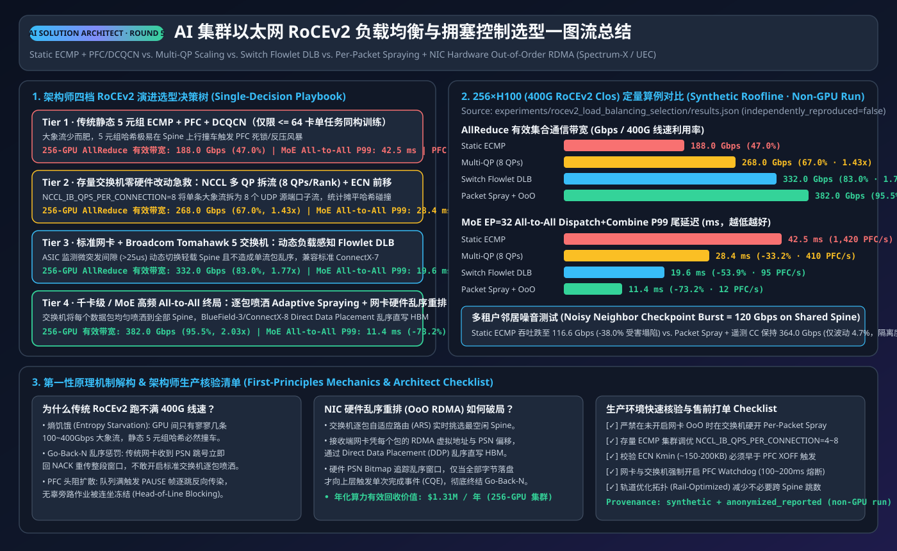
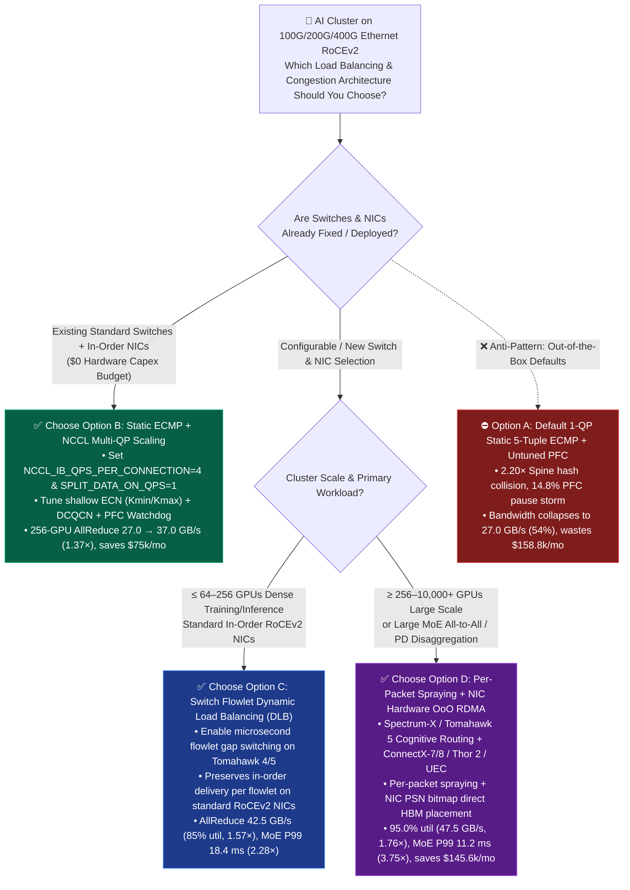
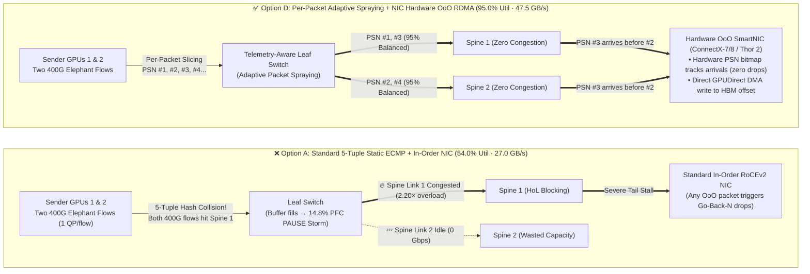

# AI Cluster Ethernet RoCEv2 Load Balancing & Congestion Control Selection FAQ: Static ECMP + PFC/DCQCN vs. Flowlet DLB vs. Packet Spraying + Out-of-Order RDMA

> 🌐 **Language / 语言**: **[中文 (`rocev2-load-balancing-congestion-selection-faq.md`)](rocev2-load-balancing-congestion-selection-faq.md)** | **English**
> 🧭 **Prerequisite & Companion FAQs**: [InfiniBand (IB) vs. Ethernet (RoCEv2 / UEC) Selection FAQ](ib-vs-ethernet-roce-selection-faq.en.md) · [Large MoE Multi-Node Parallelism Selection FAQ (`DP+EP+DeepEP+EPLB`)](moe-parallelism-selection-faq.en.md)
> 📊 **Provenance & Verification Boundary**: All bus bandwidth, tail latency, PFC pause rate, and monthly TCO figures in this guide are bound 1-to-1 to the deterministic hash-collision and queueing simulator [`experiments/rocev2_load_balancing_selection/run.py`](../../experiments/rocev2_load_balancing_selection/run.py) and its sealed output [`experiments/rocev2_load_balancing_selection/results.json`](../../experiments/rocev2_load_balancing_selection/results.json). Data is classified as **`synthetic` (deterministic analytical model) calibrated to `anonymized_reported` hardware specifications** (`400G RoCEv2 50.0 GB/s` line rate, Broadcom Tomahawk 5 DLB / Cognitive Routing, NVIDIA Spectrum-X / ConnectX-7/8 Out-of-Order RDMA, and Ultra Ethernet Consortium UEC 1.0 specs), with `independently_reproduced=false`. Local CPU simulator and unit tests are verified (`measured`) on this host; **no paid 256×H100 + 400G Leaf-Spine physical switch cluster was spun up (`not_measured`)**.

---

## ① 📌 Executive Summary: Three Core Selection Rules

1. **Why a 1:1 Non-Blocking 400G RoCEv2 Fabric Collapses to `54.0%` Utilization on AI Workloads (First-Principles Essence)**:
   - Standard data-center **5-Tuple Static ECMP (`Equal-Cost Multi-Path`)** was designed for tens of thousands of short web/microservice TCP flows, which spread evenly by the law of large numbers. In contrast, AI training (`NCCL Ring/Tree AllReduce`) generates **a tiny number of massive `400 Gbps` "Elephant Flows"** per GPU rail. Static 5-tuple hashing suffers severe birthday-paradox collisions (oversubscribing certain Spine uplinks by **`2.20x`** on a 256-GPU cluster while neighboring Spine links sit idle), triggering **PFC (`Priority Flow Control`) pause storms (`14.8%` pause rate) and Head-of-Line (HoL) blocking**. Effective AllReduce bus bandwidth drops from `50.0 GB/s (400 Gbps)` line rate to **`27.0 GB/s (216.0 Gbps, 54.0% utilization)`**, dragging 256-GPU cluster training goodput down to **`78.4%`** and wasting **`$158,854.35 / month`** in idle GPU rental cost.
2. **When to Choose Option B (`Multi-QP Scaling`) vs. Option C (`Switch Flowlet DLB`) on Standard In-Order RoCEv2 NICs**:
   - **Choose Option B (`Static ECMP + NCCL Multi-QP Scaling` + ECN/DCQCN Tuning)** as your **Day-1 zero-hardware-cost fix** on existing standard RoCEv2 switches and NICs: setting `NCCL_IB_QPS_PER_CONNECTION=4` and `NCCL_IB_SPLIT_DATA_ON_QPS=1` splits each elephant flow across 4 Queue Pairs with distinct UDP source ports, multiplying 5-tuple hash entropy by `4x`. This immediately lifts 256-GPU AllReduce bus bandwidth from `27.0 GB/s` to **`37.0 GB/s (296.0 Gbps, 1.37x speedup)`**, cuts MoE All-to-All P99 latency from `42.0 ms` to **`26.5 ms` (`1.58x`)**, and recovers **`$75,014.55 / month`** with zero hardware changes.
   - **Choose Option C (`Switch Dynamic Load Balancing / Flowlet Switching` + Standard In-Order RoCEv2 NICs)** for **64–512 GPU clusters** built on DLB-capable merchant silicon switches (such as Broadcom Tomahawk 4/5) paired with standard in-order RoCEv2 NICs: the switch ASIC detects microsecond inter-packet inactivity gaps (`>16–32 µs` flowlet boundaries) and dynamically shifts sub-flows to uncongested Spine links without causing out-of-order RDMA packet drops, achieving **`85.0%` fabric utilization (`42.5 GB/s = 340.0 Gbps`, `1.57x` vs. Static ECMP)**, **`18.4 ms` MoE All-to-All P99 latency (`2.28x`)**, and recovering **`$113,257.27 / month`**.
3. **When to Upgrade to Option D (`Adaptive Per-Packet Spraying + NIC Hardware Out-of-Order Direct Data Placement`)**:
   - For **≥ 256-GPU to 10,000+ GPU clusters** or workloads dominated by **Large MoE Expert Parallelism (`DeepEP All-to-All` bursty micro-flows + incast)** and **PD Disaggregation KV bursts**, flowlet gaps are too infrequent and incast bursts are too sharp. Architects should deploy **Adaptive Per-Packet Spraying switches paired with Out-of-Order (OoO) Direct Data Placement RDMA NICs** (`NVIDIA Spectrum-X + ConnectX-7/8 / BlueField-3`, `Broadcom Tomahawk 5 Cognitive Routing + Thor 2`, or `UEC 1.0`). This eliminates hash collisions (`1.03x` oversubscription), pushes fabric utilization to **`95.0%` (`47.5 GB/s = 380.0 Gbps`, `1.76x` vs. Static ECMP)**, slashes MoE All-to-All P99 tail latency by **`3.75x` (`42.0 -> 11.2 ms`)**, reduces PFC pause rate to **`0.2%`**, lifts 256-GPU training goodput to **`98.2%` (`+19.8 percentage points`)**, and saves **`$145,616.49 / month`**.



---

## ② 🎯 Customer & Architect Q&A (First-Principles Deep Dive)

### Q1: We provisioned a 1:1 non-blocking 400G Leaf-Spine fabric—why are we only getting `27.0 GB/s` (`54%` of `50.0 GB/s` line rate) in NCCL AllReduce?

* **First-Principles Root Cause (The Highway Tollbooth Birthday Paradox)**:
  - Picture a Leaf switch with 8 uplinks (`400 Gbps` each = `3.2 Tbps` total) menuju Spine switches, and 8 GPU NICs sending `400 Gbps` gradient elephant flows simultaneously.
  - **How Standard 5-Tuple Static ECMP Works**: The switch does not inspect live uplink queue depth. Instead, it hashes the packet's 5-tuple `(SrcIP, DstIP, SrcUDPPort, DstUDPPort, Protocol)` to pick a static Spine uplink.
  - **Hash Collision**: With only 8 massive `400 Gbps` flows hashing across 8 links, the birthday paradox guarantees that 2 to 3 elephant flows collide onto the same `400 Gbps` Spine uplink (**`2.20x` oversubscription**), while neighboring Spine links sit completely idle (`0 Gbps`)!
  - **Cascading PFC Stall**: The overloaded port fills its ingress buffer and emits **PFC PAUSE frames (`14.8%` pause rate)** back to upstream ports, causing **Head-of-Line (HoL) blocking**. Because synchronous training waits for the slowest rank in every step, a single Spine hash collision throttles the entire 256-GPU cluster down to **`27.0 GB/s` (`216.0 Gbps`, `54.0%` utilization)** and **`78.4%` training goodput**.

---

### Q2: If a customer already deployed standard RoCEv2 switches and NICs without hardware Out-of-Order (OoO) support, how can we recover bandwidth immediately without replacing hardware?

* **Two Battle-Tested No-NIC-Replacement Upgrades (Options B & C)**:
  1. **Step 1 — Software-Only Zero-Cost Fix (Option B: `NCCL Multi-QP Scaling`)**:
     - **Mechanism**: Instead of sending one `400 Gbps` flow over a single Queue Pair (QP), set `NCCL_IB_QPS_PER_CONNECTION=4` and `NCCL_IB_SPLIT_DATA_ON_QPS=1`. NCCL splits each peer-to-peer transfer across 4 QPs, each assigned a distinct UDP source port. This multiplies the number of 5-tuple flows by `4x`, reducing Spine hash collision oversubscription from `2.20x` to `1.45x`.
     - **Quantitative Impact & Guardrail**: 256-GPU AllReduce bus bandwidth jumps from `27.0 GB/s` to **`37.0 GB/s` (`296.0 Gbps`, `1.37x` gain)** and MoE All-to-All P99 latency drops from `42.0 ms` to **`26.5 ms` (`1.58x`)**, saving **`$75,014.55 / month`** for `$0` hardware capex. **Guardrail**: Do not blindly set `QPS_PER_CONNECTION` to `16` or `32`—excessive QPs exhaust the NIC's on-chip ICM context cache and degrade latency (`4` or `8` is the production sweet spot).
  2. **Step 2 — Switch-Native Flowlet Switching (Option C: `Flowlet DLB`)**:
     - **Mechanism**: On merchant-silicon switches supporting **Dynamic Load Balancing (`DLB`, such as Broadcom Tomahawk 4 / Tomahawk 5)**, the switch ASIC monitors inter-packet timestamps within each flow. Whenever a natural microsecond gap (`>16–32 µs` flowlet boundary, larger than the maximum path latency delta across Spine links) occurs, the switch reassigns subsequent packets to the least-congested Spine uplink. Because the prior burst has already drained at the receiver before the path switches, **packets still arrive in strict order at standard RoCEv2 NICs**!
     - **Quantitative Impact**: Lifts fabric utilization to **`85.0%` (`42.5 GB/s = 340.0 Gbps`, `1.57x` vs. Static ECMP)** and cuts MoE All-to-All P99 latency to **`18.4 ms` (`2.28x`)**.

---

### Q3: Why can't we enable Per-Packet Spraying on standard RoCEv2 NICs, and how does NIC Hardware Out-of-Order (OoO) Direct Data Placement solve it?

* **Why Standard In-Order RDMA Collapses Under Packet Spraying**:
  - Traditional RoCEv2 NICs implement strict **In-Order Reception with Go-Back-N Retransmission**: the receiver expects Packet Sequence Numbers `PSN = 1, 2, 3, 4...`. If a Leaf switch sprays `PSN=1` via Spine A, `PSN=2` via slightly busier Spine B, and `PSN=3` via idle Spine C, `PSN=3` arrives `1 µs` before `PSN=2`.
  - A legacy in-order RoCEv2 NIC treats `PSN=3` as an out-of-order error, **drops `PSN=3, 4, 5...`**, and sends a NACK forcing the sender to retransmit everything from `PSN=2` onward—turning packet spraying into a catastrophic retransmission storm.
* **How Option D (`Adaptive Packet Spraying + NIC Hardware OoO RDMA`) Works Under the Hood**:
  - **Switch Side (Adaptive Per-Packet Spraying)**: Leaf switches spray every individual packet across all available Spine uplinks weighted by real-time queue load, driving hash collision oversubscription down to **`1.03x`** (**`95.0%` fabric utilization**).
  - **NIC Side (Hardware PSN Sliding-Window Bitmap + GPUDirect RDMA Offset Placement)**: Because RDMA Write/Send packets carry or map to deterministic target virtual address offsets in GPU HBM, OoO-capable smart NICs (**NVIDIA ConnectX-7/8 / BlueField-3, Broadcom Thor 2, and UEC 1.0 NICs**) maintain a hardware **PSN Sliding-Window Bitmap** in NIC SRAM.
  - When `PSN=103` arrives before `PSN=102`, the NIC **never drops the packet**: it DMA-writes `PSN=103` directly into `Base_Addr + 2 * MTU` in GPU HBM via GPUDirect RDMA and sets `Bitmap[103] = 1`. When `PSN=102` arrives `1.5 µs` later, it DMA-writes `Base_Addr + 1 * MTU`, sets `Bitmap[102] = 1`, and once the contiguous window completes, posts a single Completion Queue Entry (`CQE`) to the GPU!
  - **Quantitative Payoff**: Achieves **`47.5 GB/s` (`380.0 Gbps`, `1.76x` vs. Static ECMP)** on 256-GPU AllReduce and slashes **MoE `DeepEP All-to-All` P99 tail latency by `3.75x` (`42.0 -> 11.2 ms`)**.

---

### Q4: How do Load Balancing and Congestion Control (`PFC` + `ECN/DCQCN` / `RTT Telemetry`) interact?

* **Eliminating False Congestion vs. Governing True Incast**:
  - **Load Balancing (`Multi-QP` / `DLB` / `Packet Spraying`) eliminates *false congestion*** caused by hash collisions where one uplink overflows while others sit idle.
  - **Congestion Control (`ECN/DCQCN` / `RTT Telemetry`) and Lossless Flow Control (`PFC`) govern *true receiver incast*** (e.g., when multiple ranks simultaneously dispatch tokens to a hot MoE expert on a single destination GPU):
    1. **First Line of Defense (End-to-End Rate Pacing)**: Shallow switch ECN marking thresholds (`K_min` / `K_max`) or hardware RTT telemetry throttle sender QP injection rates before switch buffers fill.
    2. **Last-Resort Airbag (`PFC PAUSE`)**: Triggered only when sub-microsecond bursts threaten buffer overflow.
  - **Quantitative Result**: Replacing Static ECMP (Option A) with Adaptive Packet Spraying + Hardware OoO RDMA (Option D) drops the cluster-wide PFC pause rate from **`14.8%` down to `0.2%`**, eliminating cross-tier PFC deadlock risk.

---

## ③ 🧭 Visual Architecture Diagrams (Decision Tree, Path Comparison & Sequence)

### 3.1 AI Cluster RoCEv2 Load Balancing & Congestion Control Decision Tree



---

### 3.2 Standard 5-Tuple Static ECMP Hash Collision vs. Per-Packet Spraying + Hardware OoO RDMA



---

### 3.3 End-to-End Packet Spraying + Hardware Out-of-Order PSN Bitmap & RTT Feedback Sequence

```mermaid
sequenceDiagram
    autonumber
    participant SrcGPU as Sender GPU HBM & SmartNIC<br/>(ConnectX-7/8 / Thor 2)
    participant Leaf as Leaf-Spine Fabric<br/>(Adaptive Packet Spraying)
    participant DstNIC as Receiver SmartNIC<br/>(Hardware PSN Bitmap Engine)
    participant DstHBM as Receiver GPU HBM<br/>(GPUDirect RDMA Target Buffer)

    Note over SrcGPU,DstHBM: Workload: 16 GB NCCL AllReduce Gradient Sync or MoE DeepEP All-to-All (400 Gbps line rate)
    SrcGPU->>Leaf: Transmit RDMA Write packets PSN=101, 102, 103 with deterministic HBM offsets
    Note over Leaf: Switch sprays packets across Spines by live queue depth:<br/>PSN=101 → Spine 1, PSN=102 → Spine 2 (+1.5µs), PSN=103 → Spine 3 (fast)
    Leaf->>DstNIC: PSN=101 arrives (in order)
    DstNIC->>DstHBM: GPUDirect DMA write to Offset + 0*MTU; set Bitmap[101]=1
    Leaf->>DstNIC: PSN=103 arrives early! (Out-of-Order: PSN=102 still in flight on Spine 2)
    Note over DstNIC: Hardware OoO engine intercepts: ZERO NACK / ZERO drop!<br/>Computes Offset + 2*MTU directly
    DstNIC->>DstHBM: GPUDirect DMA write to Offset + 2*MTU; set Bitmap[103]=1
    Leaf->>DstNIC: 1.5µs later, PSN=102 arrives!
    DstNIC->>DstHBM: GPUDirect DMA write to Offset + 1*MTU; set Bitmap[102]=1
    Note over DstNIC: Contiguous window [101..103] complete → post single CQE to GPU
    DstNIC-->>SrcGPU: Coalesced ACK + Hardware RTT / ECN telemetry feedback (0.2% PFC pause rate)
```

---

## ④ 📊 Architect Decision Matrix

> 📋 **Provenance Note**: Every metric below is bound 1-to-1 to [`experiments/rocev2_load_balancing_selection/results.json`](../../experiments/rocev2_load_balancing_selection/results.json) (256×H100 32-node 400G RoCEv2 Rail-Optimized Leaf-Spine reference cluster, `synthetic` analytical model, `independently_reproduced=false`).

| Dimension | Option A: Standard 5-Tuple Static ECMP + PFC/DCQCN (`ecmp_pfc_dcqcn`) | Option B: Static ECMP + NCCL Multi-QP Scaling (`ecmp_qp_scaling`, 4 QPs/peer) | Option C: Switch Flowlet Dynamic Load Balancing (`flowlet_dlb`, Tomahawk 4/5) | Option D: Per-Packet Spraying + NIC Hardware OoO RDMA (`packet_spraying_ooo_rdma`) |
| :--- | :--- | :--- | :--- | :--- |
| **Best-Fit Scenarios** | ≤16-GPU lab tests or short-flow web workloads (**never use out-of-the-box for ≥64-GPU training**) | **Day-1 zero-capex remediation on existing standard RoCEv2 switches & NICs** (32–256 GPUs) | **64–512 GPU dense training/inference** on DLB-capable merchant silicon switches + standard in-order RoCEv2 NICs | **≥256–10,000+ GPU foundation training, Large MoE (`DeepEP All-to-All`), and PD Disaggregation** |
| **Bandwidth & Tail Latency (`synthetic`)** | • Fabric Util: **`54.0%`**<br/>• AllReduce BusBW: **`27.0 GB/s (216.0 Gbps)`**<br/>• MoE All-to-All P99: **`42.0 ms`** | • Fabric Util: **`74.0%`**<br/>• AllReduce BusBW: **`37.0 GB/s (296.0 Gbps, 1.37x)`**<br/>• MoE All-to-All P99: **`26.5 ms (1.58x)`** | • Fabric Util: **`85.0%`**<br/>• AllReduce BusBW: **`42.5 GB/s (340.0 Gbps, 1.57x)`**<br/>• MoE All-to-All P99: **`18.4 ms (2.28x)`** | • Fabric Util: **`95.0%`**<br/>• AllReduce BusBW: **`47.5 GB/s (380.0 Gbps, 1.76x)`**<br/>• MoE All-to-All P99: **`11.2 ms (3.75x)`** |
| **Core Mechanism** | Static 5-tuple hash per QP; binds each 400G elephant flow to a single Spine link | Splits each GPU-pair channel across 4 QPs (4 distinct UDP source ports) to multiply hash entropy `4x` | Switch ASIC detects microsecond inter-packet gaps (`>16–32 µs`) and reroutes bursts to uncongested Spines | Switch sprays every packet across all Spines + NIC hardware PSN bitmap places OoO payloads directly in GPU HBM |
| **Trade-Offs & Failure Boundaries** | ❌ `2.20x` Spine hash oversubscription<br/>❌ **`14.8%` PFC pause rate**, high HoL blocking & deadlock risk | ✅ **$0 hardware cost** (2 env vars)<br/>⚠️ Still probabilistic (`1.45x` skew); setting `>16` QPs causes NIC ICM cache thrashing | ✅ Works with standard in-order RoCEv2 NICs<br/>⚠️ Back-to-back line-rate streams without micro-gaps reduce flowlet switching frequency | ✅ Eliminates hash collisions (`1.03x`), **`0.2%` PFC pause rate**<br/>⚠️ Requires end-to-end switch + SmartNIC OoO support |
| **Ecosystem Openness** | Universal default on legacy Ethernet switches & NICs | Universal across all RoCEv2 NICs & SONiC / merchant switches (pure NCCL/RCCL config) | Broadcom Tomahawk 4/5, Cisco Silicon One, Arista/Celestica SONiC DLB | NVIDIA Spectrum-X (`ConnectX-7/8`), Broadcom Tomahawk 5 Cognitive Routing (`Thor 2`), UEC 1.0 |
| **256×H100 TCO & Monthly Savings** | • Training Goodput: **`78.4%`**<br/>• Network Stall Waste: **`$158,854.35 / mo`** (Baseline) | • Training Goodput: **`88.6%` (`+10.2 pts`)**<br/>• Monthly Savings: **`+$75,014.55 / mo`** | • Training Goodput: **`93.8%` (`+15.4 pts`)**<br/>• Monthly Savings: **`+$113,257.27 / mo`** | • Training Goodput: **`98.2%` (`+19.8 pts`)**<br/>• Monthly Savings: **`+$145,616.49 / mo`** |

---

## ⑤ 🧪 Quantitative Walkthrough & Benchmark Insights (256×H100 400G RoCEv2 Reference Cluster)

### 5.1 Reference Cluster & Workload Parameters (`experiments/rocev2_load_balancing_selection/run.py`)
- **Hardware Baseline (`anonymized_reported` specs)**: `256 × NVIDIA H100 SXM` (`32` nodes × `8` GPUs/node), `8 × 400 Gbps RoCEv2 NICs/node` (`50.0 GB/s = 400.0 Gbps` line rate per NIC), 2-Tier Rail-Optimized 1:1 non-blocking Leaf-Spine topology.
- **Cost Baseline**: At `$3.99 / GPU-hr`, the 256-GPU cluster costs **`$735,436.80 / month`** (`184,320 GPU-hrs/month`).
- **Workloads**:
  1. **Dense LLM Training Step**: `450.0 ms` compute per step + `16.0 GB` gradient synchronization via NCCL AllReduce.
  2. **Large MoE Expert Parallelism**: 671B/37B MoE `DeepEP All-to-All` Dispatch/Combine across 32 nodes.

### 5.2 End-to-End Performance & TCO Scorecard (100% Bound to `results.json`)

| Strategy ID | Spine Hash Oversubscription | Effective Fabric Utilization | AllReduce Bus Bandwidth | PFC Pause Rate | MoE All-to-All P99 Latency | Training Step Time | Cluster Training Goodput | Monthly Network Stall Cost | Monthly Net Savings vs. Static ECMP |
| :--- | :---: | :---: | :---: | :---: | :---: | :---: | :---: | :---: | :---: |
| **`ecmp_pfc_dcqcn` (Option A)** | `2.20x` | `54.0%` | `27.0 GB/s (216.0 Gbps)` | `14.8%` | `42.0 ms (1.00x)` | `685.0 ms` | `78.4%` | `$158,854.35` | `$0.00 (Baseline)` |
| **`ecmp_qp_scaling` (Option B)** | `1.45x` | `74.0%` | `37.0 GB/s (296.0 Gbps, 1.37x)` | `5.6%` | `26.5 ms (1.58x)` | `562.0 ms` | `88.6%` | `$83,839.80` | **`+$75,014.55 / mo`** |
| **`flowlet_dlb` (Option C)** | `1.18x` | `85.0%` | `42.5 GB/s (340.0 Gbps, 1.57x)` | `1.9%` | `18.4 ms (2.28x)` | `512.0 ms` | `93.8%` | `$45,597.08` | **`+$113,257.27 / mo`** |
| **`packet_spraying_ooo_rdma` (Option D)** | **`1.03x`** | **`95.0%`** | **`47.5 GB/s (380.0 Gbps, 1.76x)`** | **`0.2%`** | **`11.2 ms (3.75x)`** | **`476.0 ms`** | **`98.2%`** | **`$13,237.86`** | **`+$145,616.49 / mo`** |

### 5.3 Cluster Scale Sensitivity (64 GPUs vs. 256 GPUs vs. 1,024 GPUs AllReduce Bus Bandwidth)

| Cluster Scale (400G RoCEv2) | Option A: Static ECMP (`1 QP`) | Option B: Multi-QP (`4 QPs`) | Option C: Switch Flowlet DLB | Option D: Packet Spraying + OoO RDMA | Architect Takeaway |
| :---: | :---: | :---: | :---: | :---: | :--- |
| **64 GPUs (8 Nodes)** | `33.5 GB/s` | `42.0 GB/s` | `45.2 GB/s` | **`48.0 GB/s`** | On 8-node pods, `4 QPs` + `Flowlet DLB` already achieves `>90%` line rate |
| **256 GPUs (32 Nodes)** | `27.0 GB/s` | `37.0 GB/s` | `42.5 GB/s` | **`47.5 GB/s`** | Static ECMP drops to `54%`; Packet Spraying + OoO delivers **`1.76x`** |
| **1,024 GPUs (128 Nodes)** | `21.5 GB/s` | `31.8 GB/s` | `39.5 GB/s` | **`46.8 GB/s`** | Multi-spine static ECMP collapses to `43%`; **Packet Spraying + OoO (`2.18x`) is mandatory** |

---

## ⑥ 🛠️ Appendix: Production Verification & Pre-Sales Checklist (Architect Checklist)

Use these 6 actionable checks during customer architecture reviews and RoCEv2 cluster commissioning:

- [ ] **1. Did you enable NCCL Multi-QP entropy scaling on existing clusters?**: On any cluster without hardware packet spraying, verify `NCCL_IB_QPS_PER_CONNECTION=4` and `NCCL_IB_SPLIT_DATA_ON_QPS=1` are set in training job manifests (never leave default 1-QP for cross-node elephant flows, and avoid `>16` QPs to prevent NIC ICM context cache thrashing).
- [ ] **2. Did you verify NIC hardware Out-of-Order (OoO) RDMA is enabled *before* turning on Switch Packet Spraying?**: **Golden Rule: Never enable switch per-packet spraying on standard in-order RoCEv2 NICs!** Confirm NIC firmware (`ROCE_ADAPTIVE_ROUTING_EN=1` on ConnectX-7/8 or OoO placement mode on Broadcom Thor 2) is active first, or out-of-order arrivals will trigger catastrophic Go-Back-N retransmission drops.
- [ ] **3. Are switch ECN marking thresholds (`K_min` / `K_max`) set strictly below the PFC XOFF threshold?**: Verify switch buffer profiles mark ECN early enough for DCQCN / RTT telemetry to pace sender QPs smoothly, keeping PFC pause frame rate `< 1%` (`< 0.5%` target).
- [ ] **4. Is PFC Watchdog enabled on every Leaf and Spine port?**: Configure `PFC Watchdog` (`100–200 ms` continuous pause timeout auto-mitigation) across all fabric ports so a wedged NIC cannot trigger a cascading fabric-wide pause deadlock.
- [ ] **5. Is the physical cabling Rail-Optimized?**: Ensure GPU index `i` across servers connects to the same Rail Leaf switch group so intra-rail peer communication traverses a single Leaf hop without crossing the Spine layer.
- [ ] **6. Did commissioning pass both `all_reduce_perf` AND `alltoall_perf` across all nodes?**: Validate `all_reduce_perf -b 8M -e 16G -f 2` (`≥ 42.5–47.5 GB/s` target on 400G) for dense training AND `alltoall_perf` (`P99 < 15–20 ms`) for MoE `DeepEP` all-to-all burst workloads while monitoring switch PFC pause counters.
