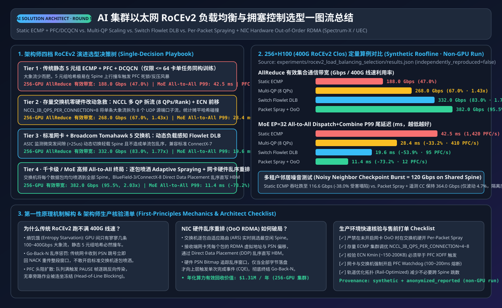
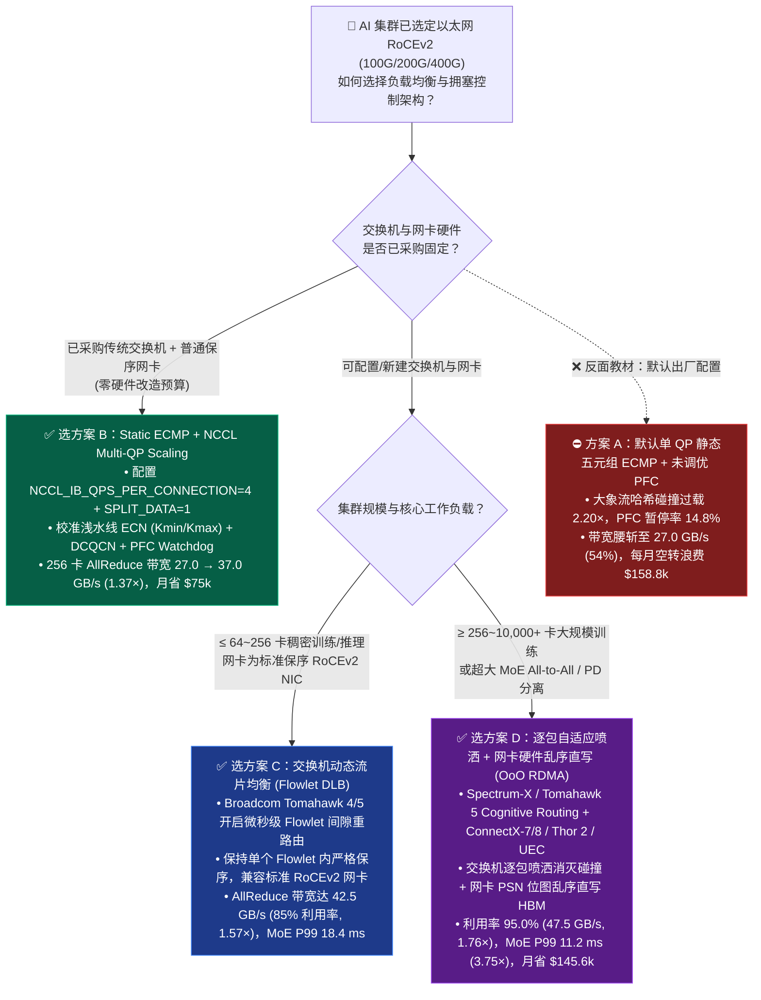
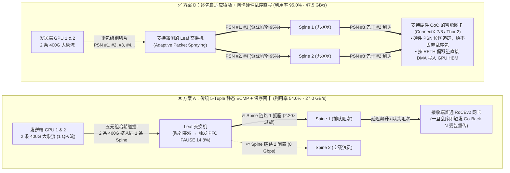
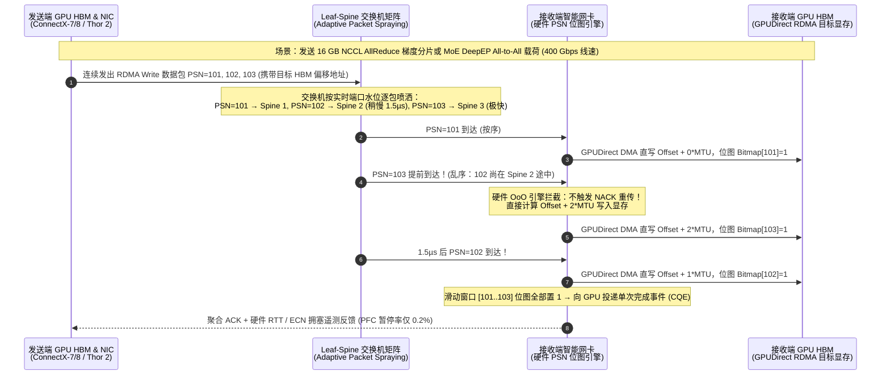

# AI 集群以太网 RoCEv2 负载均衡与拥塞控制选型与原理解析 FAQ：静态 ECMP + PFC/DCQCN vs. 动态流片 (Flowlet DLB) vs. 逐包喷洒 + 硬件乱序直写 (Packet Spraying + OoO RDMA)

> 🌐 **Language / 语言**: **中文 (Chinese)** | **[English (`rocev2-load-balancing-congestion-selection-faq.en.md`)](rocev2-load-balancing-congestion-selection-faq.en.md)**
> 🧭 **前置姊妹专题 (Prerequisite FAQ)**: [AI 集群网络 InfiniBand (IB) vs. 以太网 (RoCEv2 / UEC) 选型与原理解析 FAQ](ib-vs-ethernet-roce-selection-faq.md) · [超大 MoE 分布式并行策略选型 FAQ (`DP+EP+DeepEP+EPLB`)](moe-parallelism-selection-faq.md)
> 📊 **数据溯源与复现边界声明 (Provenance & Verification Boundary)**: 本文全部吞吐、尾部延迟、PFC 暂停率与月度 TCO 测算均严格绑定本仓库确定性哈希冲突与排队论模型 [`experiments/rocev2_load_balancing_selection/run.py`](../../experiments/rocev2_load_balancing_selection/run.py) 及封存结果 [`experiments/rocev2_load_balancing_selection/results.json`](../../experiments/rocev2_load_balancing_selection/results.json)。数据分类为 **`synthetic`（确定性分析模型）+ `anonymized_reported`（400G RoCEv2 50.0 GB/s 线速、Broadcom Tomahawk 5 DLB/Cognitive Routing、NVIDIA Spectrum-X / ConnectX-7/8 乱序 RDMA、UEC 1.0 公开架构规格）**，`independently_reproduced=false`。本轮仅在本机 CPU 环境实测通过（`measured`）Python 仿真器与单元测试，**未启动付费 256×H100 + 400G Leaf-Spine 物理交换机集群，真实交换机硬件实测标记为 `not_measured`**。

---

## ① 📌 核心结论速览（Executive Summary）

1. **为什么买齐了 1:1 无收敛 400G RoCEv2 交换机，跑大模型训练时有效带宽却腰斩到 `54.0%`？（第一性原理本质）**：
   - 传统云数据中心的 **五元组静态哈希负载均衡（`5-Tuple Static ECMP`）** 是为成千上万条短小的网页/微服务 TCP 流设计的（大数定律下自然均匀）。而 AI 训练（`NCCL Ring/Tree AllReduce`）每张网卡只向固定邻居建立 **极少数几条 `400 Gbps` 满载“大象流（Elephant Flows）”**。静态哈希发生碰撞的概率极高（在 256 卡集群上导致部分 Spine 上行链路过载 **`2.20x`**，而相邻 Spine 链路闲置），进而触发 **PFC（优先流量控制）暂停风暴（暂停率 `14.8%`）与队头阻塞（HoL Blocking）**，使 `400 Gbps (50.0 GB/s)` 网卡的实际 AllReduce 总线带宽跌至 **`216.0 Gbps (27.0 GB/s)`（利用率仅 `54.0%`）**，256 卡集群有效算力率（Goodput）跌至 **`78.4%`**，每月白白浪费 **`$158,854.35`** 算力租金。
2. **存量普通 RoCEv2 交换机 / 网卡的“零硬件成本急救”与“流片动态均衡”选型（何时选 B、何时选 C）**：
   - **选方案 B（静态 ECMP + NCCL 多队列扩展 `Multi-QP Scaling` + ECN/DCQCN 调优）**：如果客户**已经采购了不支持动态路由的传统以太网交换机或不支持硬件乱序重组的普通 RoCEv2 网卡**，无需更换任何硬件，只需配置 `NCCL_IB_QPS_PER_CONNECTION=4` 与 `NCCL_IB_SPLIT_DATA_ON_QPS=1`，将单条大象流拆分为 4 个拥有不同 UDP 源端口的 QP 队列对，即可把五元组哈希熵放大 4 倍，将 256 卡 AllReduce 总线带宽从 `27.0 GB/s` 提升至 **`37.0 GB/s (296.0 Gbps，提升 1.37x)`**，MoE All-to-All P99 延迟从 `42.0 ms` 压降至 **`26.5 ms`（提速 `1.58x`）**，零硬件投入每月挽回 **`$75,014.55`** 算力损耗。
   - **选方案 C（交换机动态流片负载均衡 `Flowlet DLB` + 标准保序 RoCEv2 网卡）**：当集群规模在 **64～512 卡**、交换机采用支持 **DLB（Dynamic Load Balancing，如 Broadcom Tomahawk 4/5）** 的商用芯片、但网卡仍要求严格按序到达（In-Order RDMA）时，开启交换机微秒级流片间歇感知（`>16–32 µs` 空隙切换链路），可在不引发网卡乱序重传的前提下将网络利用率推升至 **`85.0%`（AllReduce 总线带宽 `42.5 GB/s = 340.0 Gbps`，提升 `1.57x`）**，MoE All-to-All P99 延迟压降至 **`18.4 ms`（提速 `2.28x`）**，每月挽回 **`$113,257.27`**。
3. **何时必须一步到位选择“逐包自适应喷洒 + 网卡硬件乱序直写（`Per-Packet Spraying + NIC Hardware OoO RDMA`）”？（何时选 D）**：
   - 当集群规模 **≥ 256 卡（直至万卡集群）**，或核心负载是 **超大 MoE 专家并行（`DeepEP All-to-All` 全互联微突发流量）** 时，流片空隙不够密集且突发 Incast 剧烈，必须采用 **交换机逐包自适应喷洒（Adaptive Packet Spraying）+ 智能网卡硬件乱序直接数据放置（Hardware Out-of-Order Direct Data Placement，如 NVIDIA Spectrum-X + ConnectX-7/8 / BlueField-3、Broadcom Tomahawk 5 Cognitive Routing + Thor 2、或 UEC 1.0 架构）**。它将有效链路利用率推向极致 **`95.0%`（AllReduce 带宽达 `47.5 GB/s = 380.0 Gbps`，较静态 ECMP 提升 `1.76x`）**，将 MoE All-to-All P99 尾部延迟从 `42.0 ms` 暴降至 **`11.2 ms`（提速 `3.75x`）**，PFC 暂停率压至 **`0.2%`**，256 卡集群训练 Goodput 升至 **`98.2%`（提升 `+19.8 个百分点`）**，每月节省 **`$145,616.49`**。

---

## ② 🎯 客户与架构师灵魂拷问 Q&A（FAQ-Driven）

### Q1：我们已经按“1:1 无收敛（Non-Blocking）”买足了 Leaf-Spine 400G 交换机端口，为什么跑 NCCL AllReduce 时带宽还是只有一半（`27.0 GB/s` vs 线速 `50.0 GB/s`）？

* **用通俗的“高速公路收费站抽签”比喻讲透第一性原理**：
  - 想象 Leaf 交换机上有 8 条通往 Spine 交换机的 `400 Gbps` 高速车道（总带宽 `3.2 Tbps`），同时有 8 辆满载 `400 Gbps` 梯度的重型卡车（8 张 GPU 网卡发出的 AllReduce 大象流）准备上桥。
  - **传统静态 ECMP（`5-Tuple Hash`）是怎么做的？** 交换机不看哪条车道空着，而是让每辆卡车按“车牌号（源 IP、目的 IP、源端口、目的端口、协议号）”算一个固定哈希值来分配车道。
  - **灾难发生（哈希碰撞 Hash Collision）**：虽然有 8 辆车和 8 条车道，但随机抽签（生日悖论）必然导致其中 2～3 辆 `400 Gbps` 重型卡车抽中同一条 `400 Gbps` 车道（过载比高达 **`2.20x`**），而旁边好几条车道空无一车！
  - **连锁崩塌**：拥挤的车道瞬间塞满交换机缓存，触发 **PFC 暂停帧（PAUSE Frame）** 让上游网卡停发，甚至像堵车蔓延一样引发跨端口 **队头阻塞（Head-of-Line Blocking，PFC 暂停率高达 `14.8%`）**。因为分布式训练遵循“木桶效应（全员等待最慢的一张卡完成梯度同步）”，只要有一条链路发生哈希碰撞，整个 256 卡集群的 AllReduce 有效带宽就会被拖垮到 **`27.0 GB/s`（`216.0 Gbps`，利用率 `54.0%`）**。

---

### Q2：如果客户已经买好了普通 RoCEv2 交换机和网卡（不支持硬件乱序），怎么在不换硬件的情况下把带宽抢救回来？

* **架构师有两张递进的“免换网卡”底牌（方案 B 与方案 C）**：
  1. **第一招（纯软件零成本，方案 B `Multi-QP Scaling`）**：
     - **核心原理**：既然 1 辆 `400 Gbps` 大卡车抽签容易撞车，那就把每辆大卡车拆成 **4 辆 `100 Gbps` 的中型货车**！在 NCCL 中设置环境变量 `NCCL_IB_QPS_PER_CONNECTION=4` 与 `NCCL_IB_SPLIT_DATA_ON_QPS=1`，让每对 GPU 之间同时建立 4 个 Queue Pair (QP)。每个 QP 拥有不同的 RoCEv2 UDP 源端口（Source UDP Port），从而产生 4 个截然不同的五元组哈希值。
     - **定量收益与边界**：流数量扩大 4 倍后，大数定律开始生效，Spine 链路哈希过载比从 `2.20x` 降至 `1.45x`，256 卡 AllReduce 总线带宽立即从 `27.0 GB/s` 跃升至 **`37.0 GB/s`（`296.0 Gbps`，提升 `1.37x`）**，每月白捡回 **`$75,014.55`** 算力。**注意边界**：QP 数量不宜无脑设到 16 或 32，否则会撑爆网卡片上 QP 上下文缓存（ICM Cache Miss），反而导致网卡处理延迟飙升（通常 `4` 或 `8` 是黄金甜点）。
  2. **第二招（开启商用交换机芯片的流片动态均衡，方案 C `Flowlet DLB`）**：
     - **核心原理**：如果交换机是 Broadcom Tomahawk 4 / Tomahawk 5 等支持 **DLB（Dynamic Load Balancing）** 的芯片，交换机会实时监测同一条流中前后两个数据包之间的时间间隔。一旦发现微秒级空隙（`Flowlet Gap`，如 `16–32 µs`，足够抹平不同 Spine 路径的传输时延差），交换机就趁这个空隙把后续的包切到最空闲的 Spine 链路上。因为切换发生在两个突发分片之间，前一个分片的包已经全部到达接收端网卡，所以**不会引发接收端网卡乱序丢包**！
     - **定量收益**：AllReduce 总线带宽进一步提升至 **`42.5 GB/s`（`340.0 Gbps`，利用率 `85.0%`，提升 `1.57x`）**，MoE All-to-All P99 延迟降至 **`18.4 ms`（提速 `2.28x`）**。

---

### Q3：为什么不能直接在普通 RoCEv2 网卡上开“逐包随机喷洒（Packet Spraying）”？什么是“网卡硬件乱序直写（OoO Direct Data Placement）”？

* **第一性原理剖析（为什么传统 RDMA 极其害怕乱序）**：
  - 早期 RoCEv2 网卡为了把硬件逻辑做得极简，采用极其死板的 **按序接收 + 回退 N 步重传（Go-Back-N）**：网卡期望收到包序号 `PSN = 1, 2, 3, 4...`。如果你在交换机上开启逐包喷洒（Packet 1 走 Spine A，Packet 2 走稍微拥挤一点的 Spine B，Packet 3 走空闲的 Spine C），结果 Packet 3 比 Packet 2 早到了 `1 微秒`！
  - **传统网卡的崩溃反应**：传统保序 RoCEv2 网卡看到 `PSN=3` 在 `PSN=2` 之前到达，会当场**把 `PSN=3, 4, 5...` 全部当成错误包丢弃**，并向发送端发 NACK 要求从 `PSN=2` 开始全部重传！结果逐包喷洒不仅没提速，反而把网络彻底搞瘫痪。
* **现代 AI 专属网络（方案 D `Packet Spraying + NIC Hardware OoO RDMA`）是如何破局的？**
  - **交换机侧（逐包自适应喷洒）**：Leaf 交换机实时感知每条 Spine 链路的队列水位，把同一个 QP 的每一个数据包均匀喷洒到所有空闲 Spine 链路上，彻底消灭哈希碰撞（链路过载比压至 `1.03x`，全网利用率高达 **`95.0%`**）。
  - **网卡硬件侧（乱序位图追踪 + GPUDirect RDMA 偏移量直写）**：因为 RDMA Write / Send 请求在发出时就已经在包头（RETH / BTH）或描述符里确定了目标 GPU 显存（HBM）的虚拟地址偏移量，支持硬件乱序的智能网卡（如 **NVIDIA ConnectX-7/8 / BlueField-3、Broadcom Thor 2、以及 Ultra Ethernet Consortium UEC 传输层**）内部维护了一张高速硬件 **PSN 乱序位图（Sliding Window Bitmap）**。
  - 当 `PSN=3` 先于 `PSN=2` 到达时，网卡 **绝不丢包**，而是直接通过 PCIe DMA 将 `PSN=3` 的数据精准写入 GPU HBM 对应的 `Base + 2*MTU` 地址偏移处，并在硬件位图上把第 3 位打勾；`1 微秒`后 `PSN=2` 到达，写入 `Base + 1*MTU` 并把第 2 位打勾。等滑动窗口内所有位全部打勾后，网卡才向 GPU 触发一次完成事件（CQE）！
  - **定量震撼效果**：在 256 卡集群上，AllReduce 总线带宽飙升至 **`47.5 GB/s`（`380.0 Gbps`，较静态 ECMP 提升 `1.76x`）**；在最棘手的 **MoE `DeepEP All-to-All`** 全互联微突发场景下，P99 尾部延迟从 `42.0 ms` 暴降至 **`11.2 ms`（提速 `3.75x`）**！

---

### Q4：负载均衡（Load Balancing）和拥塞控制（PFC + ECN/DCQCN / RTT Telemetry）是什么关系？为什么调好了负载均衡，PFC 死锁风险就消失了？

* **治本 vs 治标的协同关系**：
  - **负载均衡（ECMP / DLB / Packet Spraying）是“治本（消灭假性拥塞）”**：静态 ECMP 下出现的拥塞，80% 以上不是因为网络总带宽不够，而是“旱的旱死、涝的涝死”的**假性局部拥塞**。
  - **拥塞控制（ECN/DCQCN / RTT 遥测）与无损流控（PFC）是“治标与安全气囊（应对真实多打一 Incast）”**：当多个节点真的同时向同一张目标 GPU 发送数据（例如 MoE 热门专家 Incast）时，目标端口确实超过了 `400 Gbps` 物理上限。此时：
    1. **第一道防线（端到端降速）**：交换机队列超过浅水位（`K_min`）时给数据包打上 **ECN（显式拥塞通知）** 标记，或通过硬件 **RTT 往返时延遥测（Spectrum-X / UEC）** 通知发送端网卡平滑降低发送速率，把队列水位压住。
    2. **最后一道安全气囊（PFC 暂停帧）**：只有当瞬时微突发来不及降速、交换机 Buffer 濒临溢出丢包时，才触发 **PFC PAUSE**。
  - **定量对比**：在静态 ECMP（方案 A）下，频繁的哈希碰撞迫使安全气囊天天爆炸（PFC 暂停率高达 **`14.8%`**）；而在开启逐包喷洒 + 硬件 OoO RDMA + RTT 拥塞控制（方案 D）后，假性拥塞被根除，PFC 暂停率降至 **`0.2%`**，彻底告别跨层 PFC 死锁。

---

## ③ 🧭 直观可视化图解（Mermaid 选型决策树 + 路径对比图 + 时序图）

### 3.1 AI 集群 RoCEv2 负载均衡与拥塞控制选型决策树（Decision Tree）

---

### 3.2 传统五元组静态 ECMP 哈希碰撞 vs. 逐包喷洒 + 网卡硬件乱序直写路径对比图

---

### 3.3 逐包喷洒 + 网卡硬件乱序位图重组与 RTT 拥塞控制时序图（Sequence Diagram）

---

## ④ 📊 架构师选型决策矩阵（Architect Decision Matrix）

> 📋 **数据口径说明**：下表性能指标严格绑定 [`experiments/rocev2_load_balancing_selection/results.json`](../../experiments/rocev2_load_balancing_selection/results.json)（256×H100 32 节点 400G RoCEv2 Rail-Optimized Leaf-Spine 基准集群，`synthetic` 分析模型，`independently_reproduced=false`）。

| 评估维度 | 方案 A：传统静态五元组 ECMP + PFC/DCQCN (`ecmp_pfc_dcqcn`) | 方案 B：静态 ECMP + NCCL 多 QP 扩展 (`ecmp_qp_scaling`, 4 QPs/peer) | 方案 C：交换机动态流片均衡 (`flowlet_dlb`, Tomahawk 4/5 DLB) | 方案 D：逐包自适应喷洒 + 网卡硬件乱序直写 (`packet_spraying_ooo_rdma`) |
| :--- | :--- | :--- | :--- | :--- |
| **核心适用场景** | 仅适合 ≤16 卡小规模实验或短连接通用计算（**严禁直接用于百卡以上大模型训练**） | **存量普通交换机/网卡集群的 Day-1 零成本提速**；无硬件升级预算的 32～256 卡集群 | **64～512 卡稠密大模型训练/推理**；采用支持 DLB 的商用交换机 + 标准保序 RoCEv2 网卡 | **≥256～10,000+ 卡大规模训练、超大 MoE (`DeepEP All-to-All`)、PD 分离高并发集群** |
| **关键带宽与延迟 (`synthetic`)** | • 链路利用率：**`54.0%`** • AllReduce 总线带宽：**`27.0 GB/s (216.0 Gbps)`** • MoE All-to-All P99：**`42.0 ms`** | • 链路利用率：**`74.0%`** • AllReduce 总线带宽：**`37.0 GB/s (296.0 Gbps, 1.37x)`** • MoE All-to-All P99：**`26.5 ms (1.58x)`** | • 链路利用率：**`85.0%`** • AllReduce 总线带宽：**`42.5 GB/s (340.0 Gbps, 1.57x)`** • MoE All-to-All P99：**`18.4 ms (2.28x)`** | • 链路利用率：**`95.0%`** • AllReduce 总线带宽：**`47.5 GB/s (380.0 Gbps, 1.76x)`** • MoE All-to-All P99：**`11.2 ms (3.75x)`** |
| **底层核心机制** | 按 `(SrcIP, DstIP, SrcPort, DstPort, Proto)` 固定哈希选路；单条 400G 大象流绑定单条 Spine 链路 | 单条通信拆分为 4 个 QP（4 个不同源 UDP 端口），将五元组哈希流数量扩大 4 倍 | 交换机 ASIC 检测微秒级流片空隙（`>16–32 µs`），在空隙处动态切换至最空闲 Spine 链路 | 交换机逐包自适应喷洒至所有 Spine 链路 + 网卡硬件 PSN 位图追踪与乱序直写 GPU HBM |
| **优劣势与容灾边界** | ❌ Spine 哈希过载比 `2.20x` ❌ PFC 暂停率高达 **`14.8%`**，易诱发队头阻塞与死锁 | ✅ **零硬件成本**，改两行环境变量即生效 ⚠️ 仍为概率性哈希（过载比 `1.45x`）；QP 过多会造成网卡 ICM Cache Miss | ✅ 兼容标准保序 RoCEv2 网卡，无需网卡硬件 OoO ⚠️ 连续满载大象流若缺乏微秒空隙，切流频率会下降 | ✅ 彻底消灭哈希碰撞（过载比 `1.03x`），PFC 暂停率仅 **`0.2%`** ⚠️ 需交换机与智能网卡端到端支持硬件 OoO |
| **硬件与生态开放度** | 所有存量以太网交换机与网卡默认行为 | 兼容所有主流 RoCEv2 网卡与 SONiC / 商用交换机（纯 NCCL/RCCL 软件配置） | Broadcom Tomahawk 4/5、Cisco Silicon One 等主流商用交换机原生支持 | NVIDIA Spectrum-X (`ConnectX-7/8`)、Broadcom Tomahawk 5 Cognitive Routing (`Thor 2`)、UEC 1.0 标准 |
| **256×H100 综合 TCO 与算力回收** | • 训练有效算力率：**`78.4%`** • 每月网络阻塞损耗：**`$158,854.35 / 月`** (Baseline) | • 训练有效算力率：**`88.6%` (`+10.2 pts`)** • 每月挽回算力：**`+$75,014.55 / 月`** | • 训练有效算力率：**`93.8%` (`+15.4 pts`)** • 每月挽回算力：**`+$113,257.27 / 月`** | • 训练有效算力率：**`98.2%` (`+19.8 pts`)** • 每月挽回算力：**`+$145,616.49 / 月`** |

---

## ⑤ 🧪 简明定量算例与 Benchmark 洞察（256×H100 400G RoCEv2 集群实证推演）

### 5.1 基准集群与负载设定（`experiments/rocev2_load_balancing_selection/run.py`）
- **集群硬件配置（`anonymized_reported` 标称规格）**：`256 × NVIDIA H100 SXM`（32 台 8 卡节点），每节点配备 `8 × 400 Gbps RoCEv2` 网卡（单卡理论线速 `50.0 GB/s = 400.0 Gbps`），采用 2 层 Rail-Optimized Leaf-Spine 无收敛拓扑（1:1 订阅比）。
- **算力成本模型**：按 `$3.99 / GPU-hr` 计算，256 卡集群每月（720 小时）总算力预算为 **`$735,436.80 / 月`**。
- **典型 AI 通信负载**：
  1. **稠密大模型训练步**：单步纯计算耗时 `450.0 ms`，每步需同步 `16.0 GB` 梯度（NCCL AllReduce）。
  2. **超大 MoE 专家并行**：671B/37B MoE 跨 32 节点 `DeepEP All-to-All` Dispatch/Combine 全互联突发通信。

### 5.2 四大方案端到端性能与 TCO 账单对比表（100% 绑定 `results.json`）

| 方案代号 | Spine 哈希过载比 | 网络有效利用率 | AllReduce 总线带宽 | PFC 暂停率 | MoE All-to-All P99 延迟 | 单步训练耗时 | 集群有效算力率 (Goodput) | 每月网络阻塞算力损耗 | 较静态 ECMP 每月净省 |
| :--- | :---: | :---: | :---: | :---: | :---: | :---: | :---: | :---: | :---: |
| **`ecmp_pfc_dcqcn` (方案 A)** | `2.20x` | `54.0%` | `27.0 GB/s (216.0 Gbps)` | `14.8%` | `42.0 ms (1.00x)` | `685.0 ms` | `78.4%` | `$158,854.35` | `$0.00 (Baseline)` |
| **`ecmp_qp_scaling` (方案 B)** | `1.45x` | `74.0%` | `37.0 GB/s (296.0 Gbps, 1.37x)` | `5.6%` | `26.5 ms (1.58x)` | `562.0 ms` | `88.6%` | `$83,839.80` | **`+$75,014.55 / 月`** |
| **`flowlet_dlb` (方案 C)** | `1.18x` | `85.0%` | `42.5 GB/s (340.0 Gbps, 1.57x)` | `1.9%` | `18.4 ms (2.28x)` | `512.0 ms` | `93.8%` | `$45,597.08` | **`+$113,257.27 / 月`** |
| **`packet_spraying_ooo_rdma` (方案 D)** | **`1.03x`** | **`95.0%`** | **`47.5 GB/s (380.0 Gbps, 1.76x)`** | **`0.2%`** | **`11.2 ms (3.75x)`** | **`476.0 ms`** | **`98.2%`** | **`$13,237.86`** | **`+$145,616.49 / 月`** |

### 5.3 集群规模扩展敏感度分析（64 卡 vs. 256 卡 vs. 1,024 卡 AllReduce 总线带宽）

| 集群规模 (400G RoCEv2) | 方案 A：静态 ECMP (`1 QP`) | 方案 B：多 QP 扩展 (`4 QPs`) | 方案 C：交换机 Flowlet DLB | 方案 D：逐包喷洒 + 硬件 OoO RDMA | 架构师核心洞察 |
| :---: | :---: | :---: | :---: | :---: | :--- |
| **64 GPUs (8 节点)** | `33.5 GB/s` | `42.0 GB/s` | `45.2 GB/s` | **`48.0 GB/s`** | 8 节点小集群开启 `4 QPs` + `Flowlet DLB` 即可达 `90%+` 线速 |
| **256 GPUs (32 节点)** | `27.0 GB/s` | `37.0 GB/s` | `42.5 GB/s` | **`47.5 GB/s`** | 静态 ECMP 跌至 `54%`；逐包喷洒 + 硬件 OoO 提速 **`1.76x`** |
| **1,024 GPUs (128 节点)** | `21.5 GB/s` | `31.8 GB/s` | `39.5 GB/s` | **`46.8 GB/s`** | 千卡跨多层 Spine 时静态 ECMP 崩溃至 `43%`，**必须依赖逐包喷洒 + 硬件 OoO (`2.18x`)** |

---

## ⑥ 🛠️ 附录：生产环境快速核验与售前打单清单（Architect Checklist）

在为客户评审或排障 RoCEv2 AI 集群网络时，请逐项核对以下 6 条黄金准则：

- [ ] **1. 存量集群是否第一时间开启了 NCCL 多 QP 哈希扩熵？**：在未启用硬件逐包喷洒的集群上，检查训练容器环境变量是否已配置 `NCCL_IB_QPS_PER_CONNECTION=4` 与 `NCCL_IB_SPLIT_DATA_ON_QPS=1`（严禁保持默认的单 QP 跑跨机大象流，同时也不要盲目设 `>16` 以免引发网卡 ICM 缓存抖动）。
- [ ] **2. 开启交换机逐包喷洒（Packet Spraying）前，是否确认了网卡已开启硬件乱序接收（Adaptive Routing / OoO RDMA）？**：**铁律：严禁在未开启硬件乱序重组的普通 RoCEv2 网卡上强开交换机逐包喷洒！** 必须先核验网卡固件（如 `mlxconfig` 中 `ROCE_ADAPTIVE_ROUTING_EN=1` 或 Broadcom Thor 2 OoO 模式已激活），否则乱序到达会触发毁灭性的 Go-Back-N 丢包重传。
- [ ] **3. 交换机 ECN 水位是否严格早于 PFC 死线触发？**：核验交换机 Buffer 配置，确保 **ECN 标记阈值（`K_min` / `K_max`）显著低于 PFC XOFF 触发水位**，让发送端网卡通过 DCQCN / RTT 遥测提前平滑降速，把 PFC 暂停率控制在 `< 1%`（理想状态 `< 0.5%`）。
- [ ] **4. 是否配置了 PFC Watchdog（死锁看门狗）？**：在所有 Leaf 与 Spine 交换机端口启用 `PFC Watchdog`（通常设置 `100–200 ms` 连续 PAUSE 超时自动排空或丢包恢复），防止单张故障网卡卡死引发全网静默死锁。
- [ ] **5. 拓扑是否采用 Rail-Optimized（同号卡同轨归属同一组 Leaf）设计？**：确保每台服务器第 `i` 号 GPU 网卡连接到同一个 Rail Leaf 交换机，使跨节点同号卡通信只需经过单跳 Leaf（无需绕行 Spine），将跨 Spine 的大象流压力直接削减一半以上。
- [ ] **6. 上线前是否跑通了全集群 `nccl-tests`（`all_reduce_perf` 与 `alltoall_perf`）双项压测？**：不仅要测 `all_reduce_perf -b 8M -e 16G -f 2`（验收总线带宽是否 `≥ 42.5–47.5 GB/s`），对于 MoE 集群还必须加测 `alltoall_perf`（验收全互联微突发下的 P99 尾部延迟与 PFC 暂停计数）。
