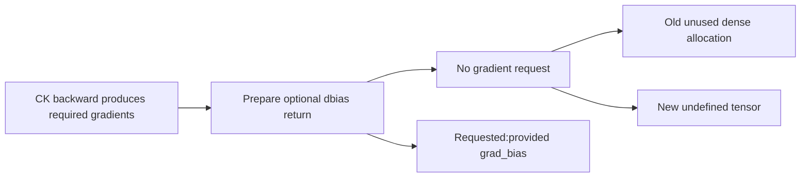
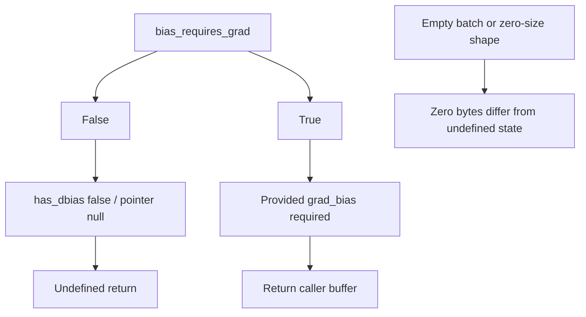
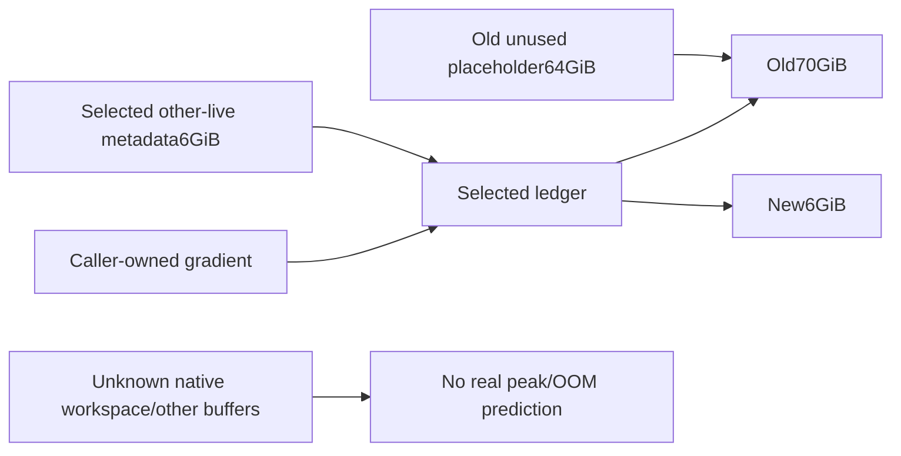

# AI Infra memory-contract FAQ: ROCm CK FlashAttention backward optional dbias allocation

> **Language**: English | [中文](rocm-ck-flash-backward-optional-dbias-allocation-selection-faq.md)  
> **Round151 · 2026-11-14daytime**: same-day CKfixed/varlen correction;original exact subledger,no ROCm/GPUbenchmark reproduction.

**Finding:** With no bias-gradient request,the kernel's dbiaspointer isnull andhas_dbiasisfalse.Do not allocate an unused dense tensor after kernel work.Four original sequences×32queryheads×16K×16K×2Brequest64GiB.The corrected optional output remains undefined,not a dense zero gradient.Requested gradients and other scratch do not disappear.

**Artifacts**: [H5exact ledger](../reports/rocm-ck-flash-backward-optional-dbias-allocation-sizer.html) · [seven cards](../reports/rocm-ck-flash-backward-optional-dbias-allocation-selection-cards.html) · [1600px SVG](../../assets/svg/rocm-ck-flash-backward-optional-dbias-allocation-selection-faq-summary.svg) · [sealed report](../../experiments/optional_dbias_allocation_selection/report.json)

## Q1: Is the same-day fix kernel math or unused-output allocation?

The pinned **Nov14,03:22UTC=11:22BJT**commit removes fixed/varlen CK`at::empty`dbiasplaceholders when`bias_requires_grad=false`.That branch runs after kernel/gradient work,before tuple return.Even produced required gradients could be followed by an unnecessary quadratic-allocation failure.



Sourcehas_dbiasfollows the request flag;false leaves pointer null.FlashAttention callers passfalse/null and discard the fifth output.This does not remove every attention bias,change kernel mathematics or fix all backends.Only source was verified;no native gradients/ROCmexecuted.

## Q2: Why does the placeholder depend on max lengths and query heads?

Fixed shape is`[B,Hq,Sq,Sk]`;varlen`[B,Hq,maxSq,maxSk]`,with2Bfor16-bit qdtype.**Hqis notHkv**:GQA's fewer KVheads do not shrink this placeholder.Causal/window masks do not change that dense shape.

Original query lengths`[16384,2048,512,128]`,key lengths`[16384,1024,512,128]`,B4/Hq32/Hkv8yield64GiB.Paired rectangular positions total270,811,136versus1,073,741,824max-padded positions,a802,930,688gap.

These are full rectangular geometry,not causal active-pair counts,real packed bias storage or native FLOPs.`totalQ×totalK`incorrectly includes cross-sequence pairs;∑qkdoes not prove backend packed allocation.

## Q3: How do undefined,empty and requested gradients differ?



Source checks optional grad_biaspresence forrequest=trueand returns it.Unrequested output stays undefined,not all-zero.A zero-byte tensor is another state.Our metadata checks presence,not real tensor shape/dtype/strides,pointers,device or backend validity.

**Changing a flag does not free caller-owned storage.**An original provided64GiBbuffer remains live even ifrequest=falseand returned dbiasisundefined.Consumers must honor optional/defined semantics rather than unconditionally read unrequested output.

## Q4: Is70→6GiBa native peak improvement or virtual subledger?

Original other-live metadata is6GiB,budget8GiB;provided gradient is excluded from that metadata and separately added.Old64GiBplaceholder makes70GiBselected live bytes.New fresh return-region allocation iszero,leaving6GiB.`new_selected_fits_budget=true`covers only this **synthetic subledger**.



dQ/dK/dV,softmax_d,GQAexpanded buffers and doutpadding may remain.Source also has oldAITERexplicit dq_accum,newAITERinternal workspace and pinned-host workspace paths.Full lifetimes/allocator behavior are not modeled.Native peak/workspace/OOM stay null,not missing values coerced tozero.

## Q5: What does the CPU policy toy measure?

| Discarded zero-filled CPUtoy | Gated branch(ms) | Eager bytearray(ms) |
| ---: | ---: | ---: |
| 8KiB | 0.000133 | 0.000567 |
| 32KiB | 0.000133 | 0.000667 |
| 128KiB | 0.000133 | 0.001867 |
| 512KiB | 0.000133 | 0.007133 |

Both observable results areNone.Eager constructs/checks/discards bytearray;gated allocates none.Maximum actual toy512KiB;**64GiBwas not allocated**.Two warmups,seven alternating repeats and three operations/sample yield median repeat means.Submicrosecond branches include call/timer overhead and must not extrapolate speedups.

CPUbytearrayzero-initializes;native`at::empty`does not imply zero fill.These are not ROCmallocator,CKbackward,GPUpeak or upstream-native reproduction.BigInt/decimal strings retain exact counts beyond2^53.

## Q6: How can real long-context backward be verified?

```powershell
python -m unittest discover -s tests -p test_optional_dbias_allocation_selection.py -q
python -m experiments.optional_dbias_allocation_selection.run --check
# --measure replaces at-most512KiBCPUtoy samples,no CK.
```

Eight tests cover independent64GiBarithmetic,request/provided/missing gates,retained caller memory,causal/GQA/empty states,2^54exact counts,invalid metadata,64small pair oracles/71Nodeparity cases,and the full six-policy matrix.

Sources:[Nov14correction](https://github.com/pytorch/pytorch/commit/b09cae0b541cc9b78691436c2b8bf1bf5be3feed),[fixed CKbackward](https://github.com/pytorch/pytorch/blob/b09cae0b541cc9b78691436c2b8bf1bf5be3feed/aten/src/ATen/native/transformers/hip/flash_attn/ck/mha_bwd_ck.hip),[varlen CKbackward](https://github.com/pytorch/pytorch/blob/b09cae0b541cc9b78691436c2b8bf1bf5be3feed/aten/src/ATen/native/transformers/hip/flash_attn/ck/mha_varlen_bwd_ck.hip),[callers](https://github.com/pytorch/pytorch/blob/b09cae0b541cc9b78691436c2b8bf1bf5be3feed/aten/src/ATen/native/transformers/hip/flash_attn/flash_api.h),[LICENSE](https://github.com/pytorch/pytorch/blob/b09cae0b541cc9b78691436c2b8bf1bf5be3feed/LICENSE).Rights preserved,no implementation mirror.

Deployment needs actual commit/backend/AITERversions,optional-output consumers,valid requested gradients,gradient error,full allocation lifetimes/peak and backward latency.Provenance is`synthetic`, `independently_reproduced=false`;CPU separately`measured`.Upstream native experiments are not ours.Original60-solid latch is not MI350hardware.Prior browser refusal remains respected;no visual browser acceptance.
