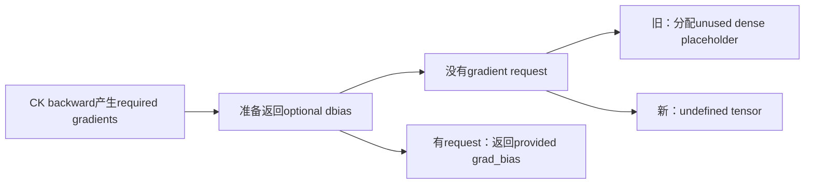
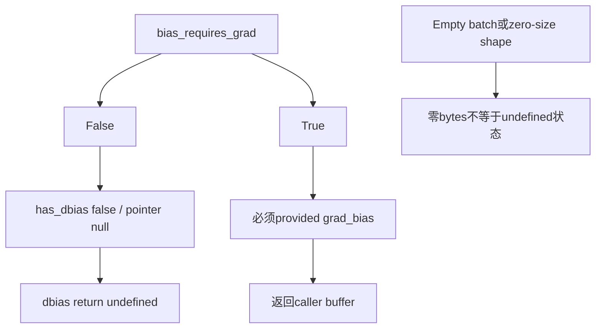
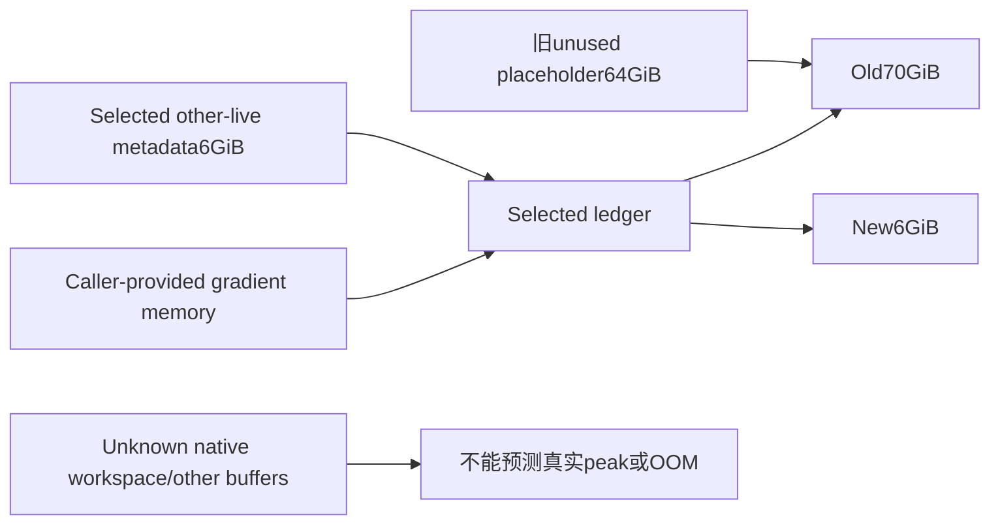

# AI Infra 内存契约 FAQ：ROCm CK FlashAttention Backward 的 Optional dbias Allocation

> **语言**：中文 | [English](rocm-ck-flash-backward-optional-dbias-allocation-selection-faq.en.md)  
> **Round151 · 2026-11-14白班**：当天CK fixed/varlen correction；原创exact subledger，未复现ROCm/GPU benchmark。

**结论速览**：没有请求bias gradient时，kernel的dbias pointer=null、has_dbias=false；不应在kernel结束后再分配一个unused dense tensor。原创4sequences×32query heads×16K×16K×2B对应64GiBplaceholder。新return保留undefined tensor，而非零值dense gradient。requested/provided gradients和其他scratch不会因这项修正自动消失。

**交付**：[H5 exact ledger](../reports/rocm-ck-flash-backward-optional-dbias-allocation-sizer.html) · [7-Card](../reports/rocm-ck-flash-backward-optional-dbias-allocation-selection-cards.html) · [1600px SVG](../../assets/svg/rocm-ck-flash-backward-optional-dbias-allocation-selection-faq-summary.svg) · [sealed report](../../experiments/optional_dbias_allocation_selection/report.json)

## Q1：当天修正是kernel算错，还是unused optional output分配错？

固定PyTorch commit为**Nov14 03:22UTC＝11:22BJT**，删除fixed与varlen CK backward在`bias_requires_grad=false`时的`at::empty`dbias placeholder。该branch在kernel/gradient工作后、返回tuple前执行；即使核心gradients已产生，也可能因无用的quadratic allocation失败。



source kernel的`has_dbias`取request flag，false时pointer保持null；FlashAttention callers传false/null并丢弃第五output。不是证明所有attention bias都可移除，也不是kernel数学或所有backend的通用修复。本轮只核验source，未执行native gradients/ROCm。

## Q2：fixed/varlen placeholder为什么和max lengths、query heads相关？

fixed shape为`[B,Hq,Sq,Sk]`；varlen为`[B,Hq,maxSq,maxSk]`，16-bit q dtype对应2B/element。**Hq不是Hkv**：GQA减少KVheads不缩小这个placeholder。causal/window mask也没有改变该dense shape。

原创varlen query lengths`[16384,2048,512,128]`、key lengths`[16384,1024,512,128]`，B4/Hq32/Hkv8：dense placeholder64GiB。paired rectangular positions为270,811,136，而max-padded positions1,073,741,824，差802,930,688。

这些positions是原创full rectangular几何，不是causal有效pair计数、真实packed bias buffer或native FLOPs。不能用`totalQ×totalK`把不同sequences的cross pairs混进去，也不能以∑qk断言backend已实现相应packed allocation。

## Q3：undefined tensor、empty tensor和requested gradient怎样区分？



源码在request=true时检查optional grad_bias有值，并返回它；request=false时不创建dbias。undefined不是全零gradient，zero-byte tensor仍是另一状态。model检查presence metadata，不验证真实tensor shape/dtype/strides、pointer、device或backend有效性。

**改变flag不会释放caller-owned buffer**。原创提供64GiBbuffer但request=false时，new dbias仍undefined，已由caller持有的64GiB仍在selected ledger中。API消费者应按defined/optional语义处理，而不是无条件读取未请求output。

## Q4：70→6GiB是native peak改善，还是虚拟subledger？

原创other-live metadata取6GiB、budget8GiB，明确排除provided gradient再单独计入。old64GiBplaceholder使selected ledger70GiB；new无fresh return-region allocation，selected剩6GiB。`new_selected_fits_budget=true`只指这个**synthetic subledger**。



dQ/dK/dV、softmax_d、GQA expanded buffers、dout padding仍可能存在。source还有旧AITER explicit dq_accum与新AITER内部workspace路径、pinned host workspace等；本轮没有计算这些完整lifetimes或allocator行为。native peak/workspace/OOM prediction保持null，不把缺失项视为0。

## Q5：CPU policy toy能验证什么，不能替代什么？

| discarded zero-filled CPUtoy | gated branch（ms） | eager bytearray（ms） |
| ---: | ---: | ---: |
| 8KiB | 0.000133 | 0.000567 |
| 32KiB | 0.000133 | 0.000667 |
| 128KiB | 0.000133 | 0.001867 |
| 512KiB | 0.000133 | 0.007133 |

两个路径observable结果均None，eager构建/检查并丢弃bytearray，gated不创建buffer；最大实际toy512KiB，**没有分配64GiB**。2warmups、7轮交替repeat、每sample3operations取median repeat means。submicrosecond branch samples受调用/timer开销影响，不用于外推speedup。

CPUbytearray会zero initialize，native `at::empty`不意味着zero fill；这些时延不是ROCm allocator、CK backward、GPU memory peak或source报告native实验复现。BigInt/decimal strings保持超过2^53的exact byte counts，避免JS Number默默舍入。

## Q6：如何复现并核验真实长上下文backward？

```powershell
python -m unittest discover -s tests -p test_optional_dbias_allocation_selection.py -q
python -m experiments.optional_dbias_allocation_selection.run --check
# --measure仅替换512KiB以内CPUtoy samples，不执行CK。
```

八项测试覆盖独立64GiB算术、request/provided与missing gate、caller-owned未释放、causal/GQA/empty states、2^54exact counts、非法metadata、64small pair-count oracles/71Node parity cases、完整six-policy matrix。

来源：[Nov14correction](https://github.com/pytorch/pytorch/commit/b09cae0b541cc9b78691436c2b8bf1bf5be3feed)、[fixed CK backward](https://github.com/pytorch/pytorch/blob/b09cae0b541cc9b78691436c2b8bf1bf5be3feed/aten/src/ATen/native/transformers/hip/flash_attn/ck/mha_bwd_ck.hip)、[varlen CK backward](https://github.com/pytorch/pytorch/blob/b09cae0b541cc9b78691436c2b8bf1bf5be3feed/aten/src/ATen/native/transformers/hip/flash_attn/ck/mha_varlen_bwd_ck.hip)、[callers](https://github.com/pytorch/pytorch/blob/b09cae0b541cc9b78691436c2b8bf1bf5be3feed/aten/src/ATen/native/transformers/hip/flash_attn/flash_api.h)、[LICENSE](https://github.com/pytorch/pytorch/blob/b09cae0b541cc9b78691436c2b8bf1bf5be3feed/LICENSE)。rights保留，无实现镜像。

上线核验实际commit/backend/AITER版本、optional output消费者、requested gradients有效性、gradient error、完整allocation lifetimes/peak与backward latency。主报告`synthetic`、`independently_reproduced=false`，CPU单独`measured`；上游native实验不作为本轮测量。原创60-solid latch metaphor非MI350硬件；此前browser refusal仍尊重，未做视觉浏览器验收。
