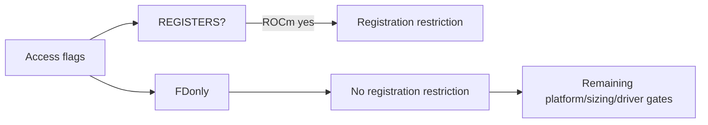
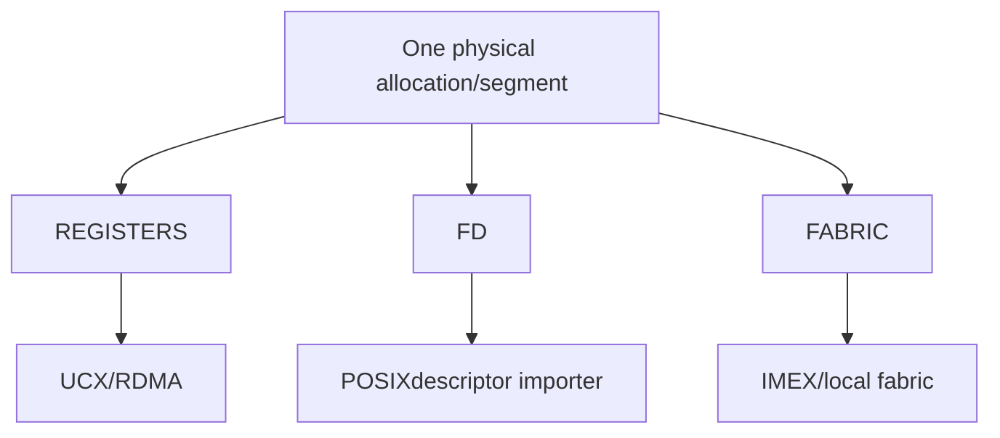
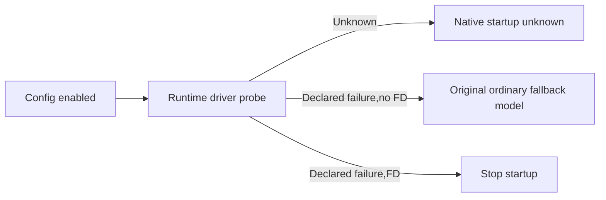

# AI Infra KV FAQ: ROCm extensible cache,POSIX FDexport and registration capabilities

> **Language**: English | [中文](rocm-extensible-kv-fd-export-registration-capabilities-selection-faq.md)  
> **Round157 · 2026-11-14daytime**: same-day gate correction;original config/runtime witnesses,no native driver/FD/ROCm.

**Finding:** Single-allocation requirements are not UCX/RDMAregistration.Five of12original results change,config permits2→7.FD-only no longer wrongly rejects;**FD+REGISTERSstill rejects**.FDimporter requires extensible cache;explicitoff/driver failure cannot masquerade as successful ordinary fallback.

**Artifacts**:[H5planner](../reports/rocm-extensible-kv-fd-export-registration-capabilities-sizer.html) · [seven cards](../reports/rocm-extensible-kv-fd-export-registration-capabilities-selection-cards.html) · [1600px SVG](../../assets/svg/rocm-extensible-kv-fd-export-registration-capabilities-selection-faq-summary.svg) · [sealed report](../../experiments/rocm_fd_cache_capability_selection/report.json)

## Q1: Which predicate narrowed?

Pinned **Nov14,06:08:48UTC=14:08:48BJT**changes ROCmgate fromneeds_single_chunktoREGISTERSmembership.FD-only does not register withUCX/RDMA.Old coarse gating raises FDmandatory errors,not merely silent feature disablement.



IN_PROCESS=0;REGISTERS,FD,FABRIC,LEGACY_IPCare different flags.MultiConnector combines children.Names are not capability evidence.

## Q2: How do chunk,FDandFABRICrequirements differ?

REGISTERS/FD/FABRICall require**one physical allocation per segment**.FDrequires extensible/exportable cache;FABRICneedsIMEX;legacyCUDAIPCcannot export driver-mapped memory.FDnotregistration does not allow multiple physical chunks.



Legacyregisters_kv_cache_memorystill returns broaderneeds_single_chunk.Do not infer exact registration from thatmethod name.No allocation/FDexport modeled.

## Q3: Which original decisions change?

Six sets(in-process,REG,FD,FABRIC,FD+REG,FD+FABRIC)×auto/on=12ROCm/no-IMEXcases.FDauto/on,FABRICon,FD+FABRICauto/on give5changes;permits2→7.

FD+REGstill rejects.FABRICautooff withoutIMEX;expliciton warns oflocalTCPfallback.FD+FABRICmust enable FDallocator withwarning.**Config semantics,not ROCmFABRICdriver/network certification.**

Earlier platform/sizing/elasticEP/legacyIPC/custompool gates remain.Explicit incompatibleon raises.Rejected records carrynull enabled,not success.

## Q4: Why is enabled config not successful startup?



Ordinary runtime VMMfailure may disable feature;FDimporter cannot export ordinary torchallocation and stops.Our probes are declared witnesses,no driver execution.Native probe/startup alwaysnull.

Native resolution settles once per model;derived configs do not revisit it.Our matrix uses independent fresh configs,not the internal resolved flag.

## Q5: Is CPUclassification KVtransfer performance?

| Capability sets | Bits(ms) | Name scans(ms) |
| ---: | ---: | ---: |
| 64 | 0.009867 | 0.028733 |
| 256 | 0.043567 | 0.114633 |
| 1024 | 0.183233 | 0.473767 |
| 4096 | 0.827400 | 2.048767 |

Identical five capability booleans.Two warmups,seven alternating repeats,three operations/sample,median repeat means.Excludes inputs/masks/validation/full resolver,VMM/FD/UCX/RDMA/vLLM/GPU.Not native startup,networklatency,throughput or peak.

## Q6: How can real FDconnectors be validated?

```powershell
python -m unittest discover -s tests -p test_rocm_fd_cache_capability_selection.py -q
python -m experiments.rocm_fd_cache_capability_selection.run --check
# --measure only executes original CPUclassification.
```

Eight tests coverFD/REG/coarsegates,combinedflags,explicitoff/override priority,FABRICIMEX,FD/ordinary driver failure,invalidschema/platform,64randomcases/65Nodefixtures(130old/new outcomes),and12sealed cases.

Sources:[Nov14fix](https://github.com/vllm-project/vllm/commit/06c5e7c3ba2c05beb3b7b69274cfc6c71cc9fb82),[resolver](https://github.com/vllm-project/vllm/blob/06c5e7c3ba2c05beb3b7b69274cfc6c71cc9fb82/vllm/config/vllm.py),[access taxonomy](https://github.com/vllm-project/vllm/blob/06c5e7c3ba2c05beb3b7b69274cfc6c71cc9fb82/vllm/config/kv_transfer.py),[config/runtime tests](https://github.com/vllm-project/vllm/blob/06c5e7c3ba2c05beb3b7b69274cfc6c71cc9fb82/tests/v1/engine/test_engine_args.py),[LICENSE](https://github.com/vllm-project/vllm/blob/06c5e7c3ba2c05beb3b7b69274cfc6c71cc9fb82/LICENSE).Rights retained,no implementation mirror.

Real checks require full capability unions,allocation/handle/driver support,IMEX/local-crosshost paths,startup/fallback,sizing/KVcorrectness.Main`synthetic`, `independently_reproduced=false`;CPUseparately`measured`;nativeFD/ROCm/VMM/peakunknown/null.Original60-solid cabinet is not hardware.No browser visual acceptance;prior refusal respected.
