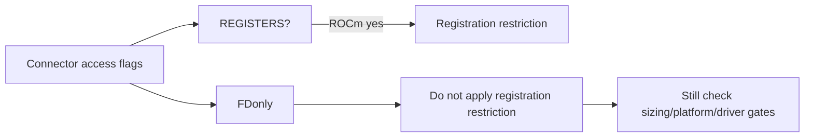
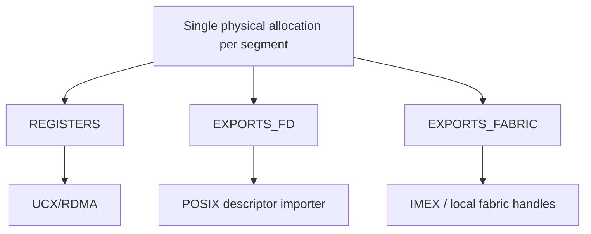
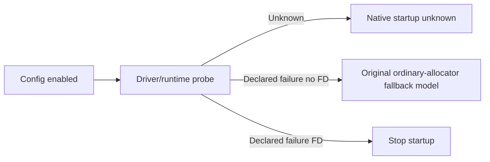

# AI Infra KV FAQ：ROCm Extensible Cache、POSIX FD Export 与 Registration Capabilities

> **语言**：中文 | [English](rocm-extensible-kv-fd-export-registration-capabilities-selection-faq.en.md)  
> **Round157 · 2026-11-14白班**：当天vLLM capability gate修正；原创configuration/runtime-witness模型，无native driver/FD/ROCm执行。

**结论速览**：single physical allocation requirement不等于UCX/RDMAregistration。原创12configs中5results改变，config permits2→7；FD-only在ROCm不再被coarse predicate错误拒绝，**FD+REGISTERS仍拒绝**。FDimporter必须使用extensible cache；explicitoff或runtime driver失败不能伪装普通allocator fallback成功。

**交付**：[H5 capability planner](../reports/rocm-extensible-kv-fd-export-registration-capabilities-sizer.html) · [7-Card](../reports/rocm-extensible-kv-fd-export-registration-capabilities-selection-cards.html) · [1600px SVG](../../assets/svg/rocm-extensible-kv-fd-export-registration-capabilities-selection-faq-summary.svg) · [sealed report](../../experiments/rocm_fd_cache_capability_selection/report.json)

## Q1：当天修正缩窄哪个predicate？

固定commit **Nov14 06:08:48UTC＝14:08:48BJT**：ROCm gate由`needs_single_chunk()`变为`REGISTERS in kv_cache_access`。FD-only出口不涉及UCX/RDMAregistration；旧coarse gate会触发FDmandatory配置错误，不只是默默关掉feature。



IN_PROCESS为0；REGISTERS、EXPORTS_FD、EXPORTS_FABRIC、LEGACY_IPC是不同flags，MultiConnector组合children。connector名字不能代替capabilities。

## Q2：Single chunk、FD与FABRIC分别要求什么？

REGISTERS、FD、FABRIC都要求**每segment一个physical allocation**；FD另要求extensible/exportable cache，FABRIC需要IMEX；legacyCUDAIPC不支持driver-mapped cache。不能把“FD不是registration”误读成“FD允许多physical chunks”。



legacy方法`registers_kv_cache_memory()`仍返回更宽的`needs_single_chunk()`；不能仅凭其名字当作精确REGISTERS predicate。原型没有allocator布局、实际FDexport或物理chunk分配。

## Q3：哪些原创configuration decisions改变？

六capability sets（in-process、REG、FD、FABRIC、FD+REG、FD+FABRIC）×auto/on＝12cases，ROCm/无IMEX。FD auto/on两项、FABRICon一项、FD+FABRICauto/on两项共5changes；permits2→7。

FD+REG auto/on仍因注册限制拒绝。FABRIC auto在无IMEX时off；expliciton可以开启并报告localTCPfallback warning。FD+FABRIC必须开启FDallocator，即使无IMEX仍带warning。**这是config语义，不认证ROCm FABRICdriver或真实network path。**

此前sizing overrides、elasticEP、legacyIPC、custompool/platform gates仍在更前位置。expliciton不兼容配置会raise；原型records用`rejected`/null enabled，绝不算成功。

## Q4：Config enabled之后，为什么还不能说启动成功？



source executor允许ordinary connector在runtimeVMM probe失败后关闭feature；FDimporter不能export普通torchallocator，因此必须停止。原型probe仅是declared witness，不执行driver；所有native startup/probe字段null。

resolver source每model settle一次，derived submodel configs不应重新决策；原型matrix是互相独立fresh configs，不模拟内部resolved flag或推荐反复修改settled配置。

## Q5：CPUclassification计时是不是KVtransfer性能？

| Capability sets | Bit projection（ms） | Name scan（ms） |
| ---: | ---: | ---: |
| 64 | 0.009867 | 0.028733 |
| 256 | 0.043567 | 0.114633 |
| 1024 | 0.183233 | 0.473767 |
| 4096 | 0.827400 | 2.048767 |

两paths返回相同五个capability booleans；2warmups、7轮交替repeat、每sample3operations、median repeat means。排除input/mask/validation、完整configresolver、VMM/FD/UCX/RDMA/vLLM/GPU。不是native初始化、网络latency、throughput或memory peak。

## Q6：如何复现并验证真实FDconnector？

```powershell
python -m unittest discover -s tests -p test_rocm_fd_cache_capability_selection.py -q
python -m experiments.rocm_fd_cache_capability_selection.run --check
# --measure只执行原创CPUcapability classification。
```

八tests覆盖FDvsREG/coarsegate、combinedflags、explicitoff/override priority、FABRICIMEX、FD/ordinary runtime失败差异、非法schema/platform、64randomcases/65Nodefixtures（130old/new outcomes）、12-case sealed report。

来源：[Nov14修正](https://github.com/vllm-project/vllm/commit/06c5e7c3ba2c05beb3b7b69274cfc6c71cc9fb82)、[Native resolver](https://github.com/vllm-project/vllm/blob/06c5e7c3ba2c05beb3b7b69274cfc6c71cc9fb82/vllm/config/vllm.py)、[Access flags/chunk requirements](https://github.com/vllm-project/vllm/blob/06c5e7c3ba2c05beb3b7b69274cfc6c71cc9fb82/vllm/config/kv_transfer.py)、[Config/runtime tests](https://github.com/vllm-project/vllm/blob/06c5e7c3ba2c05beb3b7b69274cfc6c71cc9fb82/tests/v1/engine/test_engine_args.py)、[LICENSE](https://github.com/vllm-project/vllm/blob/06c5e7c3ba2c05beb3b7b69274cfc6c71cc9fb82/LICENSE)。rights保留，无实现镜像。

真实检查完整connector union、allocation/exporthandle与driver support、IMEX/local-vs-crosshost路径、startup/fallback、profile sizing与KV正确性。主`synthetic`、`independently_reproduced=false`，CPU单独`measured`；nativeFD/ROCm/VMM/peak未知/null。原创60-solid柜非hardware；无视觉浏览器验收，尊重此前拒绝。
