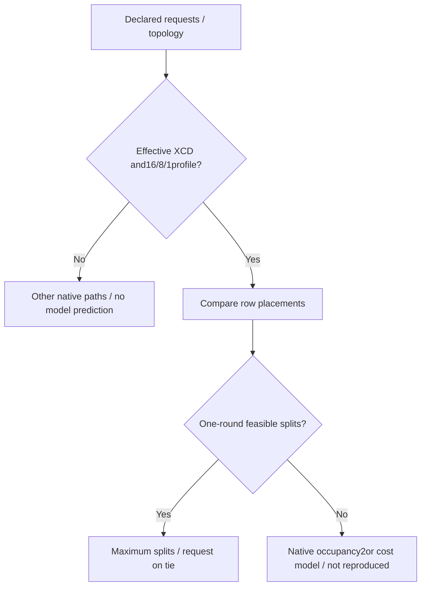
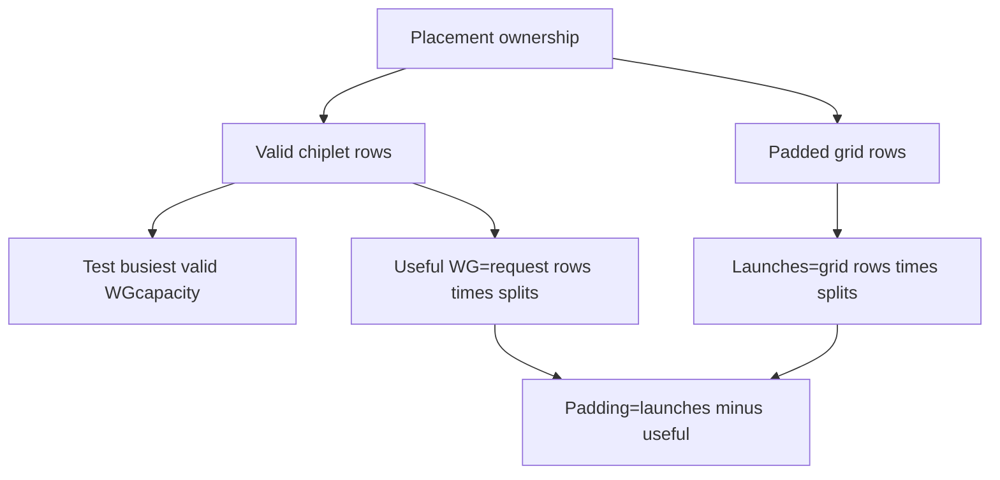

# ROCm MiniMax-M3.1 XCD FAQ: Balanced Tails,One-round Splits and Padding Workgroups

> **Language**: English · [中文](rocm-minimax-xcd-balanced-tail-one-round-placement-selection-faq.md)  
> **Round170/daytime47**: [pinned vLLM change](https://github.com/vllm-project/vllm/commit/2aa7eb3ea5cea8c99f484ca726be2f4d9c0ba418),2026-11-14 09:16:29UTC/17:16:29BJT.Scope is sparse-decode placement,not reproducing the entire indexer commit or popularity ranking.  
> [H5](../reports/rocm-minimax-xcd-balanced-tail-one-round-placement-sizer.html) · [Seven cards](../reports/rocm-minimax-xcd-balanced-tail-one-round-placement-selection-cards.html) · [SVG](../../assets/svg/rocm-minimax-xcd-balanced-tail-one-round-placement-selection-faq-summary.svg) · [Experiment](../../experiments/xcd_tail_placement_selection/README.md)

## Executive Summary

**Keep whole request groups local;balance query rows only in the incomplete tail when it buys feasible splits.** The new sparse-decode plan compares busiest-chiplet valid rows for request and balanced-tail placement,chooses at most4one-round splits,and prefers request locality on equal split counts.

Our10requests×8rows,8chiplets×32CUs,topk16/oneKVhead case gives request placement16busiest rows/2splits versus balanced10rows/chiplet/3splits.Balanced launches80grid rows×3=240with no padding;request-only launches128×2=256,including96padding row-split pairs.Launch count,useful work and GPUlatency are different.

**Synthetic,independently_reproduced=false** integer ownership/one-round search.CPUtally separately measured;no AMDGPU,FlyDSL,NVFP4/MXFP8or bitwise verification.Upstream reported GPUranges are not report coordinates.

## Q1: Which profiles enter the XCDplan,and which keep other native paths?

| Boundary | Pinned source | Original workbench |
| :--- | :--- | :--- |
| Requested XCDs | ≤1normalizes to plain grid | 0/1outside tuned profile |
| Topk/query/KVheads |16/8/1plan scope | No guessed split/performance otherwise |
| CUdistribution | Integer cus/xcds | Extra equal/divisible topology requirement |
| No one-round capacity | Native occupancy2/cost-model branches | Null selection/scope boundary |
| Explicit splits | Bypass automatic plan,default request placement |1–4within this subset;may exceed one round |

Pinned [host](https://github.com/vllm-project/vllm/blob/2aa7eb3ea5cea8c99f484ca726be2f4d9c0ba418/vllm/models/minimax_m3/amd/ops/nvfp4_sparse_decode/host.py) can choose2balanced splits/occupancy2hint beyond one-round capacity through48requests,then plain cost model.Native general cost model considers up to8splits.Our4limit is one-round candidate scope,not universal native maximum.

## Q2: How does balanced-tail mapping retain groups and every row?

Request placement assigns all query rows of request r to r modulo XCDs,padding the grid to whole XCD×query groups.Balanced placement retains complete XCD-request groups and divides residual query rows into contiguous `ceil(tail_rows/XCDs)`runs;the final run may include masked padding.

With10requests/8XCDs,whole8requests give8rows/chiplet and the16tail rows give2more each.With8requests,both placements fit4splits,so locality wins.We independently enumerate inverse grid mapping to verify a bijection without dropping valid queries.

Pinned [kernel](https://github.com/vllm-project/vllm/blob/2aa7eb3ea5cea8c99f484ca726be2f4d9c0ba418/vllm/models/minimax_m3/amd/ops/nvfp4_sparse_decode/kernel.py) further masks row validity/sequence positions.Our model executes no lane/page/FP4attention.

## Q3: Why separate valid rows,launches and one-round capacity?

For each placement,the model searches splits1..4with `max(valid_rows_per_chiplet)×splits ≤ CUs_per_chiplet`,then maximizes splits with request tie preference.This mirrors the one-round idea,not actual occupancy simulation.

Default request-only2splits has32busiest valid WGsbut256launches;balanced3has30busiest/240total.Do not infer latency merely from fewer launches/more splits.Native combine,KVlocality,cold cache,VGPR/spills,output mode and occupancy are excluded.

Explicit4request splits yields64busiest WGsand one_round=false.Native independent overrides/occupancy and `MAX_SPLIT_ROWS=1024`guard can affect final dispatch.Our≤64request/8row/onehead subset has grid≤512and never reaches that guard.This is not a full host dispatch emulator.

## Q4: Are reported GPUtimes or bitwise results being presented as measured?

No.Eight tests cover3BAL/2REQand240/256/96accounting,1–32one-round intervals/ties,33/49scope boundaries,eligibility,overrides,no-work/unknown workspace and invalid inputs.64random ownership cases compare independent grid enumeration/bijection;65profiles compare130Python/Node outcomes.

Native fixed-split balanced bitwise tests were read,not run.Placement/occupancy comparisons with fixed splits do not prove3versus2split reductions are bit-identical.Our metadata equivalence is not attention numerical verification.

`latency.json` times original analytic8bin ownership versus per-grid enumeration for64/256/1024/4096rows:two warmups,seven alternating repeats,three batches/sample,median repeat means.No GPUlaunch,tensor,NVFP4/MXFP8or combine measurements.Source-comment GPUranges are not sealed coordinates/local measurements.Seven900×1125strict-CSPcards have no scripts/network;H5separately uses inline JS.The original cabinet is not a physical GPUfloorplan,and visual acceptance is unknown.

## Q5: What must actual GPUselection and fallback verify?

Pin hardware/CU/XCDdiscovery,query/topk/KVheads/TP,context,dtype,split/place/waves,output mode and graph replay.Check fixed-split placement row/page/output parity before changing splits;then measure numerical error,latency distribution and peak workspace.Verify padding,unsupported profiles,overrides and capacity guard.

Unsupported profiles retain existing cost models or reviewed explicit settings,not unverified hardware defaults from this proxy.Two/fourKVheads,fourquery rows,single chiplet and occupancy2are not all tuned by the one-round experiment.CPUinteger tally is not GPUbenchmarking.

Recheck `python -m unittest discover -s tests -p test_xcd_tail_placement_selection.py -q` and `python -m experiments.xcd_tail_placement_selection.run --check`.Apache-2.0rights retained;link rather than mirror source.AI-assisted original research;native GPU/bitwise/allocator/visual acceptance remains unknown.
