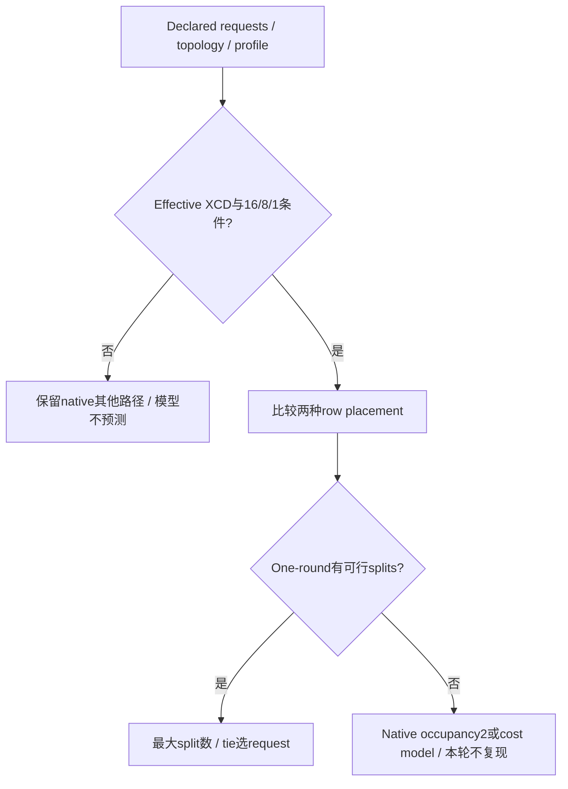
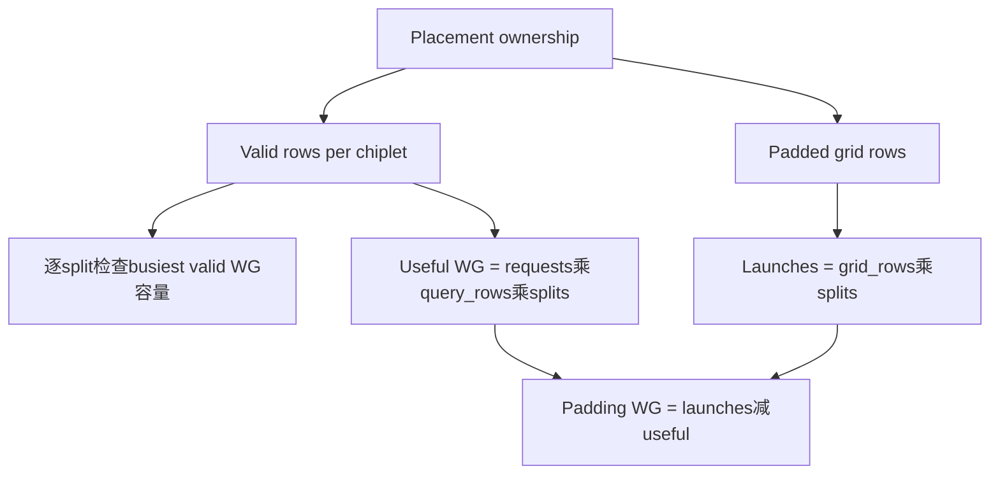

# ROCm MiniMax-M3.1 XCD 选型 FAQ：Balanced Tail、One-round Split 与 Padding Workgroups

> **语言**：中文 · [English](rocm-minimax-xcd-balanced-tail-one-round-placement-selection-faq.en.md)  
> **Round 170 / 白班 47**：固定 [vLLM 当日提交](https://github.com/vllm-project/vllm/commit/2aa7eb3ea5cea8c99f484ca726be2f4d9c0ba418)，2026-11-14 09:16:29 UTC / 17:16:29 BJT。本轮聚焦 sparse-decode host/kernel 的XCD row placement，不声称整个indexer改动已复现或热度排名。  
> [H5](../reports/rocm-minimax-xcd-balanced-tail-one-round-placement-sizer.html) · [七卡](../reports/rocm-minimax-xcd-balanced-tail-one-round-placement-selection-cards.html) · [SVG](../../assets/svg/rocm-minimax-xcd-balanced-tail-one-round-placement-selection-faq-summary.svg) · [实验](../../experiments/xcd_tail_placement_selection/README.md)

## 核心结论速览

**整组request保持XCD locality，未满一组的尾部query rows则可能值得平摊。** 新版sparse-decode plan比较request-preserving与balanced-tail placement在最忙XCD上的valid rows，选择最多4个可在one-round容量代理下容纳的splits；相同split数优先request placement。

原创10requests×8query rows、8chiplets×32CUs、topk16/oneKVhead case：request placement最忙16rows，可做2splits；balanced每chiplet10rows，可做3splits，最忙30valid workgroups。Balanced grid80rows×3=240launches、0padding；request-only grid128×2=256launches，其中96是padding row-split pairs。**launch数量不等于有效工作数量，也不等于GPU时延。**

全部为 **synthetic、independently_reproduced=false** 的整数row ownership/one-round search。CPUownership tally另外measured；没有AMD GPU、FlyDSL、NVFP4/MXFP8运行或bitwise证明。Native源码注释的GPU时间范围没有拿来当本报告坐标。

## Q1：什么profile能进入XCD计划，什么应保持其他native路径？

| 边界 | 固定source行为 | 原创工作台范围 |
| :--- | :--- | :--- |
| Requested XCD数 | ≤1在host归一为plain grid | 0/1标记outside tuned profile |
| Top-k / query rows / KVheads | `_xcd_plan`针对16 /8 /1 | 其余不猜split或GPU性能 |
| 同等CU拓扑 | Source用整数cus/xcds | 模型额外要求均匀可整除 |
| One-round不可容纳 | Native有occupancy2与cost-model分支 | 返回scope boundary与null selection |
| Explicit splits | 跳过自动plan、默认request placement | 仅1–4、且限本profile；可能不满足one-round |

固定 [host source](https://github.com/vllm-project/vllm/blob/2aa7eb3ea5cea8c99f484ca726be2f4d9c0ba418/vllm/models/minimax_m3/amd/ops/nvfp4_sparse_decode/host.py) 在busiest rows超过单round且requests≤48时可选2balanced splits与occupancy2 hint，更多请求返回plain cost model。Native后者可考虑最多8splits；本轮最多4是**one-round候选范围**，不是所有native模式上限。

## Q2：Balanced tail如何保持整组request，又如何避免丢row？

Request placement把request r的query rows全放到r mod XCD的bin；grid padding至整组XCD×query_rows。Balanced placement保留完整的XCD-request groups，只将剩余query rows划成大小为ceil(tail_rows/XCDs)的连续runs；最后可能有masked padding。

10requests/8XCDs时，完整8requests让每个chiplet已有8rows，尾部16rows再每chiplet2rows，共10。8requests的两种placement同样可容纳4splits，故tie选择request locality。模型以逐grid-block逆映射验证所有grid row的bijection，没有借padding丢弃valid query。

固定 [kernel mapping](https://github.com/vllm-project/vllm/blob/2aa7eb3ea5cea8c99f484ca726be2f4d9c0ba418/vllm/models/minimax_m3/amd/ops/nvfp4_sparse_decode/kernel.py) 对row_ok与sequence position继续mask；本实验不执行实际lane/page/FP4解码与attention。

## Q3：为什么要分别算valid rows、launched workgroups与one-round容量？

对给定placement，model枚举splits1..4，只接受 `max(valid_rows_per_chiplet)×splits ≤ CUs_per_chiplet`。再按split数优先、tie偏request选候选。这个容量代理反映源码一round思路，不是实际occupancy模拟。

默认request-only2splits，busy32valid WG，但全grid还发256WG；balanced3splits busy30、总240有效WG。不能由“更少launches/更多splits”直接宣称延迟改善。Native partial combine、KV locality、cache冷暖、VGPR/spill、FP8 output与register occupancy未在CPU算账里。

Explicit4split在默认request placement使busy64，模型明确one_round=false；native允许独立参数与occupancy选择，且还有 `MAX_SPLIT_ROWS=1024` workspace guard可迫使single split。支持的本H5≤64requests/8rows/onehead最多grid512，未触及该guard；**其结果不是完整host final dispatch模拟**。

## Q4：本轮测试与七卡有没有把reported GPU时间当实测？

没有。八项测试覆盖10request的3BAL/2REQ与240/256/96padding账，1–32request的one-round区间与tie，33/49的scope boundary，eligibility、explicit override、no-work/unknown workspace、非法输入。64随机request/query/chiplet组合验证analytic ownership等于独立逐grid-row映射及bijection；65profile/130Python-Node输出匹配。

Native `test_balanced_placement_bitwise` 等只读取未运行。源码固定split数下placement/occupancy output可独立比较；**3splits与2splits改变reduce分组，不由本轮metadata一致性推出bitwise相同**。

`latency.json`只对64/256/1024/4096原创rows做CPUanalytic8bin计数与逐grid-row枚举；2warmup、7交替重复、每样本3batch、median repeat means。GPUlaunch、tensor/device、NVFP4/MXFP8、combine均未知。Source注释的reported GPU范围没有进入sealed coordinates或本地测量。七卡900×1125/CSP无script/network，H5inline JS另行允许；SVG是原创chiplet tail cabinet隐喻，不是物理GPU版图，视觉验收未知。

## Q5：真实GPU选型与回退需要补什么证据？

固定GPU/CU/XCD发现结果、query rows、top-k、KVheads/TP、context长度、dtype、split/place/waves参数、output mode与图重放环境。先在固定split下检查不同placement的row/page/output一致，再比较不同split数的数值误差、latency分布和peak workspace；分别验证padding、超scope、explicit overrides及MAX_SPLIT_ROWS guard。

不支持的profile保留原有cost model或受控explicit配置，不从这个one-round代理生成未经验证的硬件默认值。尤其别将二head/四head、四query-row、单chiplet或occupancy2路径解释成同样已调优。CPU整数计数不是GPUbenchmark。

复验 `python -m unittest discover -s tests -p test_xcd_tail_placement_selection.py -q` 与 `python -m experiments.xcd_tail_placement_selection.run --check`。Apache-2.0权利保留、公开源实现只链接；AI辅助原创研究，native GPU性能/位一致性/allocator与视觉认证未知。
