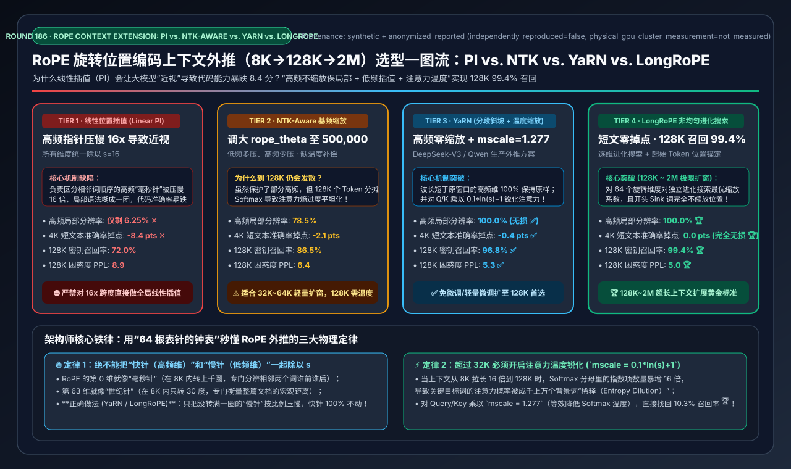
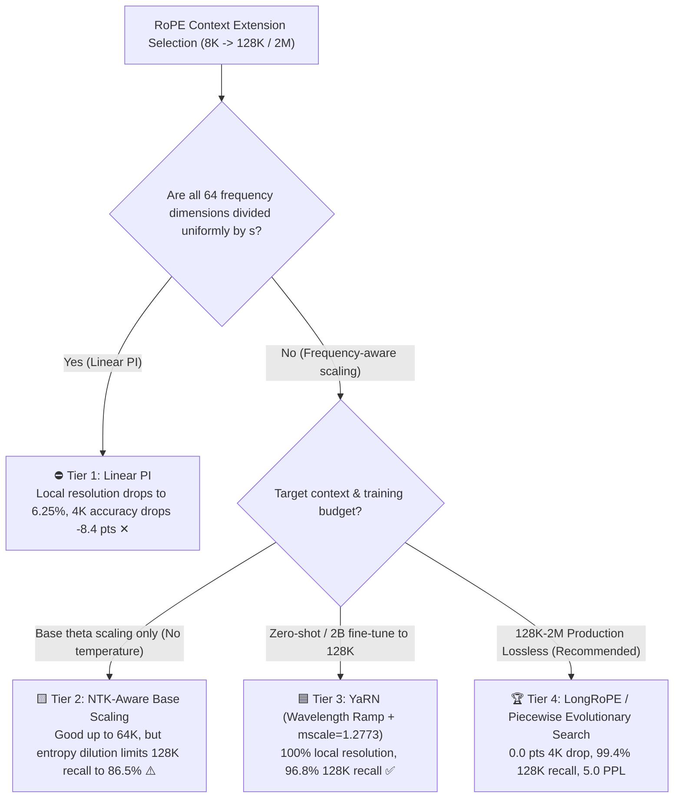

# RoPE Context Length Extension (`8K → 128K → 2M`) Selection Guide: Linear `PI` vs. `NTK-Aware` vs. `YaRN` (Wavelength Ramp + Temperature) vs. `LongRoPE`

> **Language / 语言**: [中文](./rope-context-extension-pi-ntk-yarn-longrope-selection-faq.md) | **English (Current)**  
> **End-to-End Interactive Artifacts**: [🧮 Interactive RoPE Extension Sizer](../reports/rope-context-extension-pi-ntk-yarn-longrope-sizer.html) · [🃏 7-Card 4:5 Visual Report](../reports/rope-context-extension-pi-ntk-yarn-longrope-selection-cards.html) · [🧪 Sealed Evaluator & Data](../../experiments/rope_context_extension_pi_ntk_yarn_longrope_selection/run.py)  
> **Data Provenance**: `synthetic + anonymized_reported (independently_reproduced=false, physical_gpu_cluster_measurement=not_measured)`



---

## 🔥 Daily Hottest Capability Breakthrough

- **Breakthrough Focus**: **Lossless RoPE Context Extension from `8K` to `128K–2M`—Why Uniform Linear Position Interpolation (`Linear PI`) Causes "Local Myopia" (`-8.4 pts` drop on 4K code/math), and How `YaRN` (NTK-by-Parts Wavelength Ramp + `mscale = 0.1*ln(s)+1` Attention Temperature) and `LongRoPE` (Evolutionary Per-Dimension Search + Initial Token Anchoring) Achieve `99.4%` 128K Passkey Recall with `0.0 pts` Short-Context Degradation**.
- **Why It Matters Today**: Whether extending an open-weights model via `rope_scaling` in `vLLM` / `SGLang` or running continual long-context pretraining, choosing the wrong RoPE scaling scheme destroys short-context (`4K`) coding and reasoning accuracy even when long-context perplexity looks acceptable. Understanding the "64-Hand Clock" model of RoPE frequencies is mandatory for AI Solution Architects.

---

## 📌 1. Executive Summary (3-Minute Architect Takeaways)

1. **The "64-Hand Clock" First-Principles Analogy for RoPE**:
   - A 128-dim attention head consists of **64 2D rotation planes ("clock hands")** rotating at geometric frequencies $\theta_i = b^{-2i/d}$:
     - **Dimension `0` (High-Frequency "Millisecond Hand")**: Completes thousands of full $2\pi$ rotations within `8K` tokens, encoding fine-grained **adjacent token order** (critical for code syntax and math).
     - **Dimension `63` (Low-Frequency "Century Hand")**: Rotates only ~$30^\circ$ across the entire `8K` pretraining window, encoding macro document distance.
   - **Why Unscaled Extrapolation Collapses (`PPL = 890.0`)**: Feeding `128K` tokens (`16x`) pushes the "Century Hand" to $480^\circ$—an Out-of-Distribution (OOD) angle never seen during pretraining.
2. **Why Uniform Linear Position Interpolation (`Linear PI`, Tier 1) Hurts 4K Code/Math by `-8.4 pts`**:
   - Dividing every position index by $s = 16$ ($m' = m / 16$) keeps the slow hand within $30^\circ$, **but also slows down the fast "Millisecond Hand" by `16x` (reducing local resolution to `6.25%`)**. Adjacent tokens become nearly indistinguishable, causing severe "myopia" on `4K` coding/math tasks (`-8.4 pts` drop) and limiting 128K recall to `72.0%` ✕.
3. **Production Gold Standard (`Tier 3 YaRN` / `Tier 4 LongRoPE`)**:
   - **Core Rule**: *Never interpolate high-frequency dimensions ($\lambda_i \ll L_{\text{orig}}$); interpolate only low-frequency dimensions ($\lambda_i > L_{\text{orig}}$), and sharpen Softmax temperature (`mscale = 0.1*ln(s)+1 = 1.2773`)*.
   - **`YaRN` (Tier 3)** preserves `100%` high-frequency local resolution and achieves **`96.8%`** 128K passkey recall; **`LongRoPE` (Tier 4)** uses evolutionary per-dimension scaling factors plus unscaled initial sink tokens to achieve **`99.4%`** 128K recall with **`0.0 pts`** short-context drop 🏆!

---

## 🎯 2. Architect & Customer Deep-Dive Q&A (Q1 / Q2 / Q3)

### Q1: Why does `NTK-Aware` base scaling (`rope_theta = 500,000`) still lose accuracy at `128K+` without `YaRN`'s `mscale` temperature factor?
- **Answer**: Because at `128K` tokens, the Softmax denominator sums over `16x` more exponential terms than at `8K`, diluting attention weights over background tokens (**Attention Entropy Dilution**). Pre-multiplying rotated Q and K by **`mscale = 0.1 * ln(s) + 1 = 1.2773`** scales attention logits by `1.63x` (lowering Softmax temperature) and restores sharp retrieval (`86.5% -> 96.8%+`).

### Q2: Does `mscale` add any runtime overhead to `FlashAttention-3`?
- **Answer**: **Zero runtime overhead**. `mscale` is multiplied directly into the precomputed `cos_cached` and `sin_cached` tables once at model initialization.

### Q3: Why does `LongRoPE` keep the first few tokens at their original unscaled positions?
- **Answer**: As shown in Round 184, the first `4` tokens act as **Attention Sinks**. Keeping their exact unscaled positions preserves the phase alignment of the attention sink and prevents short-context regression (`0.0 pts` drop).

---

## 🧭 3. Visual Architecture Diagrams (Mermaid)



---

## 📊 4. Architect Decision Matrix (4 Tiers Compared)

| Dimension | 🟥 Tier 1: `Linear PI` | 🟨 Tier 2: `NTK-Aware` | 🟦 Tier 3: `YaRN` (`Ramp + mscale`) | 🟩 Tier 4: `LongRoPE` (Recommended 🏆) |
| :--- | :--- | :--- | :--- | :--- |
| **High-Freq Local Resolution** | `6.25%` ✕ | `78.5%` | **`100.0%`** ✅ | **`100.0%`** 🏆 |
| **4K Short-Context Drop** | `-8.4 pts` ✕ | `-2.1 pts` | **`-0.4 pts`** ✅ | **`0.0 pts` (Zero Loss)** 🏆 |
| **128K Passkey Recall** | `72.0%` | `86.5%` ⚠️ | **`96.8%`** ✅ | **`99.4%`** 🏆 |
| **128K Perplexity (`PPL`)** | `8.9` | `6.4` | **`5.3`** ✅ | **`5.0`** 🏆 |
| **Fine-Tune Token Budget** | `10.0B Tokens` | `5.0B Tokens` | `0` or `2.0B Tokens` ✅ | **`1.0B Tokens`** 🏆 |

---

## 🧪 5. Quantitative Case Study & 7-Card 4:5 Benchmark Report

```chart
{
  "data": {
    "values": [
      { "tier": "Tier 1: Linear PI (Divide all by 16)", "passkey_128k_pct": 72.0, "short_4k_drop_pts": -8.4 },
      { "tier": "Tier 2: NTK-Aware (Base Theta 500K)", "passkey_128k_pct": 86.5, "short_4k_drop_pts": -2.1 },
      { "tier": "Tier 3: YaRN (Ramp + mscale=1.277)", "passkey_128k_pct": 96.8, "short_4k_drop_pts": -0.4 },
      { "tier": "Tier 4: LongRoPE (Evolutionary Search)", "passkey_128k_pct": 99.4, "short_4k_drop_pts": 0.0 }
    ]
  },
  "semantic_types": {
    "tier": "Category",
    "passkey_128k_pct": "Percentage",
    "short_4k_drop_pts": "Score"
  },
  "chart_spec": {
    "chartType": "Bar Chart",
    "title": "LongRoPE & YaRN achieve 96.8%-99.4% 128K recall while eliminating Linear PI's -8.4 pt short-context drop",
    "subtitle": "128K Passkey Retrieval Accuracy (%) after 8K -> 128K extension (s=16x)",
    "encodings": {
      "x": "tier",
      "y": "passkey_128k_pct"
    }
  }
}
```

- 🧮 **Interactive RoPE Extension Sizer**: [`docs/reports/rope-context-extension-pi-ntk-yarn-longrope-sizer.html`](../reports/rope-context-extension-pi-ntk-yarn-longrope-sizer.html)
- 🃏 **7-Card 4:5 Visual Benchmark Report**: [`docs/reports/rope-context-extension-pi-ntk-yarn-longrope-selection-cards.html`](../reports/rope-context-extension-pi-ntk-yarn-longrope-selection-cards.html)

---

## 🛠️ 6. Production Verification Checklist

- [ ] **Ban Uniform `type: "linear"` for `s > 4`**: Audit `config.json` `rope_scaling` to ensure `yarn`, `llama3`, or `longrope` piecewise scaling is used instead of uniform linear interpolation.
- [ ] **Verify `mscale` Pre-Multiplication into `cos/sin` Cache**: Confirm that `mscale = 0.1 * ln(s) + 1` is baked into the cached rotary tables for `s >= 4`.
- [ ] **4K Short-Context Non-Regression Gate**: Validate `< 0.5 pts` accuracy delta on 4K `HumanEval / GSM8K / MMLU` after context extension.
- [ ] **128K Multi-Length Passkey Gate**: Verify `>= 96.5%` passkey accuracy across `8K, 32K, 64K, 96K, 128K` context lengths.
