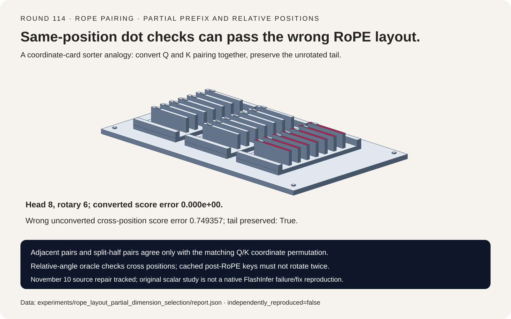
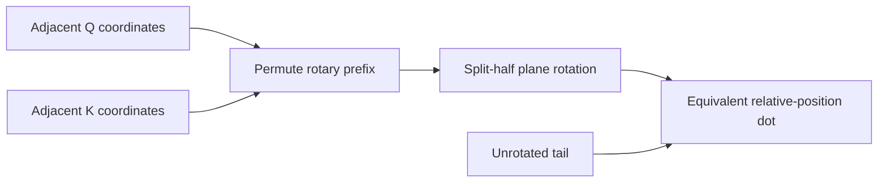
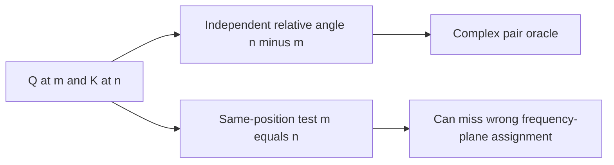
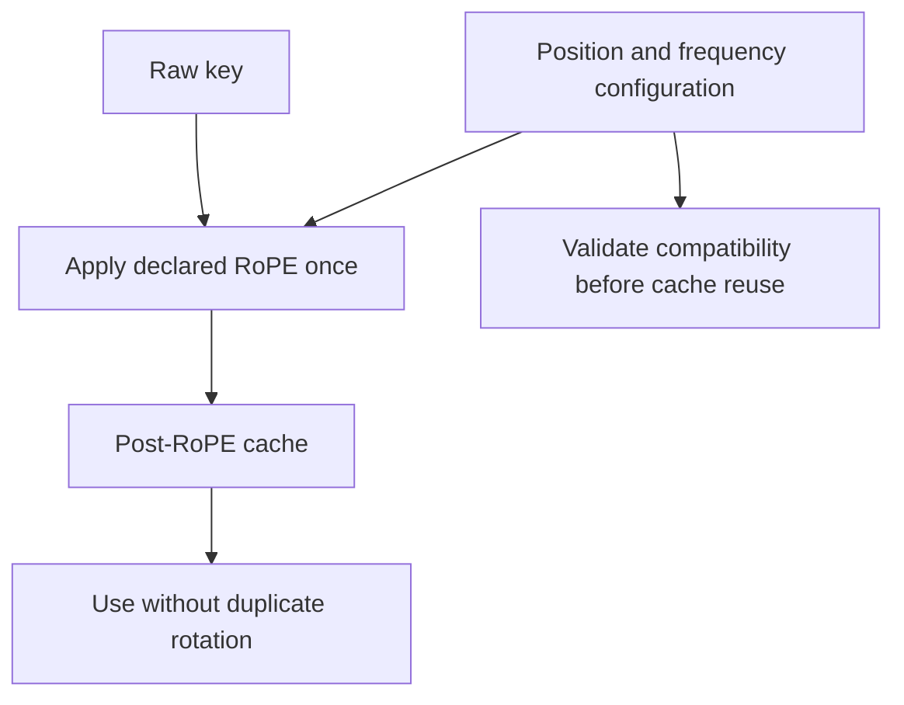

# RoPE FAQ: interleaved versus NeoX coordinates, partial prefixes and cache state

> **Language**: [中文](rope-interleaved-neox-partial-rotary-layout-selection-faq.md) | English
>
> **Round 114 · 2026-11-14 (twenty-third round of the November 13 night)** · [SVG](../../assets/svg/rope-interleaved-neox-partial-rotary-layout-selection-faq-summary.svg) · [7-card report](../reports/rope-interleaved-neox-partial-rotary-layout-selection-cards.html) · [H5](../reports/rope-interleaved-neox-partial-rotary-layout-sizer.html) · [Sealed report](../../experiments/rope_layout_partial_dimension_selection/report.json)
>
> **Synthetic, `independently_reproduced=false`.** Only original scalar rotations and dense matrix arithmetic were timed. No FlashInfer/CUDA execution, native failure/fix reproduction, checkpoint conversion, real-model quality or peak-HBM measurement.



## 1. Executive summary: a layout flag does not convert an existing checkpoint

Verified FlashInfer changes on **November 10, 2026** add an explicit
rotary-dimension/head guard for the regular RoPE APIs and repair the
cos/sin-cache kernel's partial-dimension/layout handling. The inspected
kernel distinguishes vector-path constraints from a by-lane pair path.
This is a current implementation study, not a new invention of RoPE
or an independently reproduced native regression.

The original eight-value head rotates a six-value prefix and preserves
two tail values. Interleaved and split-half layouts agree after a
matching Q/K coordinate permutation. Switching the layout flag alone
changes the cross-position dot score by **0.749357** in this fixture.
Yet **both same-position dot checks still pass**.

| Contract | Preserve | Do not infer |
| :--- | :--- | :--- |
| Pair layout | Frequency-to-coordinate-plane assignment | Runtime flag converts Q/K projection outputs |
| Partial rotation | Even prefix no wider than each head | Pair against half the full head for every prefix |
| Position | Declared token positions and cache representation | Already-rotated keys can rotate again |
| Coefficients | Correct half-width, dtype and configuration | Cache payload is extra allocation or native precision proof |

## 2. Architect Q&A: what makes two RoPE layouts actually equivalent?

### Q1: What is the adjacent versus split-half difference?

For rotary width six, interleaved/adjacent pairs are
`(x0,x1),(x2,x3),(x4,x5)`. Split-half/NeoX pairs are
`(x0,x3),(x1,x4),(x2,x5)`.

The coordinate conversion
`[x0,x1,x2,x3,x4,x5]→[x0,x2,x4,x1,x3,x5]`
preserves each plane when the split-half rotation receives the
converted vector. Apply the same conversion to both Q and K outputs
per head; leave the non-rotary tail unchanged.

For equivalent projection-weight conversion, permute the matching
**output coordinates** of Q/K projections. The relevant weight axis
depends on the framework's matrix convention. This prototype does
not load/convert model checkpoints or claim arbitrary weight formats
are interchangeable by a runtime Boolean.

### Q2: Why can same-position tests miss a wrong format?

Each layout applies an orthogonal rotation. When query/key positions
are equal, the rotations cancel inside the dot product:
`dot(R(m)q,R(m)k)=dot(q,k)`.
Both unconverted formats therefore return the raw dot score **−61.75**
within scalar tolerance, despite assigning different frequency planes.

At query position 3 and key position 9, the correct relative-angle
oracle gives **−61.61589130276029**. Converted split-half agrees
with zero observed error; the unconverted layout differs by
**0.7493568789935168**.

The independent oracle uses complex pair products and the relative
angle `(n−m)*frequency`, rather than calling the rotation function.
Shared shifts 0/7/128/4096 preserve the correct plain-RoPE kernel within
the sealed tolerance **1e−10**. This is not a bitwise determinism
guarantee at arbitrary positions or across low-precision GPU kernels.

### Q3: Which dimensions and cache layout must agree?

The original model requires an even positive `rotary_dim<=head_dim`,
checks both Q/K widths for its score oracle and preserves the tail
verbatim. A partial prefix pairs against **rotary_dim/2**, not
head_dim/2.

The pinned cached API stores
`[cos_0..cos_(r/2−1),sin_0..sin_(r/2−1)]` per position and explicitly
requires **float32 coefficient cache**. Its `is_neox=True` selects
non-interleaved pairing; the lower-level `interleave` flag has the
opposite polarity. Read the actual API rather than assuming flag
names or polarity match.

The separate regular-RoPE API dimension guard and the cached kernel
repair are related but distinct source changes. The original common
dimension validation is not a claim that every native wrapper has
identical validation order or error behavior. Real deployments must
also check flattened head reshaping, pointer/stride alignment, supported
dtypes/shapes and valid cache position indices.

### Q4: Why must key-cache representation be explicit?

If a cache stores a post-RoPE key `R(n)k`, applying position `n` again
produces `R(2n)k`, not the original cached representation. The fixture's
double-rotation control changes its score by **5.449086539737564**.

Whether keys are pre- or post-RoPE is a runtime contract, not inferred
from their array shape. Position offsets, theta/scaling, coordinate
format and coefficient-cache generation must agree with the stored
state. Changing those configurations can require cache regeneration
or another explicitly supported conversion.

This study uses plain RoPE only. YaRN, Llama3 scaling, M-RoPE,
quantized/fused cache paths, cross-layer model behavior and real
attention quality are not modeled. Signed positions are allowed for
analytic identity tests; they are not permission to use negative
indices in a production coefficient cache.

### Q5: How much coefficient and Q/K payload does the H5 select?

Default 131,072 positions × 64 rotary values × four-byte coefficients
× one selected cache instance is **33,554,432 bytes**.
There are half as many cosines and sines each, so their combined
width is rotary_dim, not two times the full head width.

For 4096 active rows, 32 Q heads, eight K heads, head width 128 and
two-byte Q/K values, full Q/K output payload is **41,943,040 bytes**.
The rotated prefix and untouched tail each account for **20,971,520**.

These are selected logical payloads, not extra allocations, memory
traffic or peak HBM. The source has both in-place and output-returning
forms; fused execution and aliasing are not measured here.
Configuration-compatible layers can share a coefficient cache, so
the H5 does not automatically multiply it by layer count.
Four-byte coefficients are enforced for the pinned cached API;
other selected Q/K widths are accounting assumptions, not certified
native dtype/shape support.

## 3. Visual architecture: coordinate conversion, relative positions and cache state







## 4. Selection matrix: preserve model coordinates before choosing a kernel path

| Choice | Good fit | Gate before adoption |
| :--- | :--- | :--- |
| Adjacent/interleaved | Matching projection coordinates | Pair/frequency assignment |
| Split-half/NeoX | Matching or explicitly converted Q/K | Per-head output permutation |
| Partial rotary prefix | Models with unrotated tail | Even prefix, head bounds, tail identity |
| Cached coefficients | Reused position/configuration table | Float32 source contract, index/config validity |
| In-place/fused path | Runtime-supported memory contract | Aliasing, strides and kernel shape support |
| Same-position dot alone | Basic orthogonality check only | Add cross-position relative-angle oracle |

## 5. Hands-on evidence: independent complex oracle and bounded CPU comparison

```powershell
python -m experiments.rope_layout_partial_dimension_selection.run --check
python -m unittest discover -s tests -p test_rope_layout_partial_dimension_selection.py -q
```

Eight focused tests cover multiple head/prefix widths and signed
analytic positions, layout conversion, tail identity, norm preservation,
same-position false reassurance, shared shifts, double rotation,
invalid dimensions/coefficients and Node.js/Python exact byte parity.

The CPU arithmetic comparison uses precomputed coefficients/matrices:

| Rotary width | Paired scalar rotations (ms) | Dense matrix application (ms) |
| :--- | ---: | ---: |
| 8 | 0.004600 | 0.008316 |
| 16 | 0.007848 | 0.027404 |
| 32 | 0.014516 | 0.099732 |
| 64 | 0.024524 | 0.319680 |

Two warmups, seven alternating repeats, 25 operations per sample;
median repeat means. Coefficient/matrix construction, attention,
native kernels and GPU movement/scheduling are excluded.
This demonstrates original linear-pair versus dense arithmetic,
not the source repair's performance. Browser visual inspection was
not performed; prior refusal was respected.

## 6. Sources, provenance and readiness

- [Pinned Python API](https://github.com/flashinfer-ai/flashinfer/blob/a984f0f6e8c950571de8fbb12f5e0fd948ad1b0b/flashinfer/rope.py): regular prefix guard, cached half-width, float32 cache and flag polarity.
- [Pinned kernel](https://github.com/flashinfer-ai/flashinfer/blob/a984f0f6e8c950571de8fbb12f5e0fd948ad1b0b/include/flashinfer/pos_enc.cuh): pair indexing, partial rotary width and vector/by-lane dispatch.
- [November 10 dimension guard](https://github.com/flashinfer-ai/flashinfer/commit/edac99f9177685bfa16d9ca4a313cdbd39181450) and [cache/layout repair](https://github.com/flashinfer-ai/flashinfer/commit/a984f0f6e8c950571de8fbb12f5e0fd948ad1b0b): verified recent changes, not native failure/fix reproduction.
- [Apache-2.0 license](https://github.com/flashinfer-ai/flashinfer/blob/a984f0f6e8c950571de8fbb12f5e0fd948ad1b0b/LICENSE); upstream rights remain with their owners.

All vectors, scalar rotations, coordinate conversion, complex oracle,
budgets, timing and artwork are original. No upstream implementation,
model weights or private prompts were copied. Synthetic report
`independently_reproduced=false`; original CPU timing separately measured.
Native latency, extra allocation, peak HBM and model quality remain null.
