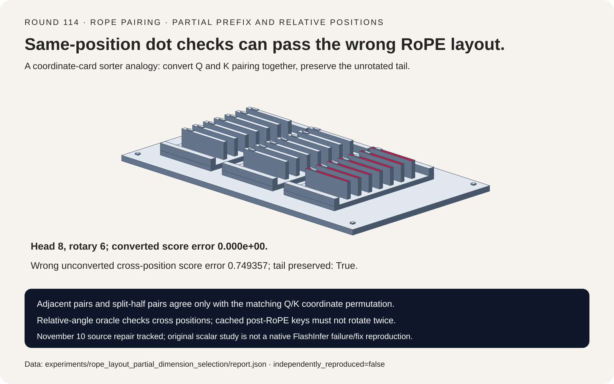
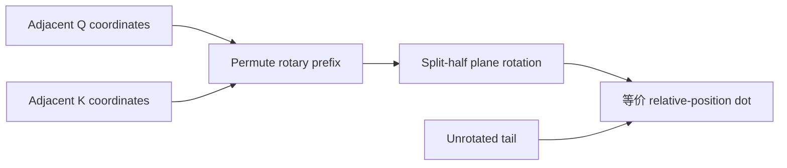
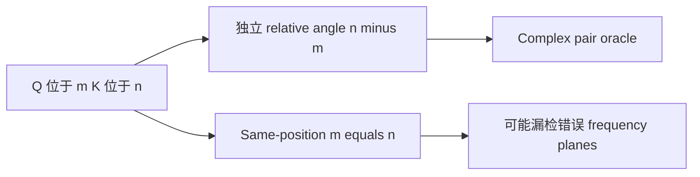
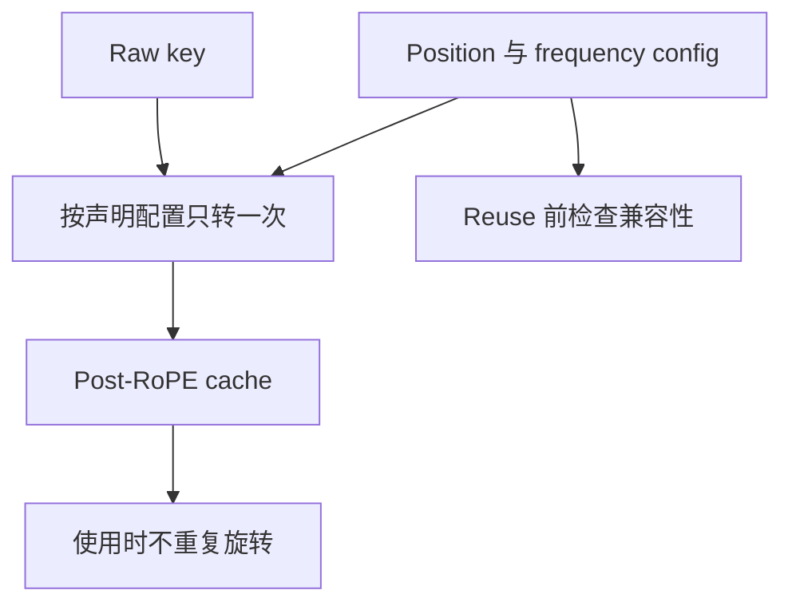

# RoPE FAQ：Interleaved / NeoX 坐标、Partial Prefix 与 Cache 状态

> **语言**：中文 | [English](rope-interleaved-neox-partial-rotary-layout-selection-faq.en.md)
>
> **Round 114 · 2026-11-14（11 月 13 日夜班第 23 轮）** · [高清 SVG](../../assets/svg/rope-interleaved-neox-partial-rotary-layout-selection-faq-summary.svg) · [七卡报告](../reports/rope-interleaved-neox-partial-rotary-layout-selection-cards.html) · [H5 工作台](../reports/rope-interleaved-neox-partial-rotary-layout-sizer.html) · [封存数据](../../experiments/rope_layout_partial_dimension_selection/report.json)
>
> **Synthetic，`independently_reproduced=false`。** 只实测原创 scalar rotation 与 dense matrix 算术；不执行 FlashInfer/CUDA、不复现 native failure/fix、不转换真实 checkpoint，也不测模型质量或 peak HBM。



## 一、先看结论：改 Layout Flag 不等于转换已有 Checkpoint

核验 FlashInfer **2026-11-10** 两项变化：regular RoPE API 增加
rotary dimension/head guard，cos/sin-cache kernel 修复 partial dimension/layout。
固定 kernel 区分 vector path 限制与 by-lane pair path。它们是当前实现研究，
不是 RoPE 新发明，也不是已独立复现 native 回归。

原创 head=8、rotary prefix=6，保留两条 tail。同步转换 Q/K 坐标后，
interleaved 与 split-half 等价；只切 flag，cross-position dot score
变化 **0.749357**。然而**两个 same-position dot tests 都仍通过**。

| 契约 | 必须保留 | 不能推断 |
| :--- | :--- | :--- |
| Pair layout | Frequency 对应 coordinate plane | Runtime flag 自动转换 projection outputs |
| Partial rotation | 偶数 prefix 不超过每个 head | 任何 prefix 都按全 head 的一半配对 |
| Position | 真实 token position 与 cache representation | Post-RoPE key 可以再转一次 |
| Coefficients | Half-width、dtype、configuration | Payload 等于额外 allocation 或 native 精度证明 |

## 二、架构师 Q&A：两种 RoPE Layout 怎样才真正等价？

### Q1：Adjacent 与 Split-Half 究竟差在哪里？

Rotary width=6 时，interleaved/adjacent pairs：
`(x0,x1),(x2,x3),(x4,x5)`；split-half/NeoX pairs：
`(x0,x3),(x1,x4),(x2,x5)`。

先转换 `[x0,x1,x2,x3,x4,x5]→[x0,x2,x4,x1,x3,x5]`，
再做 split-half rotation，即保留同一批 planes。
每个 head 的 Q/K outputs 都做相同 prefix permutation，non-rotary tail 不动。

等价 projection-weight conversion 需要调整 Q/K 的**输出坐标**；
具体 weight axis 取决于框架矩阵约定。本原型不加载/转换真实 checkpoint，
不声称任意权重格式可以仅凭 Boolean 切换。

### Q2：为什么 Same-Position 检查可能放过错误格式？

两种 layout 都是正交旋转。当 query/key position 相同，
`dot(R(m)q,R(m)k)=dot(q,k)`。本样例两种未转换 layout 都得到
raw dot **−61.75**（容差内），但 frequency-plane assignment 不同。

Query position=3、key position=9 时，独立 relative-angle oracle 为
**−61.61589130276029**；converted split-half 的 observed error=0，
未转换 layout 的 error=**0.7493568789935168**。

Oracle 用 complex pair products 与 `(n−m)*frequency`，不调用 rotation 函数。
共同 position shifts 0/7/128/4096 的正确 plain-RoPE kernel 在封存
**1e−10** 容差内不变；这不是任意超长位置或低精度 GPU 的 bitwise 保证。

### Q3：Dimension 与 Coefficient Cache 必须如何对齐？

原创模型要求 `rotary_dim` 正偶数且不超过 head；score oracle 检查 Q/K 宽度，
tail 原样保留。Partial prefix 按 **rotary_dim/2** 配对，不按 head_dim/2。

固定 cached API 每位置存
`[cos_0..cos_(r/2−1),sin_0..sin_(r/2−1)]`，
并明确要求 **float32 coefficient cache**。
`is_neox=True` 表示 non-interleaved；底层 `interleave` 的极性相反。
不同 API 不能仅凭 flag 名猜含义。

Regular RoPE 的 dimension guard 与 cached kernel repair 是相关但独立的改动。
原创共同 validation 不声称所有 wrapper 检查顺序或报错方式完全相同。
真实部署还要验证 flatten 后 head reshape、pointer/stride alignment、
supported dtype/shape，以及 cache position index 范围。

### Q4：为什么必须声明 Key Cache 是 Pre-RoPE 还是 Post-RoPE？

若 cache 已存 `R(n)k`，再次用 position=n 旋转就得到 `R(2n)k`，
不再是原表示。本样例 double-rotation control 的 score error 为
**5.449086539737564**。

Pre/post-RoPE 是 runtime contract，不能从 shape 猜。Position offsets、
theta/scaling、coordinate format、coefficient cache generation 必须与存量状态一致。
改配置可能需要重建 cache 或另有明确支持的转换。

本文只含 plain RoPE；不模拟 YaRN、Llama3 scaling、M-RoPE、quantized/fused
cache、跨层模型行为或真实 attention quality。解析恒等式测试可用 signed positions，
不表示生产 coefficient cache 允许负索引。

### Q5：H5 的 Coefficient 与 Q/K Payload 怎么算？

默认 131,072 positions×64 rotary values×4-byte coefficients×1 cache，
共 **33,554,432 bytes**。Cos/sin 各占一半，合计宽度是 rotary_dim，
不是 2×完整 head。

4096 active rows、32 Q heads、8 K heads、head=128、2-byte Q/K，
full output payload 为 **41,943,040 bytes**；
rotated prefix 与 untouched tail 各 **20,971,520**。

这是选定 logical payload，不是 extra allocation、memory traffic 或 peak HBM。
源码有 in-place/output-returning forms，本文不测 fusion/aliasing。
同配置 layers 可共享 coefficients，所以不默认乘层数。
H5 对固定 cached API 强制四字节 coefficients；其余 Q/K 字节宽度只是预算假设，
不是 native dtype/shape 支持证明。

## 三、三张架构图：坐标转换、Relative Position 与 Cache







## 四、选型矩阵：先保留模型坐标，再选 Kernel Path

| 方案 | 适合 | 上线 Gate |
| :--- | :--- | :--- |
| Adjacent/interleaved | 配套 projection coordinates | Pair/frequency assignment |
| Split-half/NeoX | 原生匹配或明确转换后的 Q/K | 每 head 输出 permutation |
| Partial prefix | 有 unrotated tail 的模型 | Even prefix、head bounds、tail identity |
| Cached coefficients | 可复用位置/配置表 | Float32、index/config validity |
| In-place/fused | Runtime 明确支持 | Aliasing、strides、kernel shapes |
| 单独 same-position dot | 仅基本正交性检查 | 增加跨位置 relative-angle oracle |

## 五、动手证据：Complex Oracle 与有边界的 CPU 对照

```powershell
python -m experiments.rope_layout_partial_dimension_selection.run --check
python -m unittest discover -s tests -p test_rope_layout_partial_dimension_selection.py -q
```

8 项 focused tests 覆盖多组 head/prefix、signed analytic positions、
layout conversion、tail identity、norm preservation、same-position 假安心、
共同偏移、double rotation、非法 dimensions/coefficients 与 JS/Python 字节一致性。

CPU 对照预计算 coefficients/matrices：

| Rotary width | Paired scalar rotation（ms） | Dense matrix（ms） |
| :--- | ---: | ---: |
| 8 | 0.004600 | 0.008316 |
| 16 | 0.007848 | 0.027404 |
| 32 | 0.014516 | 0.099732 |
| 64 | 0.024524 | 0.319680 |

2 warmups、7 次交替 repeats、每 sample 25 次操作，报告 repeat means 的 median。
排除 coefficients/matrix 构造、attention、native kernels、GPU movement/scheduling。
只说明原创成对线性算术与 dense 算术差异，不是源码修复的实测 speedup。
未做浏览器视觉验收，遵守此前拒绝。

## 六、来源、许可、溯源与 Readiness

- [固定 Python API](https://github.com/flashinfer-ai/flashinfer/blob/a984f0f6e8c950571de8fbb12f5e0fd948ad1b0b/flashinfer/rope.py)：regular prefix guard、cached half-width、float32 与 flag polarity。
- [固定 Kernel](https://github.com/flashinfer-ai/flashinfer/blob/a984f0f6e8c950571de8fbb12f5e0fd948ad1b0b/include/flashinfer/pos_enc.cuh)：pair indexing、partial rotary 与 vector/by-lane dispatch。
- [11 月 10 日 dimension guard](https://github.com/flashinfer-ai/flashinfer/commit/edac99f9177685bfa16d9ca4a313cdbd39181450)、[cache/layout repair](https://github.com/flashinfer-ai/flashinfer/commit/a984f0f6e8c950571de8fbb12f5e0fd948ad1b0b)：核验近期改动，不冒充 native failure/fix reproduction。
- [Apache-2.0 LICENSE](https://github.com/flashinfer-ai/flashinfer/blob/a984f0f6e8c950571de8fbb12f5e0fd948ad1b0b/LICENSE)：上游权利保留。

Vectors、scalar rotations、conversion、complex oracle、budgets、timing 与视觉均原创，
未复制上游实现、模型权重或私有 prompts。Synthetic report 的
`independently_reproduced=false`；原创 CPU 记录单独标 measured。
Native latency、extra allocation、peak HBM、model quality 均保留 null。
