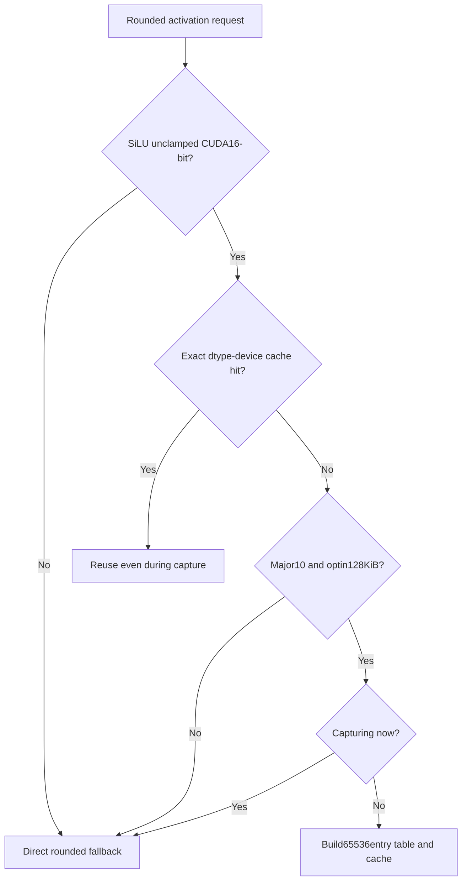
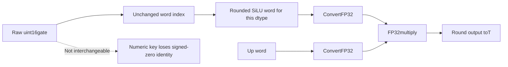
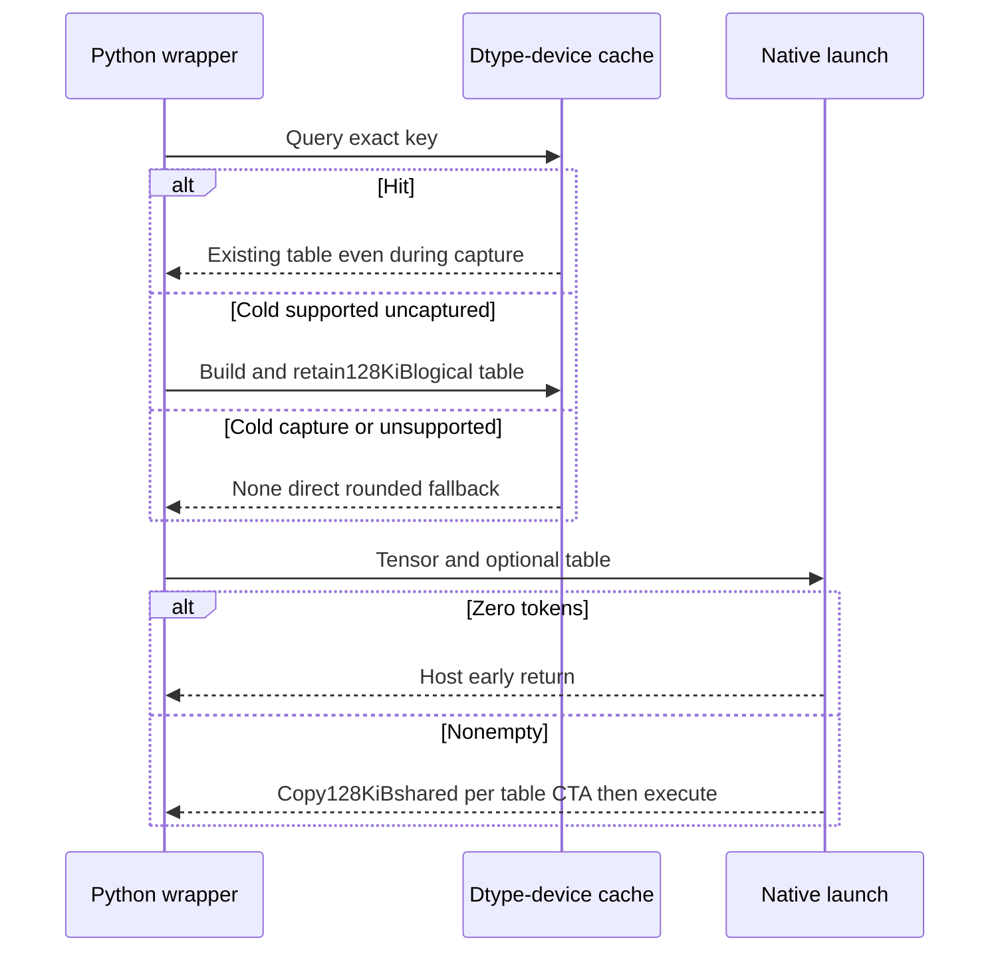

# Rounded SiLU selection FAQ: intermediate rounding, bit-pattern lookup and dtype/device warmup

> **Language**: English | [中文](rounded-silu-bit-pattern-lut-capture-cache-selection-faq.md)  
> **Round158**: actual2026-11-14 addition,not a popularity ranking or reproduced GPU benchmark.Single-final-round misses **7/16** original finite lanes;bit-key LUT misses **0/16**.`synthetic`, `independently_reproduced=false`;CPU samples separately `measured`.
>
> [H5 workbench](../reports/rounded-silu-bit-pattern-lut-capture-cache-sizer.html) · [Seven cards](../reports/rounded-silu-bit-pattern-lut-capture-cache-selection-cards.html) · [1600px SVG](../../assets/svg/rounded-silu-bit-pattern-lut-capture-cache-selection-faq-summary.svg) · [Original experiment/evidence](../../experiments/rounded_silu_bit_table_selection/README.md)

## Q1: When should a rounded SiLU LUT replace direct computation?

Not because lookup universally beats exp:the **intermediate dtype cast,device gate,warmup phase and shared-memory budget** must all fit.The new SGLang path is for unclamped SiLU,CUDA,float16/bfloat16.A cold table additionally requires exactly `props.major == 10`,at least `131072 B` opt-in shared memory,and no current graph capture.This is not a blanket rule for every newer GPU.

| Dimension | LUT | Direct rounded path |
| :--- | :--- | :--- |
| Activation | Index pre-rounded activation by raw gate bits | Per-lane FP32activation and intermediate cast |
| Memory | One128KiBlogical table/dtype/device;128KiBshared copy/table CTA | No such table/shared copy |
| Cold capture | Do not allocate a table;fall back | Preserve existing rounded fallback |
| Applicability | Not a cold-path selection for clamp,other activations,float32 or ROCm | Do not delete it because a LUT was added |

The source's power-capped-clock/ALU-bound observation motivates the change;it is **not locally reproduced throughput**.Eligibility does not certify driver,JIT,occupancy or end-to-end speed.

## Q2: Why does one final cast change the result?

The contract is `T gate → FP32SiLU → round-to-T activation → FP32multiply with T up → round-to-T output`.Removing the intermediate cast changes rounding even with the same mathematical activation.

Original normal half `gate=0x0401`, `up=0x3e00` rounds activation to `0x0201`,then produces `0x0302`.Single-final-round produces `0x0301`.This is a replayable finite CPUcounterexample,not CUDAbyte acceptance.

| Method | Original16-lane outcome |
| :--- | :--- |
| Direct intermediate rounding | Reference |
| Raw gate-word lookup of rounded activation,then multiply | 0/16misses |
| Multiply unrounded activation,then one final cast | 7/16misses |

Stable float64sigmoid is another trap.The verified non-fast header uses `__nv_expf` and `__fdiv_rn(x,1+exp(-x))`.For original BF16gate−89,the FP32-exp-overflow model yields negative zero `0x8000`;high-precision stable arithmetic yields `0x8287`.Mathematical stability is not implementation-byte equivalence.

Python libm-exp rounded toFP32is **not CUDA__nv_expf**.Transcendental/FMA details,native special-value payloads and native byte parity remain unknown.

## Q3: Why index65536bit patterns rather than floating-point values?

Two bytes represent65536raw patterns,including signed zeros,finite values,Inf and NaNs—not65536distinct finite real values.Native lookup retains the complete raw domain.`0x0000` and `0x8000` compare numerically equal but can produce differently signed outputs.Our float-key dictionary merges them and misses **1/2** words;raw keys preserve both.

The same word is dtype-dependent:`0x3c00` means1inhalf and1/128inBF16.The table cache therefore keys `(torch.dtype,input.device.index)`,not device alone.

Shared table loading uses fixed `AlignedVector<uint16_t,8>`:a16-byte copy.Activation gate/up vectors instead use architectural `kMaxVecBytes/sizeof(T)`.The verified Blackwell-or-greater compile branch uses32B,or16lanes for16-bit T;the table-copy8lanes must not be mistaken for activation width.Host checks compiled-vector divisibility and a32-bit item-index limit.

Our sparse fixture has only **8finite keys/dtype** and rejects Inf/NaN input words.This deliberately limited prototype is not the native table's domain.Missing keys raise explicit errors rather than returning zero.

## Q4: How do capture,empty inputs and inplace affect lifetime and memory?

Exact cache lookup precedes hardware/capture probes.A cold capturing stream falls back;an exact warm dtype/device table can be reused during capture.A table for another dtype/device is not a hit.Workbench cache keys are declared witnesses,not actual GPUtensors or hardware permissions.

**Empty does not mean allocation-free warmup**.Python table lookup/build occurs before native's zero-token early return.Our supported,cold,uncaptured `tokens=0` ledger still adds131072logical table bytes,but no activation launch or table-CTAshared request for that call.

The persistent global table and each CTA's shared reservation are different memory spaces.Do not add `128KiB×CTAs` as extra HBM.Allocator peak,table lifetime costs and occupancy are unmeasured.Source grid selection considers SMcount,blocks/SManditemcount;“small table”does not prove high occupancy.

Inplace writes the gate half and retains the up half.Host verifies output/input aliasing and row stride.Shape,alignment,indexing,device and dtype contracts still apply.This prototype executes neither GPUinplace writes nor the complete native host ABI.

## Q5: What was measured,and what was not?

Eight tests cover intermediate rounding,RNE boundaries,±0keys,missing-key errors,FP32overflow,exact-key/capture order,empty warmup and invalid schema.Another128random finite lanes compare lookup with an explicit rounded reference;Node/Python compare144lanes and11dispatch configurations.

| Original finite lanes | Prebuilt8-key dictionary / ms | Direct rounded arithmetic / ms |
| :--- | ---: | ---: |
| 64 | 0.092033 | 0.152133 |
| 256 | 0.372700 | 0.615433 |
| 1024 | 1.479367 | 2.452633 |
| 4096 | 6.003700 | 9.978833 |

Sealed `latency.json` records2warmups,7alternating repeats,3operations/sample and median repeat means.Both paths validate finite words.Input/sparse-table construction is excluded.**No full65536-table generation,GPUshared copy,bank conflict,launch,capture,driver or model-throughput measurement** occurs.These CPUratios are not GPUaccelerations.

Upstream tests enumerate65536gate words and compare `int16` views for two dtypes and in/out-place.That is not all possible `gate×up` combinations.We did not execute those native tests.All seven-card quantitative widths derive from sealed data.Native unknowns are not zeros.The previous browser refusal remains respected;there is no visual-acceptance claim.

## Q6: What constitutes production acceptance?

First confirm the caller requires activation-rounding rather than ordinary fast activation.Keep the intermediate cast and fallback.Check pinned version,dtype/device,SM10andopt-in shared capacity;exercise cold calls,pre-capture warmup,warm capture,dtype/device changes,empty input and inplace alias.Native word-level tests,representative up values,special values and boundary shapes precede measurements of build cost,steady state,shared occupancy and model impact.Do not substitute prototype timing.

This archive contains original explanations/models,not mirrored third-party implementations or stripped licenses.The cache decision model grants no device capability.H5finite arithmetic and its independent dispatch ledger explicitly have different scopes.

**Pinned primary evidence**:

- [ActualNov14commit](https://github.com/sgl-project/sglang/commit/6a64408419ccc4a091e3982c5b9fc10c5bda0f0e)
- [Python dispatch/cache](https://github.com/sgl-project/sglang/blob/6a64408419ccc4a091e3982c5b9fc10c5bda0f0e/python/sglang/kernels/ops/activation/activation.py)
- [LUT,host guards and rounded kernels](https://github.com/sgl-project/sglang/blob/6a64408419ccc4a091e3982c5b9fc10c5bda0f0e/python/sglang/kernels/jit/csrc/elementwise/activation.cuh)
- [Non-fast FP32formula](https://github.com/sgl-project/sglang/blob/6a64408419ccc4a091e3982c5b9fc10c5bda0f0e/python/sglang/kernels/jit/include/sgl_kernel/activation.cuh)
- [Architectural vector constant](https://github.com/sgl-project/sglang/blob/6a64408419ccc4a091e3982c5b9fc10c5bda0f0e/python/sglang/kernels/jit/include/sgl_kernel/utils.cuh)
- [Native gate-word tests](https://github.com/sgl-project/sglang/blob/6a64408419ccc4a091e3982c5b9fc10c5bda0f0e/test/registered/kernels/ops/activation/test_activation.py)
- [Apache-2.0LICENSE](https://github.com/sgl-project/sglang/blob/6a64408419ccc4a091e3982c5b9fc10c5bda0f0e/LICENSE)
