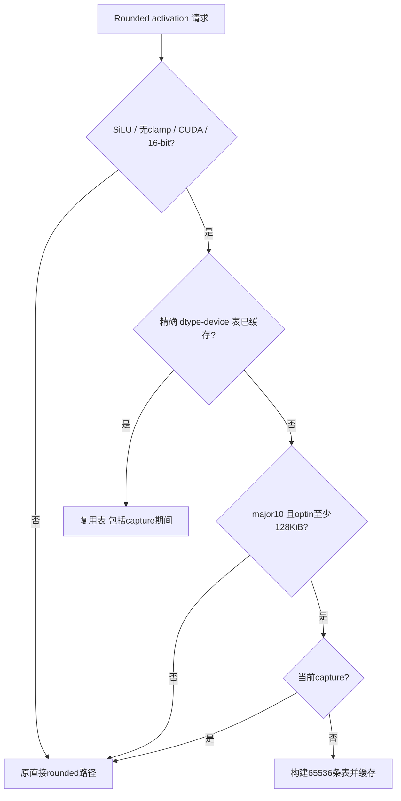
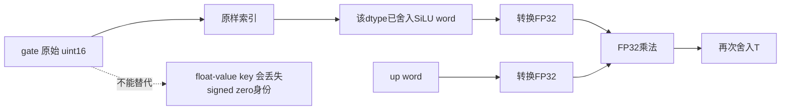
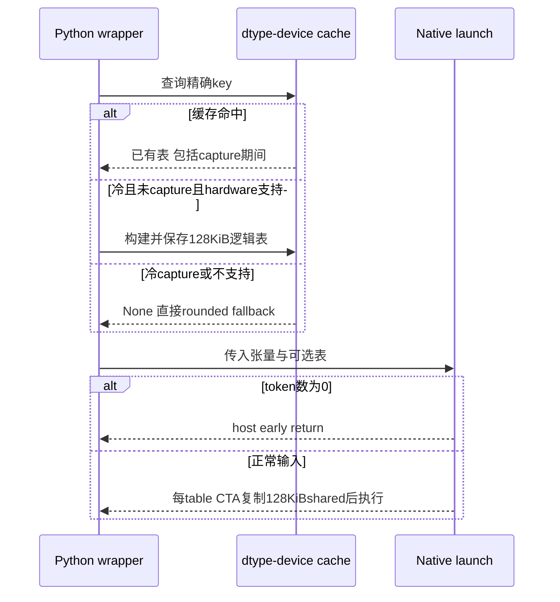

# Rounded SiLU 架构选型 FAQ：先舍入、按位查表、按 dtype/device 预热

> **语言**：中文 | [English](rounded-silu-bit-pattern-lut-capture-cache-selection-faq.en.md)  
> **Round 158**：实际 2026-11-14 新增路径，不宣称热度排名或本机复现 GPU 性能。原创有限 CPU 样例中，single-final-round 错 **7/16**，bit-key LUT 错 **0/16**。`synthetic`，`independently_reproduced=false`；CPU 时延另标 `measured`。
>
> [H5 工作台](../reports/rounded-silu-bit-pattern-lut-capture-cache-sizer.html) · [七卡报告](../reports/rounded-silu-bit-pattern-lut-capture-cache-selection-cards.html) · [高清 SVG](../../assets/svg/rounded-silu-bit-pattern-lut-capture-cache-selection-faq-summary.svg) · [实验与封存证据](../../experiments/rounded_silu_bit_table_selection/README.md)

## Q1：何时选择 rounded SiLU LUT，何时保留直接计算？

问题不是“查表一定比 exp 快”，而是既有算子的 **中间 dtype 舍入语义、设备适用性、表预热时机和 shared-memory 预算** 能否同时满足。SGLang 的本次路径针对 SiLU、无 clamp、CUDA `float16/bfloat16`；首次构建还要求 `props.major == 10`、opt-in shared memory 至少 `131072 B`、当前不在 graph capture 中。这里是精确 `major == 10`，不能自动推广为所有新一代 GPU。

| 维度 | LUT 路径 | 直接 rounded 路径 |
| :--- | :--- | :--- |
| 激活计算 | 已舍入结果按 gate 原始位索引 | 每 lane 执行 FP32 激活及中间转换 |
| 内存 | 每 dtype/device 一张逻辑 128 KiB 表；每 CTA shared copy 128 KiB | 不需要该表或该 shared copy |
| capture 首次缺表 | 不在 capture 内构建，回退 | 可承担既有 rounded fallback |
| 扩展适用性 | 不适用于 clamp、其他激活、float32、ROCm 的冷缓存选择 | 不应因 LUT 新增而删除原路径 |

源码关于 power-capped clocks 下 ALU-bound 的说明是上游动机，**不是本机吞吐证据**。适用条件也不是 driver、JIT 编译、占用率或端到端模型速度的认证。

## Q2：为什么“最终只 cast 一次”会改变结果？

契约是 `T gate → FP32 SiLU → round-to-T activation → FP32 multiply with T up → round-to-T output`。中间 cast 必须保留。即使激活函数表达式相同，提前把乘法融合进去也会改变舍入位置。

原创正常 half 输入 `gate=0x0401`、`up=0x3e00`，激活先舍入得到 `0x0201`；正确原型输出 `0x0302`，single-final-round 输出 `0x0301`。这是有限 CPU 原型的可重放反例，不是 native CUDA 字节验收。

| 方法 | 原创 16 lane 结果 |
| :--- | :--- |
| 逐 lane 保留中间舍入 | reference |
| 以原始 gate word 查已舍入值后乘 up | 0/16 miss |
| 激活未舍入就乘 up、最后只舍入一次 | 7/16 miss |

另一个陷阱是用数值稳定的 float64 sigmoid 替代 native 的非 fast FP32 公式。已核验 shared header 使用 `__nv_expf` 与 `__fdiv_rn(x, 1 + exp(-x))`。原创 BF16 `x=-89` 的 FP32-exp-overflow 模型得到负零 `0x8000`，高精度稳定形式得到 `0x8287`。数学上“更稳定”不等于实现字节相同。

本机用 Python libm `exp` 再舍入 FP32，**不是 CUDA `__nv_expf`**。FMA/超越函数细节、完整特殊值 payload 和 native byte parity 均保留 unknown。

## Q3：为什么表按 65536 个 bit pattern 索引，而不是按浮点数建字典？

两个字节有 `2^16 = 65536` 个模式，包括正负零、有限数、Inf 和 NaN。native 表覆盖完整原始位域，不是“65536 个不同有限实数”。`0x0000` 与 `0x8000` 数值比较相等，但输出符号可不同；原创 float-value-key 字典将它们合并，出现 **1/2** word miss，raw-word 字典保留两个槽。

dtype 也不能混同：`0x3c00` 在 half 中是 `1`，在 BF16 中是 `1/128`。因此全局表缓存的 key 是 `(torch.dtype, input.device.index)`，不是仅 device。

内核 shared 表搬运用固定 `AlignedVector<uint16_t,8>`，即 **16-byte copy**；激活 gate/up 向量却用架构相关 `kMaxVecBytes / sizeof(T)`。已核验 Blackwell-or-greater 编译分支为 32 B，因此 16-bit 激活向量为 16 lane，不能把表搬运的 8 lane 误作激活宽度。host 要求 hidden size 可被其编译向量宽度整除，并检查 32-bit item 索引上限。

原创工具只建立每 dtype **8 个有限 key**，显式拒绝 Inf/NaN 输入；这是原型范围限制，不是 native 限制。缺少 key 抛错，绝不填零或制造“匹配”。

## Q4：capture、空输入与 inplace 会怎样改变生命周期和内存账？

缓存命中先于 hardware/capture probe。冷缓存 capture 不构建表；精确 dtype/device 的暖缓存可在 capture 内复用。换 dtype 或 device 后，不能把另一张表当成当前 key 的命中。工作台中的 cache keys 是声明见证，不是实际 GPU tensor 或硬件权限。

**空输入不意味着零预热分配**：Python 查表/构建发生在 native `num_tokens == 0` early return 之前。原创 `tokens=0`、支持硬件、冷且未 capture 的账本仍记新增逻辑表 `131072 B`，但无 activation launch、无该次 table-CTA shared 申请。

逻辑 global table 与每 CTA shared reservation 属不同内存空间，不能把 `128 KiB × CTA数` 加成额外 HBM。实际 allocator peak、table 生命周期开销和 occupancy 未测量。源码结合 SM 数、每 SM blocks 与 item 数限制 grid，不能从“表很小”推出 occupancy 很高。

inplace 路径写 gate 半区，保留 up 半区；host 验证 output alias input 和对应 row stride。shape、alignment、索引边界、设备和 dtype 都必须成立。原型没有执行 inplace GPU 写入，也没有复制完整 host ABI。

## Q5：本机到底测了什么，没测什么？

八项测试覆盖中间舍入、IEEE RNE 边界、±0 key、缺 key 显式报错、FP32 overflow、精确 cache/capture 顺序、空预热和无效 schema。128 个额外随机有限 lane 校验查表与显式舍入 reference；Node/Python 比较 144 lane 和 11 组 dispatch 状态。

| 原创 finite lane 数 | 预建 8-key dictionary lookup / ms | 直接 rounded arithmetic / ms |
| :--- | ---: | ---: |
| 64 | 0.092033 | 0.152133 |
| 256 | 0.372700 | 0.615433 |
| 1024 | 1.479367 | 2.452633 |
| 4096 | 6.003700 | 9.978833 |

时延来自封存 `latency.json`：两次 warmup、七次交替 repeat、每 sample 三次运行，报告 repeat mean 的 median；两路都包含有限 word 校验。输入和稀疏表构造不计时。**没有 full65536 表生成、GPU shared copy、bank conflict、launch、capture、driver 或模型吞吐测量**，不能把这些 CPU 比值当 GPU 加速比。

上游测试枚举所有 65536 gate words，并对结果使用 `int16` view 字节比较，覆盖两种 dtype 及 in/out-place；这也不等于遍历所有 `gate × up` 组合。本机没有执行这些 native 测试。七卡所有数值条宽来自封存数据；native unknown 不转零；已尊重先前 browser 拒绝，无视觉验收声称。

## Q6：上线前如何做架构验收并保留证据边界？

先确认调用确实要求 activation-rounding，而非普通 fast activation；保留中间 cast 和 fallback。检查准确版本、dtype/device、SM10、opt-in shared 容量，分别验证冷调用、capture 前预热、暖 capture、改 dtype/device、空输入和 inplace alias。用 native 全 word 位级测试及代表性 up、特殊值、边界 shape 验证；再实测 table build、steady-state、shared/occupancy 与端到端模型影响，不以原型时间替代。

本次以原始文档和原创模型归档，不镜像第三方实现、不剥离许可证；缓存分支模型不是设备能力授予，H5 数值模块与 dispatch 账本是明确独立的两个范围。

**固定一手证据**：

- [实际 Nov14 commit](https://github.com/sgl-project/sglang/commit/6a64408419ccc4a091e3982c5b9fc10c5bda0f0e)
- [Python dispatch/cache](https://github.com/sgl-project/sglang/blob/6a64408419ccc4a091e3982c5b9fc10c5bda0f0e/python/sglang/kernels/ops/activation/activation.py)
- [LUT、host guards 与 rounded kernel](https://github.com/sgl-project/sglang/blob/6a64408419ccc4a091e3982c5b9fc10c5bda0f0e/python/sglang/kernels/jit/csrc/elementwise/activation.cuh)
- [non-fast FP32 激活公式](https://github.com/sgl-project/sglang/blob/6a64408419ccc4a091e3982c5b9fc10c5bda0f0e/python/sglang/kernels/jit/include/sgl_kernel/activation.cuh)
- [架构 vector 常量](https://github.com/sgl-project/sglang/blob/6a64408419ccc4a091e3982c5b9fc10c5bda0f0e/python/sglang/kernels/jit/include/sgl_kernel/utils.cuh)
- [native 全 gate-word 测试](https://github.com/sgl-project/sglang/blob/6a64408419ccc4a091e3982c5b9fc10c5bda0f0e/test/registered/kernels/ops/activation/test_activation.py)
- [Apache-2.0 LICENSE](https://github.com/sgl-project/sglang/blob/6a64408419ccc4a091e3982c5b9fc10c5bda0f0e/LICENSE)
