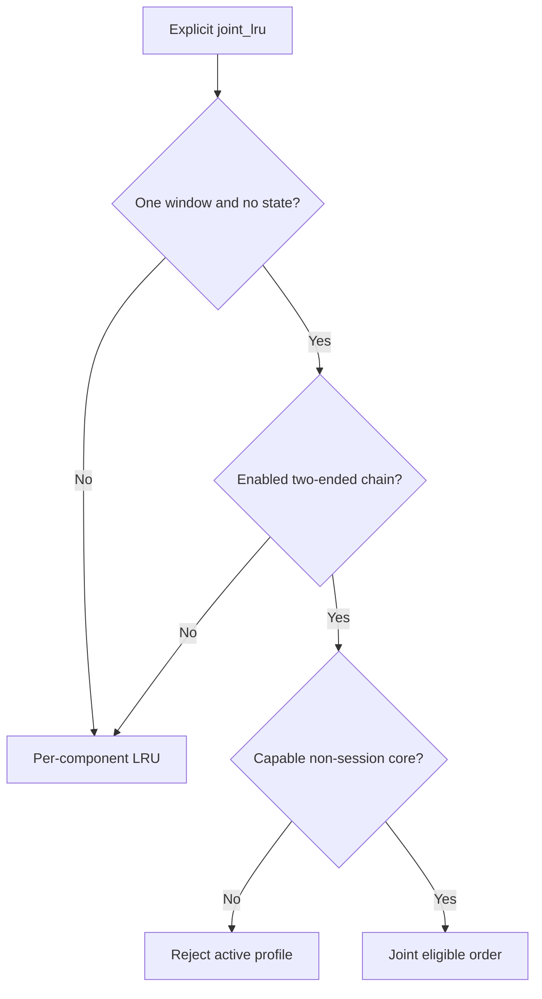

# Shared KV arena FAQ:Rust joint Full/SWA eviction,recency and strip-only victims

> **Language**:English | [中文](rust-joint-full-swa-eviction-recency-strip-only-selection-faq.md)  
> **Round163 · actualNov14**:Rust unified tree adds the joint walk,not a new universal default. **One window,no state,two-ended chain and capable core still gate activation.** Original target8releases8SWA units while retaining80Full;wrong collapse retains48. Synthetic oracle,not native Rust/allocator evaluation.
>
> [H5](../reports/rust-joint-full-swa-eviction-recency-strip-only-sizer.html) · [7-Card](../reports/rust-joint-full-swa-eviction-recency-strip-only-selection-cards.html) · [1600pxSVG](../../assets/svg/rust-joint-full-swa-eviction-recency-strip-only-selection-faq-summary.svg) · [Experiment/evidence](../../experiments/joint_full_swa_eviction_selection/README.md)

## Q1: Does joint_lru apply to every hybrid tree?

Active joint requires explicit `joint_lru`,enabled tree,exactly one window,no state and ChainAllocator with window pool/no Mamba allocator. Rust now advertises joint capability and forwards start/next/end. Unsupported cores still reject active profiles;the session-cache restriction remains.



Our inputs are declared feature witnesses,not a native allocator. Inactive mode is labeled component_lru but its complete fallback is not simulated. Old active Rust joint mode was unsupported;the wrong collapse proposal is not old native execution.

## Q2: Why are Full and SWA recencies separate?

They can represent different actual accesses. SWA ticks and Full `last_access_counter` share the arena counter and are comparable. SWA is stamped on insertion/MRU movement;window refresh stamps nodes in correct depth order.


Heap key is `(tick,component_index,rank,node)`:Full0beforeSWA1on equal ticks,Fullrank=node ID,SWA rank=LRU enumeration for equal-tick fragments. Ticks are access order,not seconds;unrelated component clocks are not interchangeable.

## Q3: Why must an SWA victim on a Full leaf not collapse the entire leaf?

The joint SWA side is strip-only:remove SWA/tick and retain Full for its own later candidacy. Native pending SWA backup finish preserves that flag whether backup was acknowledged or not.

Original Full total80units plus two8-unit SWA values targets8. Removing the oldest SWA releases8and retains80Full. The intentionally wrong collapse additionally removes32unselected Full units,leaving48. These are declared synthetic resource units,not native bytes,endpoint token ratios or physical allocator peak.

A Full pin need not pin independently evictable SWA. The prototype declares separate lock witnesses;native path/window/transfer-lock lifecycles are broader.

## Q4: Why are parent re-entry,stale candidates and split recency required?

```mermaid
sequenceDiagram
    participant H as Joint heap
    participant L as Eligible Full leaf
    participant P as Full parent
    H->>L: Select;caller completes eviction
    L-->>P: Last live Full child disappears
    P->>H: Re-enter with original tick if eligible
    H->>H: Skip SWA removed by earlier cascade
    H->>H: Prefix split is not suffix access
```

A parent is not initially a Full leaf. After actual child eviction,the next victim call checks whether it is now eligible. Selection alone does not free data or make a parent eligible.

Prefix-only match/insert splits keep the suffix's original Full tick under joint mode. SWA fragments inherit the suffix tick:split moves no data and does not refresh a cold suffix. Original Fulltick5with prefixAccess20stays5;the other-policy model becomes20. SWA removal/arena freeing clears ticks so reused slots do not inherit obsolete recency.

## Q5: What did original tests and timing establish?

Eight tests cover strip-only,separate locks,component/rank ties,parent re-entry,cascade-stale candidates,activation,split recency and invalid forests. 64random states compare heap against independent eligible-min selection;Node/Python compare65configs/130outcomes. JS uses an ordered queue,not native Rust heap.

The prototype consumes victims synchronously in a simplified forest. Native radix splits,host coexistence,resumable backups,compaction,matching and allocator freeing are excluded. Upstream integration/random/pending-backup tests were read,**not run locally**.

Sealed CPU timing compares heap drain with repeated linear-min drain on64/256/1024/4096static keys. Two warmups,seven alternating repeats,three drains/sample and median repeat means are used. Dynamic tree/parent work,Rust/Torch/bindings,backup,GPUs and hit rate are excluded. All card bars derive from sealed values.

## Q6: How should production acceptance avoid confusing fast heaps with usable reclaimed memory?

Verify effective profile/capability,comparable ticks,fragment ties,separate locks,strip-only pending finish,stale filtering and parent re-entry. Then validate real endpoint byte/token accounting,fragmentation and compaction against successful allocator admission.

CPU heap speed does not establish Rust throughput,TTFT,cache hit rate or contiguous reusable capacity. SWA free is not automatically a Full token budget;prefix access must not keep an untouched suffix artificially hot. Provenance is `synthetic`,`independently_reproduced=false`;CPU samples separately `measured`. Native Rust/allocator and browser acceptance remain null.

**Pinned primary evidence**:[Actualcommit](https://github.com/sgl-project/sglang/commit/1dd0dcce38ee01c6828c16700e7a4790bf438a9d) · [Rust walk](https://github.com/sgl-project/sglang/blob/1dd0dcce38ee01c6828c16700e7a4790bf438a9d/rust/sglang-radix-tree/src/unified_tree_core.rs) · [SWA](https://github.com/sgl-project/sglang/blob/1dd0dcce38ee01c6828c16700e7a4790bf438a9d/rust/sglang-radix-tree/src/components/swa.rs) · [Feature gate/interface](https://github.com/sgl-project/sglang/blob/1dd0dcce38ee01c6828c16700e7a4790bf438a9d/python/sglang/srt/mem_cache/unified_cache/unified_tree_core_interface.py) · [Adapter](https://github.com/sgl-project/sglang/blob/1dd0dcce38ee01c6828c16700e7a4790bf438a9d/python/sglang/srt/mem_cache/rust_tree_core/adapter.py) · [Nativeintegration](https://github.com/sgl-project/sglang/blob/1dd0dcce38ee01c6828c16700e7a4790bf438a9d/test/registered/unit/mem_cache/test_rust_tree_core_integration.py) · [Apache-2.0LICENSE](https://github.com/sgl-project/sglang/blob/1dd0dcce38ee01c6828c16700e7a4790bf438a9d/LICENSE). Rights retained;original ledger,not an implementation mirror.
