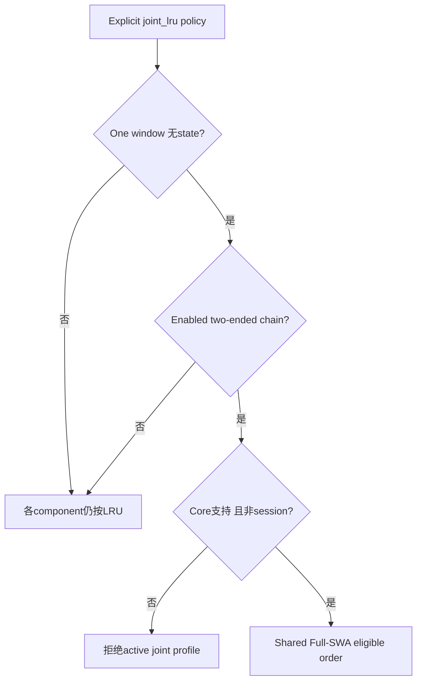
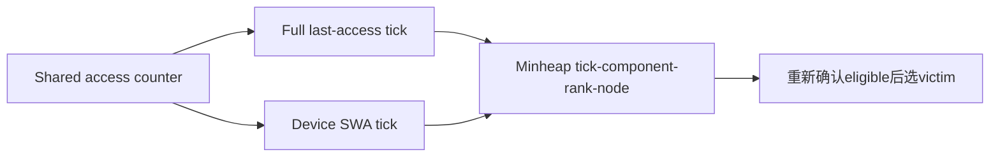
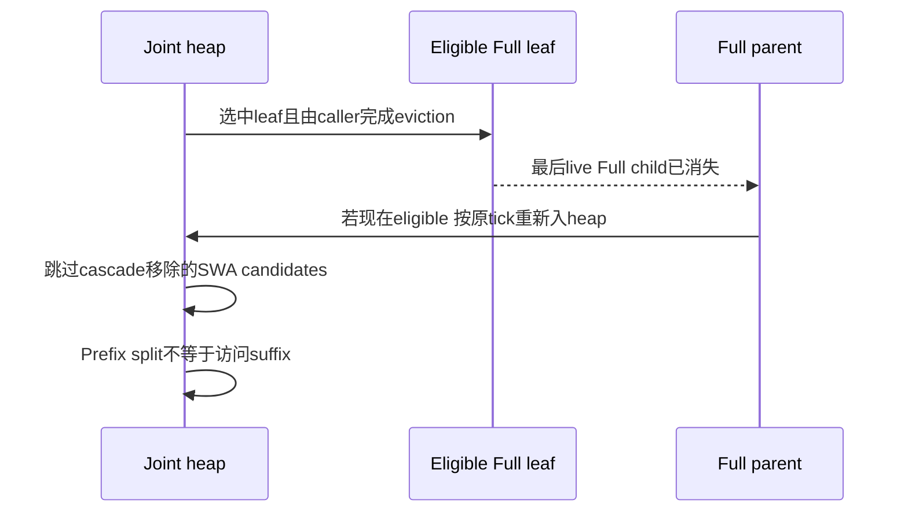

# AI Infra Shared KV Arena FAQ：Rust Joint Full/SWA Eviction、Recency 与 Strip-only

> **语言**：中文 | [English](rust-joint-full-swa-eviction-recency-strip-only-selection-faq.en.md)  
> **Round163 · actualNov14**：Rust unified tree新增joint Full/SWA walk；不是新增默认全局policy。**一window、无state、two-ended chain allocator与有效capability仍为门槛**。原创target8units：SWA-only释放8、保留Full80；错误collapse proposal仅保留48。synthetic oracle，非nativeRust/allocator评测。
>
> [H5 victim workbench](../reports/rust-joint-full-swa-eviction-recency-strip-only-sizer.html) · [7-Card](../reports/rust-joint-full-swa-eviction-recency-strip-only-selection-cards.html) · [1600pxSVG](../../assets/svg/rust-joint-full-swa-eviction-recency-strip-only-selection-faq-summary.svg) · [实验/证据](../../experiments/joint_full_swa_eviction_selection/README.md)

## Q1：joint_lru的作用域是什么，所有hybrid tree都能用吗？

有效joint需要policy为`joint_lru`、tree未disable、exactly one window slot、无state slot，并且是有window pool、无mamba allocator的ChainAllocator。Rust adapter现在声明支持joint eviction并转发start/next/end；其他没有joint walk的core仍拒绝active profile，session radix限制也未撤销。

本原型是这些条件的显式witness，不构建nativeChainAllocator。非active路径标component_lru但不模拟整个fallback执行；旧Rustactivejoint不支持，不把本轮错误proposal冒充旧native实际行为。

## Q2：为什么Full与SWA不能只用一份node recency？

Full与SWA可以有不同实际访问时刻。nativeSWA tick与Full `last_access_counter`来自同一arena counter，可跨component比较；SWA进入或移到MRU时stamp，window refresh为不同nodes分配正确深度顺序。

原始heap key是`(tick,component_index,rank,node)`；Full index0、SWA index1，所以同tick先Full；Fullrank用node ID，equalSWA ticks用SWA LRU enumeration保持fragment顺序。tick是访问序号，不是秒数，也不是任意两个独立clock可以比较。

## Q3：选中一个Full leaf上的SWA，为什么不能整个leaf collapse？

joint walk将SWA一侧置于strip-only。SWA选择只移除SWA value/tick，保留Full供其以后独立候选。nativepending SWA backup finish也遵守这个标志：是否acked都不能借finish路径collapse未选的Full。

原创forest有Full总80units、两个SWA各8units。target8先选oldSWA：释放8、Full仍80。故意错误collapse同时删掉该node的32Fullunits，Full只剩48；不是性能提升，反而多损失未选数据。units是原创声明resource units，不是nativebytes、token endpoint比例或physical allocator peak。

full lock不必意味着该node的独立SWA也被pin；原型分别表示两个lock见证。native还涉及path/window locks和transfer pins，本机不复现完整lock生命周期。

## Q4：parent re-entry、stale candidates与split recency为何重要？

初始parent不是Full leaf不能提前入选；child真正被evict后，下一victim调用才检查parent是否成为eligible。select API本身不是已经free，不能在caller未完成时虚构parent可用。

prefix-only match/insert split时，joint模式保留suffix原Full tick；SWA fragment继承suffix SWA tick，split不搬数据也不应“刷新”冷suffix。原创suffixFull5、prefixAccess20仍为5；其他policy模型为20。SWA移除或arena slot释放时clear tick，reused slot不能继承旧数据recency。

## Q5：本机oracle与timing有哪些边界？

八tests覆盖strip-only、Full pin/独立SWA lock、component tie、SWA rank、parent re-entry、cascade stale候选、feature gates、split tick和invalid forest。64random original states比较heap与独立eligible-min reference；Node/Python比较65configs/130outcomes，JS使用ordered queue而非nativeRustheap。

原型同步消费victim，用简化forest模拟Full-child eligibility；不执行native radix atom split、host coexist、resumable backup barriers、compaction、tree key matching或allocatorfree。上游测试包含Python/Rust随机integration及pending backup ack分支，**本机只读取而未执行这些nativetests**。

封存CPU对64/256/1024/4096static keys比较heap drain与repeated linear-min drain。两次warmup、七次交替repeat、三次drain/sample；median repeat means。动态parent/tree工作、Rust/Torch/bindings、backup、GPU与cache hit-rate不计入。七卡条宽仅取封存数据。

## Q6：真实部署怎样验收，不能从heap快直接推断什么？

先确认effective joint profile及corecapability，再验证跨componenttick来源、fragment/tie顺序、独立lock、pending finish的strip-only、stale候选过滤与parent重入。用真实allocator验证每端byte/token账本、fragmentation与compaction是否让allocation真正可用。

不能从本机heap速度推断Rust吞吐、TTFT、cache hit-rate或回收后一定连续可分配；不能以SWAfree替代Fullbudget，也不能因prefix访问把整个suffix保热。当前`synthetic`,`independently_reproduced=false`；CPUsamples为`measured`，nativeRust/allocator与browser验收均null。

**固定一手证据**：[actualcommit](https://github.com/sgl-project/sglang/commit/1dd0dcce38ee01c6828c16700e7a4790bf438a9d) · [Rust joint walk](https://github.com/sgl-project/sglang/blob/1dd0dcce38ee01c6828c16700e7a4790bf438a9d/rust/sglang-radix-tree/src/unified_tree_core.rs) · [SWA refresh/strip](https://github.com/sgl-project/sglang/blob/1dd0dcce38ee01c6828c16700e7a4790bf438a9d/rust/sglang-radix-tree/src/components/swa.rs) · [policy gate/interface](https://github.com/sgl-project/sglang/blob/1dd0dcce38ee01c6828c16700e7a4790bf438a9d/python/sglang/srt/mem_cache/unified_cache/unified_tree_core_interface.py) · [adapter](https://github.com/sgl-project/sglang/blob/1dd0dcce38ee01c6828c16700e7a4790bf438a9d/python/sglang/srt/mem_cache/rust_tree_core/adapter.py) · [nativeintegration](https://github.com/sgl-project/sglang/blob/1dd0dcce38ee01c6828c16700e7a4790bf438a9d/test/registered/unit/mem_cache/test_rust_tree_core_integration.py) · [Apache-2.0LICENSE](https://github.com/sgl-project/sglang/blob/1dd0dcce38ee01c6828c16700e7a4790bf438a9d/LICENSE)。权利保留，原创ledger而非实现镜像。
