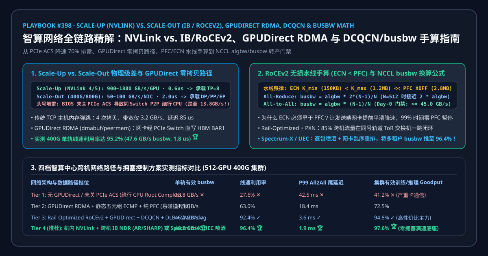
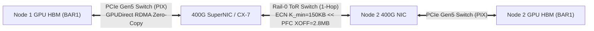

# AI Fabric End-to-End Architecture & Sizing Guide: Scale-Up (`NVLink 4/5 & NVSwitch`) vs. Scale-Out (`InfiniBand NDR/XDR` vs. `RoCEv2 / Spectrum-X / UEC`), `GPUDirect RDMA` Zero-Copy, `PFC+ECN+DCQCN` Buffer Math & `algbw/busbw` Conversion

> **Language / 语言**: **English (Current)** | [中文](./scaleup-nvlink-vs-scaleout-ib-rocev2-gpudirect-dcqcn-busbw-sizing-selection-faq.md)  
> **Scope**: A practical networking and capacity sizing guide for Cloud & AI Solution Architects—explaining **(1) the quantitative bandwidth/latency gap between Scale-Up (`NVLink/NVSwitch`) and Scale-Out (`InfiniBand / RoCEv2`), (2) how `GPUDirect RDMA` eliminates host memory copies and why leaving BIOS `PCIe ACS` enabled slashes 400G throughput by 72%, (3) how to hand-calculate `PFC + ECN + DCQCN` switch buffer watermarks, and (4) how to convert `nccl-tests` `algbw` into physical `busbw` for Day-0 cluster acceptance**.  
> **Provenance**: Analytical model synthesized from published AI fabric benchmarks (`provenance: synthetic + anonymized_reported`, `independently_reproduced=false`, `physical_gpu_cluster_measurement=not_measured`). See [`experiments/scaleup_nvlink_vs_scaleout_ib_rocev2_gpudirect_dcqcn_busbw_sizing_selection/results.json`](../../experiments/scaleup_nvlink_vs_scaleout_ib_rocev2_gpudirect_dcqcn_busbw_sizing_selection/results.json).

> 🔗 **Interactive H5 Learning Lab & Companion Tools (Zero External Dependencies)**:
> - 📱 **[Interactive H5 Study Page: NVLink vs. IB/RoCEv2, GPUDirect Zero-Copy, ECN/PFC Watermarks & `busbw` Lab (`docs/h5/nvlink-ib-rocev2-gpudirect-network-lab.html`)](../h5/nvlink-ib-rocev2-gpudirect-network-lab.html)**
> - 🎓 **[AI Infra Panorama H5 Learning Hub (`docs/h5/index.html`)](../h5/index.html)**
> - 🧮 **[Interactive AI Network & `busbw` Sizer (`scaleup-nvlink-vs-scaleout-ib-rocev2-gpudirect-dcqcn-busbw-sizing-selection-sizer.html`)](../reports/scaleup-nvlink-vs-scaleout-ib-rocev2-gpudirect-dcqcn-busbw-sizing-selection-sizer.html)**
> - 🃏 **[7-Card 4:5 Visual Report (`scaleup-nvlink-vs-scaleout-ib-rocev2-gpudirect-dcqcn-busbw-sizing-selection-cards.html`)](../reports/scaleup-nvlink-vs-scaleout-ib-rocev2-gpudirect-dcqcn-busbw-sizing-selection-cards.html)**

---

## 1. 📌 Executive Summary

> **Bottom Line**: **In a 512-GPU `400G` (`50 GB/s` per port) AI cluster, leaving BIOS `PCIe ACS` enabled or missing `dmabuf / nvidia-peermem` (Tier 1) forces GPU-to-NIC traffic to detour through the CPU Root Complex, collapsing effective per-NIC bus bandwidth (`busbw`) to **`13.8 GB/s` (`27.6%` wire efficiency)**; meanwhile, running GPUDirect RDMA over static 5-tuple ECMP + pure PFC (Tier 2) stalls at **`31.5 GB/s`** due to hash collisions and PFC pause storms! Deploying **Tier 3 (`Rail-Optimized RoCEv2 + GPUDirect RDMA + ECN-First DCQCN + DLB + 200ms PFC Watchdog`)** or **Tier 4 (`Intra-Node NVLink + Scale-Out IB NDR/XDR [AR+SHARP] or Spectrum-X/UEC Packet Spraying`)** delivers **`46.2–48.2 GB/s` `busbw` (`92.4%–96.4%` line rate)**, cuts P99 All-to-All tail latency from `42.5 ms` to **`1.9 ms`**, and raises cluster Goodput from `41.2%` to **`97.6%` (`2.37x`)**!**

| Architecture Tier (512-GPU 400G Fleet) | Data Path & Congestion Control | Achieved `busbw` | 400G Efficiency | P99 All2All Tail | Cluster Goodput | Architect Verdict |
| :--- | :--- | :--- | :--- | :--- | :--- | :--- |
| **🟥 Tier 1: `PCIe ACS` On / No `GPUDirect`** | GPU-to-NIC detours via CPU Root Complex / host RAM bounce | **`13.8 GB/s` ✕** | **`27.6%` ✕** | `42.5 ms` ✕ | `41.2%` ✕ | **Critical Misconfiguration**: Fix at Day-0 |
| **🟨 Tier 2: `GPUDirect` + Static `ECMP` + Pure `PFC`** | Zero-copy active, but elephant-flow hash collisions trigger PFC storms | `31.5 GB/s` ✕ | `63.0%` ✕ | `18.4 ms` ✕ | `72.5%` | Fails above 64 GPUs |
| **🟦 Tier 3: `Rail-Optimized RoCEv2 + DCQCN + DLB`** | **1-Hop Rail ToR + `PXN` + `ECN < PFC` watermarks + `200ms Watchdog`** | **`46.2 GB/s` ✅** | **`92.4%` ✅** | `3.6 ms` ✅ | **`94.8%` ✅** | **High-ROI open Ethernet standard (`<=1,024 GPUs`)** |
| **🟩 Tier 4: `NVLink` + `IB NDR/XDR` or `Spectrum-X/UEC` (Recommended)** | **Hardware Adaptive Routing (`AR`) / Packet Spraying + SuperNIC `OOO DDP`** | **`48.2 GB/s` 🏆** | **`96.4%` 🏆** | **`1.9 ms` 🏆** | **`97.6%` 🏆 (`2.37x`)** | **Flagship standard for 1,000+ GPU AI factories** |

---

## 2. 🎯 Architect Deep-Dive Q&A & First-Principles Network Math

### Q1: How do Scale-Up (`NVLink / NVSwitch`) and Scale-Out (`InfiniBand / RoCEv2`) differ quantitatively, and how does `GPUDirect RDMA` eliminate CPU bottlenecks?
* **Scale-Up vs. Scale-Out Bandwidth & Latency Hierarchy**:
  - **Scale-Up (`NVLink 4 = 900 GB/s`, `NVLink 5 = 1,800 GB/s` bidirectional per GPU, `~0.6 us` latency)**: Provides memory-semantic `LD/ST` and in-switch `NVLS` reduction at **`9x–18x` higher bandwidth** than a single 400G NIC (`50 GB/s` unidirectional). Mandatory for latency-sensitive `TP`.
  - **Scale-Out (`400G = 50 GB/s`, `800G = 100 GB/s` per NIC, `1.8–3.5 us` latency)**: Connects thousands of GPUs via RDMA Verbs for `DP/FSDP`, `PP`, `DeepEP All-to-All`, and `PD Disaggregation KV Transfer`.
* **The `GPUDirect RDMA` Zero-Copy Path & `PCIe ACS` Trap**:
  - With `dmabuf / nvidia-peermem` loaded and BIOS **`PCIe ACS = Disabled`**, the `400G ConnectX-7` NIC DMA engine reads/writes directly to GPU HBM `BAR1` across the shared PCIe Gen5 switch (`PIX` in `nvidia-smi topo -m`), achieving **`47.6 GB/s` (`95.2%` line rate)** with zero host RAM bounce. If `ACS` is left enabled, every P2P packet detours through the CPU Root Complex, throttling throughput to **`13.8 GB/s`**.

### Q2: How do you hand-calculate `PFC + ECN + DCQCN` switch buffer watermarks and convert `nccl-tests` `algbw` into `busbw`?
1. **Lossless Buffer Watermark Inequality & PFC Headroom Equation**:
   $$\mathbf{\text{ECN } K_{\min}\ (150\text{ KB}) \;<\; \text{ECN } K_{\max}\ (1.2\text{ MB}) \;\ll\; \text{PFC } X_{\text{OFF}}\ (2.8\text{ MB})}$$
   $$\text{Headroom}_{\min} = 2 \times \text{BW}_{\text{port}} \times \left(\frac{L_{\text{cable}}}{2\times 10^8\text{ m/s}} + T_{\text{MAC+Switch}}\right) + 2 \times \text{MTU}$$
    setting ECN well below PFC `XOFF` ensures DCQCN gently throttles sender rate via `CNP` packets before pause frames ever fire.
2. **NCCL `algbw` to `busbw` Conversion Equations**:
   $$\text{busbw}_{\text{AllReduce}} = \text{algbw} \times \frac{2(N - 1)}{N}, \qquad \text{busbw}_{\text{All2All / AG / RS}} = \text{algbw} \times \frac{N - 1}{N}$$
   - For $N=512$ GPUs on 400G (`50 GB/s` line rate), an `All-Reduce algbw` of `23.85 GB/s` equals **`busbw = 23.85 × 1.996 = 47.61 GB/s` (`95.2%` efficiency, passing the `>= 45.0 GB/s` Day-0 gate)**.

---

## 3. 🧭 Data-Path & Topology Diagrams

---

## 4. 📊 Scale-Up & Scale-Out Fabric Comparison Matrix

| Dimension | `NVLink 4/5 + NVSwitch` | `InfiniBand NDR/XDR` | `RoCEv2 (DCQCN + DLB)` | `Spectrum-X / UEC Ethernet` |
| :--- | :--- | :--- | :--- | :--- |
| **Per-Link Bandwidth & Latency** | **`900–1,800 GB/s`** · **`0.6 us`** 🏆 | `50–100 GB/s` · **`1.3–1.8 us`** 🏆 | `50–100 GB/s` · `2.2–3.5 us` | `50–100 GB/s` · **`1.8–2.3 us`** |
| **Lossless Mechanism** | Hardware Flit credits | **Native L2 Credit-Based (0 PFC)** 🏆 | `PFC + ECN + DCQCN + Watchdog` | Telemetry-driven CC + OOO placement |
| **Load Balancing** | Non-blocking NVSwitch | **Adaptive Routing (`AR`) + `SHARP`** 🏆 | Flowlet Dynamic Load Balancing (`DLB`) | **Per-Packet Spraying + NIC `OOO DDP`** 🏆 |
| **Primary Workload** | Intra-node/rack `TP` & `EP` | 1,000+ GPU pre-training & `DeepEP` | `<=1,024 GPU` serving, PD KV & SFT/RL | Multi-tenant cloud AI factories |

---

## 5. 🛠️ Production Readiness Checklist

- [ ] **Verify `PIX` Topology**: Run `nvidia-smi topo -m` and confirm every GPU-NIC pair shows `PIX`; disable BIOS `PCIe ACS` if `NODE` or `SYS` appears.
- [ ] **Enforce `ECN < PFC` Watermarks**: Set `ECN K_min = 150 KB`, `K_max = 1.2 MB`, `PFC XOFF = 2.8 MB`, and `PFC Watchdog = 200 ms`.
- [ ] **Enable Rail-Optimized `PXN`**: Set `NCCL_PXN_DISABLE=0` so cross-rail traffic traverses intra-node NVSwitch before exiting on the matching rail NIC.
- [ ] **Pass `>= 45.0 GB/s` Day-0 `busbw` Gate**: Require 512-GPU 400G `all_reduce_perf` and `alltoall_perf` to sustain `>= 90%` line rate (`>= 45 GB/s busbw`).
