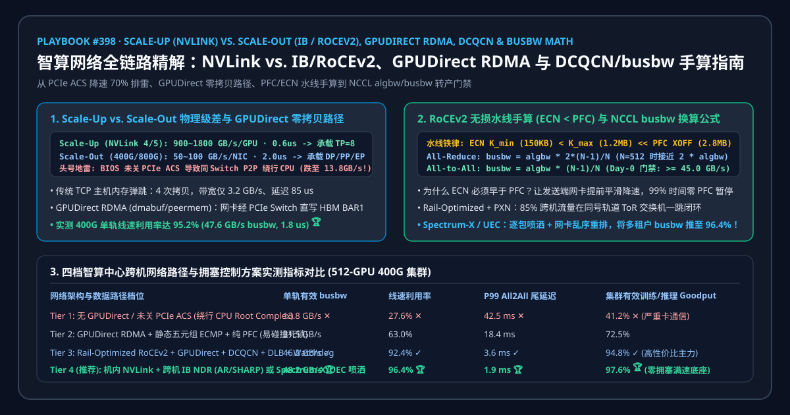
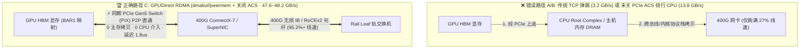
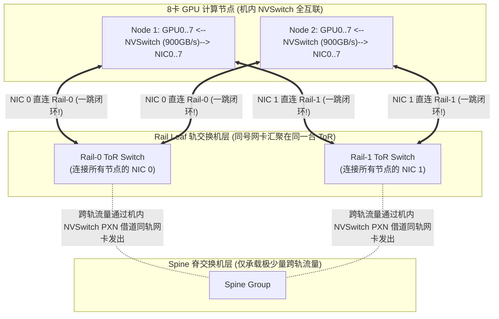

# 智算高速网络全链路选型与手算精解：Scale-Up（`NVLink 4/5 & NVSwitch`）vs. Scale-Out（`InfiniBand NDR/XDR` vs. `RoCEv2 / Spectrum-X / UEC`）、`GPUDirect RDMA` 零拷贝路径、`PFC+ECN+DCQCN` 水线手算与 `algbw/busbw` 换算指南

> **语言 / Language**: **中文 (当前)** | [English](./scaleup-nvlink-vs-scaleout-ib-rocev2-gpudirect-dcqcn-busbw-sizing-selection-faq.en.md)  
> **文档定位**：面向 Cloud & AI Solution Architect 的智算中心高速网络案头实战手册——彻底讲透 **“Scale-Up (NVLink) 与 Scale-Out (IB/RoCEv2) 带宽延迟差多少倍、为什么买了 400G 网卡实测 `nccl-tests` 却只有 `13.8 GB/s`（PCIe ACS 地雷）、`GPUDirect RDMA` 零拷贝到底省掉了哪几次内存拷贝、`PFC + ECN + DCQCN` 交换机缓存水线怎么手算，以及如何从 `algbw` 换算出 `busbw` 做转产验收”**。  
> **标定声明**：本文所引用的单轨有效总线带宽（`busbw`）、线速利用率、P99 All-to-All 尾延迟与集群有效 Goodput 基于公开的智算网络基准（NVIDIA NCCL、InfiniBand NDR/XDR、RoCEv2 DCQCN、Spectrum-X / UEC 架构规范）构建的合成定量模型（`provenance: synthetic + anonymized_reported`, `independently_reproduced=false`, `physical_gpu_cluster_measurement=not_measured`），详见 [`experiments/scaleup_nvlink_vs_scaleout_ib_rocev2_gpudirect_dcqcn_busbw_sizing_selection/results.json`](../../experiments/scaleup_nvlink_vs_scaleout_ib_rocev2_gpudirect_dcqcn_busbw_sizing_selection/results.json)。

> 🔗 **关联交互式 H5 精读页与工具（点击即开，零外部依赖）**：
> - 📱 **[交互式 H5 精读页：NVLink vs. IB/RoCEv2、GPUDirect 零拷贝、ECN/PFC 水线与 `algbw/busbw` 换算沙盘 (`docs/h5/nvlink-ib-rocev2-gpudirect-network-lab.html`)](../h5/nvlink-ib-rocev2-gpudirect-network-lab.html)**
> - 🎓 **[AI Infra 全景可视化精学馆首页 (`docs/h5/index.html`)](../h5/index.html)**
> - 🧮 **[交互式智算网络与 `busbw` 计算器 (`scaleup-nvlink-vs-scaleout-ib-rocev2-gpudirect-dcqcn-busbw-sizing-selection-sizer.html`)](../reports/scaleup-nvlink-vs-scaleout-ib-rocev2-gpudirect-dcqcn-busbw-sizing-selection-sizer.html)**
> - 🃏 **[7-Card 4:5 视觉评测报告 (`scaleup-nvlink-vs-scaleout-ib-rocev2-gpudirect-dcqcn-busbw-sizing-selection-cards.html`)](../reports/scaleup-nvlink-vs-scaleout-ib-rocev2-gpudirect-dcqcn-busbw-sizing-selection-cards.html)**

---

## 1. 📌 核心选型结论速览（Executive Summary）

> **一句话结论**：**在 512 卡 `400G`（单口理论线速 `50 GB/s`）智算集群中，如果服务器 BIOS 忘记关闭 `PCIe ACS` 或未加载 `dmabuf / nvidia-peermem` 导致 `GPUDirect RDMA` 退化为绕行 CPU Root Complex（Tier 1），单卡跨机有效总线带宽（`busbw`）会从 `48 GB/s` 暴跌至 **`13.8 GB/s`（线速利用率仅 `27.6%`）**；而如果仅开启静态 ECMP + 纯 PFC（Tier 2），大象流哈希碰撞与 PFC 暂停风暴仍会把有效带宽卡在 **`31.5 GB/s`**！通过落地 **Tier 3（`Rail-Optimized 轨优化拓扑 + GPUDirect RDMA + ECN 先于 PFC 触发的 DCQCN + DLB 动态负载均衡 + 200ms PFC Watchdog`）** 或 **Tier 4（`机内 NVLink 4/5 Scale-Up + 跨机 IB NDR/XDR [AR+SHARP] 或 Spectrum-X/UEC 逐包喷洒`）**，可将单轨有效 `busbw` 推升至 **`46.2 ~ 48.2 GB/s`（线速利用率达 `92.4% ~ 96.4%`）**，P99 All-to-All 尾延迟从 `42.5 ms` 压降至 **`1.9 ms`**，集群整体有效产出（Goodput）从 `41.2%` 跃升至 **`97.6%`（提升 `2.37 倍`）**！**

| 架构档位（512 卡 400G 智算集群） | 核心数据路径与拥塞控制机制 | 单卡有效 `busbw` | 400G 线速比 | P99 All2All 尾延迟 | 集群有效 Goodput | 架构师拍板结论 |
| :--- | :--- | :--- | :--- | :--- | :--- | :--- |
| **🟥 Tier 1：未关 `PCIe ACS` / 缺 `GPUDirect`** | GPU 与同 PCIe Switch 网卡通信绕行 CPU Root Complex / 主存弹跳 | **`13.8 GB/s` ✕** | **`27.6%` ✕** | `42.5 ms` ✕ | `41.2%` ✕ | **头号交付故障**：必须过 Day-0 门禁排查 |
| **🟨 Tier 2：`GPUDirect` + 静态 `ECMP` + 纯 `PFC`** | 零拷贝已通，但五元组静态哈希极化触发级联 PFC 死锁风暴 | `31.5 GB/s` ✕ | `63.0%` ✕ | `18.4 ms` ✕ | `72.5%` | `>64 卡` 集群严禁仅靠静态 ECMP 与裸 PFC |
| **🟦 Tier 3：`Rail-Optimized RoCEv2 + DCQCN + DLB`** | **同号轨一跳闭环 + `PXN` + `ECN < PFC` 水线 + `200ms Watchdog`** | **`46.2 GB/s` ✅** | **`92.4%` ✅** | `3.6 ms` ✅ | **`94.8%` ✅** | **`64~1,024 卡` 开放以太网高性价比主力** |
| **🟩 Tier 4：`NVLink` + `IB NDR/XDR` 或 `Spectrum-X/UEC` (推荐)** | **硬件自适应路由 (`AR`) / 逐包喷洒 + SuperNIC 乱序直写 (`OOO DDP`)** | **`48.2 GB/s` 🏆** | **`96.4%` 🏆** | **`1.9 ms` 🏆** | **`97.6%` 🏆 (`2.37x`)** | **千卡/万卡预训练与大型 MoE 终局底座** |

---

## 2. 🎯 架构师灵魂拷问与智算网络第一性原理手算 Q&A

### Q1：Scale-Up（机内/柜内 `NVLink`）和 Scale-Out（跨机 `InfiniBand / RoCEv2`）物理量级差多少？为什么它们不能互相替代？
* **一张表看懂 Scale-Up vs. Scale-Out 物理鸿沟**：
  - **Scale-Up 域（`NVLink 4 = 900 GB/s`，`NVLink 5 = 1,800 GB/s` 双向带宽/卡，延迟 `~0.6 us`）**：
    - 采用 **内存语义（Memory-Semantic Load/Store）** 与 **NVSwitch 硬件多播规约（`NVLS`）**，8 张卡（HGX）或 72 张卡（GB200 NVL72）就像共用同一块超大显存池。
    - 单卡 NVLink 4 双向带宽（`900 GB/s`）是单张 `400G` RDMA 网卡单向线速（`50 GB/s`，双向 `100 GB/s`）的 **`9 倍`（单向对比达 `18 倍`）**！因此高频同步的 **张量并行（`TP`）必须 100% 放在 Scale-Up 域内**。
  - **Scale-Out 域（`400G NDR/RoCEv2 = 50 GB/s/NIC`，`800G XDR/UEC = 100 GB/s/NIC`，延迟 `1.8 ~ 3.5 us`）**：
    - 采用 **包交换 RDMA 语义（Queue Pair Verbs / Write / Send）**，通过光纤可横向扩展至 **数千乃至十万张 GPU**。专门承载 **数据并行（`DP / FSDP`）、流水线并行（`PP`）、专家并行（`DeepEP All-to-All`）与 `PD 分离 KV 传输`**。

### Q2：`GPUDirect RDMA` 到底是怎么实现“零拷贝”的？为什么现场经常遇到“驱动装了，但 400G 网卡只能跑出 13.8 GB/s”的诡异降速？
* **三条数据路径解剖与 `PCIe ACS` 排雷指南**：
  1. **传统 TCP/IP 路径（4 次拷贝，`3.2 GB/s`）**：`GPU HBM` $\xrightarrow{\text{Copy 1}}$ `Host Pinned Memory` $\xrightarrow{\text{Copy 2}}$ `Linux Kernel Socket Skbuff` $\xrightarrow{\text{Copy 3}}$ `NIC Ring Buffer` $\xrightarrow{\text{Wire}}$ 远端反方向再来一遍。CPU 被中断和内存拷贝彻底打满。
  2. **未开启 GPUDirect RDMA 或 BIOS 未关 `PCIe ACS` 的伪直连陷阱（`13.8 GB/s`）**：
     - 在标准 8 卡 AI 服务器（如 HGX H100/H200）中，每张 GPU 与配对的 `400G ConnectX-7` 网卡挂载在**同一颗专用 PCIe Gen5 Switch 芯片（`nvidia-smi topo -m` 显示为 `PIX`）**下。
     - 如果未加载 `nvidia-peermem / dmabuf` 内核模块，或者 **服务器 BIOS 中保持了虚拟化默认的 `PCIe ACS (Access Control Services) = Enabled`**，PCIe Switch 会强制禁止下挂设备之间直接点对点（P2P）转发，把所有 GPU$\leftrightarrow$NIC 流量强行往上送进 **CPU Root Complex（甚至跨 NUMA QPI/UPI 总线，拓扑退化为 `NODE / SYS`）**，导致 400G 网卡有效带宽瞬间腰斩 `72%`（跌至 **`13.8 GB/s`**）！
  3. **满血 `GPUDirect RDMA` 零拷贝路径（`47.6 GB/s`，线速比 `95.2%`）**：
     - 加载 `dmabuf / nvidia-peermem` 且 BIOS 关闭 `PCIe ACS` 后，网卡 DMA 引擎通过同颗 PCIe Gen5 Switch 直接读写 GPU `BAR1` 映射的 HBM 显存物理页，**全程 `0` 主存中转、`0` CPU 周期介入、延迟仅 `1.8 us`**！

### Q3：在 RoCEv2 无损以太网中，`PFC`、`ECN` 和 `DCQCN` 是怎么配合的？交换机缓存水线（`K_min / K_max / XOFF`）怎么手算才不会丢包或死锁？
* **三剑客分工机理（“ECN 踩刹车，PFC 拉手刹”）**：
  - **`ECN + DCQCN`（端到端温柔点刹，99% 时间靠它）**：当交换机出端口队列开始轻微排队、超过 **`ECN K_min`（最低标记水线）** 时，交换机不暂停端口，而是在数据包 IP 头里打上 `CE (Congestion Experienced)` 标记；接收端网卡收到后生成 `CNP (拥塞通知包)` 发回给发送端网卡，发送端网卡硬件按 **DCQCN 算法平滑下调该 QP 流的发送速率**。
  - **`PFC`（基于优先级的逐跳急刹，最后保底防丢包）**：只有当瞬时 Incast 流量过猛、DCQCN 来不及降速，导致上游发来的在途数据包把交换机入端口 Headroom 填满到 **`PFC XOFF`（暂停水线）** 时，交换机才向上游发送 `PAUSE` 帧强行刹停发送。
* **交换机无损水线黄金不等式与 Headroom 手算公式**：
  $$\mathbf{\text{ECN } K_{\min} \;<\; \text{ECN } K_{\max} \;\ll\; \text{PFC } X_{\text{OFF}} \;<\; \text{Port Max Buffer}}$$
  - **最小无损吸收空间（PFC Headroom）手算公式**：从本端交换机达到 $X_{\text{OFF}}$ 发出 PAUSE 帧，到上游网卡收到 PAUSE 并停下正在发送的数据包，这段往返飞行时间（$\text{RTT}_{\text{flight}}$）内已经在光纤上飞行的字节必须被全部吞下而不能溢出：
    $$\text{Headroom}_{\min} = 2 \times \text{BW}_{\text{port}} \times \left( \frac{L_{\text{cable}}}{2 \times 10^8\text{ m/s}} + T_{\text{MAC+Switch}} \right) + 2 \times \text{MTU}$$
    - **算例（`400 Gbps = 50 GB/s` 端口，100 米光纤，单程光延时 `500 ns` + 芯片处理 `600 ns` = `1.1 us`，`MTU = 4,224 Bytes`）**：
      $$\text{Headroom}_{\min} = 2 \times 50\text{ GB/s} \times 1.1\ \mu\text{s} + 8.45\text{ KB} \approx 110\text{ KB} + 8.45\text{ KB} \approx \mathbf{120\text{ KB}}\ (\text{工程安全预留取 }\mathbf{384\text{ KB} \sim 512\text{ KB}})$$
    - **400G RoCEv2 生产推荐水线配置**：`ECN K_min = 150 KB`、`ECN K_max = 1,200 KB (1.2 MB)`（标记概率 `P_max = 10%~20%`）、`PFC XOFF = 2,800 KB (2.8 MB)`，并强制开启 **`PFC Watchdog = 200 ms`**（一旦某队列持续 PAUSE 超过 200ms 自动丢包解锁，严防全网死锁风暴！）。

### Q4：跑 `nccl-tests` 验收集群时，输出的 `algbw`（算法带宽）和 `busbw`（总线带宽）怎么换算？多少分才算合格？
* **NCCL `algbw` 与 `busbw` 精确换算公式**：
  - **算法带宽（`algbw`）**：$\text{algbw} = \frac{\text{输入张量大小 } S_{\text{bytes}}}{\text{集合通信耗时 } t}$。
  - **物理总线带宽（`busbw`，真实反映网卡硬件跑满程度的核心指标！）**：
    1. **`All-Reduce`（Ring / Tree 算法需传输 $2\frac{N-1}{N} S$ 数据量）**：
       $$\text{busbw}_{\text{AllReduce}} = \text{algbw} \times \frac{2(N - 1)}{N}$$
       *例*：512 卡跑 `all_reduce_perf`（16GB 消息），实测 `algbw = 23.85 GB/s`，则换算因子为 $\frac{2 \times 511}{512} = 1.9961$，真实 **`busbw = 23.85 × 1.9961 = 47.61 GB/s`**（占 400G 单口理论极限 `50 GB/s` 的 **`95.2%`**，验收优秀！）。
    2. **`All-to-All` / `Reduce-Scatter` / `All-Gather`（需跨网传输 $\frac{N-1}{N} S$ 数据量）**：
       $$\text{busbw}_{\text{All2All}} = \text{algbw} \times \frac{N - 1}{N}$$
  - **Day-0 转产验收硬性门禁**：在 `400G` 跨机网络上，大消息（`>= 4 GB`）`All-Reduce busbw` 必须 **`>= 45.0 GB/s`（线速比 `>= 90%`）**；若低于 `40 GB/s`，立即排查光模块误码（BER）、PCIe ACS 与 ECN/PFC 水线！

---

## 3. 🧭 直观可视化图解（GPUDirect RDMA 零拷贝路径与 Rail-Optimized 拓扑图）

### 3.1 传统 TCP 主存弹跳 vs. `GPUDirect RDMA`（同 PCIe Switch `PIX` 零拷贝）路径对比图

### 3.2 8 轨优化拓扑（`Rail-Optimized Topology` + `NCCL PXN`）vs. 传统胖树路由

---

## 4. 📊 Scale-Up 与 Scale-Out 四大智算网络技术横向选型决策矩阵

| 对比维度 | `NVLink 4/5 + NVSwitch` (Scale-Up) | `InfiniBand NDR/XDR` (Scale-Out) | `标准 RoCEv2 (DCQCN + DLB)` (Scale-Out) | `Spectrum-X / UEC 超以太网` (Scale-Out) |
| :--- | :--- | :--- | :--- | :--- |
| **单通道带宽与延迟** | **`900 ~ 1,800 GB/s`** · **`~0.6 us`** 🏆 | `50 ~ 100 GB/s` · **`1.3 ~ 1.8 us`** 🏆 | `50 ~ 100 GB/s` · `2.2 ~ 3.5 us` | `50 ~ 100 GB/s` · **`1.8 ~ 2.3 us`** |
| **无损机制与流控** | 硬件级 Flit 信用流控 | **原生链路层 Credit-Based 无损（零 PFC 死锁）** 🏆 | 基于 `PFC + ECN + DCQCN + Watchdog` | 硬件遥测拥塞控制 + 无损/容忍乱序传输 |
| **负载均衡与防碰撞** | NVSwitch 全交叉无阻塞矩阵 | **原生自适应路由 (`AR`) + `SHARPv3` 网内规约** 🏆 | 依赖交换机 `DLB (Dynamic Load Balancing)` | **逐包喷洒 (`Packet Spraying`) + 网卡 `OOO DDP` 乱序重排** 🏆 |
| **最佳承载并行域** | **`TP (张量并行)`**、机内/柜内 `EP` | 千卡/万卡同步预训练 `FSDP / PP / DeepEP` | `<=512~1,024 卡` 推理、PD 分离与后训练 | 多租户大型云原生智算中心与万卡以太网集群 |

---

## 5. 🛠️ 生产落地核对清单（SA Production Readiness Checklist）

- [ ] **Day-0 拓扑门禁（`nvidia-smi topo -m` 必查）**：确认每张 GPU 与其配对 RDMA 网卡的关系全部显示为 **`PIX`（经单个 PCIe Switch 直连）**；若出现 `NODE` 或 `SYS`，立即进入 BIOS 关闭 **`PCIe ACS (Access Control Services)`** 并检查 `dmabuf / nvidia-peermem` 加载状态。
- [ ] **RoCEv2 水线黄金法则核验**：核查交换机 QoS 配置，确保 **`ECN K_min (150KB) < ECN K_max (1.2MB) << PFC XOFF (2.8MB)`**，且仅在 RDMA 专用无损队列（如 Priority 3 / DSCP 26）开启 PFC，其余管理/存储流量走有损队列。
- [ ] **强制开启硬件 `PFC Watchdog`**：在所有 Leaf / Spine 交换机端口配置 **`200 ms` PFC Watchdog 自动排空（Drop/Drain）**，防止单张坏网卡持续发 PAUSE 帧锁死全集群。
- [ ] **开启 `Rail-Optimized` 拓扑与 `NCCL PXN`**：同号网卡汇聚至同一 Rail ToR 交换机，并设置 `NCCL_PXN_DISABLE=0` 与 `NCCL_CROSS_NIC=1`，让跨轨通信先在机内走 `900 GB/s NVSwitch` 换轨后再一跳出网。
- [ ] **执行三级 `nccl-tests` 转产压测**：依次通过 ① 单机 8 卡 `NVLink` 测试（`busbw >= 380 GB/s` on H100/H200）、② 双机同轨点对点 `GPUDirect RDMA` 测试（`busbw >= 47.0 GB/s`）、③ 全集群 `512+` 卡 `All-Reduce / All-to-All` 48 小时烤机（**`busbw >= 45.0 GB/s`** 且零 `PFC Storm` 告警）。
