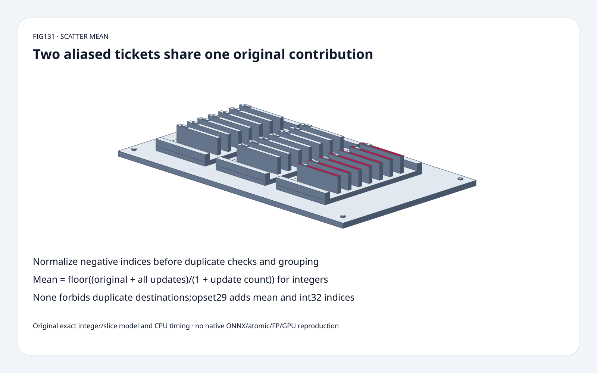
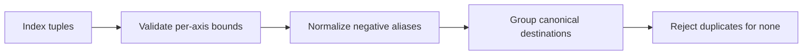
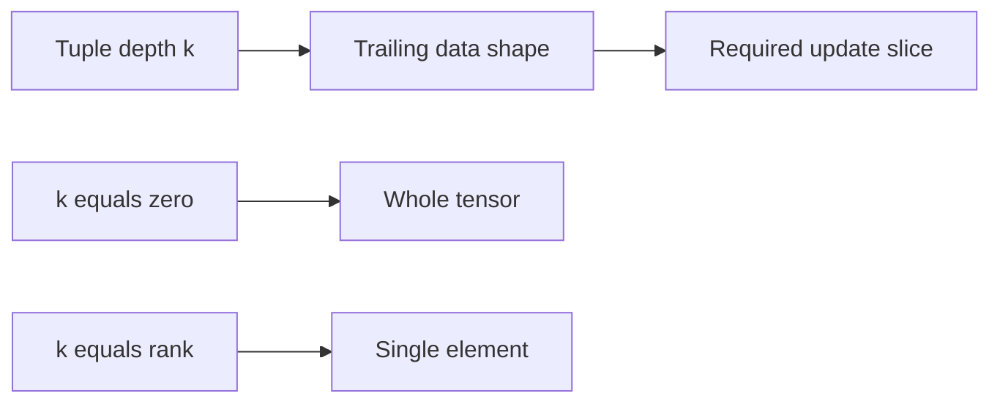
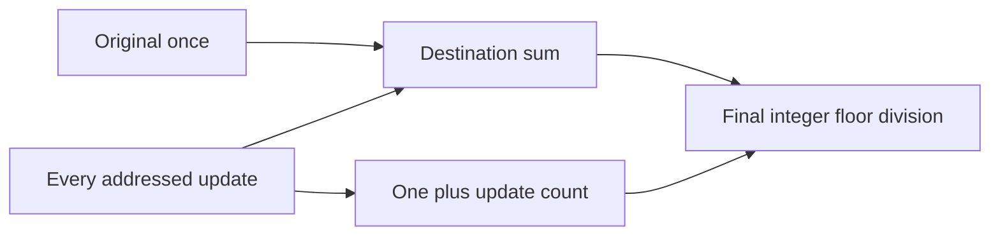

# Export FAQ: ScatterND mean,negative-index aliases and trailing slices

> **Language**: [中文](scatternd-mean-negative-alias-slice-contract-selection-faq.md) | English
>
> **Round131 · 2026-11-14 · Day round8** · [SVG](../../assets/svg/scatternd-mean-negative-alias-slice-contract-selection-faq-summary.svg) · [H5](../reports/scatternd-mean-negative-alias-slice-contract-sizer.html) · [7 cards](../reports/scatternd-mean-negative-alias-slice-contract-selection-cards.html) · [Data](../../experiments/scatter_mean_contract_selection/report.json)
>
> **Synthetic, `independently_reproduced=false`.** Original exact integer scatter/slice model and independent destination-first oracle. Original CPU paths measured separately;no native ONNX/atomic/FP/GPU or model-quality reproduction.

## 1. Executive summary: mean includes the original destination once

Verified November12 ONNX change adds **mean reduction in opset29**.
For original10 and two updates2/8,integer scatter mean is
`floor((10+2+8)/3)=6`,not update-only5.
Repeated pairwise averaging gives7;reversing updates gives5.
Group contributions,then divide once.

Negative indices can hide duplicates. For an axis of size2,index0
and index-2 identify the same destination.
Mean can group them;`reduction="none"` must not have duplicate
destinations. A sequential reference loop's overwrite behavior does
not make last-write semantics portable.

## 2. Architect Q&A: opsets,normalization,slices and denominators

### Q1: What is actually new,and does every backend support it?

Pinned ONNX commit`af56232bdc6f1ecbb27a5c9d2866263d6033bc38`,
2026-11-12T04:44:48Z,adds mean to ScatterND/ScatterElements in
opset29. The inspected tree also documents int32 indices in opset29;
int64 remains supported.
An exporter carrying that schema is not proof every execution provider
implements it. Runtime/provider/version compatibility needs a separate
native test.

The change explicitly has no `include_self` attribute:the original data
value is included once. Our mean model rejects a selected older opset,
instead of silently converting mean to replacement/addition.
It is a pinned contract exercise,not a complete ONNX version converter.

### Q2: How do negative indices change duplicate detection?

For dimension sizes,index must satisfy `-s<=i<s`.
Normalize negativei toi+s before grouping.
Different textual tuples can therefore address the same location.
Out-of-range indices are errors,not clamp/wrap convenience.

Original shape[2,2],indices[[0],[-2]] selects the same first row twice.
Dataflat[10,-4,30,40],updatesflat[2,-3,8,-2]:
mean returns **[6,-3,30,40]**.
Untouched row[30,40] is copied unchanged.
`none` rejects this normalized duplicate explicitly.

### Q3: Does an index tuple always select one scalar?

No. For data rankr and tuple widthk:
`updates.shape = indices.shape[:-1] + data.shape[k:]`.
Whenk=r,the tuple selects one element.
Whenk<r,it selects the trailing slice.
The pinned opset29 documentation permitsk0,where every empty tuple
selects the whole tensor.

The original model accepts flat[M,k]tuple lists and flat updates,
supports positive shapes up to rank4,and validates this trailing slice.
It does not implement every rankq representation,zero-size dimension,
tensor dtype or native striding.
H5 deliberately limits data to rank2,axes1..32,up to64 tuples.

### Q4: Why not average each arriving update immediately?

Mean is not an associative binary operation without weights.
Original10,updates2then8:
floor pair mean first6,then7.
Reversed:first9,then5.
The correct grouped answer remains6 in both orders.

Retain a sum and count (or a mathematically equivalent weighted state),
include the original only once,and divide at the end.
In distributed grouping,adding the original independently to every
partition would count it repeatedly;this model does not certify any
native distributed/atomic implementation.
Exact integer order invariance does not imply floating bitwise invariance.

### Q5: How are integer and floating mean results defined?

Pinned integer mean rounds **toward negative infinity**:
sum-5,count2 gives-3,not truncation-to-zero-2.
The original Python model uses unbounded integer sums to demonstrate
that contract;its wide-sum fixture exceeds int64 accumulation range
without silently overflowing. It is not a fixed-width allocator or
integer-overflow simulator.

Pinned reference widens accumulation and includes additional floating
overflow fallback. The spec separately describes NaN/infinity behavior
and conversion after division. We did not reproduce floating kernels,
NaNs,infinities,low-precision accumulation or native conversion.
H5 uses bounded exact integer inputs and onlynone/add/mean.

Selected4096×128data,1024 row updates,int32 indices,float32 **payload
width selection**:data2,097,152B,updates524,288B,indices4,096B.
Separate dense int64 sum/count logical payload8,388,608B.
Payload byte selections are not a claim that the integer toy executes
float32 or that a native backend allocates these buffers.
Metadata,Python objects,sorting,temporary copies and peak HBM are excluded.

## 3. Visual architecture: normalize,group and finalize

## 4. Selection matrix: preserve export semantics,not traversal accidents

| Choice | Good fit | Gate |
| :--- | :--- | :--- |
| Mean in opset29 | Mean includes original destination | Native provider/version support |
| Add/mul/max/min | Explicit non-mean reduction | Include original and dtype behavior |
| None | Unique normalized destinations | Reject aliases,do not promise last-write |
| Canonical index grouping | Negative aliases and row/slice updates | Validate bounds before normalization |
| Sum/count state | Exact weighted mean semantics | Original included only once |
| Integer floor model | Contract teaching and regression | Not floating determinism/GPU proof |

## 5. Workbench and evidence: eight focused tests plus original CPU paths

[H5](../reports/scatternd-mean-negative-alias-slice-contract-sizer.html)
shows canonical destinations,flat integer outputs,visible validation
errors and independent logical payload budgets.
Switch to`none` in the default aliased fixture to see an explicit error;
selectopset28 withmean to see the version gate.
Setk0 with matching whole-tensor updates to exercise empty tuples.

Tests compare scatter against an independent destination-coordinate
enumeration for every supported reduction and depth;cover negative aliases,
reversal,whole tensors,scalar writes,untouched data,flooring,wide sums,
shape/bounds/opset errors,Node parity and sealed CPU records.

| Updates across64 destinations | Original grouped ms | Original destination-first rescan ms |
| :--- | ---: | ---: |
|64|0.011300|0.195433|
|256|0.031800|0.718300|
|1024|0.107700|2.808067|
|4096|0.451233|13.738033|

Two warmups,seven alternating repeats,three operations per sample;
medians of repeat means. Sum/count initialization included.
These compare original scalar integer algorithms,not native ONNX kernels,
parallel contention,atomics,FP order or GPU performance.
Browser inspection was not performed after the prior approval refusal.

## 6. Sources,license and readiness

ONNX tree`3c41120b9c69657a1dd13407b080bd451ed06c9c`,Apache-2.0:
[ScatterND29 specification](https://github.com/onnx/onnx/blob/3c41120b9c69657a1dd13407b080bd451ed06c9c/docs/Operators.md#ScatterND),
[reference dispatch](https://github.com/onnx/onnx/blob/3c41120b9c69657a1dd13407b080bd451ed06c9c/onnx/reference/ops/op_scatternd.py),
[mean helper](https://github.com/onnx/onnx/blob/3c41120b9c69657a1dd13407b080bd451ed06c9c/onnx/reference/ops/_scatter.py),
[November12 change](https://github.com/onnx/onnx/commit/af56232bdc6f1ecbb27a5c9d2866263d6033bc38).
This is a recent verified capability,not an invented daily popularity rank.

[Original code and sealed data](../../experiments/scatter_mean_contract_selection/README.md).
No upstream implementation copied.
Static Figure-tier original ticket cabinet reuses sixty solids:
base,four feet,three trays,six rails,21cards,21tabs,four fasteners.
Ready for schema teaching and bounded regression fixtures;
native latency,HBM allocation,quality and floating-bitwise readiness remain unknown.
