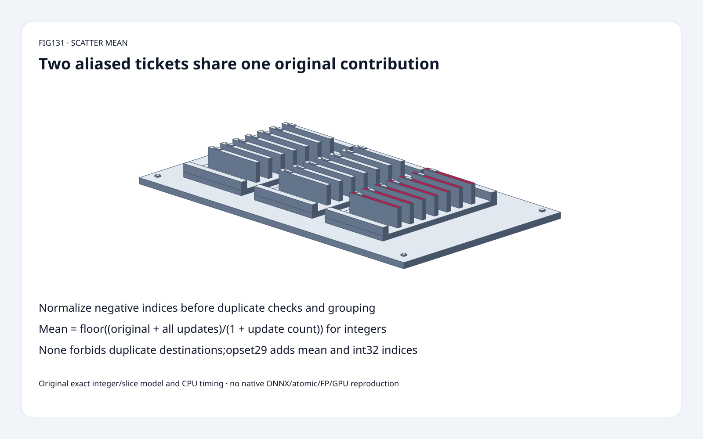
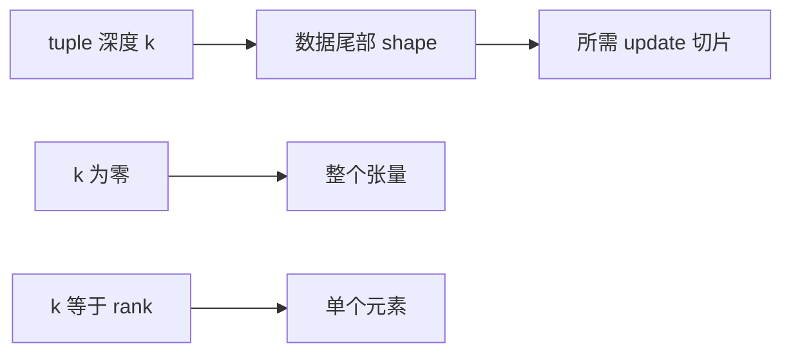
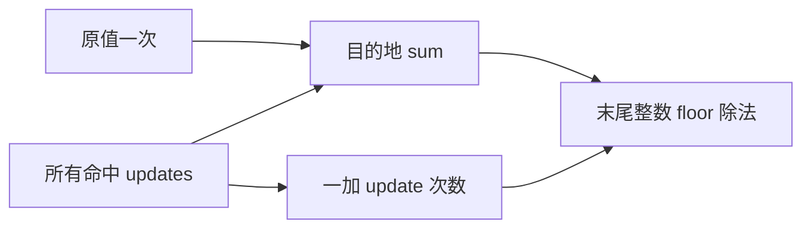

# 导出选型 FAQ：ScatterND mean、负索引别名与尾部切片

> **语言**：中文 | [English](scatternd-mean-negative-alias-slice-contract-selection-faq.en.md)
>
> **Round131 · 2026-11-14 · 白班第8轮** · [高清 SVG](../../assets/svg/scatternd-mean-negative-alias-slice-contract-selection-faq-summary.svg) · [H5](../reports/scatternd-mean-negative-alias-slice-contract-sizer.html) · [七卡](../reports/scatternd-mean-negative-alias-slice-contract-selection-cards.html) · [封存数据](../../experiments/scatter_mean_contract_selection/report.json)
>
> **synthetic，`independently_reproduced=false`。** 原创精确整数 scatter/切片模型与独立 destination-first oracle；CPU 原创路径另标 measured。非原生 ONNX、atomic、FP、GPU 或模型质量复现。

## 1. 结论：mean 把原值计入一次，不是不断两两平均

核实11月12日 ONNX 变更：**opset29 新增 scatter mean**。
原值10、更新2/8，整数结果是 `floor((10+2+8)/3)=6`，
不是仅对更新求均值的5，也不是逐次两两平均的7。
反转更新顺序后，错误逐次平均变成5，正确答案仍为6。

负索引也能隐藏重复：长度2轴上的0与-2指向同一位置。
mean 应归为同一组；`none` 合同则禁止重复目的地。
reference loop 的顺序覆盖不是跨 backend 的 last-write 保证。

## 2. 架构师问答：版本、归一化、切片与分母

### Q1：真正的新能力是什么，所有 backend 都支持吗？

固定变更 `af56232bdc6f1ecbb27a5c9d2866263d6033bc38`，
2026-11-12T04:44:48Z，为 ScatterND/ScatterElements 的 opset29
增加 mean。所查树还记录 opset29 支持 int32 indices，保留 int64。
schema/exporter 能表达，不代表任意 provider 都能执行，
还需单独核对 runtime/provider/version。

此次明确不新增 `include_self`：原值固定计入一次。
原创模型对 mean+旧 opset 显式报错，不偷偷降级成覆盖或加法；
这不是完整 ONNX version converter。

### Q2：负索引如何影响去重？

每轴大小 s 要求 `-s<=i<s`，负 i 归一为 i+s 后再分组。
不同字面 tuple 可能是同一目的地。
越界必须报错，不是 clamp 或任意 modulo 容错。

shape[2,2]，indices[[0],[-2]] 都写第一行。
flat data[10,-4,30,40]、flat updates[2,-3,8,-2]：
正确 mean **[6,-3,30,40]**，未命中行原样保留；
none 则因归一后重复而拒绝。

### Q3：一个 tuple 总是更新一个标量吗？

不是。数据 rank r、tuple 宽 k：
`updates.shape = indices.shape[:-1] + data.shape[k:]`。
k=r 更新标量，k<r 更新尾部切片。
固定 opset29 文档还允许 k0：每个空 tuple 更新整个张量。

原创模型用 flat[M,k] tuples 与 flat updates，支持 rank1..4正维度，
校验尾部切片长度；不覆盖任意 rankq 表示、零维长度、所有 dtype/striding。
H5 有意收窄为二维、轴1..32、最多64 tuples。

### Q4：为什么每来一次更新就平均会错？

缺少权重时，mean 不是可直接结合的二元算子。
原10与2先平均得6，再与8平均得7；
反向先得9，再与2平均得5。
正确需要保留 sum/count，原值只进入一次，末尾才相除。

分布式分组若每个 partition 都加原值，会重复计数。
本模型不认证任何原生分布式或 atomic 实现；
精确整数的顺序不变性也不证明 FP bitwise 一致。

### Q5：整数与浮点平均有什么差异？

固定整数语义向 **负无穷取整**，-5/2 得-3，而不是 toward-zero 的-2。
Python 使用任意精度整数累加，宽和测试超过 int64 中间范围仍不溢出；
这不是固定宽度分配器/整数 overflow 模拟。

固定 reference 会加宽累加并处理浮点 overflow fallback；
spec 另规定 NaN/无穷以及除法后 dtype conversion。
本研究不复现这些浮点路径。H5 只做有界精确整数 none/add/mean。

默认4096×128数据、1024行更新、int32 indices、float32 **载荷宽度选择**：
data2,097,152B、updates524,288B、indices4,096B。
独立 dense int64 sum/count 逻辑载荷8,388,608B。
这不表示整数 toy 在执行 float32，也不表示原生一定分配这些缓冲；
metadata、Python objects、排序、临时复制及 peak HBM 均排除。

## 3. 可视化架构：先归一，再分组，最后定稿

## 4. 选型矩阵：保留导出语义，不依赖遍历偶然性

| 选择 | 适用 | 门槛 |
| :--- | :--- | :--- |
| opset29 mean | 原值也参与平均 | 原生 provider/version 支持 |
| add/mul/max/min | 明确其他归约 | 原值与 dtype 行为 |
| none | 归一后唯一目的地 | 拒绝别名重复，不承诺 last-write |
| canonical 分组 | 负索引与行/切片更新 | 归一前验证边界 |
| sum/count | 有权重的正确平均 | 原值只能计一次 |
| 整数 floor 模型 | 教学与回归 fixture | 不推导 FP/GPU 保证 |

## 5. 工作台与证据：八项测试和原创 CPU 路径

[H5](../reports/scatternd-mean-negative-alias-slice-contract-sizer.html)
输出 canonical destinations、flat integer result、
可见错误与独立载荷预算。默认切 none 可见重复错误；
mean 选 opset28 可见版本 gate；k0需要匹配 whole-tensor updates。

测试用独立逐目的地坐标枚举检查全部模型归约与深度，
覆盖负别名、反序、whole tensor、标量写、未命中保留、
floor、宽整数和、形状/边界/版本、Node parity 与封存记录。

| 分布于64目的地的 updates | 原创 grouped ms | 原创逐目的地 rescan ms |
| :--- | ---: | ---: |
|64|0.011300|0.195433|
|256|0.031800|0.718300|
|1024|0.107700|2.808067|
|4096|0.451233|13.738033|

2 warmups、7次交替 repeat、每样本3操作，取 repeat 均值中位数，
包括 sum/count 初始化。不能解释为原生 ONNX、atomic 争用、
FP 累加顺序或 GPU 性能。此前 browser approval 被拒，未绕过或声称视觉验收。

## 6. 来源、许可与就绪边界

ONNX 固定树 `3c41120b9c69657a1dd13407b080bd451ed06c9c`，Apache-2.0：
[ScatterND29 spec](https://github.com/onnx/onnx/blob/3c41120b9c69657a1dd13407b080bd451ed06c9c/docs/Operators.md#ScatterND)、
[reference](https://github.com/onnx/onnx/blob/3c41120b9c69657a1dd13407b080bd451ed06c9c/onnx/reference/ops/op_scatternd.py)、
[mean helper](https://github.com/onnx/onnx/blob/3c41120b9c69657a1dd13407b080bd451ed06c9c/onnx/reference/ops/_scatter.py)、
[11月12日变更](https://github.com/onnx/onnx/commit/af56232bdc6f1ecbb27a5c9d2866263d6033bc38)。
这是已核实的近期能力，不虚构当日热门排名。

[原创代码与封存数据](../../experiments/scatter_mean_contract_selection/README.md)，
未复制上游实现。静态 Figure-tier 分拣柜复用原创60 solids：
底座、4脚、3托盘、6导轨、21票卡、21标签、4紧固件。
适合 schema 教学和有界回归；原生 latency/HBM/quality、
浮点 bitwise 一致与生产就绪状态仍未认证。
