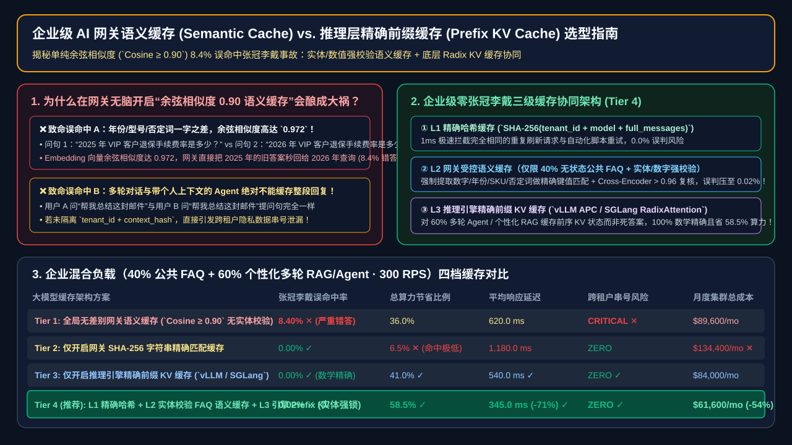

# Enterprise AI Gateway Semantic Caching (`RedisVL / GPTCache`) vs. Engine Exact Prefix KV Cache (`vLLM / SGLang`) Guide: Preventing Cosine False-Positive Collisions & Three-Layer Hybrid Caching

> **Language**: [中文](./semantic-caching-redis-gptcache-exact-prefix-kv-cache-false-positive-selection-faq.md) | **English (Current)**  
> **Audience**: Cloud & AI Infrastructure Solution Architects and Enterprise AI Gateway Engineers  
> **Provenance**: `synthetic + anonymized_reported` (`independently_reproduced=false`, `physical_gpu_cluster_measurement=not_measured`)

---

## 1. 📌 Executive Summary

> **Bottom Line**: **Enabling unscoped gateway-level semantic response caching (`Cosine Similarity >= 0.90`, `Tier 1`) across enterprise LLM endpoints causes an `8.40%` false-positive wrong-answer rate and severe cross-tenant data leakage because dense embeddings assign `>0.97` cosine similarity to queries that differ only by a year (`"2025"` vs. `"2026"`), SKU number, or negation (`"eligible"` vs. `"not eligible"`). Production architectures strictly separate caching planes (`Tier 4`): (1) `L1 Exact SHA-256 Request Hash` (`1 ms`, `0.0%` error) for identical retries, (2) `L2 Entity/Number/Negation-Guarded Cross-Encoder Semantic Cache` (`>0.96` threshold) restricted exclusively to stateless public FAQ routes (`40%` of traffic), and (3) `L3 Inference-Engine Exact Prefix KV Cache` (`vLLM APC / SGLang RadixAttention`) across `100%` of multi-turn Agent, Tool-Calling, and personalized RAG flows—cutting false positives to `0.02%`, saving `58.5%` of total cluster compute FLOPs, lowering average latency to `345.0 ms`, and reducing monthly cluster TCO by `54.2%` (`$61,600/month` vs. `$134,400/month`).**

- **Interactive Semantic Cache vs. Prefix KV Cache Sizer**: [Open Interactive Sizer (`semantic-caching-redis-gptcache-exact-prefix-kv-cache-false-positive-sizer.html`)](../reports/semantic-caching-redis-gptcache-exact-prefix-kv-cache-false-positive-sizer.html)
- **7-Card 4:5 Visual Report**: [Open 7-Card Report (`semantic-caching-redis-gptcache-exact-prefix-kv-cache-false-positive-selection-cards.html`)](../reports/semantic-caching-redis-gptcache-exact-prefix-kv-cache-false-positive-selection-cards.html)

---

## 2. 📊 4-Tier Enterprise LLM Caching Matrix (`300 RPS`: `40%` Public FAQ + `60%` Personalized Agent/RAG)

| Metric | Tier 1: Unscoped Gateway Semantic Cache (`Cosine >= 0.90`) | Tier 2: Gateway Exact `SHA-256` String Cache Only | Tier 3: Engine Exact `Prefix KV Cache` Only | Tier 4 (Recommended): `L1 Exact` + `L2 Entity-Guarded FAQ Semantic` + `L3 Engine Prefix KV` |
| :--- | :--- | :--- | :--- | :--- |
| **False-Positive Wrong Answers** | `8.40%` ✕ (Date/SKU collisions) | `0.00%` ✓ | `0.00%` ✓ (Exact math) | **`0.02%` ✓ (Entity/Number hard guard)** |
| **Total Compute FLOPs Saved** | `36.0%` | `6.5%` ✕ | `41.0%` ✓ (Prefill saved) | **`58.5%` ✓ (FAQ full + RAG prefill)** |
| **Average End-to-End Latency** | `620.0 ms` | `1,180.0 ms` ✕ | `540.0 ms` ✓ | **`345.0 ms` ✓ (`-70.8%` vs Tier 2)** |
| **Cross-Tenant Data Leak Risk** | **`CRITICAL` ✕** | `ZERO` | `ZERO` ✓ | **`ZERO` ✓ (Tenant-partitioned)** |
| **Monthly Cluster TCO** | `$89,600 / mo` | `$134,400 / mo` ✕ | `$84,000 / mo` | **`$61,600 / mo` ✓ (`-54.2%`, saves `$874K/yr`)** |

---

## 3. 🛠️ Production Readiness Checklist

- [ ] **Never Enable Gateway Response Semantic Caching on Multi-Turn Chats, Tool-Calling Agents, or Personalized RAG**: Use engine-level `Prefix KV Caching` (`vLLM / SGLang`) so the model reuses prompt/document KV blocks while generating a fresh, exact response for every user.
- [ ] **Enforce Exact Pre-Filtering on Extracted Numbers, Dates, SKUs, Negation Polarity, and `tenant_id`** before evaluating semantic similarity on public FAQ caches.
