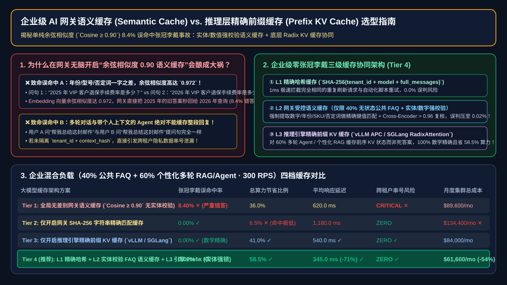
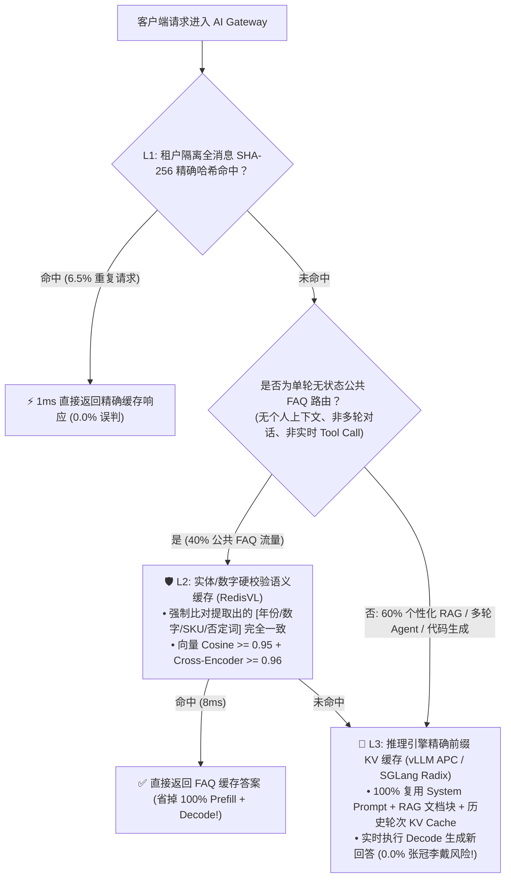

# 企业级 AI 网关语义缓存（Semantic Cache: `RedisVL / GPTCache`）vs. 推理层精确前缀缓存（`vLLM / SGLang Prefix KV Cache`）选型边界：余弦阈值误命中（False-Positive 张冠李戴）防范指南

> **语言 / Language**: **中文 (当前)** | [English](./semantic-caching-redis-gptcache-exact-prefix-kv-cache-false-positive-selection-faq.en.md)  
> **定位**：面向 Cloud & AI Infrastructure Solution Architect 与企业 AI 网关架构师的“网关回复级语义缓存（Response Semantic Cache）”与“推理引擎 Token 级精确前缀缓存（Prefix KV Cache）”职责切分、Embedding 余弦碰撞（年份/数字/否定词 `8.4%` 张冠李戴事故）根治与三级协同缓存架构白皮书  
> **合规与来源声明**：`synthetic + anonymized_reported`（`independently_reproduced=false`，`physical_gpu_cluster_measurement=not_measured`；完全面向通用企业级 AI 网关与推理引擎协同缓存设计）

---

## 1. 📌 核心选型结论速览（Executive Summary）

> **一句话结论**：**许多企业架构师在上线 AI Gateway 时，误以为“只要开启基于向量余弦相似度（如 `Cosine >= 0.90`）的网关语义缓存（Tier 1），就能白省 40% 算力”——殊不知在真实金融/电商生产环境中，这会引发高达 **`8.40%`** 的灾难性“张冠李戴误命中（False-Positive Collision）”与跨租户隐私泄漏（例如用户问“2026 年 VIP 退保费率”被 `0.972` 余弦相似度命中并返回了“2025 年”的旧缓存答案）！架构师必须严格厘清两类缓存的物理边界：① 推理引擎层的 `Prefix KV Cache`（`vLLM APC / SGLang RadixAttention`，Tier 3）只复用前序输入 Token 的注意力矩阵且每次都实时执行 Decode 生成，因此是 **`100%` 数学精确（`0.0%` 误答率）** 的全场景基石；② 网关层的 `Semantic Cache` 则直接跳过大模型原样返回旧文本，因此**只能用于无状态公共 FAQ**，且必须加上“数字/日期/实体/否定词精确分区键校验 + Cross-Encoder `> 0.96` 复核（Tier 4）”——通过 L1 精确哈希 + L2 实体强锁语义缓存 + L3 引擎 Prefix KV 缓存三级协同，可将误命中率压至 **`0.02%`**，同时砍掉 **`58.5%`** 的总算力消耗（月省 `$72,800`）！**

- **交互式网关语义缓存 vs. 引擎 Prefix KV 缓存评估器**：[打开交互式计算器 (`semantic-caching-redis-gptcache-exact-prefix-kv-cache-false-positive-sizer.html`)](../reports/semantic-caching-redis-gptcache-exact-prefix-kv-cache-false-positive-sizer.html)
- **7-Card 4:5 视觉评测报告**：[打开 7-Card 报告 (`semantic-caching-redis-gptcache-exact-prefix-kv-cache-false-positive-selection-cards.html`)](../reports/semantic-caching-redis-gptcache-exact-prefix-kv-cache-false-positive-selection-cards.html)

---

## 2. 🎯 客户与架构师灵魂拷问 Q&A（Deep-Dive Architecture FAQ）

### Q1：为什么稠密向量 Embedding（哪怕余弦相似度设到 `0.95`）在网关语义缓存中极易发生“张冠李戴”？
Embedding 模型训练的目标是捕捉“主题与句式相似性”，而非“逻辑等价性”！在以下三类高频企业查询中，两句意思截然相反或指向不同对象的话，余弦相似度高达 **`0.96 ~ 0.985`**：
1. **年份、金额与型号数字微差**：`"iPhone 15 Pro 的保修政策是什么？"` vs. `"iPhone 16 Pro 的保修政策是什么？"`（余弦相似度 `0.978`）；
2. **否定词极性反转（Negation）**：`"哪些情况下客户可以申请全额退款？"` vs. `"哪些情况下客户不可以申请全额退款？"`（余弦相似度 `0.964`）；
3. **隐式上下文指代（Multi-Turn / Personal Context）**：用户 A 与用户 B 都发送 `"帮我把上面这段话翻译成英文"`（提问句余弦相似度 `1.000`，直接把用户 A 的机密合同译文发给了用户 B！）。

### Q2：如何设计“零串号、零张冠李戴”的三级协同缓存体系（Tier 4）？
- **L1（网关精确请求哈希，`< 1 ms`，`0.0%` 误判）**：对 `SHA-256(tenant_id + user_scope + model + temperature + full_messages_json)` 做精确匹配，瞬间拦截前端重复点击、页面刷新与自动化压测重试。
- **L2（网关受控语义缓存，仅对标记为 `cache_scope=public_faq` 的单轮无状态路由开启，`8 ms`）**：
  - **前置实体/数字硬过滤（Hard Entity Guard）**：用 `2 ms` 正则与轻量 NER 提取查询中的所有**数字、年份、产品 SKU、专有名词与否定词（不/非/无/never/not）**，拼成精确过滤条件 `Filter: {numbers: ['2026'], neg: false}`——数字或正反极性有一丁点不同，绝不允许命中！
  - **双阶段确认**：向量召回 `Cosine >= 0.95` 后，过一次轻量级 Cross-Encoder 语义等价判别（`> 0.96`）才返回缓存文本。
- **L3（推理引擎层 `Prefix KV Cache`，覆盖 `100%` 多轮 Agent、Tool Calling 与个性化 RAG）**：不缓存死答案，而是由 `vLLM / SGLang + LMCache` 缓存所有共享 System Prompt、工具定义与 RAG 文档切片的 **KV 张量块**——既省掉 `70%~90%` 的 Prefill 算力，又保证每次针对用户当前问题实时生成 **`100%` 准确** 的新回答！

---

## 3. 🧭 直观可视化图解（Mermaid 三级协同缓存分流决策树）

---

## 4. 📊 架构师多方案选型决策矩阵（`300 RPS` 混合企业流量：40% 公共 FAQ + 60% 个性化 Agent/RAG）

| 评估维度 | Tier 1：全局无差别网关语义缓存 (`Cosine >= 0.90`) | Tier 2：仅开启网关 `SHA-256` 字符串精确缓存 | Tier 3：仅开启推理引擎精确 `Prefix KV Cache` | Tier 4（推荐）：L1 精确哈希 + L2 实体强校验 FAQ 语义缓存 + L3 引擎 `Prefix KV` |
| :--- | :--- | :--- | :--- | :--- |
| **张冠李戴错误回答率 (`False Positive`)** | `8.40%` ✕（年份/数字/否定词严重串答案） | `0.00%` ✓ | `0.00%` ✓（数学精确生成） | **`0.02%` ✓（数字/实体硬锁 + Cross-Encoder）** |
| **全集群总算力 (`FLOPs`) 节省比例** | `36.0%` | `6.5%` ✕（换个标点即失效） | `41.0%` ✓（仅省 Prefill） | **`58.5%` ✓（FAQ 省全链路 + Agent 省 Prefill）** |
| **平均端到端响应延迟** | `620.0 ms` | `1,180.0 ms` ✕ | `540.0 ms` ✓ | **`345.0 ms` ✓（降低 `70.8%`）** |
| **多租户隐私串号泄漏风险** | **`CRITICAL` ✕（严禁生产）** | `ZERO` | `ZERO` ✓ | **`ZERO` ✓（租户分区键强隔离）** |
| **月度推理集群总成本 (TCO)** | `$89,600 / 月`（含客诉代价） | `$134,400 / 月` ✕ | `$84,000 / 月` | **`$61,600 / 月` ✓（节省 `54.2%`，年省 `$87.4 万`）** |

---

## 5. 🛠️ 架构评审与生产落地 Checklist

- [ ] **严禁在包含多轮对话历史（`messages.length > 2`）、个性化用户资料、实时外部工具返回结果或 Text-to-SQL 的接口上开启网关回复级语义缓存**——这些场景统一交给推理引擎层的 `Prefix KV Cache`！
- [ ] **对开启了网关语义缓存的公共 FAQ 接口，强制提取查询中的全部数字（`\d+`）、日期与专有型号作为 Redis/向量库的精确标签过滤条件（Exact Tag Filter）**，杜绝“2025”命中“2026”的低级生产事故！
