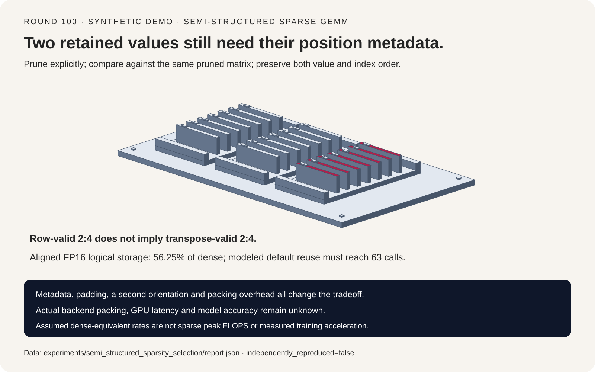
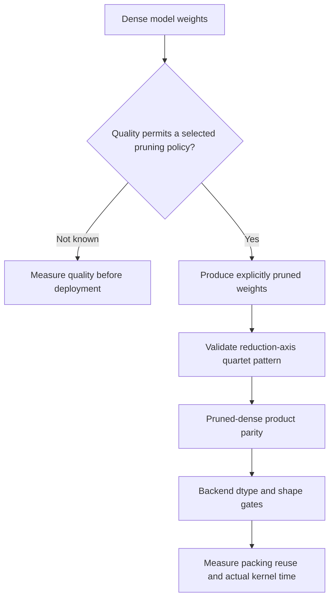
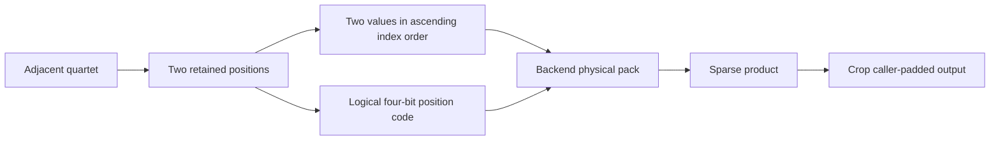
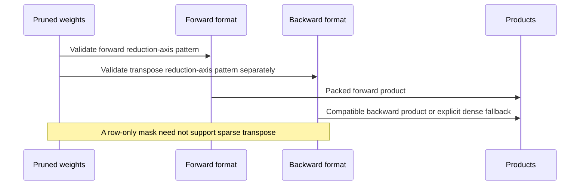

# Semi-structured sparse GEMM FAQ: 2:4 metadata, transpose constraints and reuse

> **Language**: [中文](semi-structured-2-4-sparse-gemm-metadata-selection-faq.md) | English
>
> **Round 100 · 2026-11-14 (ninth round of the November 13 night)** · [SVG](../../assets/svg/semi-structured-2-4-sparse-gemm-metadata-selection-faq-summary.svg) · [7-card report](../reports/semi-structured-2-4-sparse-gemm-metadata-selection-cards.html) · [H5 workbench](../reports/semi-structured-2-4-sparse-gemm-metadata-sizer.html) · [Sealed report](../../experiments/semi_structured_sparsity_selection/report.json)
>
> **Synthetic, `independently_reproduced=false`.** Original logical encoding and scalar products, not PyTorch/CUTLASS/cuSPARSELt/hipSPARSELt execution, physical packed allocations, GPU latency or model accuracy.



## 1. Executive summary: fifty percent zeros do not mean twice the speed

Semi-structured sparsity imposes a **local pattern along the reduction
dimension**, not merely a global zero fraction. For the FP16/BF16 model
here, each adjacent row quartet retains two slots, plus their positions.
Pruning, encoding and accelerated execution are separate decisions.

| Decision | Required evidence | Do not substitute |
| :--- | :--- | :--- |
| Prune weights | Model-quality evaluation | A numerical product test |
| Compress pruned weights | Same-pruned-dense product parity | Original unpruned output |
| Execute sparse GEMM | Compatible dtype/shape/backend and timing | Sparse peak FLOPS |
| Train with sparse weights | Forward/backward pattern and layout plan | Blind transpose of a row mask |

The original `4 × 8` fixture's packed product exactly matches its row-pruned
dense reference. Swapping the two logical metadata indices while keeping
values fixed produces maximum error `6.4`. Pruning itself changes the
original dense output by `0.96`; that is an intentional operator change,
not an encoding failure or a model-accuracy score.

Pinned [PyTorch source](https://github.com/pytorch/pytorch/blob/5a7eae40861f6b8cc9ec71d3bc0e61f17a6568fa/torch/sparse/semi_structured.py)
includes an August 13, 2026 ROCm FP8 FNUZ support change. That is concrete
capability context, not a local accelerator result or a same-day popularity
claim. This workbench deliberately models only FP16/BF16.

## 2. Architect Q&A: what does a valid compressed matrix preserve?

### Q1: Is compression allowed to silently prune a dense matrix?

Our logical packer requires at most two nonzeros per adjacent quartet.
Pruning is an explicit preceding operation. Two slots are stored even
when a retained slot is zero. Ties in row pruning use a deterministic
lower-index preference; this is an original fixture policy.

The source exposes conversion and a separate `prune_dense_static_sort`
path. Its shape validator checks device/dimensions/contiguity/dtype/shape;
do not infer a comprehensive pattern validator from that routine alone.
Nor should this toy's explicit rejection policy be mistaken for an exact
description of every native compression kernel's invalid-pattern behavior.

Correctness is tested against **the same pruned matrix**. Choosing the
mask may still require retraining, calibration or quality assessment,
none of which is performed here.

### Q2: How much metadata is needed for two retained positions?

For ascending positions `i0<i1` in a quartet:

```text
logical_code = i0 | (i1 << 2)
stored_values = [weight[i0], weight[i1]]
```

Six valid position pairs yield logical nibble codes
`4,8,9,12,13,14`. Four metadata bits plus two FP16 values use 36 bits
versus 64 dense bits: **56.25%**, not 50%.

The inspected conversion code documents these logical positions and then
reorders/swizzles metadata for its backend. Our nibble list is not that
physical representation. Actual backend packed bytes remain null.
FP32's pinned CUTLASS conversion takes a different **1:2** branch; the
FP16/BF16 formula must not be generalized to it.

### Q3: Why can a valid row mask fail after transpose?

All rows in the fixture retain the first two positions of each quartet.
The first transposed row then contains four nonzeros in one quartet,
violating the chosen row constraint. Packing the original orientation
does not make the transpose eligible.

The source's tile-pruning training path enforces row/column constraints
and stores separate packed orientations. The original toy uses its own
greedy `4 × 4` capacity-constrained policy to illustrate this tradeoff.
It preserves both direction checks, but changes output by `4.575`
relative to row-only pruning.

That is another pruning policy, not source algorithm parity or a quality
improvement. Dense `Wᵀ*dY` remains a valid mathematical backward, checked
against all 24 input-coordinate finite differences; the hardware sparse
eligibility of that backward is a separate question.

### Q4: Are dtype and shape constraints the same across backends?

No. At the pinned FP16/BF16 sparse-weight configuration:

| Backend | Weight rows M | Reduction columns K |
| :--- | :--- | :--- |
| CUTLASS | Multiple of 32 | Multiple of 64 |
| cuSPARSELt | Multiple of 16 | Multiple of 16 |

The source rejects incompatible sparse weight shapes; it does not
automatically pad them in this conversion path. The calculator explicitly
assumes caller-side zero padding, output cropping and dense-operand
columns `N` aligned to eight. This models an isolated linear product,
not arbitrary full-model padding semantics.

Each orientation is padded independently for its selected backend.
For original `M=33,K=65`, CUTLASS forward shape is `[64,128]`, whereas
the transpose pack is `[96,64]`. Reusing one orientation's shape formula
for the other would miscount bytes.

FP8 needs scaled operations and additional backend/hardware/output-dtype
checks. A dtype entry in a configuration table does not certify every
GPU. PyTorch's CUDA-facing device interface also serves ROCm; its
`is_cuda` gate must not be read as proof that the class excludes HIP.

### Q5: How many calls amortize packing?

Let `P` be one-time packing cost and `Td,Ts` per-call dense/sparse costs:

```text
reuse * Td > P + reuse * Ts
if Td <= Ts: no strict break-even for nonnegative P
otherwise: smallest integer reuse strictly exceeding P/(Td-Ts)
```

The calculator assumes dense 500 and sparse 800 **dense-equivalent effective**
TFLOP/s, five-microsecond launch and `P=0.2 ms`. It never adds another
factor of two from marketing sparse peak FLOPS.

For aligned `4096 × 4096` weights and 128 tokens, the modeled strict
threshold is 63 calls; 62 does not save time. At one token, padding the
sparse operand to eight columns makes the sparse path slower and the
threshold stays **null**. These rates and costs are assumptions, not
hardware observations.

## 3. Visual architecture: selection, format and orientation lifecycle







## 4. Selection matrix and metadata/padding boundaries

| Workload property | Evaluate | Excluded inference |
| :--- | :--- | :--- |
| Reused inference weights | One-time packing plus actual kernel benefit | Zeros alone imply speed |
| Small token count | Launch and dense-operand padding | Peak sparse throughput is achievable |
| Unaligned dimensions | Padded shapes and original-byte ratio | Compression always shrinks original storage |
| Sparse training | Both directions, mask and optimizer lifecycle | Forward-only packing is sufficient |
| New dtype/platform | Exact backend/version/API | FP16 formula certifies FP8 or FP32 |

For aligned FP16/BF16 weight shape `M*K`:

```text
retained value bytes = M*K
logical metadata bytes = M*K/8
logical forward packed bytes = 9*M*K/8
original dense bytes = 2*M*K
```

Default `4096 × 4096` weights:

| Selected allocation | Bytes |
| :--- | ---: |
| Dense weights | `33,554,432` |
| Retained values | `16,777,216` |
| Logical metadata | `2,097,152` |
| One logical orientation | `18,874,368` |
| Both logical orientations | `37,748,736` |

Both orientation packs already exceed original dense weight bytes before
adding masks or optimizer state. This is not a peak-memory comparison:
physical backend layout, actual allocation, activations and training
lifetimes are unmeasured.

## 5. Worked evaluation and seven-card report

| Case | Maximum product difference | Interpretation |
| :--- | ---: | :--- |
| Logical packed product | `0` | Same row-pruned dense reference |
| Reverse metadata index order | `6.4` | Wrong value/position identity |
| Pruned versus original | `0.96` | Intentional pruning difference |
| Bidirectional packed product | `0` | Same bidirectionally pruned reference |
| Bidirectional versus row mask | `4.575` | Different pruning policy |

Card 6 uses sealed analytical data across 1/8/128/1024 tokens.
Under the stated assumptions, strict reuse thresholds are
`null / 994 / 63 / 8`. At default reuse 64, dense total is
`0.869755813888 ms`, while sparse kernel calls plus one-time packing
total `0.863597383680 ms`. That small modeled difference is not a
measured speedup or a claim that real training is accelerated.

The seven-card report distinguishes numerical gates, pruning quality,
logical storage and assumed timings. Its original sorter SVG represents
retained values and their position cards, not literal accelerator
hardware. H5 has bilingual inputs and explicit errors. Browser visual
verification was not performed; the previous refusal remains respected.

## 6. Reproduction, provenance and readiness boundaries

```powershell
python -m experiments.semi_structured_sparsity_selection.run
python -m experiments.semi_structured_sparsity_selection.run --check
python -m unittest tests.test_semi_structured_sparsity_selection
python scripts\validate_research.py
```

Eight tests cover explicit pruning, all six codes and zero fillers,
packed products plus dense backward finite differences, transpose
constraints, independent orientation padding, strict reuse boundaries,
invalid inputs, sealed CSP/SVG outputs and Python/Node formula parity.
The scalar product includes validation and is not a sparse-performance
implementation.

First-party references:
[sparse classes](https://github.com/pytorch/pytorch/blob/5a7eae40861f6b8cc9ec71d3bc0e61f17a6568fa/torch/sparse/semi_structured.py),
[conversion code](https://github.com/pytorch/pytorch/blob/5a7eae40861f6b8cc9ec71d3bc0e61f17a6568fa/torch/sparse/_semi_structured_conversions.py)
and [upstream LICENSE](https://github.com/pytorch/pytorch/blob/5a7eae40861f6b8cc9ec71d3bc0e61f17a6568fa/LICENSE).
GitHub license metadata returned `NOASSERTION`; no single SPDX identifier
is asserted here. No implementation or model weights were copied.
Cards use `default-src 'none'; style-src 'unsafe-inline'`, without
external fonts, scripts or requests.

**Ready for:** reviewing masks, metadata identity, shape assumptions and
reuse boundaries. **Not ready for:** choosing production pruning masks,
certifying a GPU/backend combination, or predicting model quality and
end-to-end acceleration.
