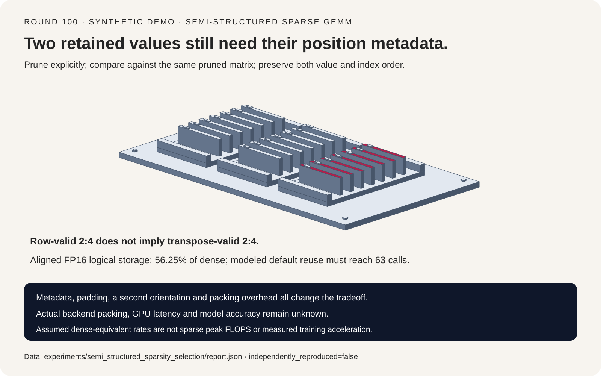
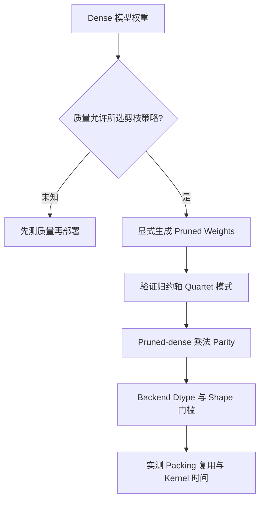
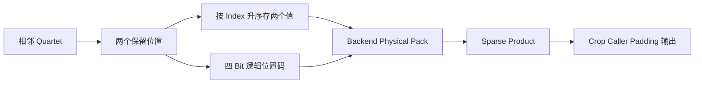
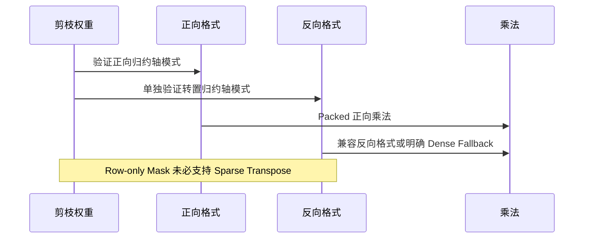

# 半结构化稀疏 GEMM 选型 FAQ：2:4 Metadata、转置约束与复用门槛

> **语言**：中文 | [English](semi-structured-2-4-sparse-gemm-metadata-selection-faq.en.md)
>
> **Round 100 · 2026-11-14（11 月 13 日夜班第九轮）** · [SVG](../../assets/svg/semi-structured-2-4-sparse-gemm-metadata-selection-faq-summary.svg) · [七卡报告](../reports/semi-structured-2-4-sparse-gemm-metadata-selection-cards.html) · [H5 工作台](../reports/semi-structured-2-4-sparse-gemm-metadata-sizer.html) · [封存数据](../../experiments/semi_structured_sparsity_selection/report.json)
>
> **Synthetic，`independently_reproduced=false`。** 原创逻辑编码与标量乘法，不执行 PyTorch/CUTLASS/cuSPARSELt/hipSPARSELt，不含物理 packed allocation、GPU 延迟或模型准确率实测。



## 一、先说结论：一半零值不等于两倍速度

半结构化稀疏要求 **归约维度上的局部模式**，不是全局零值比例。本轮
FP16/BF16 模型每个相邻 row quartet 保留两个 slot，并记录位置。
剪枝、编码、加速执行必须分开决策。

| 决策 | 必需证据 | 不可替代为 |
| :--- | :--- | :--- |
| 剪枝权重 | 模型质量评估 | 一次乘法正确性测试 |
| 压缩剪枝结果 | 对同一 pruned-dense 参照 | 对原始未剪枝结果 |
| 稀疏 GEMM 执行 | Dtype/shape/backend 与实测 | Sparse peak FLOPS |
| 稀疏训练 | 正反向模式与布局规划 | 直接转置 row mask |

原创 `4 × 8` fixture 的 packed product 与其 row-pruned dense 完全一致；
保留值不变、反转 metadata 的两个位置，最大输出误差 `6.4`。
剪枝本身使原 dense 输出改变 `0.96`，这是有意算子变化，不是编码失败
或模型准确率。

[PyTorch 固定源码](https://github.com/pytorch/pytorch/blob/5a7eae40861f6b8cc9ec71d3bc0e61f17a6568fa/torch/sparse/semi_structured.py)
含 2026-08-13 ROCm FP8 FNUZ 支持变更；这是具体能力背景，不是本机
GPU 结果，也不包装成当日热度。本工作台刻意只预算 FP16/BF16。

## 二、架构师 Q&A：一个有效压缩矩阵必须保留什么？

### Q1：Compression 能默默替 Dense 做剪枝吗？

本逻辑 packer 要求每相邻 quartet 至多两个非零，剪枝显式在前。
即使某保留值为零，仍存两个 slot；tie 按较低 index 决胜，是原创
fixture 策略。

源码有 conversion 与独立 `prune_dense_static_sort` 路径。Shape
validator 检查 device、dim、contiguity、dtype、shape，不能据此推断
它完整验证了非零模式；也不能把本 toy 的显式拒绝行为说成每个 native
compress kernel 对非法模式的精确语义。

乘法正确性以 **同一剪枝矩阵** 为参照。选 mask 可能需要重训、校准、
质量测试，本轮没有进行。

### Q2：两个保留位置需要多少 Metadata？

对 `i0<i1`：

```text
logical_code = i0 | (i1 << 2)
stored_values = [weight[i0], weight[i1]]
```

六种位置组合对应 nibble `4,8,9,12,13,14`。两个 FP16 值加四个 metadata
bits，共 36 bits，对原 64 bits 是 **56.25%**，不是 50%。

阅读的 conversion 先定义逻辑位置，再进行 backend reorder/swizzle。
本 nibble list 不是其物理格式；actual packed bytes 保持 null。
固定 CUTLASS FP32 分支采用 **1:2**，不能套用 FP16/BF16 公式。

### Q3：为什么 Row-valid Mask 转置后可能无效？

Fixture 每行保留 quartet 的前两个位置；转置后第一行一个 quartet 内
有四个非零，违反所选 row 约束。正向 pack 不代表转置自动可用。

上游 tile-pruning 训练路径保持行列约束并存两方向 packed 数据。
原创 toy 用自己的 greedy `4 × 4` capacity policy 示意：两方向都有效，
但与 row-only 结果相差 `4.575`。这是另一剪枝策略，不是源码算法复现
或质量提高。

数学上 dense `Wᵀ*dY` 仍有效，本轮通过全部 24 个输入坐标有限差分；
该 backward 是否能用硬件 sparse kernel 是另一个问题。

### Q4：不同 Backend 的 Dtype/Shape 约束一样吗？

不一样。固定 FP16/BF16 sparse-weight 配置：

| Backend | Weight rows M | 归约 columns K |
| :--- | :--- | :--- |
| CUTLASS | 32 的倍数 | 64 的倍数 |
| cuSPARSELt | 16 的倍数 | 16 的倍数 |

该 conversion 拒绝不兼容 sparse weight shape，不自动 pad。
计算器显式假设 caller zero-padding、输出 cropping、dense operand
的 `N` 按八对齐；只模型化孤立线性乘法，不推导完整模型 padding 语义。

两方向单独对齐。原 `M=33,K=65` 时，CUTLASS 正向为 `[64,128]`，
transpose pack 为 `[96,64]`，不能共用一个方向的 shape 公式。

FP8 需 scaled operations 及额外 backend/hardware/output dtype 检查；
dtype 表有一项，不等于所有 GPU 都支持。PyTorch CUDA-facing 接口也
服务 ROCm，不能将 `is_cuda` 条件误读成排除 HIP。

### Q5：复用多少次才能摊薄压缩成本？

```text
reuse * Td > P + reuse * Ts
若 Td <= Ts：非负 P 下没有严格 break-even
否则：取严格大于 P/(Td-Ts) 的最小整数 reuse
```

假设 dense 500、sparse 800 **原稠密等效有效 TFLOP/s**，启动五微秒、
一次 pack `0.2 ms`。不再从营销 sparse peak 额外乘二。

对齐的 `4096 × 4096`、128 tokens 时门槛 63 次；62 次不节省。
单 token 下 sparse padding 到八列，反而更慢，门槛保留 **null**。
这些算力、时间均为假设，不是硬件观测。

## 三、可视化架构：选型、格式与方向生命周期







## 四、选型矩阵与 Metadata/Padding 预算

| 场景 | 应评估 | 不可推断 |
| :--- | :--- | :--- |
| 反复使用推理权重 | 一次 pack 加真实 kernel 获益 | 有零值就加速 |
| 小 token 数 | Launch 与 dense operand padding | 可达到 peak sparse throughput |
| 未对齐维度 | Pad 后 shape、相对原始 bytes | 压缩必然更小 |
| 稀疏训练 | 两方向、mask、optimizer 生命周期 | 只存 forward pack 足够 |
| 新 dtype/platform | 精确 backend/version/API | FP16 公式认证 FP8/FP32 |

对已对齐 FP16/BF16 `M*K`：

```text
retained value bytes = M*K
logical metadata bytes = M*K/8
logical forward packed bytes = 9*M*K/8
original dense bytes = 2*M*K
```

默认 `4096 × 4096`：

| 选定分配 | Bytes |
| :--- | ---: |
| Dense weights | `33,554,432` |
| Retained values | `16,777,216` |
| Logical metadata | `2,097,152` |
| 单方向 logical pack | `18,874,368` |
| 两方向 logical packs | `37,748,736` |

两方向已超过原 dense weight bytes，还没算 mask/optimizer。
不是 peak-memory 对比；物理 backend layout、实际分配、activation 与
训练生命周期均未测。

## 五、可复现实例与七卡报告

| Case | 最大 Product 差异 | 解释 |
| :--- | ---: | :--- |
| Logical packed product | `0` | 同一 row-pruned dense |
| 反转 metadata index 顺序 | `6.4` | 值/位置身份错误 |
| 剪枝对原始 | `0.96` | 有意剪枝变化 |
| 双向策略 packed product | `0` | 同一双向剪枝 dense |
| 双向策略对 row mask | `4.575` | 策略不同 |

第六卡以封存的解析数据比较 1/8/128/1024 tokens；所述假设下严格复用
门槛为 `null / 994 / 63 / 8`。默认复用 64 次，dense 总时间
`0.869755813888 ms`，sparse kernel 加一次 pack 为
`0.863597383680 ms`。微小模型差异不是实测 speedup，更不证明真实训练
加速；median/repeats 不适用。

七卡分开数值门槛、剪枝质量、逻辑存储与假设时间。原创分拣机中的卡片
表示保留值和位置，不是字面加速器硬件。H5 双语字段、显式报错；
此前浏览器拒绝仍被遵守，未做浏览器视觉验收。

## 六、复现、来源与生产就绪边界

```powershell
python -m experiments.semi_structured_sparsity_selection.run
python -m experiments.semi_structured_sparsity_selection.run --check
python -m unittest tests.test_semi_structured_sparsity_selection
python scripts\validate_research.py
```

八项测试覆盖显式剪枝、全部六种编码/零 slot、packed product 与 dense
backward 有限差分、转置约束、两方向 padding、严格复用边界、非法输入、
封存 CSP/SVG 与 Python/Node parity。标量乘法含校验，不是稀疏性能实现。

一手引用：[Sparse Classes](https://github.com/pytorch/pytorch/blob/5a7eae40861f6b8cc9ec71d3bc0e61f17a6568fa/torch/sparse/semi_structured.py)、
[Conversion](https://github.com/pytorch/pytorch/blob/5a7eae40861f6b8cc9ec71d3bc0e61f17a6568fa/torch/sparse/_semi_structured_conversions.py)
与 [上游 LICENSE](https://github.com/pytorch/pytorch/blob/5a7eae40861f6b8cc9ec71d3bc0e61f17a6568fa/LICENSE)。
GitHub license metadata 返回 `NOASSERTION`，不擅自确认单一 SPDX；
未复制实现或模型权重。七卡 CSP
`default-src 'none'; style-src 'unsafe-inline'`，无外部字体、脚本或请求。

**适用**：检查 mask、metadata 身份、shape 假设与复用门槛。
**不适用**：替真实模型选择生产 mask、认证 GPU/backend，或预测模型
质量与端到端加速。
