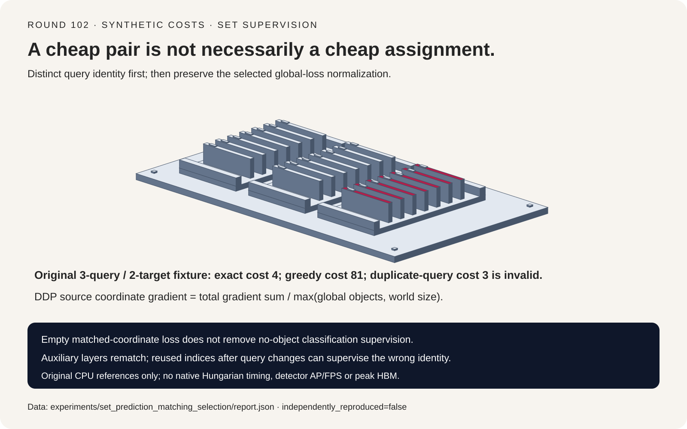
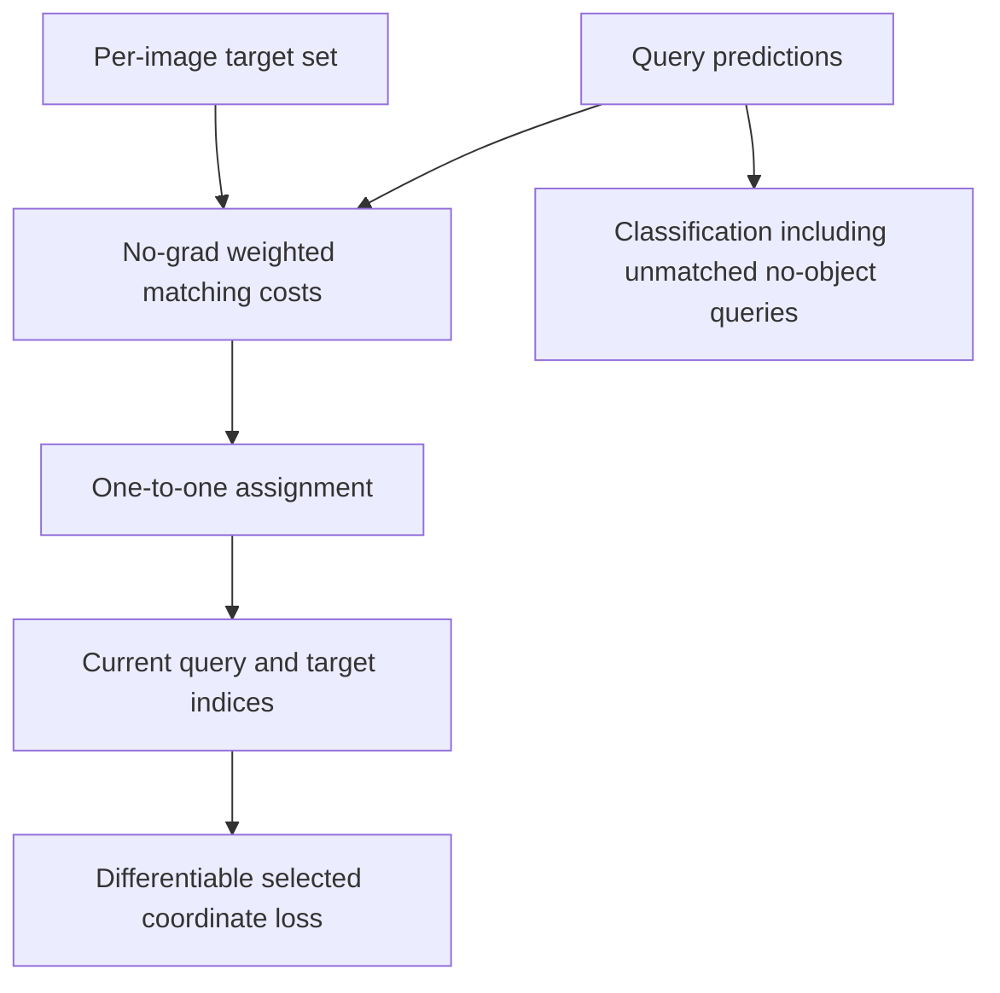
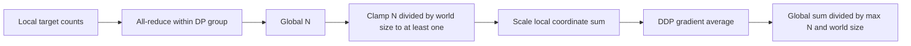
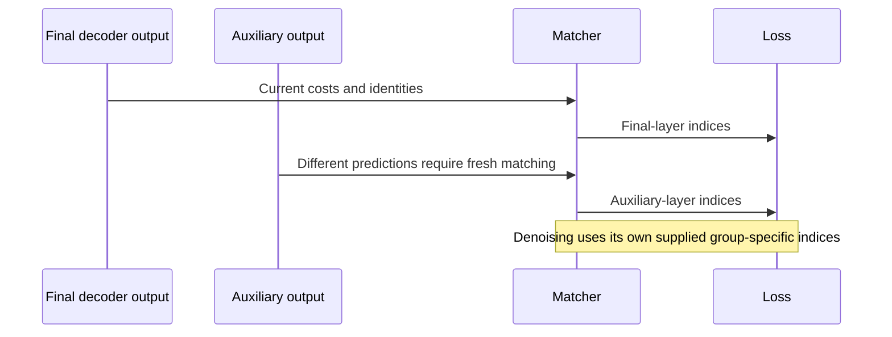

# Set-prediction FAQ: one-to-one matching, detached indices and global normalization

> **Language**: [中文](set-prediction-hungarian-matching-global-normalization-selection-faq.md) | English
>
> **Round 102 · 2026-11-14 (eleventh round of the November 13 night)** · [SVG](../../assets/svg/set-prediction-hungarian-matching-global-normalization-selection-faq-summary.svg) · [7-card report](../reports/set-prediction-hungarian-matching-global-normalization-selection-cards.html) · [H5 workbench](../reports/set-prediction-hungarian-matching-global-normalization-sizer.html) · [Sealed report](../../experiments/set_prediction_matching_selection/report.json)
>
> **Synthetic, `independently_reproduced=false`.** Timing alone measures original CPU reference functions. No detector execution, native SciPy/Hungarian benchmark, focal/GIoU reproduction, AP/FPS or accelerator result.



## 1. Executive summary: a cheap pair does not make a cheap assignment

Set-prediction training supervises an unordered target set against a
larger set of query predictions. One-to-one matching establishes which
prediction receives which target, before a separate differentiable loss.

In the original three-query/two-target cost matrix:

```text
             target 0   target 1
query 0          1          2
query 1          2        100
query 2         80         80
```

The global optimum assigns query 1 to target 0 and query 0 to target 1,
cost **4**. Greedily selecting the cheapest available pair first costs
**81**. Independent per-target argmin appears to cost 3 but assigns query
0 twice: it is infeasible.

| Contract | Must preserve | Does not establish |
| :--- | :--- | :--- |
| Matching | Distinct query and target identities | Detection quality |
| Supervision | Fresh indices for current predictions | A gradient through discrete matching |
| Distributed coordinate loss | Global count, DDP averaging and clamp | Same formula for every classification loss |
| Runtime budget | Actual tensor construction and lifetimes | Peak HBM from final cost bytes |

This is established architecture. The pinned RT-DETR PyTorch source dates
to August 2023; it is not presented as a new release or daily popularity
ranking. Its no-grad matcher combines weighted class, L1 and negative
GIoU costs and calls CPU SciPy `linear_sum_assignment`. The original
exhaustive and subset-DP references here are **not Hungarian algorithm
implementations**.

## 2. Architect Q&A: what can go wrong after matching succeeds?

### Q1: Is a monotonic per-pair cost transformation harmless?

Not for sums over assignments. The source's non-focal classification
cost is negative probability, not negative log probability. Its focal
branch has a separate positive-minus-negative cost.

For two target classes, use query probabilities
`[.60,.39]` and `[.30,.15]`; remaining no-object probabilities are `.01`
and `.55`. Negative-probability matching chooses the diagonal:
`-.60-.15=-.75`, better than the off-diagonal `-.69`.
Negative-log matching instead prefers the off-diagonal product
`.39*.30=.117` over `.60*.15=.09`.

Both objectives are well-defined, but replacing one with the other is
an intentional objective change, not a numerically equivalent refactor.
Matching weights also need not equal final training-loss weights.

### Q2: Why does the source mark matching as no-grad?

Assignment indices are a discrete routing decision. The selected
predictions then receive differentiable losses. Within a region where
the optimum is unique and unchanged, ordinary derivatives of the
selected loss can be checked without differentiating the solver.

The original scalar example uses predictions `[0,2,9]`, targets `[1,0]`,
squared matching costs and half-squared supervised loss. It gives loss
`.5` and query gradient `[0,1,0]`. All three central finite differences
agree within `6.56e-12`.

This is not L1/GIoU/focal parity, nor a smoothness claim at assignment
ties. Unmatched query 2 has zero **coordinate** gradient here; real
source classification still supervises unmatched queries as no-object.

### Q3: Can indices be reused after query ordering changes?

Only if their identities are remapped correctly. Reordering predictions
to `[9,0,2]` and rematching preserves loss `.5`; restoring query order
also preserves `[0,1,0]`. Reusing stale indices changes loss to `41`
and restored gradient to `[-1,0,9]`.

Reversing the target list likewise preserves the unique-optimum scalar
loss and gradient after fresh matching. Equal-cost ties need not preserve
the same individual identities or a different downstream objective.

The pinned criterion rematches each auxiliary decoder output. Its
denoising branch uses supplied group-specific indices and scales its
normalizer by the number of groups. Those branches must not be collapsed
into blind final-layer index reuse.

### Q4: Why divide global target count by world size before DDP?

For matched-coordinate gradient sums `g_r`, counts `n_r`, `P` ranks and
`N=sum(n_r)`, the pinned source uses:

```text
D = max(N / P, 1)
rank r loss = local matched-coordinate sum / D
DDP average gradient = sum(g_r) / (P*D)
                     = sum(g_r) / max(N,P)
```

Counts `[1,3,0]` and gradient sums `[2,18,0]` yield **5**.
Rank-local division followed by DDP averaging yields `8/3`.
Dividing each rank by global N without world compensation yields `5/3`.
An empty rank still participates in synchronization and averaging.

The clamp matters: at `N=1,P=4`, sums `[2,0,0,0]` produce `.5`,
not the unconstrained object mean 2. This is the source policy, not
automatically an implementation bug. At N=0, matched-coordinate sums
are zero and remain finite; background classification need not vanish.

### Q5: Does every criterion use that same denominator?

No. The inspected ordinary weighted cross-entropy uses its own reduction.
Box L1/GIoU and the other selected classification branches have different
code paths. This scalar derivation specifically models summed
matched-coordinate terms and DDP gradient averaging.

It does not certify FSDP/custom reducers, gradient accumulation with
different logical-batch semantics, or a full detector loss. The actual
count collective must use the same data-parallel group as the assumed
gradient reducer.

## 3. Visual architecture: assignment, supervision and count reduction







## 4. Selection matrix and raw cost-array boundaries

| Situation | Check | Do not assume |
| :--- | :--- | :--- |
| More queries than targets | Exact one-to-one target coverage | Independent argmin is sufficient |
| Fewer queries than targets | Explicit coverage policy | This toy models partial supervision |
| Query/target permutation | Identity-consistent rematching | Old integer indices retain meaning |
| Uneven rank counts | Count/reducer group and clamp | Average local means equals global mean |
| Large batches/aux layers | Cost layout and recomputation | Final tensor bytes equal peak memory |

The source flattens predictions to `B*Q` and concatenates all targets.
With uniform T targets per image it constructs `B²*Q*T` costs, then
selects **same-image blocks**. That does not mean cross-image matching.
An independent per-image-block budget would contain only `B*Q*T`
elements; no such optimization is implemented or benchmarked here.

Default `B=8,Q=300,T=40,cost_bytes=4,auxiliary_layers=5`:

| Logical final-cost payload | Bytes |
| :--- | ---: |
| Same-image blocks only | `384,000` |
| Flattened cross-image-sized tensor | `3,072,000` |
| Six final-cost payloads across main/aux passes | `18,432,000` |

The last row counts aggregate logical payload across passes, **not
simultaneous allocation or observed DRAM traffic**. Component class/L1/
GIoU arrays, CPU copies, solver conversion, model activations, lifetime
overlap and denoising are excluded. Peak HBM and latency remain null.
Zero targets produce zero final-cost payload but not zero model work.

## 5. Worked evaluation and seven-card report

The report keeps abstract costs, scalar gradients and normalization
fixtures separate. Switching cost objectives is labeled intentional;
greedy suboptimality, duplicate queries, stale identities and wrong
normalizers are explicit controls against their selected references.

Sealed original CPU timings include validation, two warmups and seven
alternating repeats:

| Queries × targets | Subset-DP median ms | Exhaustive median ms |
| :--- | ---: | ---: |
| 4 × 2 | `.0105` | `.0093` |
| 5 × 3 | `.0265` | `.0422` |
| 6 × 4 | `.0755` | `.2740` |
| 7 × 5 | `.2044` | `2.1875` |

Windows ARM64, Python 3.12.10; CPU identity is recorded in `latency.json`.
The smallest DP case is slower, not automatically a speedup. Both toy
references are exponential; these timings do not characterize SciPy's
production assignment algorithm, GPU synchronization or detector FPS.

Seven-card coordinates derive from sealed costs/timings; missing AP and
GPU metrics stay null. The original card-sorter drawing illustrates
distinct query ownership, not literal detector hardware. Browser visual
verification was not performed; the earlier refusal remains respected.

## 6. Reproduction, provenance and readiness boundaries

```powershell
python -m experiments.set_prediction_matching_selection.run
python -m experiments.set_prediction_matching_selection.run --check
python -m unittest tests.test_set_prediction_matching_selection
python scripts\validate_research.py
```

Only explicit `--measure` replaces CPU samples; `--check` loads them
without remeasurement. Eight tests cover independent rectangular solvers,
empty/negative/tied costs, greedy and duplicate-query controls,
permutation identity, finite differences in a unique region, cost-objective
changes, DDP/clamp/empty ranks, array bounds, Python/Node parity, sealed
sample medians and script-free CSP/SVG.

First-party references:
[matcher](https://github.com/lyuwenyu/RT-DETR/blob/a4a0c6a3ea2ae7bd5d232c19486a7ebd9702f19c/rtdetr_pytorch/src/zoo/rtdetr/matcher.py),
[criterion](https://github.com/lyuwenyu/RT-DETR/blob/a4a0c6a3ea2ae7bd5d232c19486a7ebd9702f19c/rtdetr_pytorch/src/zoo/rtdetr/rtdetr_criterion.py),
[Apache-2.0 license](https://github.com/lyuwenyu/RT-DETR/blob/a4a0c6a3ea2ae7bd5d232c19486a7ebd9702f19c/LICENSE).
Upstream rights remain with their holders; no detector implementation
or weights were copied. Cards have no scripts/network resources and use
`default-src 'none'; style-src 'unsafe-inline'`.

**Ready for:** reviewing matching identities and distributed
matched-coordinate loss semantics. **Not ready for:** choosing production
detectors, reproducing focal/GIoU/denoising quality, or predicting AP,
FPS, native solver timing and peak accelerator memory.
