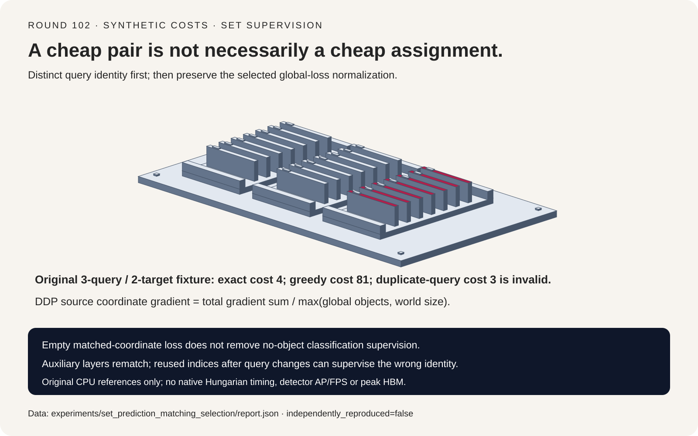
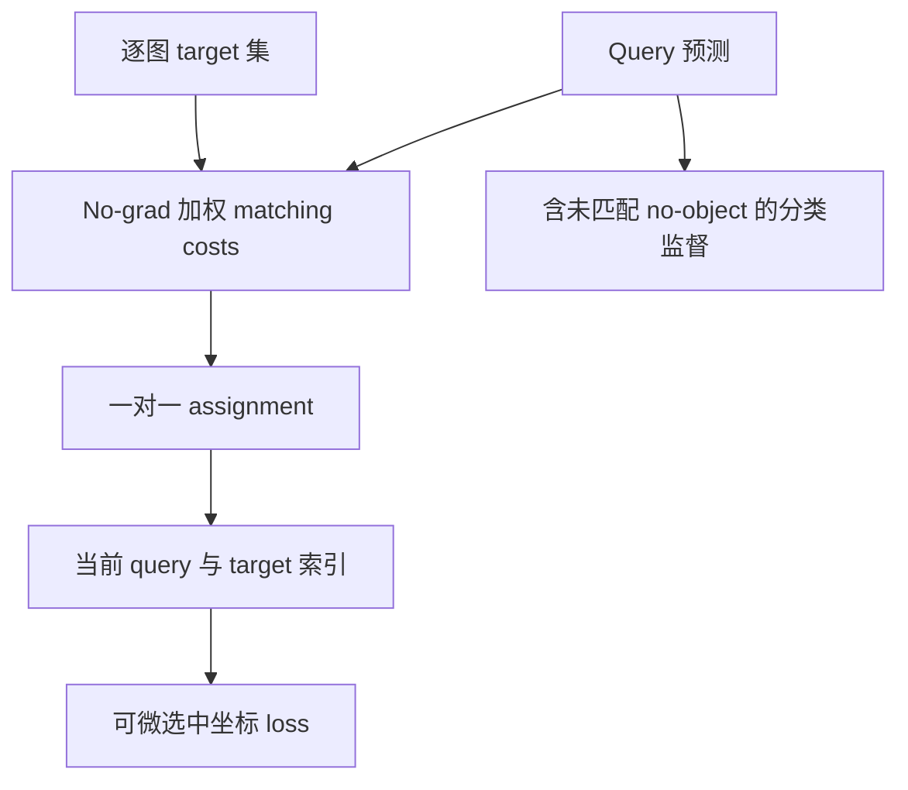
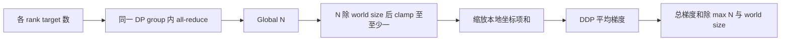
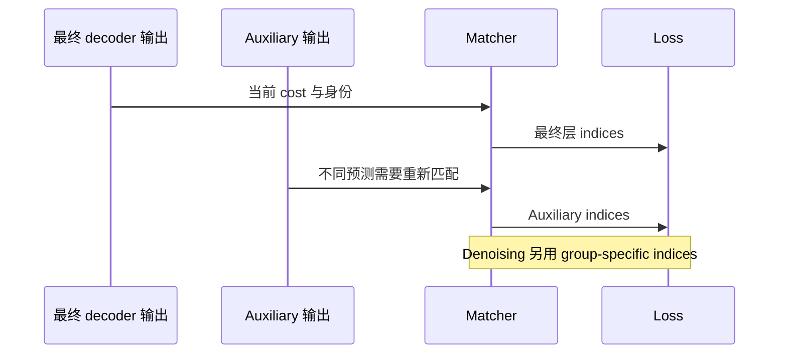

# 集合预测选型 FAQ：一对一匹配、Detached 索引与全局分母

> **语言**：中文 | [English](set-prediction-hungarian-matching-global-normalization-selection-faq.en.md)
>
> **Round 102 · 2026-11-14（11 月 13 日夜班第十一轮）** · [高清 SVG](../../assets/svg/set-prediction-hungarian-matching-global-normalization-selection-faq-summary.svg) · [七卡报告](../reports/set-prediction-hungarian-matching-global-normalization-selection-cards.html) · [H5 工作台](../reports/set-prediction-hungarian-matching-global-normalization-sizer.html) · [封存数据](../../experiments/set_prediction_matching_selection/report.json)
>
> **Synthetic，`independently_reproduced=false`。** 仅 timing 是原创 CPU 参照函数实测；没有运行检测模型、原生 SciPy/Hungarian、focal/GIoU，不含 AP/FPS 或加速器结论。



## 1. 执行摘要：最便宜的一对不一定产生最便宜的匹配

集合预测用无序 target 集监督更多 query 预测。一对一匹配先确定每个
target 归属哪个 query，再进入可微监督；它不是逐项独立 argmin。

原创三 query、两 target 矩阵：

```text
             target 0   target 1
query 0          1          2
query 1          2        100
query 2         80         80
```

最优解为 target 0→query 1、target 1→query 0，总 cost **4**。
先抢最便宜 pair 的 greedy 得到 **81**。逐 target 独立 argmin 看似
cost=3，却把 query 0 占用两次，属于非法解而不是优化。

| 契约 | 必须保留 | 不能证明 |
| :--- | :--- | :--- |
| Matching | Query 与 target 的一对一身份 | 检测质量 |
| Supervision | 对应当前预测的 fresh indices | 对离散 solver 求导 |
| 分布式坐标 loss | Global count、DDP average 与 clamp | 所有分类 loss 共用分母 |
| Runtime budget | 实际 cost 构造和 lifetime | 最终 cost 字节等于 peak HBM |

本轮研究成熟机制；固定 RT-DETR PyTorch 源码来自 2023 年 8 月，
不冒充当日新品或热度排名。其 no-grad matcher 组合 class、L1、
negative GIoU cost，并调用 CPU SciPy `linear_sum_assignment`。
本轮原创穷举与 subset DP 是独立参照，**并非 Hungarian 算法实现**。

## 2. 架构师 Q&A：匹配正确后，监督还会错在哪里？

### Q1：对每个 Pair 做单调 cost 变换，结果一定相同吗？

不一定，优化的是 assignment 的 cost 总和。源码 non-focal 分类 cost
使用负概率，不是负对数概率；focal 分支另有 positive-minus-negative
公式。

两目标类别概率取 query 0 `[.60,.39]`、query 1 `[.30,.15]`，剩余
no-object 概率分别 `.01`、`.55`。负概率偏好对角线 `-.75` 而非
非对角线 `-.69`；负 log 则偏好非对角线概率乘积 `.39*.30=.117`，
大于对角线 `.60*.15=.09`。

两种目标均可定义，但互换属于有意改变 objective，不是等价重构。
Matching weights 也不必等于最终训练 loss weights。

### Q2：为什么 Matcher 标记为 no-grad？

Assignment indices 是离散路由；选中的预测再进入可微 loss。只要处于
唯一最优匹配保持不变的区域，可以验证选中分支的普通梯度，而不是对
离散 solver 强行求导。

原创标量例子为 predictions `[0,2,9]`、targets `[1,0]`，采用平方
matching cost 和 half-squared 监督 loss，得到 loss `.5`、query
gradient `[0,1,0]`。三个 central finite differences 最大误差
`6.56e-12` 以内。

这不是 L1/GIoU/focal 一致性，也不声称 tie 点可微。未匹配 query 2
的**坐标**梯度为零，但实际分类分支仍以 no-object 监督未匹配 query。

### Q3：Query 排序变化后，整数索引还能直接复用吗？

必须正确重映射身份。预测重排成 `[9,0,2]` 后重新匹配，loss 仍为 `.5`，
还原 query 顺序后梯度仍为 `[0,1,0]`。若复用旧索引，则 loss 变成 `41`，
还原梯度为 `[-1,0,9]`。

反转 target 列表并 fresh matching，同样保持唯一最优 fixture 的 loss
与梯度。Equal-cost ties 则不保证选中相同身份，尤其当下游 loss 与
matching objective 不同，不能滥用“不变性”结论。

固定 criterion 为每个 auxiliary decoder output 重新匹配；denoising
分支使用已有 group-specific indices，并按组数扩大分母。不能把这些
分支合并成“统一复用最终层索引”。

### Q4：为什么 Global target count 先除 World size？

设 matched-coordinate 梯度和为 `g_r`，target 数为 `n_r`，rank 数为
`P`，`N=sum(n_r)`。源码逻辑为：

```text
D = max(N / P, 1)
rank r loss = 本地 matched-coordinate sum / D
DDP 平均梯度 = sum(g_r) / (P*D)
             = sum(g_r) / max(N,P)
```

Counts `[1,3,0]`、gradient sums `[2,18,0]` 给出 **5**。
按 rank 本地 count 归一再平均得到 `8/3`；直接每 rank 除 global N
而忘记 DDP compensation 得到 `5/3`。Empty rank 仍参与同步和平均。

Clamp 不能忽略：`N=1,P=4`、sums `[2,0,0,0]` 时，源码结果 `.5`，
并非无条件 object mean 的 2。这是其既定 policy，不自动等于 bug。
N=0 时坐标项和为零，结果有限；背景分类项却不一定为零。

### Q5：所有 Criterion 都采用该分母吗？

不是。所读普通 weighted cross-entropy 使用自己的 reduction；
box L1/GIoU 和其他选定分类分支分别有不同实现。此处推导限定于求和
matched-coordinate 项和 DDP 梯度平均。

没有认证 FSDP/custom reducer、不同逻辑批的梯度累积或完整 detector loss。
Count collective 必须使用与假定梯度 reducer 一致的 data-parallel group。

## 3. 可视化架构：匹配身份、可微监督与计数归约







## 4. 选型矩阵与 Raw Cost Array 边界

| 场景 | 应验证 | 不可默认 |
| :--- | :--- | :--- |
| Query 多于 target | 一对一完整 target 覆盖 | 独立 argmin 足够 |
| Query 少于 target | 明确覆盖 policy | 本 toy 支持部分监督 |
| Query/target 重排 | 身份一致的 rematching | 整数索引永远同义 |
| Rank target 数不均 | Count/reducer group 与 clamp | 本地均值平均等于总体均值 |
| 大 batch/aux layers | Cost layout 与重算次数 | 最终矩阵大小等于峰值内存 |

源码 flatten predictions 为 `B*Q` 并拼接全部 targets；每图均匀 T 个
target 时产生 `B²*Q*T` cost，再选取**同图块**。这不是跨图匹配。
逐图构造的独立预算对照为 `B*Q*T`；本轮未实现或 benchmark 该优化。

默认 `B=8,Q=300,T=40,cost_bytes=4,auxiliary_layers=5`：

| 逻辑最终 cost payload | 字节 |
| :--- | ---: |
| 仅同图 blocks | `384,000` |
| Flattened、跨图尺寸矩阵 | `3,072,000` |
| Main/aux 共六次 payload | `18,432,000` |

末行是跨 pass 的逻辑 payload 汇总，**不是同时驻留量或实测 DRAM traffic**。
排除 class/L1/GIoU 临时分量、CPU copy、solver 转换、激活、lifetime
重叠和 denoising；peak HBM、GPU latency 均为 null。
Target 数为零可让最终 cost payload 为零，但模型工作量不会因此为零。

## 5. 案例评测与七卡报告

报告分开 abstract costs、标量梯度和归一化 fixture。Cost 目标替换标明
intentional；greedy、重复 query、stale identity 和错误分母各有明确参照。

本地 CPU 封存 timing 计入 validation，每函数两次 warmup、七次交替重复：

| Queries × targets | Subset DP 中位数 ms | Exhaustive 中位数 ms |
| :--- | ---: | ---: |
| 4 × 2 | `.0105` | `.0093` |
| 5 × 3 | `.0265` | `.0422` |
| 6 × 4 | `.0755` | `.2740` |
| 7 × 5 | `.2044` | `2.1875` |

Windows ARM64、Python 3.12.10，CPU 身份保存在 `latency.json`。
最小 case DP 更慢，不能默认“优化必然获益”。两个 toy 参照均为指数
算法；这些时间不能表征原生 SciPy assignment、GPU 同步或 detector FPS。

七卡坐标来自 sealed cost/timing；AP 和 GPU 未测保持 null。原创实体
分拣器表示 query 独占身份，不是真实检测硬件。此前浏览器拒绝保持有效，
未做浏览器视觉验收，也未使用其他通道绕过。

## 6. 复现、出处与就绪边界

```powershell
python -m experiments.set_prediction_matching_selection.run
python -m experiments.set_prediction_matching_selection.run --check
python -m unittest tests.test_set_prediction_matching_selection
python scripts\validate_research.py
```

只有显式 `--measure` 替换 CPU samples，`--check` 不重新测量。八项测试
覆盖独立矩形 solver、空/负/tie costs、greedy 与重复 query、排列身份、
唯一匹配区域有限差分、cost objective 变化、DDP/clamp/empty ranks、
array bounds、Python/Node、封存中位数、无脚本 CSP/SVG。

一手资料：
[matcher](https://github.com/lyuwenyu/RT-DETR/blob/a4a0c6a3ea2ae7bd5d232c19486a7ebd9702f19c/rtdetr_pytorch/src/zoo/rtdetr/matcher.py)、
[criterion](https://github.com/lyuwenyu/RT-DETR/blob/a4a0c6a3ea2ae7bd5d232c19486a7ebd9702f19c/rtdetr_pytorch/src/zoo/rtdetr/rtdetr_criterion.py)、
[Apache-2.0 许可](https://github.com/lyuwenyu/RT-DETR/blob/a4a0c6a3ea2ae7bd5d232c19486a7ebd9702f19c/LICENSE)。
上游权利保留，未复制检测器实现或权重。七卡无脚本/网络依赖，使用
`default-src 'none'; style-src 'unsafe-inline'`。

**适合**：审查 matching 身份与分布式 matched-coordinate loss 语义。
**不适合**：生产 detector 选型、focal/GIoU/denoising 质量复现，或
预测 AP、FPS、原生 solver 延迟和 peak accelerator memory。
