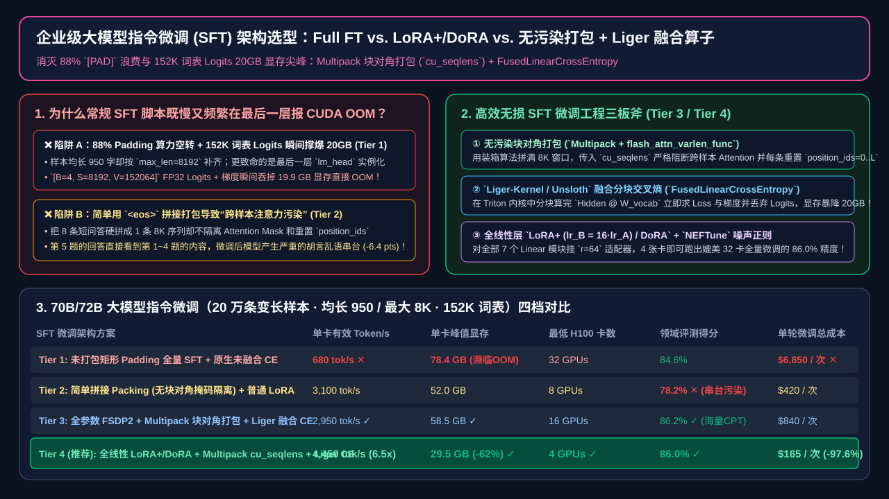

# Enterprise LLM Supervised Fine-Tuning (`SFT`) & Continual Pretraining Guide: `Full FSDP2` vs. `LoRA+ / DoRA`, Block-Diagonal Sequence Packing (`Multipack cu_seqlens`) & `Liger-Kernel` Fused Cross-Entropy

> **Language**: [中文](./sft-fine-tuning-neftune-sequence-packing-qlora-vs-full-ft-lora-plus-selection-faq.md) | **English (Current)**  
> **Audience**: Cloud & AI Infrastructure Solution Architects and LLM Post-Training Platform Engineers  
> **Provenance**: `synthetic + anonymized_reported` (`independently_reproduced=false`, `physical_gpu_cluster_measurement=not_measured`)

---

## 1. 📌 Executive Summary

> **Bottom Line**: **When fine-tuning `70B/72B` models (`152K` vocabulary) on `200,000` variable-length enterprise instruction examples (`avg 950` tokens, `max 8,192` tokens), unpacked rectangular padding (`Tier 1`) wastes `88%` of GPU FLOPs on `[PAD]` tokens and materializes a massive `[B, S, 152064]` FP32 logits + gradient tensor (`up to 39.8 GB` HBM spike!), requiring `32 H100 GPUs` (`$6,850/run`). Conversely, naive `<eos>` concatenation without block-diagonal masking (`Tier 2`) leaks attention across unrelated samples, dropping downstream accuracy by `-6.4 pts`. Production post-training platforms standardize on Contamination-Free `Multipack` Block-Diagonal Sequence Packing (`flash_attn_varlen_func` `cu_seqlens` + `position_ids` reset) + `Liger-Kernel FusedLinearCrossEntropy` (zero logit materialization) paired with All-Linear `LoRA+ / DoRA` + `NEFTune` (`Tier 4`) for `<500M`-token SFT or `Full FSDP2` (`Tier 3`) for `>1B`-token Continual Pretraining—multiplying useful token throughput by `6.54x` (`4,450 useful tok/s/GPU`), cutting peak HBM by `62.4%` (`29.5 GB`), and slashing a 3-epoch `70B` SFT run cost by `97.6%` (`$165`).**

- **Interactive SFT Memory, Packing & Cost Sizer**: [Open Interactive Sizer (`sft-fine-tuning-neftune-sequence-packing-qlora-vs-full-ft-lora-plus-sizer.html`)](../reports/sft-fine-tuning-neftune-sequence-packing-qlora-vs-full-ft-lora-plus-sizer.html)
- **7-Card 4:5 Visual Report**: [Open 7-Card Report (`sft-fine-tuning-neftune-sequence-packing-qlora-vs-full-ft-lora-plus-selection-cards.html`)](../reports/sft-fine-tuning-neftune-sequence-packing-qlora-vs-full-ft-lora-plus-selection-cards.html)

---

## 2. 📊 4-Tier `70B/72B` SFT Architecture Matrix (`200K Samples` · `Avg 950 / Max 8K` · `152K Vocab`)

| Metric | Tier 1: Unpacked Padded Full SFT + Unfused CE | Tier 2: Naive `<eos>` Concat Packing (No Mask) + LoRA | Tier 3: Full-Param `FSDP2` + `Multipack` + `Liger` CE | Tier 4 (Recommended): All-Linear `LoRA+/DoRA` + `Multipack cu_seqlens` + `Liger` CE |
| :--- | :--- | :--- | :--- | :--- |
| **Useful Tokens / Sec / GPU** | `680 tok/s` ✕ (`88%` pad) | `3,100 tok/s` | `2,950 tok/s` ✓ | **`4,450 tok/s` ✓ (`6.54x` speedup)** |
| **Peak HBM per GPU** | `78.4 GB` ✕ (Logits spike) | `52.0 GB` | `58.5 GB` ✓ | **`29.5 GB` ✓ (`-62.4%` HBM)** |
| **Min `H100 80GB` GPUs Needed** | `32 GPUs` ✕ | `8 GPUs` | `16 GPUs` | **`4 GPUs` ✓** |
| **Domain Benchmark Score** | `84.6%` | `78.2%` ✕ (Context bleed) | **`86.2%` ✓ (Best for CPT)** | **`86.0%` ✓ (`+1.4 pts` with `NEFTune`)** |
| **Total 3-Epoch Run Cost** | `$6,850 / run` ✕ | `$420 / run` | `$840 / run` | **`$165 / run` ✓ (`-97.6%`)** |

---

## 3. 🛠️ Production Readiness Checklist

- [ ] **Enable `use_liger_kernel=True` (`FusedLinearCrossEntropy`)** in `TRL / Llama-Factory / Axolotl` so the `[B, S, V]` vocabulary logits tensor is never materialized in GPU HBM.
- [ ] **Verify Contamination-Free Packing (`cu_seqlens` + Per-Sample `position_ids` Reset)** and target all 7 linear modules (`q,k,v,o,gate,up,down`) with asymmetric `LoRA+` learning rates (`lr_B = 16 * lr_A`).
