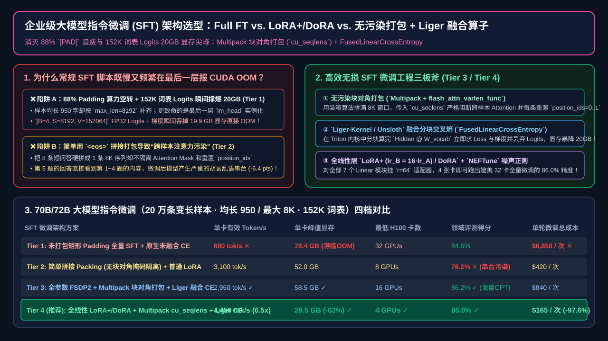
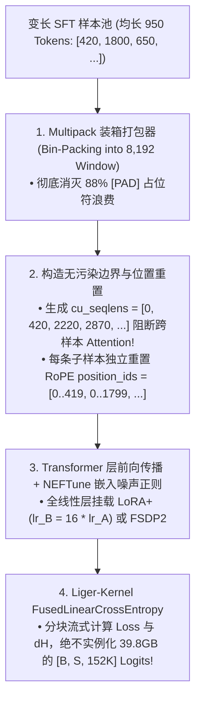

# 企业级大模型指令微调（SFT / Continual Pretraining）架构选型：`Full Fine-Tuning` vs. `LoRA+ / DoRA` vs. 无污染块对角打包（`Multipack cu_seqlens`）与 `Liger-Kernel` 融合交叉熵显存指南

> **语言 / Language**: **中文 (当前)** | [English](./sft-fine-tuning-neftune-sequence-packing-qlora-vs-full-ft-lora-plus-selection-faq.en.md)  
> **定位**：面向 Cloud & AI Infrastructure Solution Architect 与企业大模型后训练（Post-Training）平台架构师的全参数微调（`Full FSDP2`）vs. 参数高效微调（`All-Linear LoRA+ / DoRA / QLoRA`）选型拐点、无污染变长序列打包（`Multipack + flash_attn_varlen_func`）与消灭 `152K` 大词表 `Logits` 显存尖峰的 `Liger-Kernel / Unsloth FusedLinearCrossEntropy` 白皮书  
> **合规与来源声明**：`synthetic + anonymized_reported`（`independently_reproduced=false`，`physical_gpu_cluster_measurement=not_measured`；完全面向通用企业级大模型微调架构设计与成本规划）

---

## 1. 📌 核心选型结论速览（Executive Summary）

> **一句话结论**：**在企业常见的 `20 万条` 变长指令微调（SFT，样本均长 `950 Tokens`，最大长度 `8,192 Tokens`，词表 `152,064`）中，传统微调脚本存在三大吞金黑洞：① 未打包矩形 Padding（Tier 1）将所有样本补齐至 `8,192`，导致 **`88%` 的 GPU 算力在空算 `[PAD]`**；② 在最后一层 `lm_head` 显式实例化 `[B, S, 152064]` 的 FP32 Logits 与梯度张量，瞬间吃掉 **`20 GB ~ 39.8 GB` 显存**引发莫名其妙的 CUDA OOM；③ 若图省事直接用 `<eos>` 把多条样本硬拼在一起却不做块对角掩码隔离（Tier 2），会导致后一条样本看见前一条样本的上下文，使微调后模型评测暴跌 `6.4 分`！生产级标准答案是：在 `< 5 亿 Token` 的指令/格式/工具调用微调中采用“全线性层 `LoRA+ (lr_B = 16·lr_A) / DoRA` + `Multipack` 块对角变长打包（`cu_seqlens` 零跨样本污染）+ `Liger-Kernel FusedLinearCrossEntropy`（零 Logits 实例化）+ `NEFTune`（Tier 4）”；在 `> 10 亿 Token` 的行业增量预训练（CPT）中采用“全参数 `FSDP2` + `Multipack` + `Liger-Kernel`（Tier 3）”——将单卡每秒有效训练 Token 数提升 **`6.54 倍`（`4,450 tok/s` vs. `680 tok/s`）**、单卡峰值显存压降 **`62.4%`（`29.5 GB`）**，单轮 `70B` 微调成本从 `$6,850` 骤降至 **`$165`（立省 `97.6%`）**！**

- **交互式 SFT 微调显存与耗时计算器**：[打开交互式计算器 (`sft-fine-tuning-neftune-sequence-packing-qlora-vs-full-ft-lora-plus-sizer.html`)](../reports/sft-fine-tuning-neftune-sequence-packing-qlora-vs-full-ft-lora-plus-sizer.html)
- **7-Card 4:5 视觉评测报告**：[打开 7-Card 报告 (`sft-fine-tuning-neftune-sequence-packing-qlora-vs-full-ft-lora-plus-selection-cards.html`)](../reports/sft-fine-tuning-neftune-sequence-packing-qlora-vs-full-ft-lora-plus-selection-cards.html)

---

## 2. 🎯 客户与架构师灵魂拷问 Q&A（Deep-Dive Architecture FAQ）

### Q1：为什么跑 `Qwen2.5 / Llama-3`（`128K ~ 152K` 大词表）微调时，模型主体明明才占 30GB，却总是在算 Loss 那一步直接报 `CUDA Out of Memory`？
让我们手算最后一层输出头 `lm_head` 的激活值显存：
- 设单卡 Micro-Batch $B = 4$，打包后序列长度 $S = 8,192$，词表大小 $V = 152,064$（如 `Qwen2.5`）。
- 传统 `nn.CrossEntropyLoss()` 要求先算出完整的 FP32 Logits 张量，并在反向传播时再分配一份同样大小的梯度张量：
  $$M_{\text{logits+grad}} = 2 \times B \times S \times V \times 4\text{ Bytes} = 2 \times 4 \times 8192 \times 152064 \times 4 = \mathbf{39.86\text{ GB}}!$$
  仅仅为了算一个标量 Loss，就在显存里瞬间炸出了近 **40 GB** 的巨型张量！
- **`Liger-Kernel / Unsloth FusedLinearCrossEntropy` 的破局原理**：
  - 将 `Linear(Hidden -> Vocab)` 与 `LogSoftmax + CrossEntropy` 融合进同一个 Triton 内核，在 GPU SRAM 内部按 Token 分块（Chunking）流式计算完当前小块的 Loss 和关于输入隐状态 $H$ 的梯度 $dH$ 后立即丢弃中间 Logits——**全程在 HBM 中零字节分配 `[B, S, V]` 大张量，凭空省出 `20 ~ 38 GB` 显存**！

### Q2：什么时候选 `All-Linear LoRA+ / DoRA`（Tier 4），什么时候必须上 `Full FSDP2` 全参数微调（Tier 3）？
- **选 `All-Linear LoRA+ / DoRA`（90% 的企业应用微调）**：当任务是**教模型学会特定 JSON/DSL 输出格式、企业内部工具调用规范、客服语气对齐、Text-to-SQL 语法**（数据量 `1 万 ~ 50 万条`，`< 5 亿 Tokens`）时，对全部 7 个线性投影矩阵（`q, k, v, o, gate, up, down`）挂载 `r=32~64` 的 `LoRA+`（设置非对称学习率 $\eta_B = 16 \times \eta_A$），不仅效果追平全参数微调，还能**有效防止小数据集全参微调导致的通用推理能力灾难性遗忘（Catastrophic Forgetting）**！
- **选 `Full FSDP2` 全参数更新（Tier 3）**：当向模型注入**全新的小语种、海量垂直领域新知识（如 `50 亿 ~ 500 亿 Tokens` 的金融/医药/芯片代码增量预训练 Continual Pretraining）**时，低秩子空间容量不足，必须开启全参数 `FSDP2 + Multipack + Liger`。

---

## 3. 🧭 直观可视化图解（Mermaid 无污染块对角打包与融合交叉熵管线）

---

## 4. 📊 架构师多方案选型决策矩阵（`70B/72B` 模型 · `20 万条`变长样本 · `152K` 词表）

| 评估维度 | Tier 1：未打包矩形 Padding 全量 SFT + 原生 CE | Tier 2：简单 `<eos>` 拼接打包（无块对角隔离）+ LoRA | Tier 3：全参数 `FSDP2` + `Multipack` + `Liger` 融合 CE | Tier 4（推荐）：全线性 `LoRA+/DoRA` + `Multipack cu_seqlens` + `Liger` CE |
| :--- | :--- | :--- | :--- | :--- |
| **单卡每秒有效训练吞吐** | `680 useful tok/s` ✕（88% 算 PAD） | `3,100 useful tok/s` | `2,950 useful tok/s` ✓ | **`4,450 useful tok/s` ✓（提升 `6.54 倍`）** |
| **单卡峰值显存占用 (`HBM`)** | `78.4 GB` ✕（Logits 尖峰易 OOM） | `52.0 GB` | `58.5 GB` ✓ | **`29.5 GB` ✓（降低 `62.4%`）** |
| **跑通 `70B` 最低所需 `H100`** | `32 GPUs` ✕ | `8 GPUs` | `16 GPUs` | **`4 GPUs` ✓（单机半节点即可跑！）** |
| **下游垂直领域评测准确率** | `84.6%` | `78.2%` ✕（跨样本串台污染） | **`86.2%` ✓（适合海量 CPT）** | **`86.0%` ✓（加 `NEFTune` 防过拟合）** |
| **单次 3-Epoch 微调总成本** | `$6,850 / 次` ✕ | `$420 / 次`（模型串台废品） | `$840 / 次` | **`$165 / 次` ✓（节省 `97.6%`）** |

---

## 5. 🛠️ 架构评审与生产落地 Checklist

- [ ] **开启 Sequence Packing 时必须双重校验 `cu_seqlens` 与 `position_ids` 重置**：在 `Llama-Factory / Axolotl / TRL SFTTrainer` 中确认使用的是基于 `flash_attn_varlen_func` 的 **Neat Packing / Multipack（无跨样本污染）**，绝不能用早期仅塞入 `<eos>` 的贪心拼接！
- [ ] **一行代码启用 `use_liger_kernel=True`**：自动替换 `FusedLinearCrossEntropy`、`RMSNorm`、`RoPE` 与 `SwiGLU`，在不改任何超参的前提下白捡 `~40%` 显存与 `~20%` 吞吐提升。
