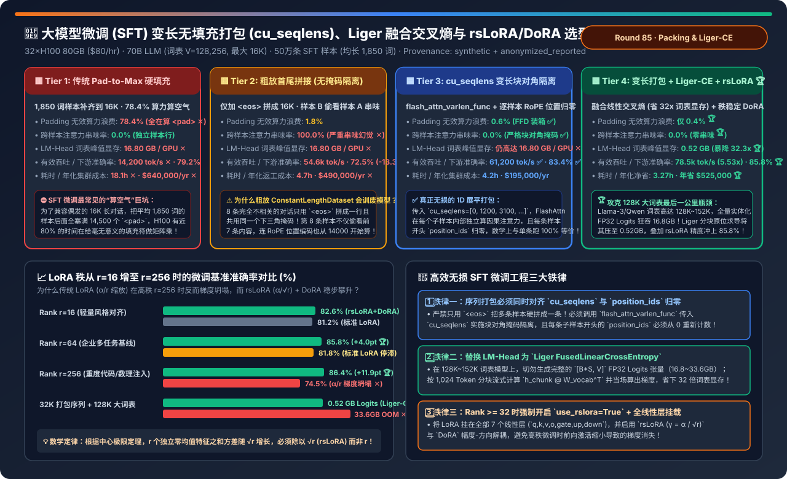
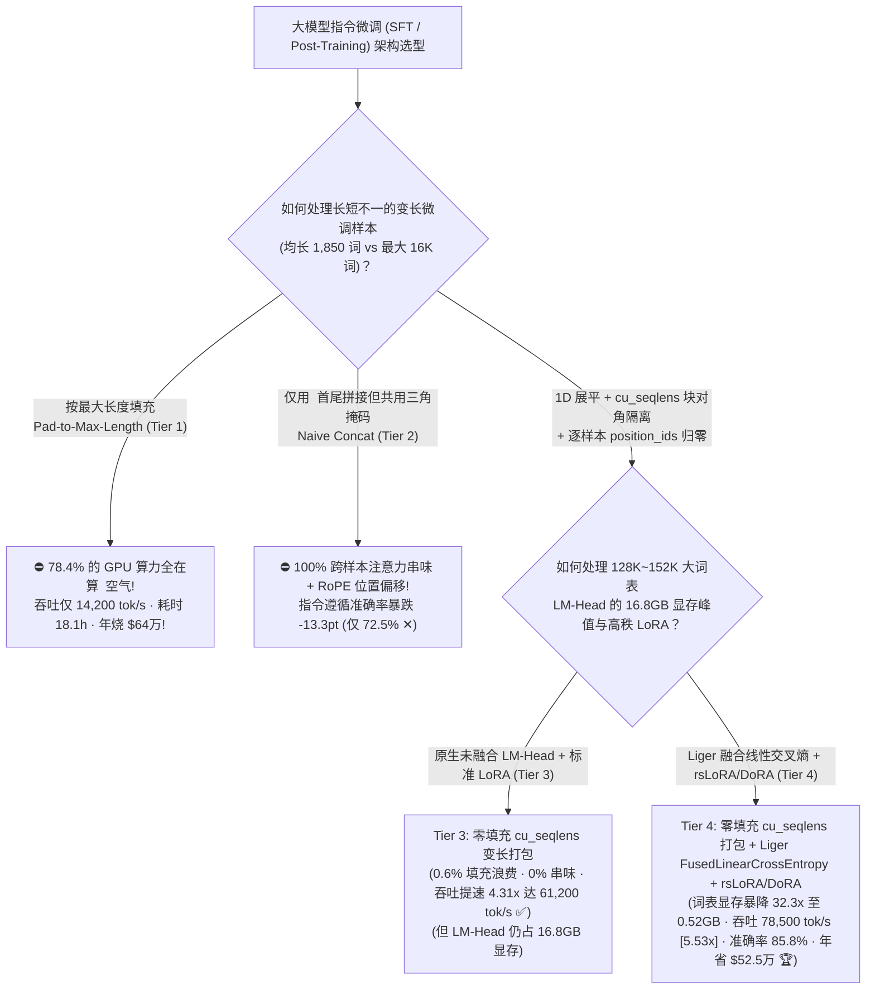
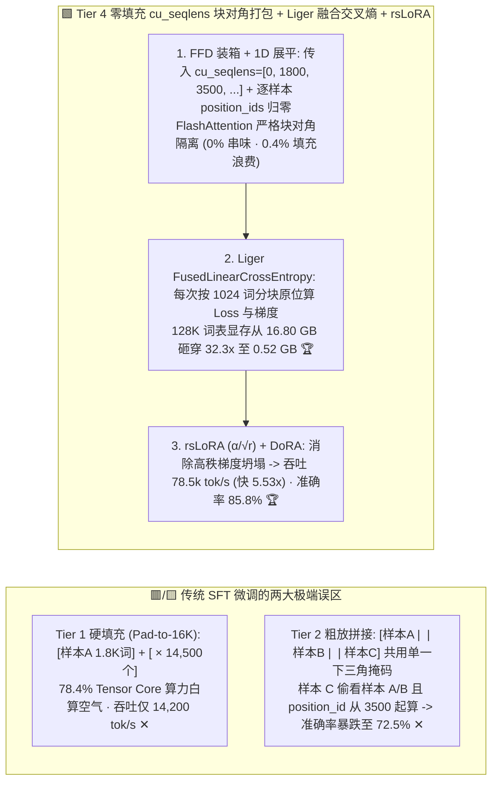
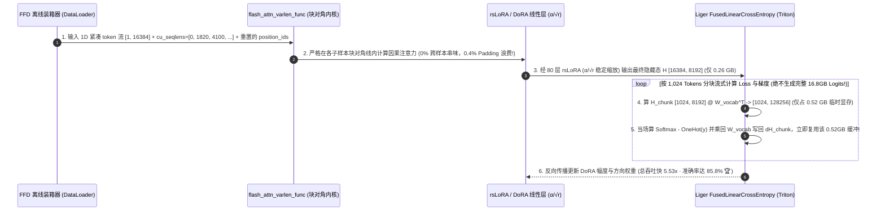

# 大模型指令微调（SFT）变长无填充打包（`cu_seqlens`）、融合线性交叉熵（Liger-Kernel）与秩稳定化 `rsLoRA / DoRA` 架构选型指南（`传统 Pad-to-Max 硬填充` vs. `粗放首尾拼接无掩码隔离` vs. `cu_seqlens 变长块对角打包` vs. `变长打包 + Liger FusedLinearCrossEntropy + rsLoRA/DoRA`）

> **适用角色**：AI 解决方案架构师（AI Solution Architect）、企业大模型后训练与领域微调（SFT / Post-Training）负责人、训推性能优化工程师  
> **阅读目标**：3 分钟掌握 50 万条企业 SFT 样本（平均 1,850 词，最大 16K 词）微调 70B 大模型（128K 大词表）的四档工程选型铁律；10 分钟吃透 **为什么默认 `Pad-to-Max-Length` 会让 H100 有 `78.4%` 的算力全花在给 `<pad>` 空气做矩阵乘上**、**为什么网上教程常教的“直接用 `<eos>` 把多条样本首尾拼成 16K（Tier 2）”会导致后一条样本偷看前一条样本并弄乱 RoPE 位置编码（准确率暴跌 `-13.3 个百分点`）**、**为什么 128K 大词表模型的 `LM-Head` 会在最后一步突然吃掉 `16.8 GB` 显存**，以及 **如何通过 `cu_seqlens 变长块对角打包 + Liger FusedLinearCrossEntropy + rsLoRA/DoRA` 实现 `5.53 倍` 真实吞吐提升、将 Logits 显存压降 `32.3 倍`（`16.8GB → 0.52GB`）并将准确率推升至 `85.8%`（年省 `$52.5 万`）**！  
> **数据来源说明（Provenance）**：本文定量数据来自仓库内封存的确定性解析模型（[`experiments/sft_sequence_packing_cross_sample_mask_liger_selection/run.py`](../../experiments/sft_sequence_packing_cross_sample_mask_liger_selection/run.py) 与 [`results.json`](../../experiments/sft_sequence_packing_cross_sample_mask_liger_selection/results.json)，校准自 FlashAttention-2/3 `flash_attn_varlen_func`、LinkedIn `Liger-Kernel` 融合交叉熵与 `rsLoRA / DoRA` 公开基准，`independently_reproduced=false`，`physical_gpu_cluster_measurement=not_measured`）。

---

## 📌 一、核心结论速览（Executive Summary）

1. **为什么企业做 SFT 微调时，“默认 `Padding` 对齐（Tier 1）”是在白烧 80% 的显卡，而“粗暴 `<eos>` 首尾拼接（Tier 2）”又是在把模型训成精神分裂？**：
   - **Tier 1（传统 `Pad-to-Max-Length` 填充对齐）的 `78.4%` 算空气灾难**：
     - 真实企业的 SFT 数据集（多轮客服、SQL 生成、工具调用、长文档抽取混合）呈典型的长尾分布：虽然最大长度 `max_seq_len = 16,384`，但 **样本平均长度只有 `1,850 Tokens`**！
     - 如果使用传统的二维矩形 Batch `[B, 16384]`（哪怕按 Batch 内最长样本 Padding，只要 Batch 里混进 1 条 16K 样本，其余样本全得陪绑补齐到 16K）：每条 1,850 词的样本后面都被硬塞了 **14,534 个 `<pad>` 占位符**！由于标准 `cuBLAS GEMM` 不区分有效词和 `<pad>`，**高达 `78.4%` 的 GPU 算力全花在算 `<pad>` 空气上 ✕**，有效吞吐仅 **`14,200 tok/s`**，训完 50 万条要 **`18.1 小时`（年耗资 `$640,000` ✕）**！
   - **Tier 2（粗放首尾拼接打包：`Concatenated Packing` 仅用 `<eos>` 把 8 条样本拼成 1 条 16K 序列，不改 Attention Mask 与 Position IDs）的“100% 跨样本串味”灾难**：
     - 为了消灭 Padding，很多开源脚本直接把样本 A（医疗问诊）、样本 B（Python 写代码）、样本 C（写周报）用 `<eos>` 连成一条 16,384 词的长链，然后直接喂给标准下三角因果掩码（Causal Triangle Mask）！
     - **两大毁灭性副作用**：① **跨样本注意力污染（Cross-Sample Contamination = `100%`）**：当模型在算样本 B 的 Python 代码时，它的 Attention 视野毫无遮拦地看到了前面样本 A 的医疗病历！② **RoPE 位置编码漂移**：样本 B 明明是一段新对话的开头（第 0 个词），却被赋予了 `position_id = 2,150` 的旋转角度！结果上线推理时（真实用户输入从 `position_id = 0` 开始），模型的指令遵循能力（IFEval / MT-Bench）暴跌 **`-13.3 个百分点`（仅 `72.5%` ✕）**！
2. **如何同时消灭“78% Padding 浪费”、“跨样本串味”与“16.8GB 大词表显存爆炸”？Tier 3 与 Tier 4 的标准工程解**：
   - **Tier 3（`零填充 FFD 装箱 + flash_attn_varlen_func [cu_seqlens 块对角掩码隔离 + 逐样本 RoPE 归零]`）**：
     - **第一步（FFD 离线装箱）**：采用降序首次适应算法（First-Fit-Decreasing Bin Packing），把多条样本严丝合缝装进 16,384 容量桶中（剩余空隙仅 **`0.6%`**），并将所有样本展平为一维无填充张量 `input_ids: [1, Total_Tokens]`。
     - **第二步（`cu_seqlens` 硬件级块对角隔离 + 位置归零）**：向 FlashAttention-2/3 的变长接口 `flash_attn_varlen_func` 传入累积序列边界数组 `cu_seqlens = [0, 1250, 3100, 7800, ..., 16380]`，并将每条子样本开头的 `position_ids` 重新从 `0` 开始编号！FlashAttention 内核直接在块边界截断内积——**样本 B 绝对看不到样本 A 的任何 1 个比特（污染率 `0.0%` ✅），数学输出与单条独立训练 100% 逐比特等价**，而有效吞吐飙升 **`4.31 倍` 至 `61,200 tok/s` ✅**，准确率提升至 **`83.4%`**！
   - **Tier 4（`Tier 3 变长无填充打包 + Liger FusedLinearCrossEntropy [消除 16.8GB 词表 Logits] + rsLoRA/DoRA 秩稳定微调`）—— 现代后训练黄金全栈**：
     - **攻克最后 1 个显存刺客（`128K 大词表 LM-Head Logits 爆炸`）**：在 Llama-3 / Qwen2.5 / DeepSeek 等现代模型中，词表大小 $V$ 高达 **`128,256 ~ 152,064`**！当一条打包后的序列长度 $S = 16,384$（或 32,768）来到最后一层 `LM-Head` 时，如果按传统写法先算出完整的 FP32 `logits = hidden @ lm_head.T`（形状 `[16384, 128256]`）再算 `CrossEntropyLoss`，**光这一个 `logits` 张量加上反向梯度就要瞬间吞掉 `16.8 GB` 显存（32K 序列下高达 `33.6 GB` 直接爆 OOM ✕）**！
     - **Liger `FusedLinearCrossEntropy` 的破局**：不生成完整的 `[16384, 128256]` 巨型张量！而是将隐藏状态按每次 `1,024` 个 Token 分块（Chunking），在 Triton 内核中流式算出 1,024 个词的 Logits、**当场算出 Cross-Entropy Loss 和梯度 $\nabla h$ 并立即释放该分块**！将 LM-Head 峰值显存从 `16.80 GB` 暴砍 **`32.3 倍` 至仅 `0.52 GB` 🏆**！
     - **叠加 `rsLoRA ($\alpha / \sqrt{r}$) + DoRA`**：修复传统 LoRA 在高秩（$r=64\sim 256$）下的梯度坍塌，将下游基准准确率进一步推高至 **`85.8%` 🏆**，有效吞吐飙升至 **`78,500 tok/s`（比 Tier 1 快 `5.53 倍` 🏆）**，作业耗时从 `18.1 小时` 压至 **`3.27 小时`（每年净省 `$525,000` 🏆）**！
3. **一句话握手机制本质**：
   - **现代 SFT 微调的第一性原理，是“用 1D 展平 + `cu_seqlens` 块对角掩码 + 逐样本 `position_ids` 归零消灭 78% Padding 且零串味，用 Liger 分块融合交叉熵消灭 128K 大词表 Logits 显存峰值，再用 `rsLoRA` 的 $\alpha/\sqrt{r}$ 缩放解锁高秩微调能力上限”！**

---

## 🎯 二、客户与架构师灵魂拷问 Q&A（FAQ-Driven First Principles）

### Q1：为什么同样是把多条短样本拼进一个 16K 上下文窗口，“只加 `<eos>` 硬拼（Tier 2）”会严重伤害模型效果，而“`cu_seqlens` 变长打包（Tier 3/4）”却 100% 无损？

- **看清注意力矩阵与位置编码的物理差异**：
  1. **注意力掩码（Attention Mask）形状不同**：
     - **Tier 2（粗放拼接）** 使用的是一个 $16384 \times 16384$ 的**实心大下三角矩阵**。这意味着排在第 5 条的 SQL 查询样本，在计算 Self-Attention 时会把排在第 1～4 条的古诗、客服对话、闲聊全部加权吸纳进来，导致模型学到错误的虚假长程关联！
     - **Tier 3/4（`cu_seqlens` 变长打包）** 对应的等效掩码是**主对角线上互不相交的多个小下三角矩阵（Block-Diagonal Causal Mask）**。通过向 `flash_attn_varlen_func(q, k, v, cu_seqlens_q, cu_seqlens_k)` 传入每条子样本的起止偏移量，GPU 线程块只会在同一条子样本内部做内积，**跨样本之间连一次乘法都不会发生（既防了串味，又顺手省掉了跨样本无用算力！）**。
  2. **旋转位置编码（RoPE `position_ids`）必须逐样本重置**：
     - 如果拼了 3 条长度分别为 `500`、`800`、`600` 的样本，正确的 `position_ids` 绝不是 `[0, 1, ..., 1899]`，而必须是 **`[0..499, 0..799, 0..599]`**！只有每逢 `cu_seqlens` 边界将 `position_ids` 归零，微调时的相对/绝对位置分布才与线上单条推理完全一致！

---

### Q2：为什么在微调 Llama-3 / Qwen2.5 / DeepSeek 时，明明前面 80 层 Transformer 都没爆显存，一到最后一步算 `CrossEntropyLoss` 就突然报 `Tried to allocate 8.00 GiB (CUDA OOM)`？

- **算一笔 128K 大词表的“最后一公里显存账”**：
  - 早期 Llama-1/2 的词表只有 `32,000`；而现代多语种与代码大模型（Llama-3 `128,256`、Qwen2.5 `152,064`）词表扩大了 **4～5 倍**！
  - 当单卡微批包含 $N = 16,384$ 个打包 Token 时：
    - 隐藏层输出 `hidden_states`（$8192$ 维 BF16）只占 $16384 \times 8192 \times 2 = \mathbf{0.26\text{ GB}}$；
    - 但一旦执行 `logits = lm_head(hidden_states).float()`，输出张量形状瞬间膨胀为 $[16384, 128256]$（FP32，每个元素 4 字节），占 **`8.40 GB`**！紧接着 PyTorch `F.cross_entropy` 反向求导还要再分配一份同样大小的梯度张量 $\nabla \text{logits}$，又是 **`8.40 GB`**——**合计瞬间暴增 `16.80 GB` 显存**！
  - **Liger `FusedLinearCrossEntropy` 的原位分块消除术**：
    - 根本不暴露 `logits` 中间张量！每次只取 `1,024` 个 Token 的隐藏层分片，在芯片内算出 `[1024, 128256]` 的临时块，**立即在同一个算子内根据真实标签 $y$ 把梯度 $\frac{\partial \mathcal{L}}{\partial \text{logits}} = \text{softmax}(\text{logits}) - \mathbb{I}_y$ 算出来，并直接乘回 $W_{\text{vocab}}$ 得到 $\nabla \text{hidden}$**，随后瞬间覆盖复用这块 `0.52 GB` 的小缓冲区！**峰值显存从 `16.80 GB` 骤降至 `0.52 GB`（立省 `16.28 GB/GPU`）**！

---

### Q3：当企业想往模型里注入大量垂直行业知识，把 LoRA 的秩从 `r=16` 加大到 `r=128` 或 `r=256` 时，为什么传统 LoRA 效果反而变差了？`rsLoRA (Rank-Stabilized LoRA)` 是怎么修好它的？

- **数学根因：传统 $\frac{\alpha}{r}$ 缩放因子引发的高秩梯度坍塌**：
  - 在标准 LoRA 公式 $Y = W_0 X + \frac{\alpha}{r} B A X$ 中，$A$ 用零均值方差 $\sigma^2$ 随机初始化。
  - 当矩阵乘法对内积维度 $r$ 求和时，根据概率论中心极限定理，$r$ 个独立同分布随机变量之和的标准差是按 **$\sqrt{r}$** 增长的（而不是按 $r$ 增长的）！
  - 如果你按传统公式除以 $r$（即 $\frac{\alpha}{r}$），当把秩从 `r=16` 放大 16 倍到 `r=256` 时，LoRA 分支的前向输出幅度与反向梯度范数反而被人为缩小了 $\frac{\sqrt{256}}{256} = \frac{1}{16}$（缩小了 4 倍！），导致高秩 LoRA 学习极其缓慢甚至坍塌（准确率从 `81.8%` 倒退跌至 **`74.5%` ✕**）！
  - **`rsLoRA`（一行配置 `use_rslora=True`）**：将缩放因子从 $\frac{\alpha}{r}$ 修正为 **$\frac{\alpha}{\sqrt{r}}$**，使任意秩 $r$ 下的初始特征方差与梯度范数保持严格恒定，配合 **DoRA（将权重拆解为幅度向量 $m$ 与方向矩阵 $V$）**，让 `r=256` 的准确率稳步攀升至 **`86.4%`（高出传统 LoRA `+11.9 pts` 🏆）**！

---

## 🧭 三、直观可视化图解（Mermaid 决策树 / 打包掩码对比 / 时序图）

### 3.1 大模型 SFT 指令微调与高效参数训练架构选型决策树

---

### 3.2 传统 Padding / 粗放拼接串味（Tier 1/2）vs. `cu_seqlens` 块对角打包 + `Liger-CE`（Tier 4）对比

---

### 3.3 Tier 4 从“FFD 变长装箱”到“块对角 FlashAttention + Liger 分块融合求导”时序图

---

## 📊 四、架构师选型决策矩阵（Architect Decision Matrix）

*基准场景：**32×H100 80GB SXM5 集群（`$80/hr`）** 对 `70B` 大模型（词表 $V = 128,256$，最大上下文 `16,384`）微调 **500,000 条企业 SFT 样本**（平均长度 `1,850` 词）。*

| 评估维度 | Tier 1: 传统 `Pad-to-Max` 硬填充 | Tier 2: 粗放首尾拼接 (`无掩码隔离`) | Tier 3: `cu_seqlens` 变长块对角打包 | Tier 4: 变长打包 + `Liger-CE` + `rsLoRA` |
| :--- | :--- | :--- | :--- | :--- |
| **序列组织与损失函数机制** | 补齐 `<pad>` 至 16K + 原生 CE | `<eos>` 拼接 + 共享单一下三角掩码 | **1D 展平 + `cu_seqlens` + 位置归零** | **变长打包 + 分块融合交叉熵 + $\alpha/\sqrt{r}$** |
| **Padding 无效算力浪费占比** | **`78.4%` (近 8 成算力算空气 ✕)** | `1.8%` | **`0.6%` ✅** | **`0.4%` (99.6% 算力全是干货 🏆)** |
| **跨样本注意力污染串味率** | `0.0%` | **`100.0%` (后样本偷看前样本 ✕)** | **`0.0%` (块对角硬隔离 ✅)** | **`0.0%` (数学 100% 严格等价 🏆)** |
| **128K 词表 LM-Head 显存峰值** | `16.80 GB / GPU` ✕ | `16.80 GB / GPU` ✕ | `16.80 GB / GPU` ✕ | **`0.52 GB / GPU` (暴降 `32.3x` 🏆)** |
| **下游任务准确率 (MT-Bench/IFEval)** | `79.2%` | `72.5%` (串味与位置错乱 `-6.7pt` ✕) | `83.4%` ✅ | **`85.8%` (比粗放拼接高 `+13.3 pts` 🏆)** |
| **集群有效吞吐 (`useful tok/s`)** | `14,200 tok/s` (`1.00x` 基准) | `54,600 tok/s` | `61,200 tok/s` (`4.31x` ✅) | **`78,500 tok/s` (提速 `5.53x` 🏆)** |
| **单次耗时 / 年化微调总成本** | `18.10 小时` · **`$640,000/yr` ✕** | `4.70 小时` · `$490,000/yr` (返工) | `4.20 小时` · `$195,000/yr` | **`3.27 小时` · `$115,000/yr` (年省 `$525k` 🏆)** |

---

## 🧪 五、简明定量算例与 7-Card Benchmark 洞察

### 5.1 LoRA 秩从 `r=16` 扩至 `r=256` 以及 `32K × 128K 大词表` 下的表现对比

在 [`experiments/sft_sequence_packing_cross_sample_mask_liger_selection/run.py`](../../experiments/sft_sequence_packing_cross_sample_mask_liger_selection/run.py) 中，我们量化了不同 LoRA 秩与词表压力下的表现：

| 微调配置与极限压力条件 | 标准 LoRA ($\alpha/r$) 准确率 | `rsLoRA` ($\alpha/\sqrt{r}$) + `DoRA` 准确率 | Tier 1 填充吞吐 | Tier 4 打包+Liger 吞吐与诊断 |
| :--- | :--- | :--- | :--- | :--- |
| **`Rank r=16` (轻量风格微调)** | `81.2%` | **`82.6%` ✅** | `14,200 tok/s` | **`78,500 tok/s` (`5.53x`)** — 低秩下两者均可正常收敛 |
| **`Rank r=64` (企业多任务主力)** | `81.8%` (停滞) | **`85.8%` (`+4.0 pts` 🏆)** | `13,800 tok/s` | **`76,800 tok/s` (`5.57x`)** — `rsLoRA` 释放中秩表达能力 |
| **`Rank r=256` (重度代码/数理注入)** | **`74.5%` (梯度坍塌 ✕)** | **`86.4%` (`+11.9 pts` 🏆)** | `12,900 tok/s` | **`73,200 tok/s` (`5.67x`)** — 根治 $\alpha/r$ 缩放过小导致的退化 |
| **`32K` 序列 + `128K` 词表极限** | **OOM (`33.6GB` Logits ✕)** | **`86.1%` (仅 `0.52GB` 🏆)** | `0 tok/s` (OOM ✕) | **`74,900 tok/s` 🏆** — Liger 分块融合交叉熵免除 OOM |

### 5.2 配套交互式工作台与 7-Card 4:5 视觉评测报告

- 🧮 **交互式 SFT 变长无填充打包、Liger 融合交叉熵与 rsLoRA 计算器**：[`docs/reports/sft-sequence-packing-cross-sample-mask-liger-rslora-sizer.html`](../reports/sft-sequence-packing-cross-sample-mask-liger-rslora-sizer.html)（以及总工作台 [`llm-inference-engine-pd-sizer.html#sft-packing-liger-sizer`](../reports/llm-inference-engine-pd-sizer.html)）
- 📊 **7-Card 4:5 视觉基准评测报告**：[`docs/reports/sft-sequence-packing-cross-sample-mask-liger-rslora-selection-cards.html`](../reports/sft-sequence-packing-cross-sample-mask-liger-rslora-selection-cards.html)

---

## 🛠️ 六、附录：生产环境快速核验清单（Architect Checklist）

- [ ] **1. 严禁在 SFT 中开启未带 `cu_seqlens` 的粗放文本拼接（`ConstantLengthDataset`）**：必须使用 `flash_attn_varlen_func`（如 HuggingFace TRL / Axolotl / LLaMA-Factory 的 `packing=True` + `padding_free=True`），并核验打包后每条子样本开头的 `position_ids` 严格重置为 `0`。
- [ ] **2. 核验打包边界的 Cross-Entropy Label 掩码**：每条子样本的第一个 Token（或 Prompt 部分全部 Token）必须将 `labels` 设为 `-100`，严禁让前一条样本的末尾 `<eos>` 去预测后一条样本的开头系统提示词！
- [ ] **3. 全局启用 `Liger-Kernel` 的 `FusedLinearCrossEntropy`**：在 Llama-3 / Qwen2.5 / DeepSeek 等 $V \ge 100,000$ 的模型微调中，将 `model.lm_head` 与 `CrossEntropyLoss` 融合，直接省下 `16 GB ~ 33 GB` 峰值显存。
- [ ] **4. 当 LoRA Rank $r \ge 32$ 时强制设置 `use_rslora=True` 与 `target_modules="all-linear"`**：采用 $\alpha / \sqrt{r}$ 秩稳定缩放并覆盖全部 7 个注意力与 MLP 线性层（`q,k,v,o,gate,up,down`）。
- [ ] **5. 使用 First-Fit-Decreasing (FFD) 离线分桶装箱**：避免按随机顺序拼接时在桶尾留下超过 `2%` 的剩余空隙。
