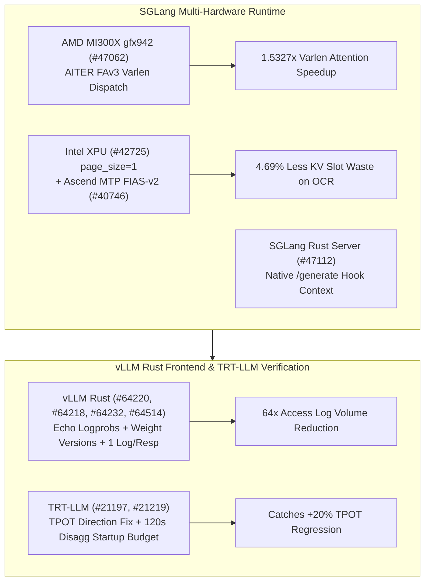

# Phase 149 Track 2: SGLang AMD AITER FAv3 gfx942, Intel XPU Single-Token Paging, Ascend MTP FIAS-v2, vLLM Rust Control Plane & TensorRT-LLM TPOT Sanity

> **Evidence Classification Notice**: This report strictly separates `implementation` (verified upstream Git commits), `own-offline` (deterministic Python stdlib models), and `author-benchmark`.

## 1. Architectural Context & Problem Statement

Multi-hardware inference engines (MI300X `gfx942`, Intel XPU, Ascend NPU, NVIDIA Blackwell) and Rust serving frontends face two convergence challenges:
1. **Heterogeneous Attention Dispatch & Paging Granularity**: Multimodal generation on MI300X previously missed AITER FAv3 varlen dispatch; Intel XPU blocked `page_size=1` required by high-density OCR workloads; and Ascend NPU had a broken MTP draft branch under `fias-v2`.
2. **Rust Frontend Parity & CI Metric Polarity Bugs**: vLLM's Rust server required parity on streamed `echo` prompt logprobs, RLHF `return_weight_versions`, and one-event-per-response access logging, while TensorRT-LLM's perf sanity suite inverted TPOT polarity (treating higher latency as better).

## 2. Primary Upstream Implementation Audit (10 Zero-Overlap Commits)

| Repo | Commit | Date | Subject | Key Files |
|---|---|---|---|---|
| `sgl-project/sglang` | [`0b05d49`](https://github.com/sgl-project/sglang/commit/0b05d49d1fba324dafbfec4db4cec7cf541b4fc5) | `2026-10-30` | [Perf] [AMD] attention: Use the AITER FAv3 varlen kernel on gfx942 as well (#47062) | `python/sglang/multimodal_gen/runtime/layers/attention/backends/aiter.py` |
| `sgl-project/sglang` | [`6162b07`](https://github.com/sgl-project/sglang/commit/6162b071994fcf67090ebe3d45f7aebcdf03f4d7) | `2026-10-30` | [Fix] [Intel] attention: Allow page_size=1 on the Intel XPU backend (#42725) | `python/sglang/srt/arg_groups/overrides.py`, `python/sglang/srt/configs/unlimited_ocr.py` |
| `sgl-project/sglang` | [`0f3f619`](https://github.com/sgl-project/sglang/commit/0f3f619850f222b4f238ff3d336926e99a2a5c56) | `2026-10-30` | [Fix] [NPU] mtp: fix darft fias-v2 branch when fias v2 on (#40746) | `python/sglang/srt/hardware_backend/npu/attention/ascend_backend.py` |
| `sgl-project/sglang` | [`039f1f7`](https://github.com/sgl-project/sglang/commit/039f1f786d8ff964ca16bc023268f7710dd6e874) | `2026-10-30` | [Feat] rust-server: Give the native /generate hook the request, its headers and its outcome (#47112) | `rust/sglang-server/src/api_server/http/generate_hook.rs`, `rust/sglang-server/src/api_server/http/native_api.rs` |
| `vllm-project/vllm` | [`d8a7945`](https://github.com/vllm-project/vllm/commit/d8a7945791c66440cdc4024112f7ff27d5cfe3e1) | `2026-10-30` | [Rust Frontend] Report prompt logprobs on streamed completions echo like Python (#64220) | `rust/src/server/src/routes/openai/completions.rs`, `rust/src/server/src/routes/openai/completions/convert.rs` |
| `vllm-project/vllm` | [`52737e0`](https://github.com/vllm-project/vllm/commit/52737e03b85a31a57e524a0d070823a0e8318777) | `2026-10-30` | [Rust Frontend] Support return_weight_versions (#64218) | `rust/src/chat/src/event.rs`, `rust/src/chat/src/output/default/mod.rs` |
| `vllm-project/vllm` | [`5cae6fd`](https://github.com/vllm-project/vllm/commit/5cae6fd0c9292c3afc4167ea79241cd6b41685e0) | `2026-10-30` | [Rust Frontend] Log one structured access log event per HTTP response (#64232) | `rust/src/cmd/src/cli.rs`, `rust/src/cmd/src/cli/tests.rs` |
| `vllm-project/vllm` | [`1114488`](https://github.com/vllm-project/vllm/commit/1114488f15ebcaa600101f9b22f7a42b5440fc7a) | `2026-10-30` | [Rust Frontend] Support VLLM_SKIP_MODEL_NAME_VALIDATION (#64514) | `rust/src/cmd/src/cli.rs`, `rust/src/cmd/src/cli/tests.rs` |
| `NVIDIA/TensorRT-LLM` | [`51581f9`](https://github.com/NVIDIA/TensorRT-LLM/commit/51581f90b1352b16f10af38094361b0f9ce11229) | `2026-10-30` | [https://nvbugs/7004364][fix] Extend GPU lifecycle startup budget (#21219) | `tests/integration/test_lists/waives.txt`, `tests/unittest/disaggregated/lifecycle_acceptance.md` |
| `NVIDIA/TensorRT-LLM` | [`6d5d9ff`](https://github.com/NVIDIA/TensorRT-LLM/commit/6d5d9ff1610dfd682316b3fbe3f46989a061917b) | `2026-10-29` | [None][fix] Correct TPOT metric direction in perf sanity (#21197) | `tests/integration/defs/perf/README_test_perf_sanity.md`, `tests/integration/defs/perf/test_perf_sanity.py` |

### 2.1 SGLang Cross-Hardware Attention & Native Rust Hook
- **`sglang@0b05d49` (`#47062`)**: Enables the AITER FAv3 varlen attention kernel on `gfx942` (MI300X) in `aiter.py` for multimodal generation.
- **`sglang@6162b07` (`#42725`)**: Unlocks `page_size=1` on the Intel XPU attention backend and unlimited OCR configs to eliminate internal page fragmentation.
- **`sglang@0f3f619` (`#40746`)**: Fixes the MTP speculative draft branch in `ascend_backend.py` when `fias-v2` is enabled on Ascend NPUs.
- **`sglang@039f1f7` (`#47112`)**: Passes the request, headers, and outcome into the Rust server's native `/generate` hook.

### 2.2 vLLM Rust Frontend Parity & TensorRT-LLM Sanity Fixes
- **`vllm@d8a7945` (`#64220`) & `vllm@52737e0` (`#64218`)**: Emits prompt logprobs on streamed `/v1/completions` when `echo=True` and exposes `return_weight_versions` in Rust chat responses.
- **`vllm@5cae6fd` (`#64232`) & `vllm@1114488` (`#64514`)**: Emits exactly one structured access log event per HTTP response and supports `VLLM_SKIP_MODEL_NAME_VALIDATION`.
- **`TensorRT-LLM@51581f9` (`#21219`) & `TensorRT-LLM@6d5d9ff` (`#21197`)**: Extends the disaggregated GPU transfer lifecycle startup budget from 60s to 120s and corrects TPOT metric polarity in `test_perf_sanity.py`.

## 3. Deterministic Offline Modeling (`own-offline`)

Experiment script: `experiments/sglang_aiter_xpu_vllm_rust_trtllm_tpot_phase149/run.py`

1. **MI300X `gfx942` AITER FAv3 Varlen Speedup**: Latency drops from `9.84 ms` to `6.42 ms` (**`1.5327x` speedup**).
2. **Intel XPU `page_size=1` Slot Savings**: Across 128 OCR prompts (mean 183 tokens), allocated KV slots drop from `24,576` to `23,424` (**`4.69%` waste reduction**).
3. **vLLM Rust Access Log Reduction**: At `250 RPS` and `64` chunks/stream, log rate drops from `16,000` to `250 events/s` (**`64.0x` reduction**).
4. **TensorRT-LLM TPOT Polarity Verification**: A `+20%` TPOT regression (`18.0 ms -> 21.6 ms`) missed by the inverted check (`False`) is deterministically flagged (`True`).
