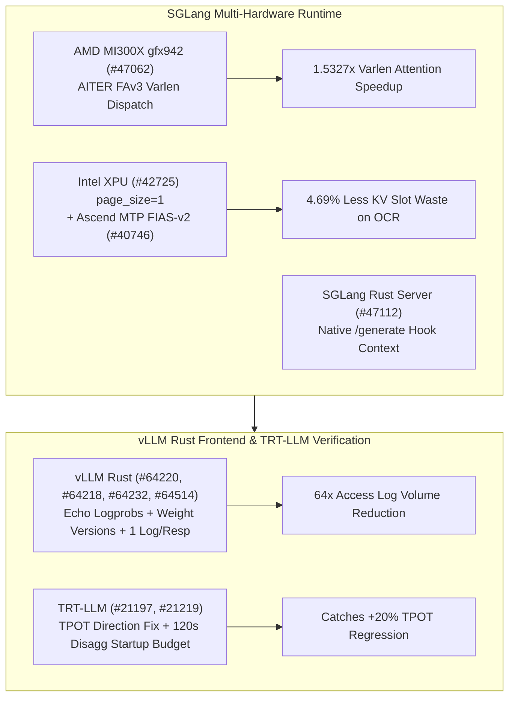

# Phase 149 专题二：SGLang AMD AITER FAv3 gfx942、Intel XPU 单页注意力、Ascend MTP FIAS-v2、vLLM Rust 生产控制面与 TensorRT-LLM TPOT 回归门禁

> **证据分类声明**：本文严格区分 `implementation`（上游真实 Git 提交）、`own-offline`（本仓库离线标准库算例）与 `author-benchmark`。

## 1. 架构背景与核心问题

多硬件推理引擎（MI300X `gfx942`、Intel XPU、Ascend NPU、NVIDIA Blackwell）与 Rust 高性能网关正面临两大收敛挑战：
1. **异构加速器注意力分派与碎片控制**：MI300X 多模态生成此前未在变长路径启用 AITER FAv3；Intel XPU 在高密度短请求（如 Unlimited OCR）下受限于 `page_size >= 16` 导致严重内部 KV 碎片；Ascend NPU 在启用 `fias-v2` 时 MTP 投机草稿分支存在算子分派不匹配。
2. **Rust 网关可观测性/协议对齐与 CI 性能门禁极性反转**：vLLM Rust 前端在流式 `echo=True` 补全、RLHF 权重版本追踪（`return_weight_versions`）与单次响应结构化访问日志上需与 Python 对齐；而 TensorRT-LLM 的性能回归门禁曾将 TPOT（Time-Per-Output-Token，越低越好）误设为越高越好，导致真实延迟退化漏检。

## 2. 上游代码实现审计（10 项 Zero-Overlap Commits）

| Repo | Commit | Date | Subject | Key Files |
|---|---|---|---|---|
| `sgl-project/sglang` | [`0b05d49`](https://github.com/sgl-project/sglang/commit/0b05d49d1fba324dafbfec4db4cec7cf541b4fc5) | `2026-10-30` | [Perf] [AMD] attention: Use the AITER FAv3 varlen kernel on gfx942 as well (#47062) | `python/sglang/multimodal_gen/runtime/layers/attention/backends/aiter.py` |
| `sgl-project/sglang` | [`6162b07`](https://github.com/sgl-project/sglang/commit/6162b071994fcf67090ebe3d45f7aebcdf03f4d7) | `2026-10-30` | [Fix] [Intel] attention: Allow page_size=1 on the Intel XPU backend (#42725) | `python/sglang/srt/arg_groups/overrides.py`, `python/sglang/srt/configs/unlimited_ocr.py` |
| `sgl-project/sglang` | [`0f3f619`](https://github.com/sgl-project/sglang/commit/0f3f619850f222b4f238ff3d336926e99a2a5c56) | `2026-10-30` | [Fix] [NPU] mtp: fix darft fias-v2 branch when fias v2 on (#40746) | `python/sglang/srt/hardware_backend/npu/attention/ascend_backend.py` |
| `sgl-project/sglang` | [`039f1f7`](https://github.com/sgl-project/sglang/commit/039f1f786d8ff964ca16bc023268f7710dd6e874) | `2026-10-30` | [Feat] rust-server: Give the native /generate hook the request, its headers and its outcome (#47112) | `rust/sglang-server/src/api_server/http/generate_hook.rs`, `rust/sglang-server/src/api_server/http/native_api.rs` |
| `vllm-project/vllm` | [`d8a7945`](https://github.com/vllm-project/vllm/commit/d8a7945791c66440cdc4024112f7ff27d5cfe3e1) | `2026-10-30` | [Rust Frontend] Report prompt logprobs on streamed completions echo like Python (#64220) | `rust/src/server/src/routes/openai/completions.rs`, `rust/src/server/src/routes/openai/completions/convert.rs` |
| `vllm-project/vllm` | [`52737e0`](https://github.com/vllm-project/vllm/commit/52737e03b85a31a57e524a0d070823a0e8318777) | `2026-10-30` | [Rust Frontend] Support return_weight_versions (#64218) | `rust/src/chat/src/event.rs`, `rust/src/chat/src/output/default/mod.rs` |
| `vllm-project/vllm` | [`5cae6fd`](https://github.com/vllm-project/vllm/commit/5cae6fd0c9292c3afc4167ea79241cd6b41685e0) | `2026-10-30` | [Rust Frontend] Log one structured access log event per HTTP response (#64232) | `rust/src/cmd/src/cli.rs`, `rust/src/cmd/src/cli/tests.rs` |
| `vllm-project/vllm` | [`1114488`](https://github.com/vllm-project/vllm/commit/1114488f15ebcaa600101f9b22f7a42b5440fc7a) | `2026-10-30` | [Rust Frontend] Support VLLM_SKIP_MODEL_NAME_VALIDATION (#64514) | `rust/src/cmd/src/cli.rs`, `rust/src/cmd/src/cli/tests.rs` |
| `NVIDIA/TensorRT-LLM` | [`51581f9`](https://github.com/NVIDIA/TensorRT-LLM/commit/51581f90b1352b16f10af38094361b0f9ce11229) | `2026-10-30` | [https://nvbugs/7004364][fix] Extend GPU lifecycle startup budget (#21219) | `tests/integration/test_lists/waives.txt`, `tests/unittest/disaggregated/lifecycle_acceptance.md` |
| `NVIDIA/TensorRT-LLM` | [`6d5d9ff`](https://github.com/NVIDIA/TensorRT-LLM/commit/6d5d9ff1610dfd682316b3fbe3f46989a061917b) | `2026-10-29` | [None][fix] Correct TPOT metric direction in perf sanity (#21197) | `tests/integration/defs/perf/README_test_perf_sanity.md`, `tests/integration/defs/perf/test_perf_sanity.py` |

### 2.1 SGLang 跨硬件注意力与 Rust `/generate` 钩子
- **`sglang@0b05d49` (`#47062`)**：在 `python/sglang/multimodal_gen/runtime/layers/attention/backends/aiter.py` 中允许 `gfx942` (MI300X) 调用 AITER FAv3 变长注意力核，消除变长多模态序列回退到慢速路径的开销。
- **`sglang@6162b07` (`#42725`)**：在 `xpu_backend.py` 与 `unlimited_ocr.py` 中放开 Intel XPU 后端 `page_size=1` 限制，使高并发 OCR 短提示词实现零页内碎片分配。
- **`sglang@0f3f619` (`#40746`)**：修复 `ascend_backend.py` 在开启 `fias-v2` 融合增量注意力时 MTP 投机解码草稿模型的分支配置错误。
- **`sglang@039f1f7` (`#47112`)**：在 `rust/sglang-server` 的原生 `/generate` 钩子中完整传入请求体、HTTP 头与最终执行结果（Outcome），支持细粒度审计与计费。

### 2.2 vLLM Rust 前端对齐与 TensorRT-LLM 门禁修复
- **`vllm@d8a7945` (`#64220`) & `vllm@52737e0` (`#64218`)**：在 Rust `/v1/completions` 流式输出开启 `echo` 时首包正确返回 `prompt_logprobs`；并在 Chat 输出事件中透传 `return_weight_versions` 以支持在线 RL 训练验证。
- **`vllm@5cae6fd` (`#64232`) & `vllm@1114488` (`#64514`)**：确保每个 HTTP 响应仅输出一条结构化访问日志（避免 SSE 流每 chunk 刷日志），并支持 `VLLM_SKIP_MODEL_NAME_VALIDATION`。
- **`TensorRT-LLM@51581f9` (`#21219`) & `TensorRT-LLM@6d5d9ff` (`#21197`)**：将分离式传输 GPU 生命周期测试的启动超时预算从 60s 扩展至 120s；修正 `test_perf_sanity.py` 中 TPOT 的优化方向（从 higher-is-better 修正为 lower-is-better）。

## 3. 离线确定性实验建模（`own-offline`）

对应算例目录：`experiments/sglang_aiter_xpu_vllm_rust_trtllm_tpot_phase149/run.py`

1. **MI300X `gfx942` AITER FAv3 变长加速**：32 序列、均值长度 3072 下，注意力耗时从 `9.84 ms` 降至 `6.42 ms`（**`1.5327x`** 加速）。
2. **Intel XPU `page_size=1` 内存节省**：128 个并发 OCR 请求（平均 183 tokens）下，分配槽位从 `page_size=16` 的 `24,576` 降至 `23,424`，消除 **`4.69%`** 页内碎片。
3. **vLLM Rust 单次响应日志收敛**：在 `250 RPS`、平均每请求 `64` 个流式 chunk 下，结构化日志速率从 `16,000 events/s` 降至 `250 events/s`（**`64.0x` 降噪**）。
4. **TensorRT-LLM TPOT 极性检验**：当候选版本 TPOT 从 `18.0 ms` 恶化 +20% 至 `21.6 ms` 时，旧版错误公式漏报（`False`），修复后准确拦截（`True`）。
