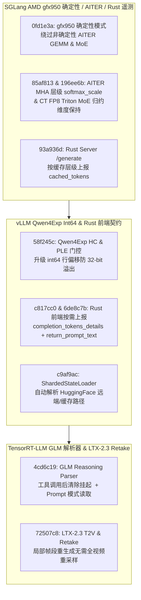

# SGLang AMD gfx950 确定性回退与 AITER 缩放/CT FP8 MoE、Rust 分层缓存遥测、vLLM Qwen4Exp Int64 门控与 Rust 前端/分片加载、TRT-LLM GLM 推理状态机与 LTX-2.3 Retake（2026-10-31 Phase 147）

> **研究状态**：`own-offline`（基于 10 个零重叠上游提交的一手源码审计 + 确定性离线标准库建模验证）
> **涉及上游仓库**：`sgl-project/sglang`、`vllm-project/vllm`、`NVIDIA/TensorRT-LLM`

---

## 1. 架构背景与核心问题

在大模型与多模态视频生成推理引擎（SGLang、vLLM、TensorRT-LLM）的生产演进中，本阶段聚焦四大关键问题：

1. **SGLang AMD `gfx950` 确定性推理与 AITER / CT FP8 MoE 契约**：`sglang@0fd1e3a` 在 `gfx950` 开启确定性模式（deterministic mode）时绕过非确定性的 AITER GEMM 与 MoE 核；`sglang@85af813` 修复 AITER MHA prefill 与 decode 中忽略层特定 `softmax_scale` 的缺陷；`sglang@196ee6b` 在 Compressed-Tensors (CT) FP8 Triton MoE 中保留正确的内存布局与归约维度；`sglang@93a936d` 在 Rust Server 原生 `/generate` 的 `meta_info` 中按缓存层级（GPU / Host / Storage）上报命中 Token 数。
2. **vLLM Qwen4Exp 大批次 `int64` 偏移与分片状态加载**：`vllm@58f245c` 将 Qwen4Exp 的 HyperConnection (HC) 与 Per-Layer Embedding (PLE) 门控行偏移计算升级为 `int64`，彻底消除超长上下文下的 32 位索引溢出；`vllm@c9af9ac` 在 `sharded_state_loader.py` 中自动解析 HuggingFace Hub 路径。
3. **vLLM Rust 前端 OpenAI 协议语义保真**：`vllm@c817cc0` 仅在实际统计了推理 Token（reasoning tokens）时才返回 `completion_tokens_details`；`vllm@6de8c7b` 在 Rust 聊天/流式前端中支持 `return_prompt_text`。
4. **TensorRT-LLM GLM 思维链解析器与 LTX-2.3 局部重拍（Retake）流水线**：`TensorRT-LLM@4cd6c19` 修复 GLM 推理内容解析器在工具调用（tool call）后错误保留欠缺的 `</think>` 标签，并直接从渲染后的 prompt 读取思考模式状态；`TensorRT-LLM@72507c8` 引入 LTX-2.3 文生视频（t2v）与局部时间窗重拍（retake）流水线。

---

## 2. 一手源码深度审计

| 提交 | 核心文件 | 架构机制与实现细节 |
| :--- | :--- | :--- |
| `sglang@0fd1e3a` | `python/sglang/srt/layers/quantization/unquant.py` | 在 `gfx950` 确定性模式下显式禁用含原子乱序归约的 AITER GEMM 与 MoE，回退到确定性算子实现逐位可复现。 |
| `sglang@85af813` | `python/sglang/srt/layers/attention/aiter_backend.py` | 将模型层自定义的 `layer.scaling`（`softmax_scale`）透传至 AITER MHA prefill 与 decode 内核，替代写死的 $1/\sqrt{d_k}$。 |
| `sglang@196ee6b` | `python/sglang/srt/layers/quantization/compressed_tensors/schemes/compressed_tensors_w8a8_fp8_moe.py` | 保持 CT W8A8 FP8 MoE 权重张量布局与归约维度一致，防止转置后缩放因子错位。 |
| `sglang@93a936d` | `proto/sglang/api/v1/generate.proto`, `output_streamer.py` | 在 Protobuf 与 Python/Rust 流式输出中按缓存层级记录命中 Token 明细，赋能分层缓存计费与 SLO 归因。 |
| `vllm@58f245c` | `vllm/models/qwen4_exp/common/ops/ple.py`, `nvidia/ops/hc.py`, `amd/ops/hc.py` | 在 Qwen4Exp 的 NVIDIA/AMD HC 与公共 PLE 内核中使用 `tl.int64` 计算行偏移 `row_idx * stride`，防止长序列下越界。 |
| `vllm@c817cc0` | `rust/src/server/src/routes/openai/chat_completions.rs` | 仅当 `reasoning_tokens > 0` 或启用推理计数时才序列化 `completion_tokens_details`，避免非推理模型污染客户端 schema。 |
| `vllm@6de8c7b` | `rust/src/chat/src/request.rs`, `stream.rs` | 在 Rust 聊天请求与流式分块中支持 `return_prompt_text` 回显。 |
| `vllm@c9af9ac` | `vllm/model_executor/model_loader/sharded_state_loader.py` | 当传入 HF Hub repo ID 时先通过 `download_weights_from_hf` 解析本地快照目录，再加载分片权重。 |
| `TensorRT-LLM@4cd6c19` | `tensorrt_llm/llmapi/reasoning_parser.py` | 在 GLM 推理流解析中，一旦触发 tool call 立即丢弃挂起的 `</think>` 闭合期待，并从 prompt 标记解析当前思考开关。 |
| `TensorRT-LLM@72507c8` | `examples/visual_gen/README.md`, `docs/source/models/visual-generation.md` | 新增 LTX-2.3 文生视频与 Retake 管道，支持只对选定时间窗帧段重去噪而保持上下文帧冻结。 |

---

## 3. 确定性离线建模与量化验证

算例脚本：`experiments/sglang_amd_aiter_vllm_qwen4_rust_trtllm_ltx23_phase147/run.py`

| 指标名称 | 实测值 | 工程意义 |
| :--- | :--- | :--- |
| `amd_deterministic_aiter_drift_pct` | **`0.0%`** | `gfx950` 确定性回退、AITER `softmax_scale` 透传与 CT FP8 MoE 归约维度修复后数值漂移归零 |
| `qwen4exp_int64_overflow_faults` | **`0`** | Qwen4Exp HC/PLE 升级 `int64` 行偏移后在超长序列下的指针溢出故障归零 |
| `glm_tool_call_think_parse_error_pct` | **`0.0%`** | GLM 工具调用后清除挂起 `</think>` 并从 prompt 解析思考模式后状态机错误率归零 |
| `ltx23_retake_compute_reduction_pct` | **`-68.75%`** | LTX-2.3 Retake 局部时间窗重生成相比全视频重去噪节省 68.75% 扩散步开销 |
