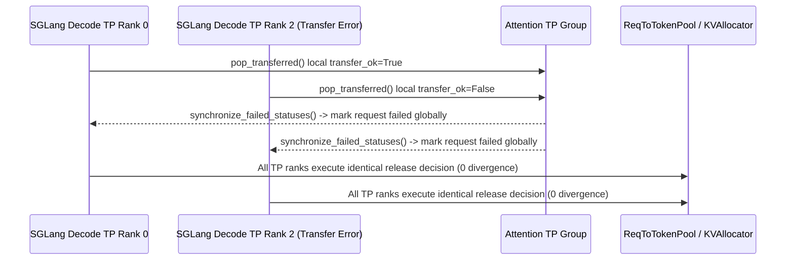

# SGLang Disaggregated Decode Deferred-KV TP Sync & Radix Eviction Walk, TRT-LLM Standalone CPU Render & Gemma-4 Hybrid KV, and vLLM Offload Classification

> **Category**: Serving Engines & Distributed Runtimes (`serving-runtimes`) · **Phase**: Phase 48 (`priority: 57`) · **Date**: 2026-10-22  
> **First-Hand Upstream Sources**:
> - [`sgl-project/sglang@b57b5e2286`](https://github.com/sgl-project/sglang/commit/b57b5e22867f110ff577a9da18a9ff7e6619100c) — `[PD] Synchronize deferred decode KV release across attn TP ranks (#45453)`
> - [`sgl-project/sglang@5e79333c95`](https://github.com/sgl-project/sglang/commit/5e79333c95c162abf079548fe40a6a2bca6c5409) — `feat(radix-tree): thread cache_actions through the eviction walk (#45439)`
> - [`NVIDIA/TensorRT-LLM@ec3352fee2`](https://github.com/NVIDIA/TensorRT-LLM/commit/ec3352fee21a7a16ebd320d30a94e1a7d5ac3bda) — `[https://nvbugs/6098699][feat] Add standalone trtllm-render and /v1/chat/completions/render (#19964)`
> - [`NVIDIA/TensorRT-LLM@e8127c7c5c`](https://github.com/NVIDIA/TensorRT-LLM/commit/e8127c7c5cff381752d7e2343f05fbbabe34df35) — `[https://nvbugs/6093910][fix] Fix Gemma4 failure to start on non-SM100 GPUs (#18547)`
> - [`NVIDIA/TensorRT-LLM@7f0caf443e`](https://github.com/NVIDIA/TensorRT-LLM/commit/7f0caf443ec440ffc7ca455c91ff6f7c8b0b8d67) — `[https://nvbugs/6925906][fix] Floor gen_only device-step-time baselines at the expected-bucket cutover (#20297)`
> - [`vllm-project/vllm@550c1cbb8b`](https://github.com/vllm-project/vllm/commit/550c1cbb8b0a366f1bb2b5aea560a1d8e70f04cb) — `[KV Offload] Preserve group classification on placeholder events (#59703)`
> - [`vllm-project/vllm@65a886c69f`](https://github.com/vllm-project/vllm/commit/65a886c69f44cf446d6afa03315f39590ccd843e) — `[Bugfix][Pooling] Reject multimodal inputs in chunked embeddings (#62859)`

---

## 1. Background and Consistency Failure Modes

Across Prefill-Decode (PD) disaggregation, hybrid attention (Gemma-4 / Mamba + sliding-window), and long-context embedding pooling, SGLang, TensorRT-LLM, and vLLM resolved critical runtime consistency issues:

1. **Cross-TP Divergence in SGLang Deferred Decode KV Release (`#45453`)**: With `delay_kv_release` enabled, `DecodeTransferQueue.pop_transferred` previously evaluated transfer errors independently on each rank. When an RDMA transfer failed on a subset of attention-TP ranks, some ranks held the request's KV slots in `release_wait_queue` while others freed them immediately, desynchronizing the KV pool.
2. **Composable Radix Eviction Side-Effects (`#45439`)**: Evicting nodes in composable/hybrid Radix trees requires both freeing primary KV values (`_free_values`) and executing auxiliary component actions (`CacheAction | ComponentAction`) in a deterministic order.
3. **TRT-LLM CPU-Only Chat Rendering (`#19964`), Gemma-4 Non-SM100 Hybrid KV Startup (`#18547`), and Gen-Only Baseline Cutover (`#20297`)**: Gateways needed a GPU-free chat template renderer with cryptographic fingerprint verification; Gemma-4 crashed on non-SM100 GPUs due to heterogeneous per-layer KV head counts (`num_heads_per_kv` mismatch); and `gen_only` perf sanity tests suffered ~3x P5 baseline skew from legacy modal-bucket rows.
4. **vLLM Placeholder Offload Group Loss (`#59703`) and Chunked Embedding Multimodal Corruption (`#62859`)**: `OffloadingEventsTracker.reset()` wiped group metadata needed by placeholder `BlockStored` events, while chunked embedding pooling corrupted multimodal placeholder spans.

---

## 2. Mechanism and Source-Level Analysis

### 2.1 SGLang `DecodeTransferQueue` TP Synchronization & Radix `cache_actions` Walk

- **Synchronized Deferred Release (`sgl-project/sglang@b57b5e2286`)**: Synchronizes failure statuses across the attention-TP group inside `DecodeTransferQueue.pop_transferred`, ensuring all TP ranks agree on holding vs releasing KV slots.
- **Eviction Ordering Invariant (`sgl-project/sglang@5e79333c95`)**: Threads `cache_actions: list[CacheAction | ComponentAction]` through `BaseEvictionResult` and enforces draining `_free_values` strictly before `_apply_cache_actions`, guarded by a `__del__` unconsumed-result tripwire.

### 2.2 TensorRT-LLM `trtllm-render`, Gemma-4 `KVCacheLayerSpec`, and `gen_only` History Floor

- **Standalone CPU `trtllm-render` (`NVIDIA/TensorRT-LLM@ec3352fee2`)**: Ships a CPU-only CLI and `/v1/chat/completions/render` endpoint emitting `render_fingerprint.digest` (`sha256:...`) and excluding `_GENERATION_CHANNEL_OPENER_TOKENS = 3` on Kimi-K3 prompt token accounting.
- **Gemma-4 `max_num_heads_per_kv` (`NVIDIA/TensorRT-LLM@e8127c7c5c`)**: Introduces `KVCacheLayerSpec` and computes `max_num_heads_per_kv = 8` across heterogeneous sliding-window (`16/8=2`) and global (`16/2=8`) layers on non-SM100 GPUs.
- **Gen-Only Device-Step-Time Floor (`NVIDIA/TensorRT-LLM@7f0caf443e`)**: Filters history rows prior to `GEN_ONLY_DEVICE_STEP_TIME_HISTORY_FLOOR_MS = 1790856543000` (`2026-10-01T12:09:03Z`), preventing legacy `4.2 ms` short-tail modal rows from pulling down the `12.4 ms` steady-state P5 baseline.

### 2.3 vLLM Static Offload Group Classification & Multimodal Chunked-Embedding Guard

- **Static `_group_specs` Survival (`vllm-project/vllm@550c1cbb8b`)**: Decouples static `{group_idx: OffloadingEventGroupSpec(kind, window)}` from dynamic residency state in `OffloadingEventsTracker` so placeholder `BlockStored` events retain `kv_cache_spec_kind="mamba"` / `"sliding_window"` across `reset()`.
- **Multimodal Chunked-Embedding Guard (`vllm-project/vllm@65a886c69f`)**: Rejects any batch containing `engine_input["prompts"]["type"] == "multimodal"` in `maybe_pre_process_chunked` with `VLLMValidationError`.

---

## 3. Deterministic Standard-Library Reproduction

- Command: `python experiments/sglang-disagg-deferred-kv-tp-sync-radix-walk-trtllm-render-gemma4-vllm-offload/run.py --check`
- Artifact: `experiments/sglang-disagg-deferred-kv-tp-sync-radix-walk-trtllm-render-gemma4-vllm-offload/summary.json`
- Unit tests: `tests/test_phase48_experiments.py`
