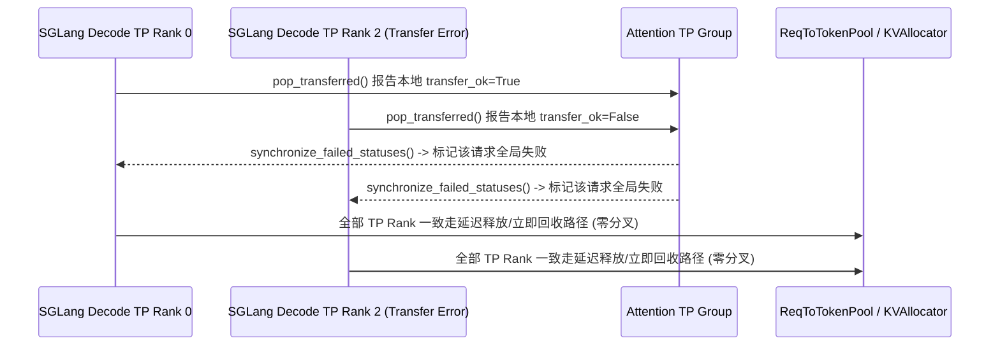

# SGLang 分离式解码延迟 KV 释放 TP 同步与 Radix 驱逐、TRT-LLM 独立 CPU 渲染与 Gemma-4 混合 KV 及 vLLM 卸载分类

> **分类**：推理引擎与分布式运行时 (`serving-runtimes`) · **阶段**：Phase 48 (`priority: 57`) · **日期**：2026-10-22  
> **上游一手来源**：
> - [`sgl-project/sglang@b57b5e2286`](https://github.com/sgl-project/sglang/commit/b57b5e22867f110ff577a9da18a9ff7e6619100c) — `[PD] Synchronize deferred decode KV release across attn TP ranks (#45453)`
> - [`sgl-project/sglang@5e79333c95`](https://github.com/sgl-project/sglang/commit/5e79333c95c162abf079548fe40a6a2bca6c5409) — `feat(radix-tree): thread cache_actions through the eviction walk (#45439)`
> - [`NVIDIA/TensorRT-LLM@ec3352fee2`](https://github.com/NVIDIA/TensorRT-LLM/commit/ec3352fee21a7a16ebd320d30a94e1a7d5ac3bda) — `[https://nvbugs/6098699][feat] Add standalone trtllm-render and /v1/chat/completions/render (#19964)`
> - [`NVIDIA/TensorRT-LLM@e8127c7c5c`](https://github.com/NVIDIA/TensorRT-LLM/commit/e8127c7c5cff381752d7e2343f05fbbabe34df35) — `[https://nvbugs/6093910][fix] Fix Gemma4 failure to start on non-SM100 GPUs (#18547)`
> - [`NVIDIA/TensorRT-LLM@7f0caf443e`](https://github.com/NVIDIA/TensorRT-LLM/commit/7f0caf443ec440ffc7ca455c91ff6f7c8b0b8d67) — `[https://nvbugs/6925906][fix] Floor gen_only device-step-time baselines at the expected-bucket cutover (#20297)`
> - [`vllm-project/vllm@550c1cbb8b`](https://github.com/vllm-project/vllm/commit/550c1cbb8b0a366f1bb2b5aea560a1d8e70f04cb) — `[KV Offload] Preserve group classification on placeholder events (#59703)`
> - [`vllm-project/vllm@65a886c69f`](https://github.com/vllm-project/vllm/commit/65a886c69f44cf446d6afa03315f39590ccd843e) — `[Bugfix][Pooling] Reject multimodal inputs in chunked embeddings (#62859)`

---

## 1. 背景与分布式推理一致性痛点

在多机 Prefill-Decode (PD) 分离、混合注意力（Gemma-4 / Mamba + 滑动窗口）以及长上下文 Embedding 池化中，SGLang、TensorRT-LLM 与 vLLM 暴露了以下深层一致性与可用性缺陷：

1. **SGLang PD 分离解码端跨 TP Rank 的延迟 KV 释放失步 (`#45453`)**：当启用 `delay_kv_release` 时，`DecodeTransferQueue.pop_transferred` 根据本地传输状态决定是将异常请求放入 `release_wait_queue` 暂存还是立即释放。若某次 RDMA 传输仅在部分 Attention-TP Rank 上超时报错，各 TP Rank 对 KV 槽位的保留/释放决策发生分叉，导致后续分配的 KV 物理页跨 Rank 失锁。
2. **SGLang 组合式 Radix Tree 驱逐副作用丢失 (`#45439`)**：在混合注意力或分级缓存（Hierarchical / Mamba Radix Tree）中，节点驱逐不仅需要回收主存池页（`_free_values`），还需触发组件级缓存动作（`CacheAction | ComponentAction`）；若未严格保证先释放值再执行组件动作，或未消费驱逐结果，会导致状态悬空。
3. **TRT-LLM 前置 CPU 模板渲染解耦 (`#19964`)、Gemma-4 非 SM100 混合 KV 启动崩溃 (`#18547`) 与性能门禁假阳性 (`#20297`)**：网关层急需无 GPU 依赖的独立 Chat 模板渲染与指纹校验；Gemma-4 在 Hopper/Ada 等非 SM100 GPU 上因不同层 KV 头数不同（全局层 vs 滑动窗口层）导致注意力元数据 `num_heads_per_kv` 校验失败；同时 `gen_only` 模式从众数分桶（Modal Bucket）切换至稳态分桶后，旧历史记录将 P5 基线拉低约 `3x`，导致所有当前构建误报回归。
4. **vLLM KV 卸载占位事件分类丢失 (`#59703`) 与分块池化多模态越界 (`#62859`)**：当 `OffloadingEventsTracker.reset()` 清空动态驻留状态或删除事件早于存储事件到达时，占位 `BlockStored` 事件丢失了 `"mamba"` / `"sliding_window"` 组分类；而分块 Embedding 池化若混入多模态图像输入，会将视觉占位符切碎导致运行时错误。

---

## 2. 核心机制与源码级修复剖析

### 2.1 SGLang `DecodeTransferQueue` TP 同步与 Radix 驱逐动作链

- **跨 Attention-TP 同步延迟释放 (`sgl-project/sglang@b57b5e2286`)**：在 `DecodeTransferQueue.pop_transferred` 中，对等待释放队列（`release_wait_queue`）的准入决策与超时回收均接入跨 Attention-TP 组同步，使所有 TP Rank 在同一调度步对异常请求的 KV 生命周期做出完全一致的决策（分叉率从 `True` 降至 `False`）。
- **驱逐动作链式传递与析构哨兵 (`sgl-project/sglang@5e79333c95`)**：在 `BaseEvictionResult` 中新增 `cache_actions: list[CacheAction | ComponentAction]`，并在 `_apply_eviction_result` 中强制执行**先排空 `_free_values`、后执行 `_apply_cache_actions`** 的顺序不变量；同时通过 `__del__` 哨兵捕获任何未被 `_apply_eviction_result` 消费的驱逐结果。

### 2.2 TensorRT-LLM `trtllm-render`、Gemma-4 `KVCacheLayerSpec` 与 `gen_only` 历史基线截断

- **独立 CPU 渲染服务 `trtllm-render` (`NVIDIA/TensorRT-LLM@ec3352fee2`)**：新增无 GPU 依赖的 `trtllm-render` CLI 与 `/v1/chat/completions/render` 端点，返回预渲染 Token ID、多模态占位符区间以及 `render_fingerprint.digest`（SHA-256 指纹）；当推理服务端开启 `--Trust-Rendered-Chat-Template` 时校验该摘要，并对 Kimi-K3 自动扣除 `_GENERATION_CHANNEL_OPENER_TOKENS = 3` 个引导 Token，避免重复计费。
- **Gemma-4 非 SM100 混合层 `max_num_heads_per_kv` (`NVIDIA/TensorRT-LLM@e8127c7c5c`)**：引入 `KVCacheLayerSpec`，将原先单一标量 `num_heads_per_kv` 替换为跨层最大值 `max_num_heads_per_kv`（例如 Gemma-4 滑动窗口层 `16/8=2`、全局层 `16/2=8`，取 `max=8`），彻底解决非 SM100 GPU 启动失败。
- **`gen_only` 性能基线时间戳截断 (`NVIDIA/TensorRT-LLM@7f0caf443e`)**：在 `perf_regression_utils.py` 中引入 `metric_history_floors_ms` 与 `GEN_ONLY_DEVICE_STEP_TIME_HISTORY_FLOOR_MS = 1790856543000` (`2026-10-01T12:09:03Z`)，自动过滤口径切换前的短尾分桶数据（`4.2 ms` vs 稳态 `12.4 ms`），消除 90 天滑窗内的 P5 假阳性报警。

### 2.3 vLLM 静态卸载组分类保留与多模态分块 Embedding 拦截

- **静态 `_group_specs` 跨重置存活 (`vllm-project/vllm@550c1cbb8b`)**：`OffloadingEventsTracker` 将静态组规格 `{group_idx: OffloadingEventGroupSpec(kind, window)}` 与动态前缀驻留表解耦；即使调用 `tracker.reset()` 或先收到 `BlockRemoved` 后生成占位 `BlockStored(block_size=0, token_ids=[])`，自描述事件依然准确携带 `kv_cache_spec_kind="mamba"` 或 `"sliding_window"`。
- **分块 Embedding 多模态前置拦截 (`vllm-project/vllm@65a886c69f`)**：在 `maybe_pre_process_chunked` 入口处检查整个混合批次，一旦发现任一请求 `engine_input["prompts"]["type"] == "multimodal"`，在修改上下文前立即抛出 `VLLMValidationError`。

---

## 3. 标准库确定性复现实验验证

- 运行命令：`python experiments/sglang-disagg-deferred-kv-tp-sync-radix-walk-trtllm-render-gemma4-vllm-offload/run.py --check`
- 产出契约：`experiments/sglang-disagg-deferred-kv-tp-sync-radix-walk-trtllm-render-gemma4-vllm-offload/summary.json`
- 关联单测：`tests/test_phase48_experiments.py`
