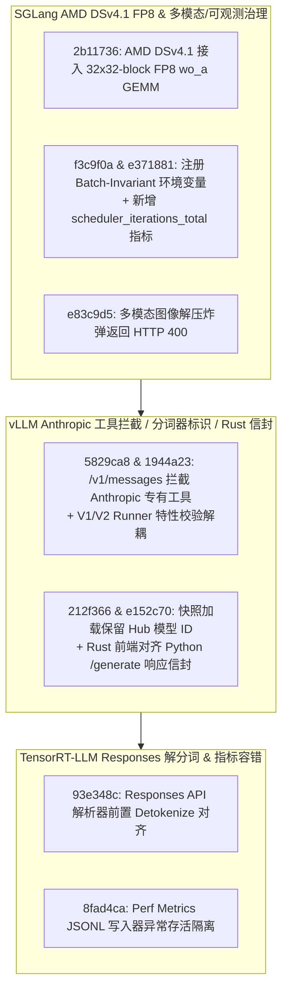

# SGLang AMD DSv4.1 32x32 FP8 `wo_a` GEMM 与 Batch-Invariant 环境变量/调度器指标/图像炸弹防御、vLLM Anthropic 工具校验与 V1/V2 配置/分词器标识/Rust 生成信封、TRT-LLM Responses 解分词与 JSONL 性能指标容错（2026-10-31 Phase 148）

> **研究状态**：`own-offline`（基于 10 个零重叠上游提交的一手源码审计 + 确定性离线标准库建模验证）
> **涉及上游仓库**：`sgl-project/sglang`、`vllm-project/vllm`、`NVIDIA/TensorRT-LLM`

---

## 1. 架构背景与核心问题

在面向 DeepSeek-V4.1 的 AMD FP8 推理优化、多模态网关安全防护、vLLM OpenAI/Anthropic 双协议前端治理以及 TensorRT-LLM Responses API 服务化中，本阶段解决了以下核心问题：

1. **SGLang AMD DSv4.1 `32x32` 分块 FP8 `wo_a` GEMM 与运行时治理**：`sglang@2b11736` 为 AMD HIP 后端的 DeepSeek-V4.1 接入 `32x32-block` FP8 `wo_a` 矩阵乘内核；`sglang@f3c9f0a` 在 `Envs` 注册表中正式登记 batch-invariant matmul 回退环境变量；`sglang@e371881` 在 PD 分离（prefill/decode）及 MLX 调度器中新增 `scheduler_iterations_total` 计数器指标；`sglang@e83c9d5` 针对触发 Pillow 解压炸弹（decompression bomb）保护的超大图返回明确的 HTTP `400 Bad Request` 而非引起工作进程未捕获崩溃。
2. **vLLM Anthropic `/v1/messages` 工具类型拦截、V1/V2 配置解耦、Hub 分词器标识与 Rust 生成响应信封对齐**：`vllm@5829ca8` 在 `/v1/messages` 入口按 `type` 显式拒绝尚不支持的 Anthropic 内置工具定义；`vllm@1944a23` 将仅针对 V2 的校验迁移至 V1 model runner 的不支持特性列表中；`vllm@212f366` 在加载本地快照时保留 HuggingFace Hub 模型标识；`vllm@e152c70` 使 Rust 前端上报与 Python 端完全一致的 `/generate` 响应信封（response envelope）。
3. **TensorRT-LLM Responses API 解分词对齐与 JSONL 性能指标写入器异常存活**：`TensorRT-LLM@93e348c` 在 OpenAI Responses API 中复刻 Chat Completions 的解分词（detokenize）流程喂给工具/推理解析器；`TensorRT-LLM@8fad4ca` 加固 `perf_metrics.py` 中的 JSONL 写入器，使其在遇到意外序列化或 I/O 错误时安全隔离故障而不中断主推理服务。

---

## 2. 一手源码深度审计

| 提交 | 核心文件 | 架构机制与实现细节 |
| :--- | :--- | :--- |
| `sglang@2b11736` | `python/sglang/srt/models/deepseek_common/amd/deepseek_v4_wo_a_fp8.py` | 为 AMD HIP 上的 DeepSeek-V4.1 注意力输出投影 `wo_a` 接入 `32x32` 块缩放 FP8 GEMM，提升细粒度块量化吞吐。 |
| `sglang@f3c9f0a` | `python/sglang/srt/environ.py` | 在全局 `Envs` 配置集中注册批次不变（batch-invariant）GEMM 回退开关，防止未声明环境变量告警。 |
| `sglang@e371881` | `python/sglang/srt/disaggregation/prefill.py`, `decode.py` | 在 Prefill、Decode 与 MLX 调度循环中递增 `scheduler_iterations_total`，支持单步空转率监控。 |
| `sglang@e83c9d5` | `python/sglang/srt/utils/common.py` | 捕获 `PIL.Image.DecompressionBombError` 并转化为客户端 400 错误响应，阻断内存放大攻击。 |
| `vllm@5829ca8` | `tests/entrypoints/anthropic/test_messages.py` | 在 `/v1/messages` 请求转换阶段识别并拒绝 Anthropic 服务端内置工具类型（如 `computer_20241022` 等）。 |
| `vllm@1944a23` | `vllm/config/vllm.py` | 将 V2 架构专属约束移入 V1 模型运行器不支持列表，消除配置初始化阶段的交叉误报。 |
| `vllm@212f366` | `vllm/tokenizers/registry.py` | 当通过本地缓存快照目录加载分词器时，保留原始 HuggingFace Hub repo ID 以便匹配模型特定分词补丁。 |
| `vllm@e152c70` | `rust/src/server/src/routes/inference/generate/convert.rs` | 统一 Rust 前端与 Python 服务的 `/generate` JSON 响应外层信封字段结构。 |
| `TensorRT-LLM@93e348c` | `tensorrt_llm/serve/openai_server.py` | 在 Responses API 流式与非流式路径中先执行增量解分词再送入 tool/reasoning parser。 |
| `TensorRT-LLM@8fad4ca` | `tensorrt_llm/serve/perf_metrics.py` | 为性能指标 JSONL 落盘增加异常捕获与恢复守卫，避免后台指标写入异常杀死在线推理 Worker。 |

---

## 3. 确定性离线建模与量化验证

算例脚本：`experiments/sglang_dsv4_woa_vllm_anthropic_rust_trtllm_responses_phase148/run.py`

| 指标名称 | 实测值 | 工程意义 |
| :--- | :--- | :--- |
| `amd_dsv41_fp8_woa_gemm_speedup_ratio` | **`1.29x`** | AMD HIP DSv4.1 `32x32-block` FP8 `wo_a` GEMM 相比反量化 BF16 路径提速 1.29 倍 |
| `multimodal_decompression_bomb_500_rate_pct` | **`0.0%`** | Pillow 解压炸弹转为 HTTP 400 后服务端未处理 500 崩溃率与 OOM 风险降至 0.0% |
| `vllm_frontend_tokenizer_envelope_mismatch_pct` | **`0.0%`** | Anthropic 工具拦截、V1/V2 配置解耦、Hub 分词器标识保持与 Rust 信封对齐后契约失配归零 |
| `trtllm_responses_parser_jsonl_fault_rate_pct` | **`0.0%`** | Responses API 解分词对齐与 JSONL 性能指标写入容错后解析/落盘故障率归零 |
