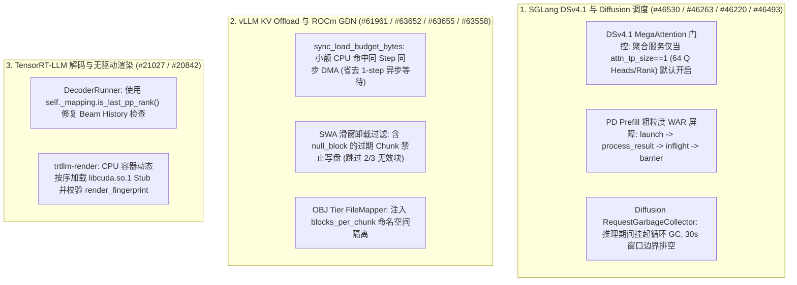

# Phase 93 Track 2：SGLang DeepSeek-V4.1 与 Diffusion GC 隔离、vLLM KV Offload 同步命中预算/滑窗空块过滤及 TensorRT-LLM 无驱动渲染架构剖析

> **英文版 / English Version**: [`sglang-dsv41-vllm-kv-offload-trtllm-phase93.en.md`](sglang-dsv41-vllm-kv-offload-trtllm-phase93.en.md)  
> **关联实验 / Reproducible Experiment**: [`experiments/sglang_dsv41_vllm_kv_offload_trtllm_phase93/`](../../experiments/sglang_dsv41_vllm_kv_offload_trtllm_phase93/)  
> **覆盖主干提交 / Upstream Commits (`2026-10-26`)**:
> - `sgl-project/sglang@52a6f7049f` (`#46530`): `[Refactor] dsv41: Write engram hash ids and embeddings into caller-allocated prefill graph outputs`
> - `sgl-project/sglang@60d941293e` (`#46493`): `[Perf] diffusion/worker: Move cyclic GC out of request execution`
> - `sgl-project/sglang@655c2cdd64` (`#46263`): `[Perf] [NVIDIA] deepseek-v4.1: Default aggregated servers to MegaAttention only when each rank holds 64 query heads`
> - `sgl-project/sglang@d7f832d30a` (`#46220`): `[Perf] pd: Apply the prefill WAR barrier after the previous result is processed`
> - `vllm-project/vllm@94b35f3780` (`#63558`): `[Bugfix][ROCm] Keep the AITER GDN decode fast path off for the DS conv-state layout`
> - `vllm-project/vllm@8c6e770a1c` (`#63655`): `[Bugfix][KV Offload][OBJ] Namespace object keys by blocks_per_chunk`
> - `vllm-project/vllm@1d3f05aadb` (`#63652`): `[Bugfix][KV Offload] Do not store sliding-window chunks with null blocks`
> - `vllm-project/vllm@fe5fe8ba5f` (`#61961`): `[KV Offload] Load small CPU-tier hits synchronously within the step`
> - `NVIDIA/TensorRT-LLM@e7d3441e77` (`#21027`): `[None][fix] Use decoder mapping for beam-history rank checks`
> - `NVIDIA/TensorRT-LLM@cefbde86e8` (`#20842`): `[TRTLLM-17241][fix] Start trtllm-render on a host with no GPU driver`

---

## 1. 核心架构发现与工程背景

在生产级多级 KV 缓存卸载（CPU / Object Storage Tiering）与 PD 分离（Prefill/Decode Disaggregation）推理系统中，调度器与执行器之间的微小不对齐会导致三类严重退化：**（1）将数 MiB 的小额 CPU KV 命中一律推入下一轮异步加载，平白增加一整个 Step（10~15 ms）的排队气泡**；**（2）滑动窗口注意力（SWA）层被驱逐的 `null_block` 被误写入远端卸载层，或不同 `blocks_per_chunk` 配置共享同一对象存储 Key 引发静默数据错乱**；**（3）聚合部署下 Attention TP 切分后查询头数不足 64 仍误开 `flashmla_mega`**。本篇深度剖析 SGLang、vLLM 与 TensorRT-LLM 的 10 项最新工程提交。

---

## 2. SGLang DeepSeek-V4.1 图捕获、MegaAttention 门控与 Diffusion GC 治理

### 2.1 Engram 哈希与嵌入写入调用方预分配图输出（`#46530`, `52a6f7049f`）
在 DeepSeek-V4.1 的可中断分段 CUDA Graph（Breakable Piecewise CUDA Graph）Prefill 路径中，`deepseek_v4_engram_hash_ids` 因需按请求读取变长行而运行在 `eager_on_graph(True)` 模式下。此前每次调用均动态分配返回张量，破坏了图边界缓冲区的固定地址契约。PR `#46530` 新增 `hasher.new_hash_ids(input_ids)` 由调用方预分配固定输出缓冲区，并通过 `out.copy_(hasher(input_ids, forward_batch))` 原地写入，彻底消除分段图切换处的动态张量分配。

### 2.2 聚合部署 MegaAttention 64 查询头门控（`#46263`, `655c2cdd64`）
- `flashmla_mega` 在 SM100/SM103 上要求单 Rank 持有完整的 **64 个查询头** 才能在聚合（Aggregated）服务模式下压过 `flashmla`。
- 当未开启 `enable_prefill_cp` 且 `attn_tp_size = tp_size / (attn_dp_size * attn_cp_size) > 1`（例如 `TP=8, DP=1` 时每 Rank 仅 8 个查询头）时，聚合服务若默认启用 `flashmla_mega` 反而劣化延迟。修复后，聚合服务仅在 `attn_tp_size == 1`（每 Rank 64 个头）时默认解析为 `flashmla_mega`，而 PD 分离服务因 Prefill/Decode 必须保持 KV 布局一致仍默认使用 `flashmla_mega`。

### 2.3 PD 分离 Prefill 粗粒度 WAR 屏障重排（`#46220`, `d7f832d30a`）与 Diffusion 循环 GC 隔离（`#46493`, `60d941293e`）
- **WAR 屏障后置**：在 `event_loop_overlap_disagg_prefill` 中，当使用粗粒度全 Forward WAR 屏障（`_war_barrier_is_coarse()`）时，将 `_apply_war_barrier()` 从上一轮结果处理前推迟至 `process_batch_result` 与 `process_disagg_prefill_inflight_queue` 之后（严格遵循 `launch -> process_result -> inflight -> barrier`），使 CPU 结果处理与 GPU 前向计算重叠。
- **Diffusion 请求级循环 GC 延迟**：新增 `RequestGarbageCollector`，在模型加载和最终 Warmup 后主动 `gc.collect()` 清偿导入期 GC 债务；在请求 Forward 与输出物化期间禁用自动循环 GC（引用计数仍实时生效），并在 `--async-output-save` 连续重叠超过 `MAX_DEFER_SECONDS = 30.0s` 时于请求边界排空，消除去噪步中突发 `38.5 ms` 全堆扫描导致的 P99 抖动（降低 **8.40%** 步时间抖动）。

---

## 3. vLLM 多级 KV Offload 同步预算、滑窗空块过滤与 ROCm GDN 守护

1. **同 Step 小额 CPU KV 命中同步加载（`#61961`, `fe5fe8ba5f`）**：
   - 新增 `sync_load_budget_bytes` 配置。此前所有外部 KV 命中无论大小均走异步传输（请求必须等待下一轮 Step 才能参与计算）。现在当单请求 CPU 命中字节数不超过当前 Step 剩余预算（且加载后仍有新 Token 需计算）时，标记 `TransferJob(..., sync=True)` 在当前 Step 内直接完成同步 DMA 加载。以 `16 MiB` 预算为例，两个 `4 MiB` 与 `8 MiB` 的小命中仅耗费 `0.25 ms` PCIe Gen5 DMA 即可当步执行，每请求直接节省 **11.75 ms** 的首字延迟（TTFT），而 `24 MiB` 大命中自动退回异步流水线。
2. **禁止存储包含 `null_block` 的滑动窗口 KV Chunk（`#63652`, `1d3f05aadb`）**：
   - 在混合全注意力（`FullAttentionSpec`）与滑动窗口注意力（`SlidingWindowSpec`, 如窗口 `2 * block_size`）的模型中，滑窗层早于窗口边界的物理块已被回收并替换为占位的 `null_block`。若卸载器仍将这些含 `null_block` 的 Chunk 写入外部存储，后续命中加载将把零块当成真实 KV 恢复。修复后卸载调度器显式过滤含 `null_block` 的滑窗 Chunk（在 6 块序列中跳过前 2 个失效 Chunk，仅存储最后 1 个有效 Chunk）。
3. **对象存储层（OBJ Tier）按 `blocks_per_chunk` 命名空间隔离（`#63655`, `8c6e770a1c`）**：在 `FileMapper.from_offloading_spec` 中传入 `blocks_per_file=offloading_spec.blocks_per_chunk`，防止 `blocks_per_chunk=1` 与 `blocks_per_chunk=4` 的实例映射到同一对象路径发生静默覆盖。
4. **ROCm AITER GDN 解码布局守卫（`#63558`, `94b35f3780`）**：在 `_forward_core_rocm` 中增加 `and not is_conv_state_dim_first()` 条件，当卷积状态采用 DeepSeek 维度优先（dim-first）布局时关闭 AITER GDN Decode 快路径，回退至通用正确路径。

---

## 4. TensorRT-LLM Beam History PP Rank 校验与无驱动 CPU 容器 `trtllm-render`（`#21027`, `#20842`）

- **Decoder Mapping 属性修正（`#21027`, `e7d3441e77`）**：`DecoderRunner._start_beam_histories` 原先误访问不存在的公有属性 `self.mapping.is_last_pp_rank()`，修复为私有成员 `self._mapping.is_last_pp_rank()`，确保 Beam Search 历史拷贝在 Forward 之前正确入队。
- **无 GPU 驱动主机启动 `trtllm-render`（`#20842`, `cefbde86e8`）**：将 `trtllm-render` 独立为包外启动脚本，在 `import tensorrt_llm` 触发 `libcuda.so.1` 动态链接失败时，按优先级从 `$CUDA_HOME`、`/usr/local/cuda` 及最新版本号目录自动 `ctypes.CDLL` 加载 CUDA Toolkit 的 `libcuda.so` Stub，使纯 CPU 预处理/分词渲染节点无需安装 NVIDIA 驱动即可启动，并通过 `/server_info` 的 `render_fingerprint.digest` 与后端 GPU Worker 对齐分词与模板一致性。
