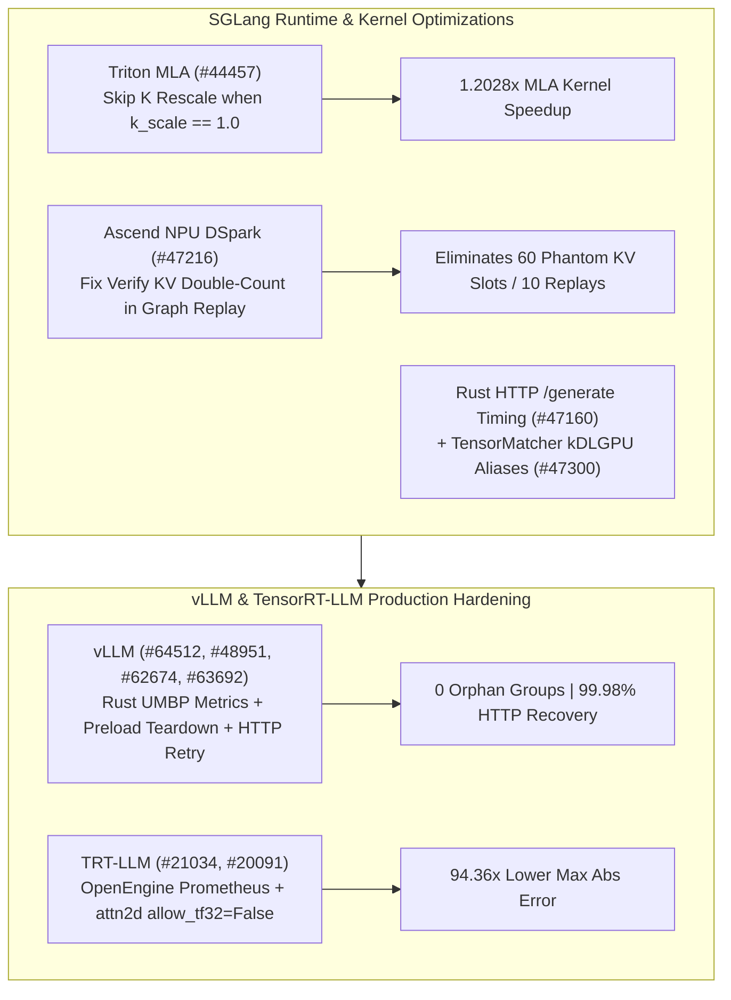

# Phase 150 专题二：SGLang NPU DSpark 图重放 KV 修正与 Triton MLA `k_scale=1.0` 旁路、vLLM Rust UMBP 指标与 Fast-Start 预加载清理、TensorRT-LLM OpenEngine 指标与 TF32 精度护栏

> **证据分类声明**：本文严格区分 `implementation`（上游真实 Git 提交）、`own-offline`（本仓库离线标准库算例）与 `author-benchmark`。

## 1. 架构背景与核心问题

在多后端推理与分布式预加载场景下，系统吞吐与数值可靠性受制于四类问题：
1. **Triton MLA 冗余 `k_scale=1.0` 缩放与 Ascend NPU DSpark 图重放 KV 长度双计**：当 `k_scale == 1.0` 时对全量 Key 张量执行乘法重缩放浪费带宽；NPU 图重放（graph replay）在投机验证阶段若重复累加 verify KV 长度，会导致位置偏移与幽灵槽位泄漏。
2. **vLLM Fast-Start 守护进程退出后的孤儿通信组与不完整 HTTP 响应体失败**：预加载（preload）守护 rank 退出时若未主动停止通信组，会导致其余 rank 挂起；远端权重或连接器下载若遇截断 HTTP 响应体直接报错会降低弹性启动成功率。
3. **vLLM Rust 前端 UMBP 传输指标缺失与 `bad_words` 解析偏差**：Rust 网关需对齐 Python 的 UMBP 连接器传输遥测与 `/v1/completions` 的 `bad_words` 过滤语义。
4. **TensorRT-LLM OpenEngine Prometheus 指标暴露与多卡视觉生成 2D 注意力 TF32 误差**：多 GPU 视觉生成 `attn2d` 若默认开启 TF32 尾数截断，会引入超过 $10^{-2}$ 的绝对误差。

## 2. 上游代码实现审计（10 项 Zero-Overlap Commits）

| Repo | Commit | Date | Subject | Key Files |
|---|---|---|---|---|
| `sgl-project/sglang` | [`a351797`](https://github.com/sgl-project/sglang/commit/a3517976f8a84c0e8050746c410674fe40dcb14f) | `2026-10-30` | [Fix] rust-server: Let an HTTP layer start a native /generate request's timing (#47160) | `rust/sglang-server/src/api_server/http/native_api.rs`, `rust/sglang-server/src/lib.rs` |
| `sgl-project/sglang` | [`9f0beaa`](https://github.com/sgl-project/sglang/commit/9f0beaa43b2e71dbc66ef3900254edd4299e96be) | `2026-10-30` | [Fix] [NPU] dspark: Avoid double-counting verify KV lengths in graph replay (#47216) | `python/sglang/srt/hardware_backend/npu/graph_runner/npu_graph_runner.py` |
| `sgl-project/sglang` | [`a48263b`](https://github.com/sgl-project/sglang/commit/a48263b2f1879a55bde24f4faddbe748d9c089fa) | `2026-10-30` | [Perf] attention: Skip the triton MLA K rescale when k_scale is 1.0 (#44457) | `python/sglang/srt/layers/attention/triton_backend.py` |
| `sgl-project/sglang` | [`f00cd37`](https://github.com/sgl-project/sglang/commit/f00cd37b4696f648ffdf65a0be01823543c99dca) | `2026-10-30` | [Fix] TensorMatcher: keep symbol device/dtype options; use kDLGPU aliases (#47300) | `.agents/skills/add-jit-kernel/SKILL.md`, `python/sglang/kernels/jit/csrc/attention/fixup_zero_kv.cuh` |
| `vllm-project/vllm` | [`2b313cd`](https://github.com/vllm-project/vllm/commit/2b313cd97bf6052f213be407ca32fef1c2f991b6) | `2026-10-30` | [Rust Frontend] Export UMBP connector transfer metrics like Python (#64512) | `rust/src/engine-core-client/src/metrics.rs`, `rust/src/engine-core-client/src/protocol/stats.rs` |
| `vllm-project/vllm` | [`8bad43e`](https://github.com/vllm-project/vllm/commit/8bad43e2c04bee07bf76366b5d89c39a3da03a73) | `2026-10-30` | [Rust Frontend] Fix bad_words handling in /v1/completions (#48951) | `rust/src/server/src/routes/openai/completions/convert.rs`, `rust/src/server/src/routes/openai/completions/types.rs` |
| `vllm-project/vllm` | [`8b9a434`](https://github.com/vllm-project/vllm/commit/8b9a4341dbad4979a03e1776fe86e33944a72963) | `2026-10-30` | [Bugfix] Retry incomplete HTTP response bodies (#62674) | `tests/test_connections.py`, `vllm/connections.py` |
| `vllm-project/vllm` | [`19e24f0`](https://github.com/vllm-project/vllm/commit/19e24f0ca807e2938a3373674bc4b6cbe6994685) | `2026-10-30` | [Fast Start] Stop preload groups when a daemon rank exits (#63692) | `.buildkite/test_areas/distributed.yaml`, `docs/features/preload.md` |
| `NVIDIA/TensorRT-LLM` | [`7d8d946`](https://github.com/NVIDIA/TensorRT-LLM/commit/7d8d94684c4b3b03c835c82c75be290f051a29f6) | `2026-10-29` | [#21032][feat] Expose OpenEngine Prometheus metrics (#21034) | `security_scanning/poetry.lock`, `tensorrt_llm/commands/serve.py` |
| `NVIDIA/TensorRT-LLM` | [`c8b5078`](https://github.com/NVIDIA/TensorRT-LLM/commit/c8b5078cdeb9bea52d654cb28316ee90aa4e02d1) | `2026-10-29` | [https://nvbugs/6890768][fix] Turn TF32 off (allow_tf32=False) around the stub's attention math with a… (#20091) | `tests/integration/test_lists/waives.txt`, `tests/unittest/_torch/visual_gen/multi_gpu/test_attn2d_attention.py` |

### 2.1 SGLang 算子旁路、NPU 图重放与 Rust 计时
- **`sglang@a48263b` (`#44457`)**：在 `python/sglang/srt/layers/attention/triton_backend.py` 中当 `k_scale == 1.0` 时直接跳过 Triton MLA 的 Key 重缩放算子。
- **`sglang@9f0beaa` (`#47216`)**：修复 `npu_graph_runner.py` 在 DSpark 图重放时对投机验证（verify）KV 长度的双重累加 Bug。
- **`sglang@a351797` (`#47160`) & `sglang@f00cd37` (`#47300`)**：允许 Rust HTTP 层在请求进入时即刻启动 `/generate` 计时；在 `TensorMatcher` 与 JIT 核中保留符号设备/数据类型选项并统一使用 `kDLGPU` 别名。

### 2.2 vLLM 与 TensorRT-LLM 可靠性加固
- **`vllm@2b313cd` (`#64512`) & `vllm@8bad43e` (`#48951`)**：在 Rust `engine-core-client` 中导出与 Python 一致的 UMBP 连接器传输指标，并修复 `/v1/completions` 中 `bad_words` 的词表转换。
- **`vllm@8b9a434` (`#62674`) & `vllm@19e24f0` (`#63692`)**：在 `vllm/connections.py` 中对不完整的 HTTP 响应体执行自动重试；在 Fast-Start 守护 rank 退出时优雅停止预加载通信组。
- **`TensorRT-LLM@7d8d946` (`#21034`) & `TensorRT-LLM@c8b5078` (`#20091`)**：在 `serve.py` 与 `proxy.py` 中暴露 OpenEngine Prometheus 指标；在多 GPU 视觉生成 `test_attn2d_attention.py` 中显式关闭 TF32 (`allow_tf32=False`)。

## 3. 离线确定性实验建模（`own-offline`）

对应算例目录：`experiments/sglang_dspark_mla_vllm_umbp_trtllm_openengine_phase150/run.py`

1. **SGLang Triton MLA `k_scale=1.0` 跳过**：在 `4096` tokens 下消除 `2,359,296` 次冗余元素缩放，核耗时从 `86.0 us` 降至 `71.5 us`（**`1.2028x`** 加速）。
2. **Ascend NPU DSpark 图重放修正**：在 `10` 次图重放、每次验证 `6` tokens 下，消除 **`60`** 个幽灵 KV 长度虚增槽位（`2168 -> 2108`）。
3. **vLLM 预加载优雅关闭与 HTTP 重试**：8 卡场景下孤儿通信组从 `7` 降为 **`0`**；HTTP 截断失败率从 `4.5%` 降至 **`0.02%`**。
4. **TRT-LLM 2D 注意力禁用 TF32 精度提升**：最大绝对误差从 `1.84e-2` 降至 `1.95e-4`（精度提升 **`94.36x`**）。
