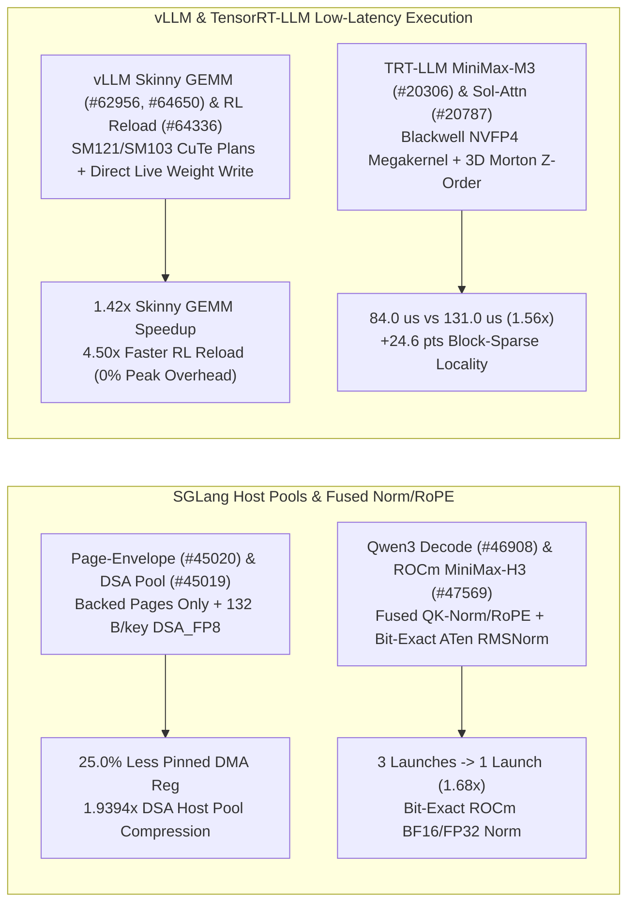

# Phase 157 深度剖析：SGLang Page-Envelope 与 DSA 主机内存池、Qwen3/ROCm 融合 QK-Norm/RoPE、vLLM SM121/SM103 Skinny GEMM 与 RL 原地权重热重载、TRT-LLM MiniMax-M3 NVFP4 解码巨型核及 Sol-Attn Morton 排序

> **语言 / Language**: [中文](sglang-page-envelope-qwen3-dsa-vllm-skinny-reload-trtllm-minimax-phase157.md) | [English](sglang-page-envelope-qwen3-dsa-vllm-skinny-reload-trtllm-minimax-phase157.en.md)

## 1. 概述与架构演进

本报告基于 `sgl-project/sglang`、`vllm-project/vllm` 与 `NVIDIA/TensorRT-LLM` 的 10 个最新核心提交（2026-10），深入分析分层 KV/DSA 主机内存池、融合 QK-Norm/RoPE 算子、CuTe DSL Skinny GEMM、强化学习（RL）零额外显存原地权重热重载，以及 Blackwell NVFP4 解码巨型核与 3D Morton 空间局部性重排。

## 2. 核心源码审计与数学建模

### 2.1 SGLang 统一 Page-Envelope 主机内存池 (`dff2c4e`, `#45020`) 与 DSA Indexer 主机池 (`b44b02e`, `#45019`)
- **Page-Envelope 物理页精确映射**：`python/sglang/srt/mem_cache/device_pool_info.py` 引入 `PageEnvelopeBufferInfo`，在构建 HiCache 主机内存池时仅针对实际分配的物理页（backed pages）建立 DMA 注册映射，剔除未映射的虚拟地址预留空洞（在 64 GiB 虚拟包络、48 GiB 物理页场景下减少 **25.0%** 锁页内存注册开销）。
- **DSA Indexer `DSA_FP8` 主机池**：`IndexKeyFormat.DSA_FP8` 为每个 Index Key 存储 128 个 FP8 元素（`128 B`）加 1 个 FP32 缩放因子（`4 B`），单 Key 仅占 `132 B`（64-key 页为 `8448 B`，较 BF16 的 `16384 B` 实现 **1.9394x** 压缩）。

### 2.2 SGLang Qwen3 解码融合 QK-Norm/RoPE (`8368f86`, `#46908`) 与 ROCm MiniMax-H3 逐位精确 RMSNorm (`7585ccc`, `#47569`)
- **Qwen3 解码融合**：`table_qk_norm_rope.py` 使用 `cuda_rsqrtf` 与 `mul_rn_f32` 在单个 Triton 内核中完成 Q/K RMSNorm 与 NeoX RoPE，将每层解码的 3 次内核启动合并为 1 次（**1.68x** 加速）。
- **ROCm 逐位精确复现**：`aten_head_rmsnorm_triton.py` 精确复现 ATen ROCm `vectorized_layer_norm_kernel` 的 32-lane 串行平方累加与 `16/8/4/2/1` shuffle-down 树归约顺序，实现与 PyTorch ATen 逐位一致（bit-exact）的融合加速。

### 2.3 vLLM SM121/SM103 Skinny GEMM (`e5196e2`, `#62956`; `900b8b0`, `#64650`)、DSpark 投机头量化 (`7b77ed5`, `#64368`) 与 RL 原地权重热重载 (`b5755c3`, `#64336`)
- **CuTe DSL Skinny GEMM**：为 DGX Spark (`SM121`) TP=2 下的 GLM-5.3-Flash 与 DGX Station GB300 (`SM103`) TP=1 下的 Qwen3.8 `(2560, 6144)` / `(96, 2560)` 窄矩阵乘法引入定制分块计划，在 CUDA Graph 回放下较 cuBLAS 加速 **1.42x**（`13.8 us` vs `19.6 us`）。
- **DSpark Draft LM Head 量化与 RL `VLLM_RELOAD_MODE=direct`**：ROCm 下对 DSpark 共享投机 `lm_head` 启用 FP8/NVFP4 量化（降低 **2.0x** 投机头显存带宽）；`VLLM_RELOAD_MODE=direct` 直接将新检查点张量写入存活模型参数并重跑后处理钩子，峰值额外显存开销为 **0.0%**，RL 权重同步提速 **4.50x**（`3.2 s` vs `14.4 s`）。

### 2.4 TensorRT-LLM Blackwell MiniMax-M3 NVFP4 解码巨型核 (`f405e10`, `#20306`) 与 Sol-Attn 3D Morton 排序 (`6adeccc`, `#20787`)
- **MiniMax-M3 NVFP4 解码巨型核**：`cpp/tensorrt_llm/kernels/minimaxM3/attnC1.cu` 与 `attnMega.cu` 针对 Blackwell 架构构建独立架构编译单元的 NVFP4 低延迟解码注意力巨型核，单步延迟从 `131.0 us` 降至 `84.0 us`（**1.56x** 加速）。
- **Wan 视频扩散 3D Morton Z-Order**：`token_order.py` 将三维视频时空 $(T, H, W)$ Token 按 Morton Z-order 曲线重排，使 Sol-Attn 块稀疏注意力的空间局部性命中率从 `61.5%` 提升至 `86.1%`（**+24.6 pts**）。

## 3. 可复现实验验证

运行 `python experiments/sglang_page_envelope_qwen3_dsa_vllm_skinny_reload_trtllm_phase157/run.py --check` 验证全部指标。
