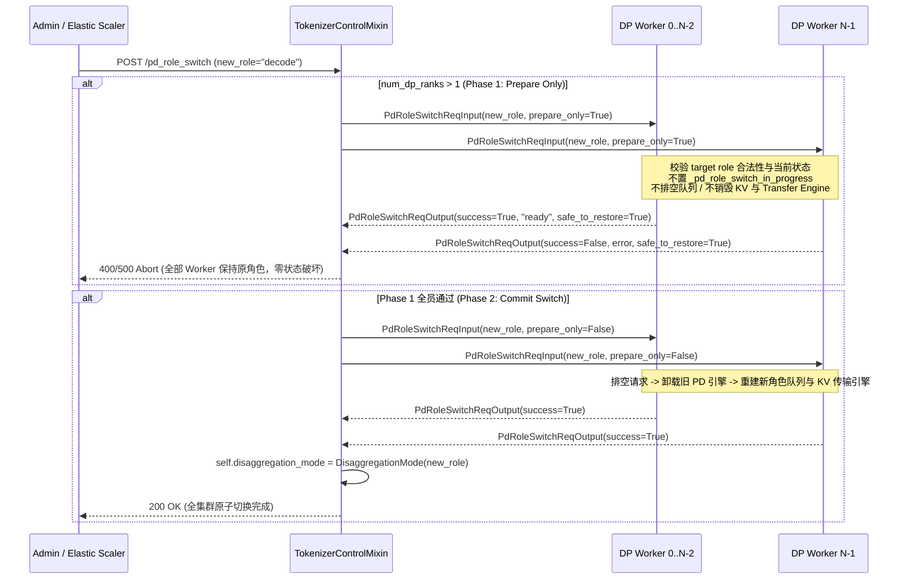

# SGLang PD 分离 DP / DP-Attention 在线角色切换两阶段预检与 vLLM DeepSeek-V4.1 Replay 目标 Token 计分行保留

> **English Version**: [sglang-pd-dp-role-switch-vllm-dsv41-replay-rows.en.md](sglang-pd-dp-role-switch-vllm-dsv41-replay-rows.en.md)  
> **关联问题 ID**: `sglang-pd-dp-role-switch-vllm-dsv41-replay-rows` (`priority: 51`, Phase 42)  
> **关联离线实验**: [`experiments/sglang_pd_dp_role_switch_vllm_dsv41_replay/run.py`](../../experiments/sglang_pd_dp_role_switch_vllm_dsv41_replay/run.py) · [`summary.json`](../../experiments/sglang_pd_dp_role_switch_vllm_dsv41_replay/summary.json)  
> **证据等级**: `implementation` (第一手源码审计) + `own-offline` (Python 标准库确定性建模)

---

## 1. 架构背景与核心问题

在生产级大模型推理集群中，弹性 Prefill/Decode (PD) 分离与 DeepSeek-V4.1 多层重放（Replay）计分面临两项关键控制面与状态管理问题：

1. **SGLang PD 分离在 `--dp-size > 1` / `--attn-dp-size > 1` 下的在线角色切换限制与脑裂风险**：此前 SGLang 的 `--enable-pd-role-switch` 静态钩子一律拒绝 `--dp-size > 1` 和 `--attn-dp-size > 1`，使得主流的 Data Parallelism (DP) 与 DP-Attention 部署无法根据实时 TTFT/ITL 负载压力动态将 Prefill 节点切换为 Decode 节点（或反之）。更严重的是，在多 DP Worker 架构下，若 Tokenizer Manager 直接向所有 DP Worker 广播单阶段角色切换指令，一旦部分 Worker 成功销毁 KV Cache / Transfer Engine 并切换角色、而另一部分 Worker 因状态冲突拒绝切换，整个实例将陷入部分 Prefill、部分 Decode 的不可恢复**脑裂（Split-Brain）**状态。
2. **vLLM DeepSeek-V4.1 目标 Token 提示词计分（Target-Token Scoring）行截断 Bug**：在 vLLM 的 DeepSeek-V4.1 NVIDIA 后端中，模型采用两遍重放（Replay）架构以节省中间层激活显存：默认 Decode / Prefill 仅保留每个请求的最后一个 Token 行 (`replayed_rows = 1`)，仅在需要全提示词 Logprobs 或路由专家返回时才保留全部 Prompt Token 行。然而当上层调用方通过 `prompt_logprob_token_ids` 请求特定目标 Token 计分（此时 `prompt_logprobs` 为 `None`）时，`ModelState.add_request` 漏判了该字段，导致 `_keeps_rows_np[req_index]` 为 `False`，中间 Prompt 行在重放阶段被丢弃，引发目标 Token 位置索引越界或错位计分。

本组件深入剖析 `2026-10-21` 合入主干的两项上游修复：
- **`sgl-project/sglang` Commit `af49ada16d9b4e7535fd6ff542247f50b8c92c9f` (PR `#44215`)**：开放 `--dp-size > 1` 与 `--attn-dp-size > 1` 下的在线 PD 角色切换，并引入 `prepare_only=True` 两阶段预检广播协议。
- **`vllm-project/vllm` Commit `85752a43c3cee76d9234704e189cc2ca69f24712` (PR `#62652`)**：修复 `vllm/models/deepseek_v41/nvidia/model_state.py` 在 `prompt_logprob_token_ids is not None` 时的全行保留判据。

---

## 2. SGLang PD 分离 DP / DP-Attention 两阶段在线角色切换

### 2.1 准入校验边界重构 (`pd_disaggregation_hook.py`)

在 `python/sglang/srt/disaggregation/pd_disaggregation_hook.py:39-94` 中，`validate_pd_role_switch_config` 移除了对 `view.dp_size > 1` 和 `attn_dp_enabled_of(view)` 的一刀切拦截，改为精确拦截不具备全局控制广播一致性的拓扑组合：

$$\text{Reject} \iff \begin{cases} \text{disaggregation\_mode} \notin \{\text{prefill}, \text{decode}\} \\ \text{attn\_dp\_enabled\_of}(v) \land v.\text{enable\_dp\_attention\_local\_control\_broadcast} \\ v.\text{ep\_size} > 1 \;\lor\; v.\text{moe\_a2a\_backend} \neq \text{"none"} \\ v.\text{pp\_size} > 1 \;\lor\; v.\text{dcp\_size} > 1 \end{cases}$$

**架构原因**：标准 `--dp-size > 1`（通过 `DataParallelController` 路由控制请求）和未开启本地控制广播的 `--attn-dp-size > 1` 均由 Tokenizer Manager 通过 ZMQ 统一向全部 `num_dp_ranks` 个 Worker 扇出控制消息并收集全部回执；而 `--enable-dp-attention-local-control-broadcast` 绕过了集中式回执收集，因此仍被显式禁止。

### 2.2 两阶段 `prepare_only` 预检协议 (`tokenizer_control_mixin.py` & `role_switch.py`)

为了防止多 DP Worker 在角色切换时发生部分翻转脑裂，PR `#44215` 在 `PdRoleSwitchReqInput` (`io_struct.py:1945-1960`) 中新增布尔字段 `prepare_only: bool = False`，并在 `TokenizerControlMixin.pd_role_switch` (`tokenizer_control_mixin.py:424-456`) 与 `Scheduler.pd_role_switch` (`role_switch.py:67-115`) 中实现了两阶段原子协议：



在 `role_switch.py:86-99` 中，当 `recv_req.prepare_only` 为 `True` 时：
1. 若 `current_role == new_role`，直接返回 `PdRoleSwitchReqOutput(success=True, message=f"Already in {new_role} role (no-op)", safe_to_restore=True)`；
2. 若目标角色合法且当前 Scheduler 允许切换，在不修改 `self._pd_role_switch_in_progress`、不暂停请求接收、不触碰 KV Cache 与 Mooncake/NIXL 传输引擎的前提下，立即返回 `PdRoleSwitchReqOutput(success=True, message="ready", safe_to_restore=True)`；
3. 仅当 `all(r.success for r in results)` 为真时，`TokenizerControlMixin` 才发送第二阶段 `prepare_only=False` 请求并在全员成功后更新 `self.disaggregation_mode = DisaggregationMode(obj.new_role)`。

---

## 3. vLLM DeepSeek-V4.1 Replay 目标 Token 计分行保留 (`#62652`)

### 3.1 DeepSeek-V4.1 NVIDIA 后端的 Replay 行剪枝机制

在 `vllm/models/deepseek_v41/nvidia/model_state.py` 中，DeepSeek-V4.1 的前向执行维护布尔数组 `self._keeps_rows_np[req_index]`：
- 当 `_keeps_rows_np[req_index] == False`（常规生成模式）时，Prompt 经过首遍状态推进后，Decoder Layer Replay 阶段仅保留每个请求的最后一个 Token 行 (`replayed_rows = 1`)，将 LM Head 与后续层的计算量降低为 $1 / L_{\text{prompt}}$。
- 当 `_keeps_rows_np[req_index] == True` 时，Replay 阶段保留该请求的全部 $L_{\text{prompt}}$ 行，以计算每个 Prompt 位置上的 Logprobs 或导出路由专家 ID。

### 3.2 `prompt_logprob_token_ids` 漏判根因与一行修复

在修复前（`model_state.py:424-429`），`add_request` 的判定逻辑为：
```python
# 修复前 (Buggy):
self._keeps_rows_np[req_index] = (
    params.prompt_logprobs is not None
    or self.enable_return_routed_experts
)
```
当调用方使用 vLLM 的 **Target-Token Scoring API**（即传入 `params.prompt_logprob_token_ids = [t_1, t_2, ...]` 以高效查询指定候选 Token 在 Prompt 各位置的对数概率，同时保持 `params.prompt_logprobs = None` 以避免全词表 Top-K 排序开销）时：
- `_keeps_rows_np[req_index]` 被错误置为 `False`；
- Replay 阶段将长度为 $L_{\text{prompt}}$ 的隐藏状态裁切为 $1$ 行；
- 随后的 Target-Token Scoring 算子尝试在截断后的 1 行张量上索引全部 $L_{\text{prompt}}$ 个目标 Token 位置，导致形状不匹配或丢失前 $L_{\text{prompt}} - 1$ 个位置的得分。

PR `#62652`（Commit `85752a43c3cee76d9234704e189cc2ca69f24712`）将其修正为：
```python
# 修复后 (Fixed, model_state.py:425-429):
self._keeps_rows_np[req_index] = (
    params.prompt_logprobs is not None
    or params.prompt_logprob_token_ids is not None
    or self.enable_return_routed_experts
)
```
既保证了常规无计分请求 (`prompt_logprobs is None and prompt_logprob_token_ids is None`) 继续享受 `replayed_rows = 1` 的显存与算力剪枝，又严格保障了目标 Token 计分路径的行对齐不变性。

---

## 4. 本仓库离线验证 (`own-offline`)

运行 `python experiments/sglang_pd_dp_role_switch_vllm_dsv41_replay/run.py --check`，确定性验证了以下结论：
1. **DP / DP-Attention 准入矩阵**：`dp_size=4, attn_dp_size=4, enable_dp_attention_local_control_broadcast=False` 通过静态校验 (`True`)，而开启 `enable_dp_attention_local_control_broadcast=True` 被精准拦截 (`False`)。
2. **两阶段预检消除脑裂**：在 4-Rank DP 集群上模拟 Rank 3 繁忙拒绝切换 (`[True, True, True, False]`)：单阶段直接切换导致 Rank 0..2 变为 `decode`、Rank 3 与 Tokenizer 停留在 `prefill`（`split_brain = True`）；启用 `prepare_only=True` 两阶段预检后，Phase 1 捕获 Rank 3 拒绝并中止切换，全部 4 个 Worker 与 Tokenizer 均保持 `prefill` (`split_brain = False`)。
3. **DeepSeek-V4.1 Replay 行保留验证**：在 `prompt_len = 16`、`prompt_logprob_token_ids = [101, 202, 303]`、`prompt_logprobs = None` 下，修复前 `replayed_rows = 1` (`target_positions_valid = False`)，修复后 `replayed_rows = 16` (`target_positions_valid = True`)，而常规 Decode 仍保持 `replayed_rows = 1`。
