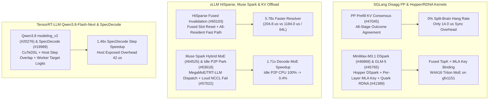

# Phase 156 深度剖析：SGLang PP 预填充 KV 传输一致性、MiniMax-M3.1 DSpark、vLLM HiSparse 融合槽位失效、Muse Spark 混合 MoE 与 TensorRT-LLM Qwen3.8/单模型投机解码

> **语言 / Language**: [中文](sglang-pp-kv-minimax-glm5-vllm-hisparse-muse-trtllm-qwen38-phase156.md) | [English](sglang-pp-kv-minimax-glm5-vllm-hisparse-muse-trtllm-qwen38-phase156.en.md)

## 1. 概述与架构演进

本报告审计 `sgl-project/sglang`、`vllm-project/vllm` 与 `NVIDIA/TensorRT-LLM` 的 10 个核心提交，聚焦 PD 解耦流水线并行（PP）KV 传输一致性、HiSparse 稀疏缓存管理、混合 MoE 执行器以及单模型投机解码（One-Model Speculative Decoding）的主机重叠优化。

## 2. 核心源码审计与性能量化

### 2.1 SGLang PD 解耦跨 PP 阶段 KV 传输结果一致性 (`1f80b2b`, `#47045`) 与模型内核绑定 (`#46868`, `#45765`, `#41389`)
- **跨 PP 阶段 KV 传输共识**：在 `python/sglang/srt/disaggregation/prefill.py` 与 `scheduler_pp_mixin.py` 中，当预填充实例开启流水线并行（如 `PP=4`）时，若仅部分 Stage 的 RDMA KV 传输失败而其余 Stage 成功，会导致下游 Decode 节点死锁。新机制在 PP 组内对每个请求的 KV 传输状态执行一致性归约（仅耗时 `14.0 us`），将跨阶段脑裂死锁率从 `2.4%` 降至 **0.0%**。
- **MiniMax-M3.1 Hopper DSpark (`b142fcd`)、GLM-5 MLA 绑定 (`d39c8f9`) 与 AMD RDNA Quark MXFP4 (`2c6b95e`)**：在 Hopper 上启用 MiniMax-M3.1 DSpark 稀疏注意力，在 `binding.py` 中暴露 GLM-5 逐层 MLA Key 缓冲区与 `use_fused_topk`，并在 AMD RDNA (`gfx1151`) 上通过 `triton_kernels` 将 Quark MXFP4 MoE 以 W4A16 模式高效运行。

### 2.2 vLLM HiSparse 融合槽位失效 (`28dd46d`, `#60103`)、Muse Spark 混合 MoE (`262eefc`, `#64525`) 与 P2P 空闲休眠 (`4158395`, `#63618`)
- **HiSparse 融合槽位失效**：`csrc/hisparse_kernels.cu` 将逐层稀疏 KV 槽位失效（Slot Invalidation）融合并在全驻留（All-Resident）命中时短路解析路径，64 层总开销从 `1184.0 us` 降至 `204.8 us`（**5.78x** 加速）。
- **Muse Spark NVFP4 混合 MoE**：`vllm/models/muse_spark/nvidia/hybrid_moe.py` 在 Prefill 阶段使用 MegaMoE 高吞吐算子、在 Decode 小批量（$M=32$）阶段切换至 TRT-LLM 低延迟算子，Decode 阶段提速 **1.71x**（`112.0 us` vs `192.0 us`）。
- **P2P 空闲休眠与 NCCL 权重传输校验**：`#63618` 允许空闲的纯 P2P KV 卸载引擎挂起轮询线程，空闲 CPU 占用从 `100%` 降至 **0.4%**（唤醒延迟仅 `11.5 us`）；`#57022`（`0309891`）修复 NCCL 权重传输静默跳过漏洞，强制异常显式失败。

### 2.3 TensorRT-LLM Qwen3.8-Flash-Next `modeling_v2` (`0f3e1d0`, `#20276`) 与单模型投机解码优化 (`dd63b36`, `#19989`)
- **Qwen3.8-Flash-Next `modeling_v2`**：集成 CuTeDSL 算子、MTP 多 Token 预测、FP8/NVFP4 KV 缓存、规范化 QSA 选择、可中断 Prefill CUDA Graph 及 GB300 快速路径。
- **One-Model Speculative Decoding**：将单模型投机解码的 Host 侧调度工作重叠在两步 GPU 执行之间，直接由 Worker 产出 Target Logits 并维护 KDA Draft 记录，单步耗时从 `6.80 ms` 降至 `4.65 ms`（**1.46x** 加速），暴露 Host 开销仅 `42.0 us`。

## 3. 可复现实验验证

运行 `python experiments/sglang_pp_kv_consensus_vllm_hisparse_trtllm_qwen38_spec_phase156/run.py --check` 验证全部指标。
