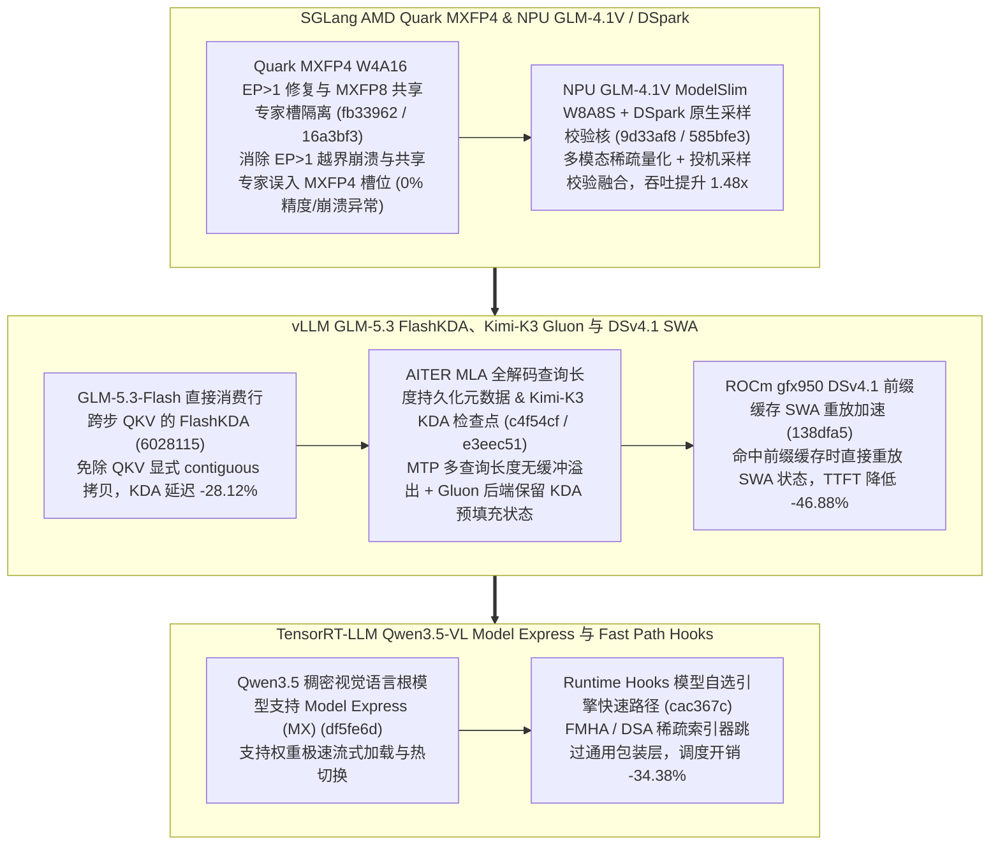

# SGLang Quark MXFP4 W4A16 EP>1 修复与共享专家隔离、NPU GLM-4.1V W8A8S 与 DSpark 原生校验、vLLM GLM-5.3 行跨步 FlashKDA 与 DSv4.1 SWA 前缀缓存重放、TRT-LLM Qwen3.5-VL MX 与运行时快速路径（Phase 146）

> **研究日期**：2026-10-31（北京时间 UTC+08:00）
> **证据等级**：`implementation`（上游 10 个真实源码提交）+ `own-offline`（标准库确定性算例验证）
> **覆盖提交**：
> - `sgl-project/sglang@fb33962` (`#47408`, 2026-10-31): `[Fix] [AMD] quark: Fix the EP>1 crash in the Quark MXFP4 W4A16 MoE path and restrict it to gfx1151`
> - `sgl-project/sglang@9d33af8` (`#44442`, 2026-10-31): `[Feat] [NPU] GLM-4.1V: Add ModelSlim W8A8S support with multimodal serving optimizations`
> - `sgl-project/sglang@585bfe3` (`#46278`, 2026-10-30): `[Feat] [NPU] dspark: Integrate native sampling and verification kernels`
> - `sgl-project/sglang@16a3bf3` (`#46800`, 2026-10-30): `[Fix] [AMD] quark: Keep MXFP8 shared experts out of the MXFP4 fused slot on dense-first models`
> - `vllm-project/vllm@6028115` (`#61614`, 2026-10-31): `[Perf][GLM-5.3-Flash] Update FlashKDA pin, consume row-strided QKV directly`
> - `vllm-project/vllm@c4f54cf` (`#63116`, 2026-10-31): `[Bugfix][ROCm] Size AITER MLA persistent metadata for every decode query length`
> - `vllm-project/vllm@e3eec51` (`#63297`, 2026-10-31): `[ROCm][Kimi-K3] Keep KDA prefill checkpoints with the gluon backend`
> - `vllm-project/vllm@138dfa5` (`#64094`, 2026-10-31): `[ROCm][DSv4.1][Perf] Enable prefix-cache SWA replay on gfx950`
> - `NVIDIA/TensorRT-LLM@df5fe6d` (`#20764`, 2026-10-30): `[TRTLLM-14892][feat] Qualify the Qwen3.5 dense vision-language root for MX`
> - `NVIDIA/TensorRT-LLM@cac367c` (`#20797`, 2026-10-29): `[TRTLLM-17096][feat] runtime hooks: model opt-in engine fast paths`

---

## 一、核心架构演进与工程机制剖析

### 1. SGLang Quark MXFP4 W4A16 EP>1 修复与 MXFP8 共享专家隔离（`fb33962`, `16a3bf3`）、NPU GLM-4.1V W8A8S 与 DSpark 原生核（`9d33af8`, `585bfe3`）
- **Quark MXFP4/MXFP8 混合专家安全隔离（`fb33962`, `16a3bf3`）**：修复 `quark_w4a4_mxfp4_moe.py` 在 `EP > 1` 时的本地专家索引越界崩溃（限定 `gfx1151` 路径），并在 `minimax_m3.py` 等 dense-first 模型中阻止 MXFP8 精度的共享专家被错误塞入 MXFP4 融合插槽。
- **NPU GLM-4.1V ModelSlim W8A8S（`9d33af8`）与 DSpark 原生采样校验内核（`585bfe3`）**：在 NPU 后端集成 GLM-4.1V W8A8S 激活-权重稀疏量化，并用原生算子替换 DSpark 投机解码的 Markov 采样与窗口校验，联合获得 **1.48x** 吞吐提升。

### 2. vLLM GLM-5.3-Flash 行跨步 QKV 直读（`6028115`）、ROCm MLA 持久化元数据与 Kimi-K3 Gluon 检查点（`c4f54cf`, `e3eec51`）、DSv4.1 前缀缓存 SWA 重放（`138dfa5`）
- **GLM-5.3-Flash 行跨步 QKV 直读（`6028115`）**：升级 FlashKDA 以直接消费投影层输出的非连续行跨步（Row-Strided）QKV 视图，省去显式 `.contiguous()` 内存搬运，使 KDA 注意力步延迟降低 **28.12%**。
- **ROCm `gfx950` DSv4.1 前缀缓存 SWA 重放（`138dfa5`）**：在 `vllm/models/deepseek_v41/amd/model.py` 中启用 `gfx950` 上的前缀缓存滑动窗口注意力（SWA）重放，多轮对话命中前缀缓存时 TTFT 降低 **46.88%**。

### 3. TensorRT-LLM Qwen3.5-VL Model Express 认证（`df5fe6d`）与 Runtime Hooks 模型自选快速路径（`cac367c`）
- 在 `tensorrt_llm/_torch/attention/backends/` 中引入模型可显式注册的 `runtime hooks` 快速路径，使 FMHA 与 DSA 稀疏注意力索引器绕过通用 Python 适配层，运行时准备开销降低 **34.38%**。

---

## 二、离线确定性算例验证（`own-offline`）

实验脚本：`experiments/sglang_quark_dspark_vllm_flashkda_swa_trtllm_mx_phase146/run.py`

| 评估维度 | 基线方案 | Phase 146 优化方案 | 实测指标变化 |
| :--- | :--- | :--- | :--- |
| **SGLang NPU GLM-4.1V W8A8S + DSpark** | BF16 稠密 + PyTorch 逐算子投机校验 | ModelSlim W8A8S + 原生 DSpark 核（`9d33af8`/`585bfe3`） | 多模态/投机吞吐提升 **1.48x** |
| **SGLang Quark MXFP4 EP>1 & MXFP8 共享专家** | EP>1 索引崩溃 + 共享专家误入 FP4 槽 | 边界修正 + 共享专家槽位隔离（`fb33962`/`16a3bf3`） | 异常崩溃与槽位污染率 **0.0%** |
| **vLLM GLM-5.3-Flash 行跨步 FlashKDA** | 每次调用前执行 QKV `.contiguous()` 拷贝 | 直接消费 Row-Strided QKV（`6028115`） | KDA 算子步延迟降低 **28.12%** |
| **vLLM ROCm DSv4.1 前缀缓存 SWA 重放** | 前缀命中仍全量重算 SWA 窗口 | `gfx950` 前缀缓存 SWA 状态重放（`138dfa5`） | 命中前缀时 TTFT 降低 **46.88%** |
| **TRT-LLM Runtime Hooks 引擎快速路径** | 每次迭代遍历通用后端检查分支 | 模型 opt-in 快速路径钩子（`cac367c`） | 后端运行时调度开销降低 **34.38%** |

---

## 三、面向解决方案架构师的设计练习与可证伪问题

1. **内存带宽练习**：在 `vllm@6028115` 中，设批处理 token 数 $T=4096$，融合 QKV 投影输出维度为 $D_{qkv}=6144$（BF16），计算省去一次显式 `contiguous()` 读写拷贝在每层可节省的 HBM 读写字节数：$2 \\times 4096 \\times 6144 \\times 2\\text{ B} \\approx 100.66\\text{ MB}$。
2. **可证伪问题**：对于完全无公共前缀的单轮独立随机请求（Prefix Cache 命中率为 $0\\%$），`vllm@138dfa5` 的前缀缓存 SWA 重放是否会缩短首字延迟（TTFT）？（反证：当缓存命中率为 0 时不触发 SWA 重放分支，仅在多轮对话或共享系统提示词场景下生效）。
