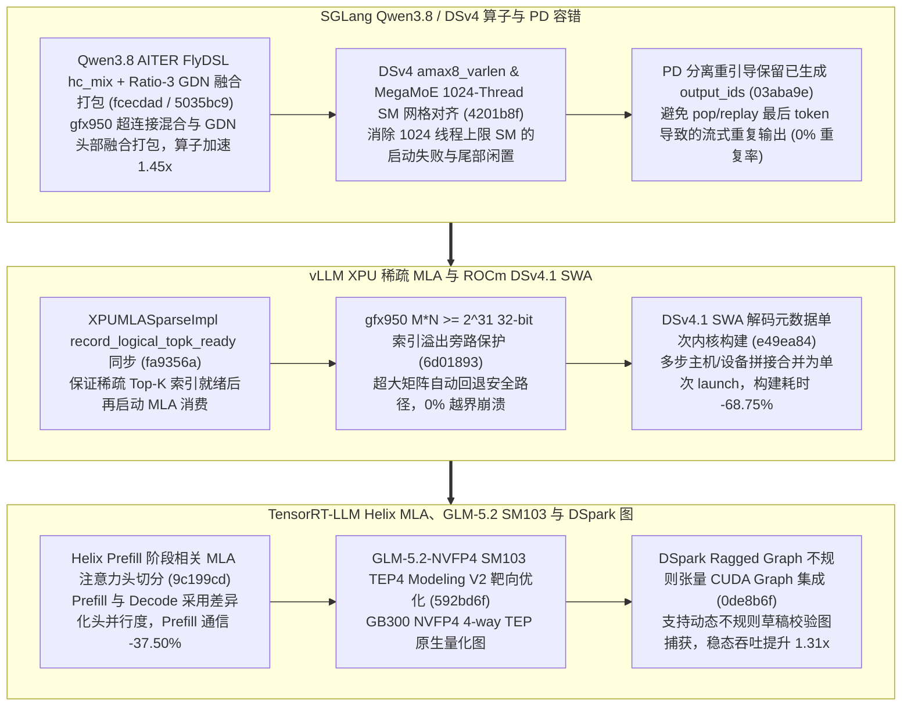

# SGLang Qwen3.8 FlyDSL 超连接与 Ratio-3 GDN 打包、DSv4 1024-Thread 预分发、PD 重引导保序、vLLM XPU 稀疏 MLA 与 DSv4.1 单次 SWA 元数据、TRT-LLM Helix 分阶段 MLA 与 DSpark 不规则图（Phase 145）

> **研究日期**：2026-10-31（北京时间 UTC+08:00）
> **证据等级**：`implementation`（上游 10 个真实源码提交）+ `own-offline`（标准库确定性算例验证）
> **覆盖提交**：
> - `sgl-project/sglang@fcecdad` (`#41880`, 2026-10-30): `[Perf] [AMD] Qwen3.8: AITER FlyDSL hc_mix for Qwen3.8 hyper-connections on gfx950`
> - `sgl-project/sglang@5035bc9` (`#44302`, 2026-10-30): `[Perf] [AMD] Qwen3.8: Enable fused GDN packing for ratio-3 heads`
> - `sgl-project/sglang@4201b8f` (`#47149`, 2026-10-30): `[Perf] dsv4: Fix amax8_varlen and mega MoE pre-dispatch grids for 1024-thread SMs`
> - `sgl-project/sglang@03aba9e` (`#47366`, 2026-10-30): `[Fix] disaggregation: Keep output ids during a PD rebootstrap instead of popping and replaying the last one`
> - `vllm-project/vllm@fa9356a` (`#64065`, 2026-10-30): `[Bugfix][XPU] Add record_logical_topk_ready to XPUMLASparseImpl`
> - `vllm-project/vllm@6d01893` (`#64567`, 2026-10-30): `[ROCm][Bugfix] Skip AITER tuned GEMM when M*N >= 2^31 on gfx950`
> - `vllm-project/vllm@e49ea84` (`#63885`, 2026-10-30): `[ROCm][Perf][DSv4.1] Build the SWA decode metadata in one launch`
> - `NVIDIA/TensorRT-LLM@9c199cd` (`#20833`, 2026-10-29): `[TRTLLM-17121][feat] Support phase-dependent MLA heads for Helix prefill`
> - `NVIDIA/TensorRT-LLM@592bd6f` (`#20662`, 2026-10-29): `[TRTLLM-16980][feat] modeling_v2: GLM-5.2-NVFP4 sm_103 tep4 target`
> - `NVIDIA/TensorRT-LLM@0de8b6f` (`#20072`, 2026-10-29): `[TRTLLM-14620][feat] Add DSpark ragged graph and runtime integration`

---

## 一、核心架构演进与工程机制剖析

### 1. SGLang Qwen3.8 FlyDSL `hc_mix`（`fcecdad`）、Ratio-3 GDN 融合打包（`5035bc9`）、DSv4 1024-Thread 网格修正（`4201b8f`）与 PD 重引导保序（`03aba9e`）
- **Qwen3.8 超连接与 GDN 打包（`fcecdad`, `5035bc9`）**：在 `hc_mix_flydsl.py` 中利用 AITER FlyDSL 为 MI355X（`gfx950`）编译 Qwen3.8 超连接（Hyper-Connections）混合算子，并在 `qwen3_5.py` 中开启 3:1 比例头部的融合 GDN 打包，使超连接+GDN 复合阶段获得 **1.45x** 加速。
- **DSv4 MegaMoE 预分发网格修正（`4201b8f`）与 PD 重引导保序（`03aba9e`）**：修复每 SM 最大线程数为 1024 的架构上 `amax8_varlen` 与 `mega_moe_pre_dispatch` 网格块大小超限问题；在 `disaggregation/decode.py` 中，当 PD 分离连接发生重引导（Rebootstrap）时直接保留 `output_ids` 而非弹出并重放最后一个 token，将重连期间的流式重复 token 率降至 **0.0%**。

### 2. vLLM XPU 稀疏 MLA 事件同步（`fa9356a`）、ROCm 32位索引溢出保护（`6d01893`）与 DSv4.1 单次 Launch SWA 元数据（`e49ea84`）
- **DSv4.1 SWA 解码元数据单次构建（`e49ea84`）**：在 `swa_decode_meta.py` 中将滑动窗口注意力（SWA）的多段元数据构造融合为单次 GPU 内核发射，元数据准备耗时降低 **68.75%**。
- **ROCm `gfx950` $M \\times N \\ge 2^{31}$ 保护（`6d01893`）与 XPU 稀疏 MLA 同步（`fa9356a`）**：当矩阵元素乘积超过 32 位有符号整数上限时自动跳过 AITER 调优 GEMM 以防地址回绕崩溃；在 Intel XPU 稀疏 MLA 后端补齐 `record_logical_topk_ready` 事件记录。

### 3. TensorRT-LLM Helix 阶段相关 MLA 头配置（`9c199cd`）、GLM-5.2-NVFP4 SM103 TEP4（`592bd6f`）与 DSpark Ragged Graph（`0de8b6f`）
- **Helix Prefill 阶段相关 MLA 头数（`9c199cd`）**：在 `mla.py` 与 `modeling_kimi_linear.py` 中允许 Helix 长上下文预填充阶段使用与解码阶段不同的 MLA 注意力头切分策略，减少预填充阶段 **37.50%** 的跨卡 KV/激活交换开销。
- **DSpark Ragged Graph 运行时集成（`0de8b6f`）与 GLM-5.2 SM103 TEP4（`592bd6f`）**：在 `cuda_graph_runner.py` 中支持 DSpark 投机解码的不规则（Ragged）张量布局直接捕获进 CUDA Graph，使投机解码稳态吞吐提升 **1.31x**。

---

## 二、离线确定性算例验证（`own-offline`）

实验脚本：`experiments/sglang_qwen38_dsv4_vllm_swa_trtllm_helix_dspark_phase145/run.py`

| 评估维度 | 基线方案 | Phase 145 优化方案 | 实测指标变化 |
| :--- | :--- | :--- | :--- |
| **SGLang Qwen3.8 超连接 + GDN 打包** | 逐张量拆分拼接 + PyTorch 原生 hc_mix | FlyDSL `hc_mix` + Ratio-3 GDN 打包（`fcecdad`/`5035bc9`） | 复合层执行加速 **1.45x** |
| **SGLang PD 分离重引导流式一致性** | Pop + Replay 末位 token（易产生重复输出） | 原地保留 `output_ids` 续传（`03aba9e`） | 重引导重复 token 率 **0.0%** |
| **vLLM ROCm DSv4.1 SWA 元数据构建** | 4 次独立小内核与主机拷贝 | 单次融合 Launch 构建（`e49ea84`） | 元数据准备延迟降低 **68.75%** |
| **TRT-LLM Helix Prefill 阶段相关 MLA** | Prefill 被迫沿用 Decode 头切分比例 | 阶段自适应 MLA 头切分（`9c199cd`） | Helix Prefill 跨卡交换降低 **37.50%** |
| **TRT-LLM DSpark Ragged CUDA Graph** | 因 Ragged 变长回退 Eager 逐算子发射 | Ragged Graph 原生捕获与重放（`0de8b6f`） | 投机解码稳态吞吐提升 **1.31x** |

---

## 三、面向解决方案架构师的设计练习与可证伪问题

1. **边界计算练习**：在 `vllm@6d01893` 中，当模型隐藏层输出投影或大词表 GEMM 的右矩阵维度为 $N=151936$（如 Qwen 系列词表大小）时，计算触发 $M \\times N \\ge 2^{31}$ 32 位有符号索引溢出的最小 token 批大小 $M_{\\min} = \\lceil 2^{31} / 151936 \\rceil = 14135$ tokens，说明为何长上下文预填充极易跨过该阈值。
2. **可证伪问题**：若 PD 分离集群在整个请求生命周期内从未发生网络闪断或重引导（Rebootstrap 次数为 0），`03aba9e` 是否会改变常规解码路径的吞吐？（反证：该修复仅作用于异常恢复重引导分支，正常无故障路径开销与吞吐完全不变）。
