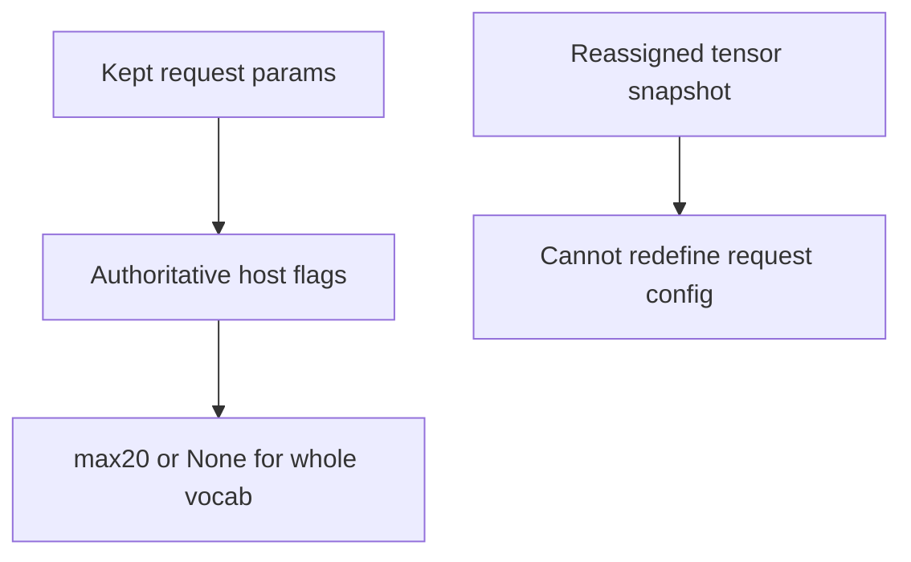
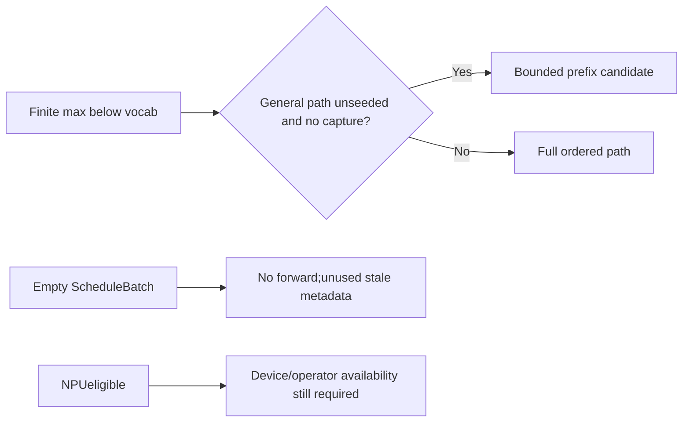

# AI Infra sampling FAQ: row-drop,safe sticky flags and top-k route refresh

> **Language**: English | [中文](sglang-sampler-row-drop-top-k-flag-refresh-selection-faq.md)  
> **Round154 · 2026-11-14daytime**: same-day SGLang host flags;original support/route ledger,not native sampling.

**Finding:** Old flags are **safe but sticky**,not wrong sampled tokens.Six original row-drop cases preserve support,0/6misses;five selected plans tighten.Prefix-column totals9542→1114are not GPUwork,memory or native speedups.

**Artifacts**:[H5ledger](../reports/sglang-sampler-row-drop-top-k-flag-refresh-sizer.html) · [seven cards](../reports/sglang-sampler-row-drop-top-k-flag-refresh-selection-cards.html) · [1600px SVG](../../assets/svg/sglang-sampler-row-drop-top-k-flag-refresh-selection-faq-summary.svg) · [sealed report](../../experiments/sampler_flag_refresh_selection/report.json)

## Q1: What changed,and why are old flags safe?

Pinned correction is **Nov14,05:21:40UTC=13:21:40BJT**.After filtering a nonempty proper subset,ScheduleBatchslices SamplingBatchInfoandrefreshes from**kept request sampling_params.top_k**.Five fields coverall/any greedy,need-top-k,NPUeligibility and max-top-k.


Old all-greedy/whole-vocab cases remain so in a subset;old finite max remains a safe upper bound.False NPUeligibility can become true.Old flags do not skip necessary support,but may keep broader routing.

Only five**top-k-related**fields refresh,not alltop-p/min-p/processor/grammar flags.Our model fixes top_p=1,min_p=0;other native sticky flags/backends can still affect gains.

## Q2: Are sentinel and tensor snapshots authoritative?

`TOP_K_ALL=1<<30`,not vocab_size.API`-1`normalizes to it;near-zero temperature can normalize togreedy.Our input is normalized positive k,not raw-1/bool.

DroppingALLand retaining20changes maxNone→20.Source's reassigned tensor test shows refresh reads supplied request params,**not that arbitrarily inconsistent tensors preserve sampling correctness**.



No native tensors,asyncH2DorRNG.JSfull ordering displays canonical support,not a partial-sort benchmark.

## Q3: Which original selected plans tighten?

| Dropped/retained requests | Sticky width | Refreshed width | Original support |
| --- | ---: | ---: | --- |
| Drop1,keepALL | 2048 | 0 | Same whole vocabulary |
| DropALL,keep20 | 2048 | 20 | Same top20 |
| Drop1/20,keep50 | 50 | 50 | Same top50 |
| Drop1300,keep20 | 1300 | 20 | Same top20 |
| DropALL,keep1 | 2048 | 0 | Same greedy |
| DropALL,keep1024 | 2048 | 1024 | Same top1024 |

**Zero width means no ranked-prefix plan**,not zero scan/compute/allocation/latency or unknown coerced tozero.Excludes softmax,sampling,temp buffers,inputscan/device workspace.Original ties prefer descending weight/ascending tokenID,not Torch tie guarantees.

## Q4: Why retain seed,capture,NPUandempty guards?



Native general Torchbounded path requires maxbelowvocab,no sampling seed and no filtered-probability capture.Seeded fullsortavoids batch-wide k altering tied ordering.Capture needs complete distributions/permutations.

Original seed/capture cases retain max20butrestore width2048(+2028columns);reversed request order remains20(Δ0).Not score pts/native tokens.NPU1..1024eligibility is not availability.

Empty keep clears requests and returns before refresh;fullkeep also returns.Empty helper truth values do not imply scheduling dispatch.

## Q5: Is bounded CPUtop20always faster?

| Original vocab | heapq bounded(ms) | Full sort(ms) |
| ---: | ---: | ---: |
| 64 | 0.016600 | 0.007833 |
| 256 | 0.042033 | 0.034800 |
| 1024 | 0.142500 | 0.175733 |
| 4096 | 0.525467 | 1.041733 |

**Bounded is slower at64/256**.Less output width does not imply lesswalltime.Both paths yield identical top20ranked IDs.Two warmups,seven alternating repeats,three operations/sample,median repeat means.

Excludes score setup,flag refresh,softmax/RNG/SGLang/Torch/GPU/NPU.Not native latency,throughput,tokens or kernel execution.Real gains need backend/seed/capture measurement.

## Q6: How can metadata and sampling correctness be checked separately?

```powershell
python -m unittest discover -s tests -p test_sampler_flag_refresh_selection.py -q
python -m experiments.sampler_flag_refresh_selection.run --check
# --measure only executes original CPUtop20ranking.
```

Eight tests covergreedy/ALL drop,independent ties/safe widebounds,empty/fullkeep,seed/capture,NPUeligibility notavailability,invalid normalized inputs/indices/unsafe lowbound,32random filters/36Nodefixtures/reversed requests,and six-case sealed totals/CPUpaths.

Sources:[Nov14correction](https://github.com/sgl-project/sglang/commit/4a909c3ba6ac32ea59347f9f5d7680794557cb97),[scheduling](https://github.com/sgl-project/sglang/blob/4a909c3ba6ac32ea59347f9f5d7680794557cb97/python/sglang/srt/managers/schedule_batch.py),[flags](https://github.com/sgl-project/sglang/blob/4a909c3ba6ac32ea59347f9f5d7680794557cb97/python/sglang/srt/sampling/sampling_batch_info.py),[normalization](https://github.com/sgl-project/sglang/blob/4a909c3ba6ac32ea59347f9f5d7680794557cb97/python/sglang/srt/sampling/sampling_params.py),[backend/seed/capture](https://github.com/sgl-project/sglang/blob/4a909c3ba6ac32ea59347f9f5d7680794557cb97/python/sglang/srt/layers/sampler.py),[LICENSE](https://github.com/sgl-project/sglang/blob/4a909c3ba6ac32ea59347f9f5d7680794557cb97/LICENSE).Rights retained,no implementation mirror.

Real acceptance checks flags,actual kept tensors,backend availability,tie/seed/capture,logprob/grammar and filter/merge correctness/latency.Main`synthetic`, `independently_reproduced=false`;CPUseparately`measured`.Native tokens/latency/tieorder unknown/null.Original60-solid cabinet is not hardware.No browser visual acceptance;prior refusal respected.
