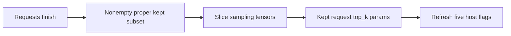
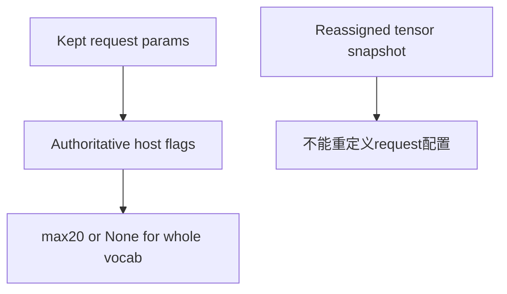
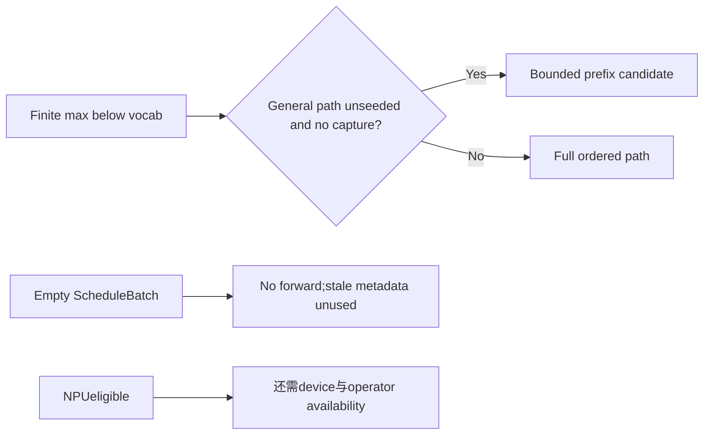

# AI Infra Sampling FAQ：Batch Row-Drop、Safe Sticky Flags 与 Top-K 路由刷新

> **语言**：中文 | [English](sglang-sampler-row-drop-top-k-flag-refresh-selection-faq.en.md)  
> **Round154 · 2026-11-14白班**：当天SGLang host flags修正；原创support/route ledger，不是native sampling benchmark。

**结论速览**：完成request离开batch后，保留旧top-k flags是**safe but sticky**，不应宣称导致错误tokens。六个原创row-drop cases保持相同retained support，0/6misses；五个selected plans tighten。planned ranked-prefix columns合计9542→1114，不是GPUwork、memory或native加速倍数。

**交付**：[H5 flags/support工作台](../reports/sglang-sampler-row-drop-top-k-flag-refresh-sizer.html) · [7-Card](../reports/sglang-sampler-row-drop-top-k-flag-refresh-selection-cards.html) · [1600px SVG](../../assets/svg/sglang-sampler-row-drop-top-k-flag-refresh-selection-faq-summary.svg) · [sealed report](../../experiments/sampler_flag_refresh_selection/report.json)

## Q1：当天优化刷新了什么，为什么旧flags仍然safe？

SGLang固定commit时间为**Nov14 05:21:40UTC＝13:21:40BJT**。非空proper subset过滤后，ScheduleBatch先slice SamplingBatchInfo，再用**kept request sampling_params.top_k**重算五个host字段：all/any greedy、need_top_k_sampling、NPUtop-k/top-p eligibility、max_top_k。



旧all-greedy true意味着原batch全greedy，subset也全greedy；旧无需top-k意味着原batch全whole-vocab，subset也不需要；旧finite max仍≥kept max。所以旧flags不应跳过必要filter，但可能维持更宽route。NPUeligible false也可能不再必要。

本次仅刷新**top-k相关五字段**，不是所有top-p/min-p/processor/grammar flags。原型固定top_p=1,min_p=0；native其他sticky flags或backend路径仍可能影响收益。

## Q2：TOP_K_ALL与physical tensor快照谁是metadata权威？

source sentinel为`TOP_K_ALL=1<<30`，不是vocab_size。API`-1`先normalize成sentinel，近零temperature可normalize成greedy；本轮只接收已经normalized的positive k，拒绝raw`-1`/bool。

当retained request top20、已完成request是ALL，旧maxNone变20；不能把ALL错误地当20或vocab_size去推断原始host配置。source测试专门reassign top_ks tensor，确认refresh读取传入request params；这**不是任意错误tensor仍保持sampling正确**的认证。



原型未执行native张量、asyncH2D或RNG。UI的JS完整排序只是展示canonical support；不是partial-sort计时。

## Q3：哪些原创selected plans缩窄，哪些没有？

| 已完成/retained请求 | Sticky prefix width | Refreshed prefix width | 原创support |
| --- | ---: | ---: | --- |
| Drop1,keepALL | 2048 | 0 | 相同whole vocab |
| DropALL,keep20 | 2048 | 20 | 相同top20 |
| Drop1/20,keep50 | 50 | 50 | 相同top50 |
| Drop1300,keep20 | 1300 | 20 | 相同top20 |
| DropALL,keep1 | 2048 | 0 | 相同greedy |
| DropALL,keep1024 | 2048 | 1024 | 相同top1024 |

**0width表示selected plan不需要ranked prefix**，不是zero scan、compute、allocation、latency或unknown被置零。ledger不含softmax、categorical sampling、temp buffers、inputscan或设备workspace；原型tie policy是weight降序/tokenID升序，不保证Torch tied ordering。

## Q4：为什么seed/capture/NPU/empty guards不能被“更紧的k”覆盖？



nativegeneral Torch path只在max小于vocab、sampling_seed=None、未请求filtered probabilities时用topk；seeded path保留full sort，避免batch-wide k改变ties的ordering。capture需要完整filtered distribution/permutation，不可随意截短。

原型主例加seed或capture，refreshed max仍20，但ranked plan恢复2048（+2028columns）；reversed request order仍20（Δ0）。这些是planned columns，不是score pts/native tokens。

NPUeligibility范围1..1024只是条件；device/operator availability另查。ScheduleBatch空keep直接清reqs并return，fullkeep也early return：不能宣称这两种情况都调用refresh。直接helper的empty-list truth值不等于empty scheduling dispatch。

## Q5：CPUbounded top20一定更快吗？

| 原创vocab | heapq bounded（ms） | full sort（ms） |
| ---: | ---: | ---: |
| 64 | 0.016600 | 0.007833 |
| 256 | 0.042033 | 0.034800 |
| 1024 | 0.142500 | 0.175733 |
| 4096 | 0.525467 | 1.041733 |

**小尺寸64/256时bounded更慢**；较少输出columns不自动意味着更少walltime。两个CPUpaths返回exact相同top20ranked token IDs；2warmups、7轮交替repeat、每sample3operations、median repeat means。

排除scores准备、flag refresh、softmax/RNG/SGLang/Torch/GPU/NPU；不认证native latency、throughput、tokens或NPUkernel。旧safe flags与新fresh flags都可能给出正确support，native收益必须在真实backend/seed/capture组合上测。

## Q6：如何复现并把metadata优化与sampling正确性分开验证？

```powershell
python -m unittest discover -s tests -p test_sampler_flag_refresh_selection.py -q
python -m experiments.sampler_flag_refresh_selection.run --check
# --measure只执行原创CPUtop20ranking，不执行SGLangsampler。
```

八项测试覆盖greedy/ALL drop、独立tied support/合法宽bound、empty/fullkeep semantics、seed/capture full排序、NPUeligibility而非availability、非法normalized输入/indices/unsafe低bound、32random filters与36Nodefixtures/reversed requests、六case sealed totals/CPUpaths。

来源：[Nov14修正](https://github.com/sgl-project/sglang/commit/4a909c3ba6ac32ea59347f9f5d7680794557cb97)、[Scheduling gate](https://github.com/sgl-project/sglang/blob/4a909c3ba6ac32ea59347f9f5d7680794557cb97/python/sglang/srt/managers/schedule_batch.py)、[Host flags](https://github.com/sgl-project/sglang/blob/4a909c3ba6ac32ea59347f9f5d7680794557cb97/python/sglang/srt/sampling/sampling_batch_info.py)、[Normalization](https://github.com/sgl-project/sglang/blob/4a909c3ba6ac32ea59347f9f5d7680794557cb97/python/sglang/srt/sampling/sampling_params.py)、[Backend/seed/capture conditions](https://github.com/sgl-project/sglang/blob/4a909c3ba6ac32ea59347f9f5d7680794557cb97/python/sglang/srt/layers/sampler.py)、[LICENSE](https://github.com/sgl-project/sglang/blob/4a909c3ba6ac32ea59347f9f5d7680794557cb97/LICENSE)。rights保留，无实现镜像。

真实验收需host flags、实际kept tensors、backendavailability、tie/seed/capture、logprob/grammar以及filter/merge组合的正确性与latency。主`synthetic`、`independently_reproduced=false`，CPU单独`measured`；native tokens/latency/tieordering未知/null。原创60-solid柜非sampler hardware；无浏览器视觉验收，尊重此前拒绝。
