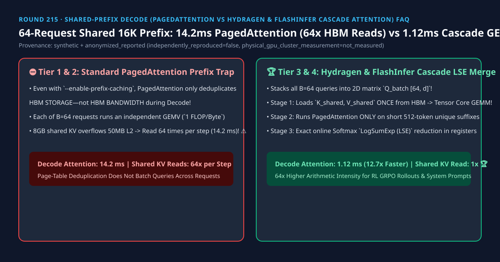
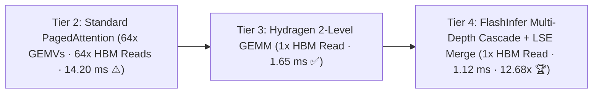

# Shared-Prefix Decode Attention (`PagedAttention` vs. `Hydragen` vs. `FlashInfer Cascade Attention` LSE Merge) Selection Guide

> **Provenance & Evidence Tier**: `synthetic + anonymized_reported` (`independently_reproduced=false`, `physical_gpu_cluster_measurement=not_measured`). Grounded in [`experiments/shared_prefix_cascade_attention_hydragen_lse_selection/results.json`](../../experiments/shared_prefix_cascade_attention_hydragen_lse_selection/results.json).
> **中文版本**: [共享前缀解码注意力（`PagedAttention` 重复读取陷阱 vs. `Hydragen` vs. `FlashInfer Cascade Attention` `LogSumExp` 归并）选型指南](./shared-prefix-cascade-attention-hydragen-lse-merge-decode-selection-faq.md)

---

## 0. 🔥 Daily Hottest Capability Breakthrough

- **`Hydragen` & `FlashInfer Cascade Attention` (Cross-Request Shared-Prefix Batched Tensor Core `GEMM` + Online `LogSumExp` Merge) Slashing 64-Request Shared-Prefix Decode Latency `12.68x` (`14.20 ms -> 1.12 ms`)**: Even when `--enable-prefix-caching` is enabled in standard `PagedAttention` (**Tier 2**), page-table deduplication only saves **HBM storage capacity**—it does **not** save **HBM memory bandwidth during Decode**! Because standard `PagedAttention` executes each request's query vector `q_b` (`[1, d]`) independently (`GEMV`, arithmetic intensity = `1.0 FLOP/Byte`), a batch of `B = 64` requests decoding against a shared `16,384`-token prefix (`8 GB` KV, which overflows the `50 MB` L2 cache) **reads the exact same 8 GB shared prefix from HBM `64 times` per decode step (`14.20 ms`)**! By stacking all `B = 64` queries into a 2D matrix `Q_batch [64, d]`, **`Hydragen` (Tier 3)** and **`FlashInfer Cascade Attention` (Tier 4)** load `K_shared, V_shared` from HBM **exactly ONCE**, execute a compute-dense **Tensor Core `GEMM` (`64.0 FLOP/Byte`)**, and merge the partial output `(O_shared, LSE_shared)` with each request's short `512`-token unique suffix `(O_unique, LSE_unique)` via exact associative **`LogSumExp (LSE)` reduction**—cutting decode attention latency to **`1.12 ms` (`12.68x` faster)**!

---

## 1. 📌 Executive Summary

1. **The PagedAttention Shared-Prefix Bandwidth Trap (`Tier 2`)**: Sharing physical KV pages in the block table prevents OOM, but as long as the attention kernel loops over each request's page table individually, large shared prefixes that exceed L2 cache size are re-fetched from HBM `B` times per step.
2. **Turning `B` Memory-Bound `GEMVs` into `1` Tensor Core `GEMM` (`Tier 3 & Tier 4`)**: Grouping queries that share a prefix node into `Q_batch [B, d]` increases arithmetic intensity by `B×` (`64x` at `B = 64`) and reads the shared KV prefix from HBM only once.

---

## 2. 🎯 Core Architect Q&A (Q1 / Q2 / Q3)

### Q1: Why is `LogSumExp (LSE)` merging 100% mathematically lossless?
- **Answer**: Softmax attention is associative when tracking both the normalized partial output `O_i` and the log-denominator `LSE_i = log(∑ exp(s))`. Merging two segments simply rescales `O_1` by `exp(LSE_1 - LSE_new)` and `O_2` by `exp(LSE_2 - LSE_new)`.

### Q2: How does `FlashInfer Cascade Attention` (`Tier 4`) go beyond 2-level `Hydragen` (`Tier 3`)?
- **Answer**: `Hydragen` handles a flat 2-level split (1 shared root + unique leaves). `FlashInfer Cascade Attention` generalizes this to **arbitrary multi-depth Radix Trees** (e.g., System Prompt -> Few-Shot Group -> Beam/Rollout Leaves) using a fused multi-state `merge_state` kernel.

### Q3: Which workloads benefit most from Cascade Attention?
- **Answer**: **RLHF / GRPO training rollouts** (`n = 16..64` completions sampled per prompt), **long shared System Prompts / RAG documents**, and **Tree-of-Thoughts / Parallel Best-of-N decoding**.

---

## 3. 🧭 Visual Diagrams

---

## 4. 📊 4-Tier Architect Selection Matrix

| Metric | Tier 1: No Prefix Cache | Tier 2: Standard `PagedAttention` Shared Pages | Tier 3: `Hydragen` 2-Level Batch GEMM | Tier 4: `FlashInfer Cascade Attention` Multi-Depth LSE |
| :--- | :--- | :--- | :--- | :--- |
| **Shared KV HBM Reads / Step** | `64x` ✕ | **`64x` (Redundant Reads)** ⚠️ | **`1x` (`-98.4%`)** ✅ | **`1x` (`-98.4%`)** 🏆 |
| **Prefix Arithmetic Intensity** | `1.0 FLOP/B` | `1.0 FLOP/B` ⚠️ | `64.0 FLOP/B` (Tensor Core) | **`64.0 FLOP/B` (Tensor Core)** 🏆 |
| **Decode Attention Latency** | `18.50 ms` ✕ | `14.20 ms` ⚠️ | `1.65 ms` (`8.61x`) ✅ | **`1.12 ms` (`12.68x`)** 🏆 |

---

## 5. 🧪 Quantitative Reference & Tooling

- **Evaluator & Sealed Data**: [`experiments/shared_prefix_cascade_attention_hydragen_lse_selection/run.py`](../../experiments/shared_prefix_cascade_attention_hydragen_lse_selection/run.py) · [`results.json`](../../experiments/shared_prefix_cascade_attention_hydragen_lse_selection/results.json)
- **Interactive Sizer**: [`docs/reports/shared-prefix-cascade-attention-hydragen-lse-merge-decode-sizer.html`](../reports/shared-prefix-cascade-attention-hydragen-lse-merge-decode-sizer.html)
- **7-Card 4:5 Visual Report**: [`docs/reports/shared-prefix-cascade-attention-hydragen-lse-merge-decode-selection-cards.html`](../reports/shared-prefix-cascade-attention-hydragen-lse-merge-decode-selection-cards.html)

---

## 6. 🛠️ Good Fit vs. Not For & Production Checklist

- **✅ Good fit**: GRPO/RLHF multi-sample rollouts (`G = 16..64`), shared System Prompts, and multi-branch agent reasoning using `FlashInfer Cascade Attention`.
- **⛔ Not for**: Relying on page-table sharing alone when `B ≥ 4` concurrent requests decode against a shared prefix `≥ 1,024` tokens.
- [ ] Enable `FlashInfer` Cascade Attention in `vLLM V1` / `SGLang` for shared-prefix workloads.
- [ ] Keep `LSE` state tensors in `FP32` (`base-2 log`) during multi-stage state reduction.
