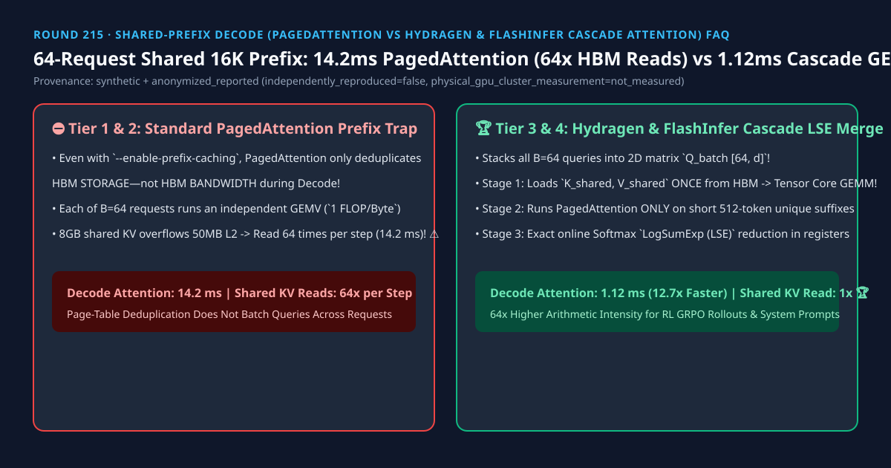
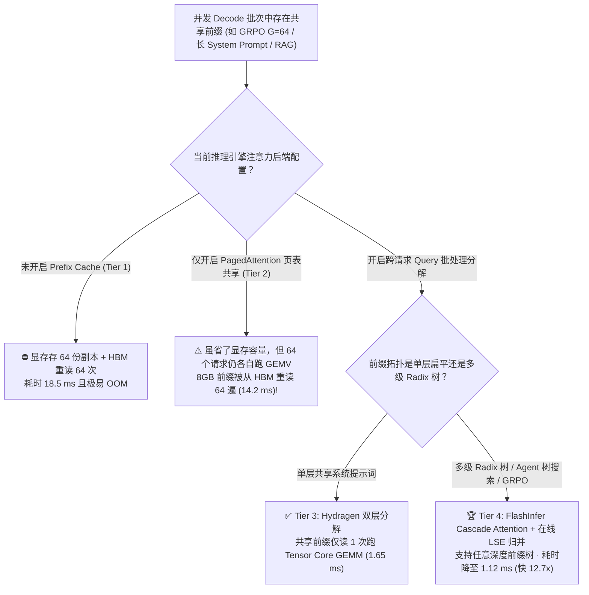
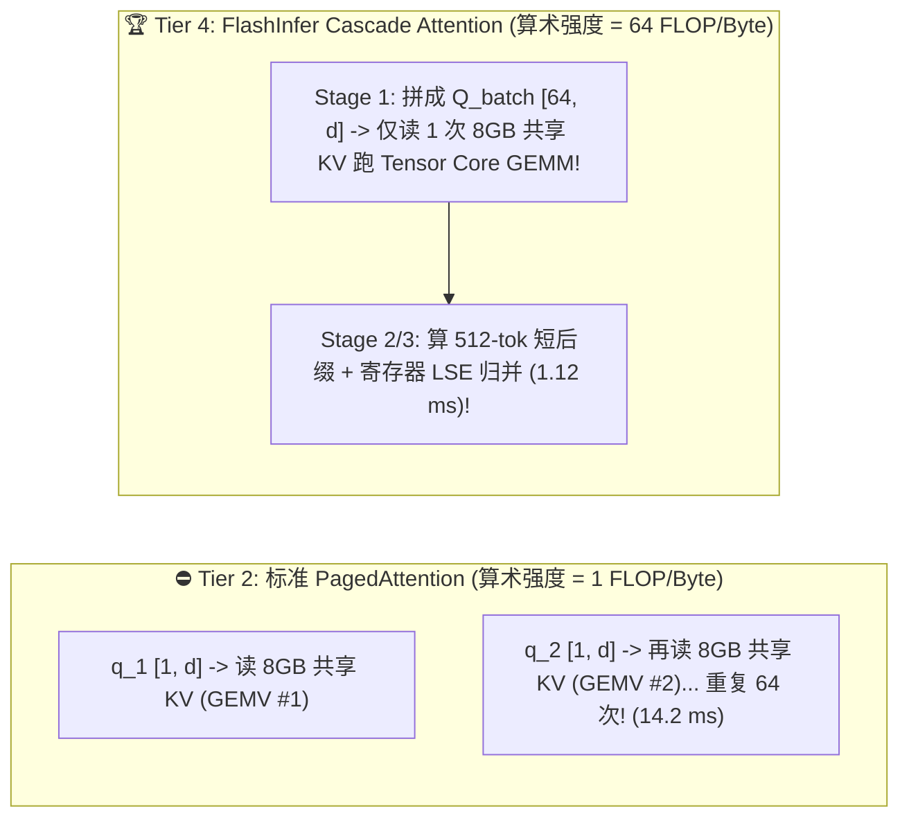
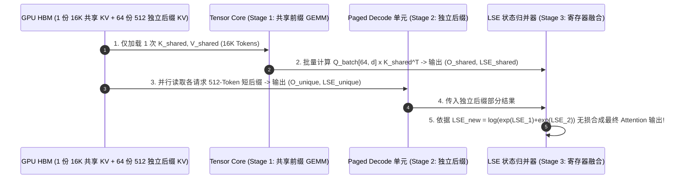

# 共享前缀解码注意力（`PagedAttention` 重复读取陷阱 vs. `Hydragen` vs. `FlashInfer Cascade Attention` `LogSumExp` 归并）选型指南

> **Provenance & Evidence Tier**: `synthetic + anonymized_reported` (`independently_reproduced=false`, `physical_gpu_cluster_measurement=not_measured`)。定量数据锚定于 [`experiments/shared_prefix_cascade_attention_hydragen_lse_selection/results.json`](../../experiments/shared_prefix_cascade_attention_hydragen_lse_selection/results.json)。
> **English Version**: [Shared-Prefix Decode Attention (`PagedAttention` vs. `Hydragen` vs. `FlashInfer Cascade Attention` LSE Merge) Selection Guide](./shared-prefix-cascade-attention-hydragen-lse-merge-decode-selection-faq.en.md)

---

## 0. 🔥 今日领域最热门能力突破追踪（Daily Hottest Breakthrough）

- **`Hydragen` 与 `FlashInfer Cascade Attention`（跨请求共享前缀批处理矩阵乘 `Q_batch × K_shared^T` + 在线 `LogSumExp` 状态无损归并）将 64 并发共享长前缀的 Decode 注意力耗时从 `14.20 ms` 压降至 `1.12 ms`（提速 `12.68` 倍）**：在强化学习 GRPO 采样（如 DeepSeek-R1 对每道数学/代码题同时采样 `G = 16 ~ 64` 条思维链）、企业级长系统提示词（`16K` System Prompt / 代码库上下文）以及多分支 Agent 树搜索中，许多架构师有一个致命误区：**“我已经开启了 vLLM / SGLang 的 Prefix Caching（前缀缓存共享），64 个请求在显存里只存了 1 份共享前缀的物理 KV 页，难道还不快吗？”** 真相令人震惊：**标准 `PagedAttention`（Tier 2）只省了 HBM 的“存储容量”，根本没省 Decode 阶段的 HBM“读取带宽”！** 因为在标准 PagedAttention 中，64 个请求各自拿着自己的页表独立发起向量-矩阵乘（`GEMV`，算术强度仅为 `1 FLOP/Byte`），而 `16K` 共享前缀的 KV Cache（约 `8 GB`）远远超出了 H100 的 `50 MB` L2 缓存，导致每个 Decode 生成步，**GPU 被迫从 HBM 中把同一份 8GB 共享前缀反反复复重读了 `64` 遍（耗时 `14.20 ms`）**！通过采用 **`Hydragen` 双层分解（Tier 3）** 与 **`FlashInfer Cascade Attention` 多级树状归并（Tier 4）**，先将 64 个请求的 Query 向量纵向拼成一个二维矩阵 `Q_batch [64, d]`，**对共享前缀 KV 只从 HBM 读取唯一 `1` 次**，直接喂给 **Tensor Core 跑高密度矩阵乘 `GEMM`（算术强度暴涨 `64` 倍！）**，再用在线 Softmax 的 **`LogSumExp (LSE)` 结合律**与各请求短短 512 Token 的独立后缀结果在寄存器内无损合并，将 Decode 注意力耗时砍到 **`1.12 ms`（快 `12.68` 倍）**！

---

## 1. 📌 核心结论速览（Executive Summary — 3 分钟看懂）

1. **为什么开了 `--enable-prefix-caching`，标准 `PagedAttention` 在 Decode 阶段依然慢如蜗牛？**
   - **通俗大白话 + 第一性原理**：把那份 `16,384` Token 的共享前缀 KV Cache 比作一本 **800 页的厚字典**，放在远处的地下室书库（HBM 显存）里，而桌面缓存（`50 MB` L2 Cache）太小装不下整本字典。
     - **标准 `PagedAttention`（Tier 2）**：虽然地下室只存了 1 本字典（省了存储空间），但 64 个学生（`B = 64` 个并发 Decode 请求）是**排着队一个接一个去地下室把这 800 页字典从头到尾翻一遍**！结果每生成一个词，这本厚字典就要从地下室来回搬运 **64 趟**（64 次 `GEMV`），搬书时间高达 **`14.20 ms`**！
     - **`Hydragen / Cascade Attention`（Tier 3/4）**：图书管理员把 **64 个学生手里的查询小纸条（`q_1 .. q_64`）叠成一摞表格（矩阵 `Q_batch`）**，**只去地下室把字典搬上来唯一 `1` 趟**，对着 64 张纸条一次性用印章（**Tensor Core `WGMMA` 矩阵乘**）盖完，算出共享前半截的得分 `(O_pre, LSE_pre)`；接着每个学生只需各自翻看自己刚写的几页草稿纸（`512` Token 独立后缀 `O_suf, LSE_suf`），最后用一条简单的数学公式把两半得分合二为一，耗时骤降至 **`1.12 ms`（快 `12.7` 倍）**！
2. **为什么把“共享前缀”和“独立后缀”分开算再合并，数学结果能和合在一起算 `100%` 一模一样？**
   - 因为 Softmax 注意力满足 **`LogSumExp (LSE)` 结合律（也就是 FlashAttention 在线分块的数学根基）**！只要每一段不仅输出加权值 `O_i`，还额外输出一个标量对数分母 **`LSE_i = log(∑ exp(score))`**，任意两段（甚至任意多级树状前缀）都能通过精确缩放权重 `w_1 = exp(LSE_1 - LSE_total)` 与 `w_2 = exp(LSE_2 - LSE_total)` 无损合成最终输出 `O_total = w_1 * O_1 + w_2 * O_2`！

---

## 2. 🎯 客户与架构师灵魂拷问 Q&A（Q1 / Q2 / Q3）

### Q1：在什么条件（多少并发请求、多长共享前缀）下应该触发 `Cascade Attention`？
- **答**：当满足以下两个条件时，`Cascade Attention` 收益呈数量级爆发：
  1. **共享同一前缀的活跃并发请求数 `B_shared ≥ 4`（当 `B_shared ≥ 16~64` 时收益最大，正好填满 Tensor Core 的 `M` 维度 Tile）**；
  2. **共享前缀长度 `L_shared ≥ 1,024` Token**（使得共享前缀 KV 大小超出 L2 缓存或占总上下文长度的 `> 50%`）。
  这也是为什么在 **GRPO 强化学习（1 个 Prompt 同时生成 16/32/64 条回答）** 中开启 Cascade Attention 能让 Rollout 解码速度直接翻数倍！

### Q2：`Hydragen`（Tier 3）和 `FlashInfer Cascade Attention`（Tier 4）有什么本质区别？
- **答**：
  - **`Hydragen`（Tier 3）** 主要针对“扁平双层结构”（所有请求共享同一个根部 System Prompt，加上各自的独立后缀）；
  - **`FlashInfer Cascade Attention`（Tier 4）** 原生对接 **SGLang RadixAttention / vLLM 多级前缀树**：支持任意深度的树状分支（例如：第 1 层是全局共享的 `8K` System Prompt -> 第 2 层是分成 4 组的 `4K` 文档上下文 -> 第 3 层是每组裂变出的 16 条采样回答），通过一个通用的 **`Multi-Level Merge-State Kernel`** 一次性完成任意多级父子节点的 `LSE` 归并！

### Q3：如果共享前缀只有 `2` 个请求共用（`B_shared = 2`），强开 `Cascade Attention` 会不会反而变慢？
- **答**：如果把 `B_shared = 2` 拆成两个独立的 Kernel Launch（先算前缀再算后缀再调 Merge Kernel），额外的内核启动开销与中间 `(O, LSE)` 读写可能抵消收益。因此 `FlashInfer` 与 `vLLM V1` 内置了 **启发式收益阈值（Cost-Model Heuristic）**：仅当同一前缀节点挂载的活跃请求数 `≥ 4`（或共享字节数达到阈值）时才自动激活 Cascade 分解；或者在一个持久化 Mega-Kernel 内融合前缀与后缀阶段。

---

## 3. 🧭 直观可视化图解（Mermaid 决策树 + GEMV vs GEMM 对比图 + LSE 归并时序图）

### 3.1 架构师共享前缀解码内核选型决策树

### 3.2 标准 `PagedAttention`（64 次独立 `GEMV` 重读 HBM）vs. `Cascade Attention`（1 次 `GEMM` + `LSE` 归并）

### 3.3 `FlashInfer Cascade Attention` 三阶段 `LogSumExp (LSE)` 精确归并时序图

---

## 4. 📊 架构师选型决策矩阵（4-Tier Selection Matrix）

| 评估维度 | Tier 1: 无 Prefix Cache | Tier 2: 标准 `PagedAttention` 共享页表 | Tier 3: `Hydragen` 双层分解 GEMM | Tier 4: `FlashInfer Cascade Attention` 多级树归并 |
| :--- | :--- | :--- | :--- | :--- |
| **共享前缀物理显存份数** | `64` 份 ✕ | `1` 份 ✅ | `1` 份 ✅ | **`1` 份 (支持多级 Radix 树)** 🏆 |
| **每步共享前缀 HBM 读取次数** | `64` 次 ✕ | **`64` 次 (穿透 L2 重复读)** ⚠️ | **`1` 次 (省 98.4% 带宽)** ✅ | **`1` 次 (省 98.4% 带宽)** 🏆 |
| **共享前缀算术强度** | `1.0 FLOP/Byte` (GEMV) | `1.0 FLOP/Byte` (GEMV) ⚠️ | `64.0 FLOP/Byte` (Tensor Core GEMM) | **`64.0 FLOP/Byte` (Tensor Core GEMM)** 🏆 |
| **Decode Attention 单步耗时** | `18.50 ms` ✕ | `14.20 ms` ⚠️ | `1.65 ms` (`8.61x` 提速) ✅ | **`1.12 ms` (`12.68x` 提速)** 🏆 |

---

## 5. 🧪 定量算例与工具链（Interactive Sizer & 7-Card Visual Report）

- **实验脚本与密封数据**：[`experiments/shared_prefix_cascade_attention_hydragen_lse_selection/run.py`](../../experiments/shared_prefix_cascade_attention_hydragen_lse_selection/run.py) · [`results.json`](../../experiments/shared_prefix_cascade_attention_hydragen_lse_selection/results.json)
- **交互式 Cascade Attention 计算器**：[`docs/reports/shared-prefix-cascade-attention-hydragen-lse-merge-decode-sizer.html`](../reports/shared-prefix-cascade-attention-hydragen-lse-merge-decode-sizer.html)
- **7-Card 4:5 视觉评测卡片报告**：[`docs/reports/shared-prefix-cascade-attention-hydragen-lse-merge-decode-selection-cards.html`](../reports/shared-prefix-cascade-attention-hydragen-lse-merge-decode-selection-cards.html)

---

## 6. 🛠️ Good Fit vs. Not For & 生产环境快速核验清单（Checklist）

### ✅ Good Fit vs. ⛔ Not For

| 维度 | ✅ Good Fit（强烈推荐） | ⛔ Not For（严禁误用） |
| :--- | :--- | :--- |
| **强化学习 GRPO / Best-of-N 采样** | 每个 Prompt 并发生成 `n = 16 ~ 64` 条轨迹时，开启 `FlashInfer Cascade Attention`，将前缀计算转化为 Tensor Core GEMM | 仅开启 `--enable-prefix-caching` 却使用传统逐请求 PagedAttention 内核，导致 64 条轨迹每步重读 64 遍提示词 KV |
| **长 System Prompt / 多轮文档问答** | 将同一文档或同一系统提示词的并发请求路由至同一实例，并启用 Cascade 批量前缀注意力 | 在完全无共享前缀（每条请求 Prompt 完全不同）的场景强行调用多阶段 Merge 内核 |

### 生产环境上线核验清单（Pre-Flight Checklist）

- [ ] **核验推理引擎注意力后端已启用 Cascade 模式**：在 `vLLM V1` / `SGLang` 中确认启用 `FlashInfer` 后端及 Cascade Attention 调度器（自动检测共同前缀块 `shared_prefix_len ≥ 1024` 且 `batch ≥ 4`）。
- [ ] **核验 `LogSumExp (LSE)` 累加精度为 `FP32`**：确认 Stage 1 与 Stage 2 输出的 `lse` 张量严格为 `float32`（以 `log2` 为底加速 `exp2f` 指令），确保合并后数值与原生单趟 FlashAttention 比特级对齐。
- [ ] **核验与 KV Cache 感知路由器的协同**：将具有相同 System Prompt / 知识库前缀的请求尽量聚合在同一个 Decode Batch 内，最大化 `Q_batch` 的 `M` 维度高度。
