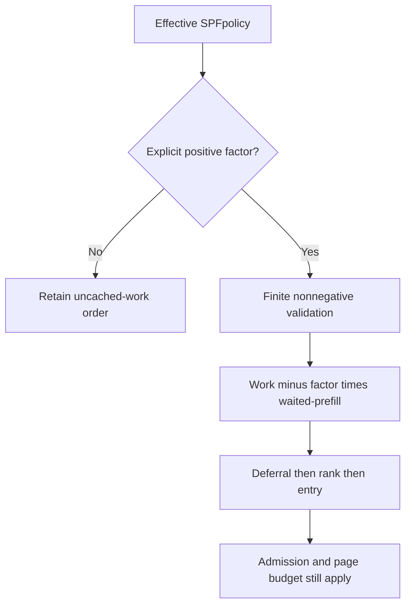
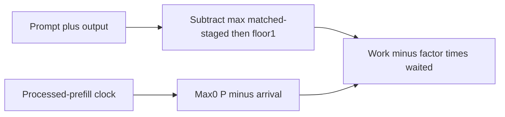
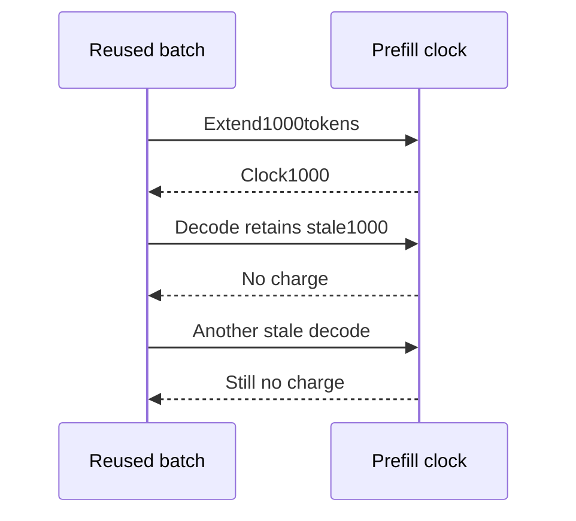

# SPFaging selection FAQ:work clocks,common-offset cancellation and page reservation

> **Language**:English | [中文](shortest-prefill-aging-clock-page-reservation-selection-faq.md)  
> **Round161**:actualNov14opt-in aging/stale decode-counter correction.Native default remains0;original profile explicitly chooses1/2.For an already-arrived fixed queue,a common clock offset cancels:the queue **does not continually reorder as that clock advances**.`synthetic`, `independently_reproduced=false`;CPU sorts separately `measured`.
>
> [H5](../reports/shortest-prefill-aging-clock-page-reservation-sizer.html) · [Seven cards](../reports/shortest-prefill-aging-clock-page-reservation-selection-cards.html) · [1600px SVG](../../assets/svg/shortest-prefill-aging-clock-page-reservation-selection-faq-summary.svg) · [Experiment/evidence](../../experiments/shortest_prefill_aging_selection/README.md)

## Q1: When should SPFaging be enabled?

A stream of new short requests can continually beat older long work.Aging lowers rank by **prefill tokens processed while waiting**,not elapsed seconds.The option does not change the native default to nonzero.

A nonzero native factor requires the effective SPFpolicy.Our bounded rational numerator/denominator models only this profile,not every policy or floating precision regime.Native default0.0remains.

## Q2: How is rank computed,and why does fixed backlog not continually reorder?

`work=max(1,prompt+output−max(matched,staged))`;`waited=max(0,P−arrival)`;`rank=work−factor×waited`.Matched/staged prefixes overlap,so usemax,not their sum.Retracted output counts towardtotal;fully cached work still has floor1.

Once every request has arrived,exact algebra gives`rank=work+factor×arrival−factor×P`.The final term is common,so sorting is equivalent to`work+factor×arrival`.**Aging changes competition against subsequent new arrivals,not the relative order of a fixed arrived pool each clock tick.**

Originalold work1000/arrival0beatsnew work10arriving atclock3000withfactor1/2:oldrank−500,newrank10.Without aging,new wins.Negative ranks are not clipped.Future arrivals use a differentmax0branch;common-offset cancellation is invalid there.This is bounded exact rational proof,not universal native large-floating-rank bit equivalence.

## Q3: What should the work clock charge?

Native launch accounting requires `batch.forward_mode.is_extend()` and a nonzero extend count. A batch reused for decode may retain old `extend_num_tokens`; do not charge it repeatedly. The original model takes an explicit native-is_extend witness, not a running ForwardMode/GPU launch.

Correct original clock 1000 contrasts with legacy 3000. But **do not invent a fixed-queue order change from that common shift**. Once both requests have arrived, the offset cancels. The erroneous counter still misstates work waiting/later-arrival accounting and serves other native policies. This study does not reproduce the full HRRN/scheduler.

## Q4: Can age bypass duplicate deferral or page admission?

No. Sort key is `(temporary_deprioritized,rank,entry)`: deferral precedes rank, even when an old rank is negative. Entry is the final tie-break; our ordinal entry is not measured wall-time.

Continuation rank uses remaining work and age. Waiting work charges `ceil(work/page)×page`. Reserve only when waiting rank is strictly lower than continuation rank and total charges fit `budget−page`; **break at the first ineligible/unfitting request**, rather than scanning later candidates. No reservation returns null; otherwise floor the continuation limit to a page multiple.

Original work 257/page 256 charges 512; budget 4096 leaves 3584 for continuation. A budget below two pages has no such reservation. This is an admission ledger, not a promise to immediately execute every lower-ranked request.

## Q5: What did local tests and CPUtiming prove?

Eight tests cover extend-only clocks, overlapping cache prefixes, work floor 1, deferral, new-arrival competition, clock cancellation, future-arrival guards, invalid factor/schema and page budgets. 64 random arrived queues compare full ranks with adjusted keys; Node/Python compare 65 configurations/195 outcomes.

Sealed `latency.json` records 64/256/1024/4096-request original CPU full-rank sorts versus common-clock adjusted keys. The adjusted path first checks all requests have arrived. Two warmups, seven alternating repeats, three sorts/sample and median repeat means are used.

Setup, native cache matching/storage prefetch/admission, GPUs, real queue waits and model throughput are excluded. All card bar widths are sealed; unknown native values remain null. No browser visual acceptance was performed.

## Q6: Why is work/factor not a wall-time SLA?

It is a conditional processed-work intuition, not a seconds limit. No prefill progress means no clock advance. Duplicate deferral, resources/admission, prefetch, dynamic work, retraction and continuation affect actual waiting. A factor of 0.5 does not imply any fabricated two-second bound.

Production acceptance checks the actual SPF policy, finite factor, arrival-clock recording, observed cached prefixes, extend-only counters, deferral release and admission/page budgets, then measures real waiting distributions. Original models are archived with primary links and rights retained, not as native performance acceptance.

**Pinned primary evidence**:[Actualcommit](https://github.com/sgl-project/sglang/commit/e5caad9a07573616e16614a9f374089959a7c48f) · [Rank/reservation](https://github.com/sgl-project/sglang/blob/e5caad9a07573616e16614a9f374089959a7c48f/python/sglang/srt/managers/schedule_policy.py) · [Launchcounter](https://github.com/sgl-project/sglang/blob/e5caad9a07573616e16614a9f374089959a7c48f/python/sglang/srt/managers/scheduler.py) · [Nativepolicytests](https://github.com/sgl-project/sglang/blob/e5caad9a07573616e16614a9f374089959a7c48f/test/registered/unit/managers/test_schedule_policy.py) · [Apache-2.0LICENSE](https://github.com/sgl-project/sglang/blob/e5caad9a07573616e16614a9f374089959a7c48f/LICENSE).
