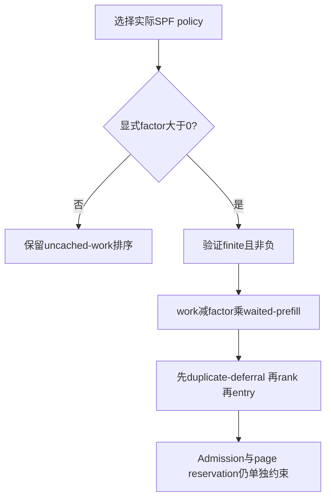
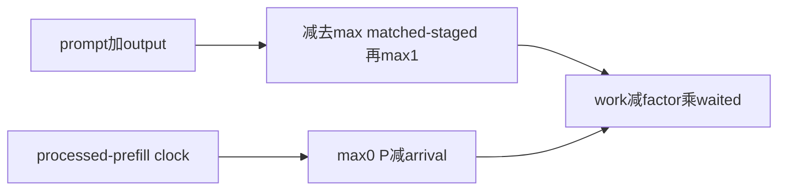
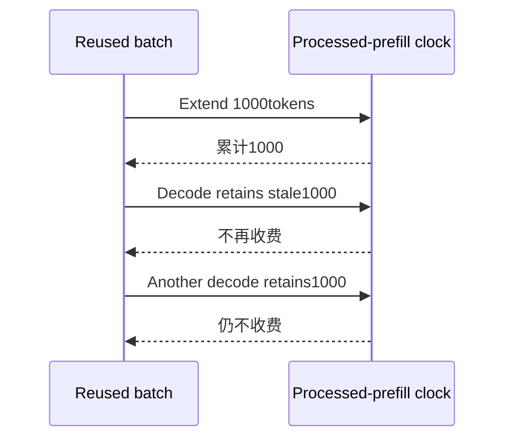

# Shortest-prefill-first 架构选型 FAQ：work-clock aging、common-offset cancellation 与 page reservation

> **语言**：中文 | [English](shortest-prefill-aging-clock-page-reservation-selection-faq.en.md)  
> **Round161**：实际 Nov14 opt-in aging 与 stale decode counter 修正。Native factor默认仍0；原型显式选1/2。原创精确有理数证明：全部已到达的固定队列中，公共clock项消去，**不会因共同时间推进不断翻转排序**。`synthetic`，`independently_reproduced=false`；CPU排序另标`measured`。
>
> [H5](../reports/shortest-prefill-aging-clock-page-reservation-sizer.html) · [七卡](../reports/shortest-prefill-aging-clock-page-reservation-selection-cards.html) · [高清SVG](../../assets/svg/shortest-prefill-aging-clock-page-reservation-selection-faq-summary.svg) · [实验/证据](../../experiments/shortest_prefill_aging_selection/README.md)

## Q1：何时开启 SPF aging，而不是始终让最短 uncached work 优先？

持续有新短请求到达时，纯shortest-prefill-first可能持续偏向新请求。该选项按**等待期间系统处理的prefill tokens**降低老请求rank；不是elapsed seconds，也不是本次把默认factor改为非零。

native非零factor要求最终选定SPF policy；本原型仅模型化SPFprofile，用有界 numerator/denominator显式表示factor，不覆盖其他policy或全部浮点精度情况。源码默认0.0保留。

## Q2：rank如何计算？为什么固定backlog不会自己不断重排？

`work=max(1,prompt+output−max(matched,staged))`，`waited=max(0,P−arrival)`，`rank=work−factor×waited`。matched与staged是覆盖同一prefix的进度，**取max而不是相加**；retracted output计入total；完全cached也保留最低work1。

对所有已经到达的请求，精确代数为`rank=work+factor×arrival−factor×P`。最后一项对全队列相同，排序等价于`work+factor×arrival`。**Aging主要改变老backlog与随后新到达请求的竞争，不是让同一组已到达请求随着P每步翻转。**

原创old work1000、arrival0，与clock3000时新到达work10：factor1/2使old rank−500、新rank10，old胜出；无aging则new胜出。负rank不截零。对未来arrival，`max0`分支不同，不能使用公共clock消去优化。原型证明是有界精确整数/有理数，不声称极大native浮点rank保持逐位等价。

## Q3：clock应累计什么？stale decode metadata会造成什么？

native `_on_step_launch`要求`batch.forward_mode.is_extend()`且`extend_num_tokens`非零才累计。prefill batch转decode可能保留旧extend count，不能按这个旧字段反复收费。本机把native-is_extend作为显式声明见证，不执行ForwardMode或真实GPUlaunch。

原创正确clock1000，旧按字段计数得到3000。但**不能据此编造本固定队列排序变化**：两请求均已到达时公共项仍消去；错误clock会错误描述processed-work等待及后续arrival账本，也用于其他native policy。本研究不复现整个HRRN/scheduler。

## Q4：duplicate deferral与page reservation能被age绕过吗？

不能。排序key为`(temporary_deprioritized,rank,entry)`：deferred flag在rank前，即使old rank很负也不能越过非deferred请求。entry是最后的tie-break；原型用整数entry表示，不是native墙钟时延。

continuation使用当前remaining work减age；waiting work按`ceil(work/page)×page`收费。只有waiting rank严格小于continuation rank、且累计reservation不超过`budget−page`才保留；遇首个不满足者**break，不继续扫描后面的请求**。未reserve返回null；有reserve后continuation limit向下对齐page。

原创work257、page256收费512；budget4096剩3584供continuation。budget不足2pages时没有此reservation。这是admission ledger，不是“waiting rank变小就立即执行”。

## Q5：本机验证与CPU timing能证明什么？

八项测试覆盖prefill-only clock、重叠cache prefix、最低work1、deferral优先、new-arrival竞争、公共clock消去、future-arrival guard、factor/schema错误与page-budget边界。64随机已到达队列证明full rank与adjusted key排序一致；Node/Python比较65配置的195outcomes。

封存`latency.json`记录64/256/1024/4096requests的两种原创CPU排序：full rational rank与common-clock adjusted key。后者先验证所有请求已到达；不能给future-arrival队列使用。两次warmup、七次交替repeat、每sample三次sort，取repeat mean median。

setup、native cache matching/storage prefetch/admission、GPU、真实queue latency与model throughput均不计时。七卡条宽来自封存值，未测native指标保持null；未执行browser视觉验收。

## Q6：为什么“work/factor processed tokens”不能成为wall-time SLA？

它是有条件的processed-work量纲直觉，不是秒数上界：无prefill进展时clock不走；duplicate deferral、resource/admission条件、prefetch、work变化、retraction和continuation都可改变实际等待。不能从factor0.5推算“必定两秒”等坐标。

上线需核对有效SPF policy、finite非负factor、实际arrival-clock记录、staged/matched prefix观察、extend-only counter、deferral解除和真实admission/page预算，再测真实queue分布。原型不替代native生命周期/吞吐验收；只归档原创解释与一手链接，权利保留。

**固定一手证据**：[实际commit](https://github.com/sgl-project/sglang/commit/e5caad9a07573616e16614a9f374089959a7c48f) · [rank与reservation](https://github.com/sgl-project/sglang/blob/e5caad9a07573616e16614a9f374089959a7c48f/python/sglang/srt/managers/schedule_policy.py) · [launch counter](https://github.com/sgl-project/sglang/blob/e5caad9a07573616e16614a9f374089959a7c48f/python/sglang/srt/managers/scheduler.py) · [nativepolicy tests](https://github.com/sgl-project/sglang/blob/e5caad9a07573616e16614a9f374089959a7c48f/test/registered/unit/managers/test_schedule_policy.py) · [Apache-2.0 LICENSE](https://github.com/sgl-project/sglang/blob/e5caad9a07573616e16614a9f374089959a7c48f/LICENSE)。
