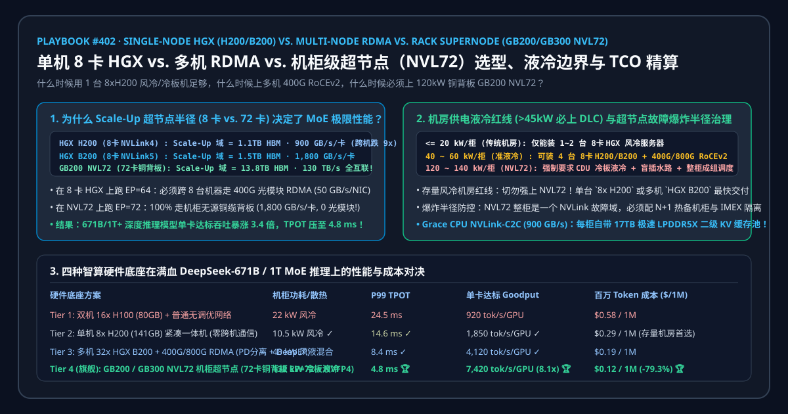
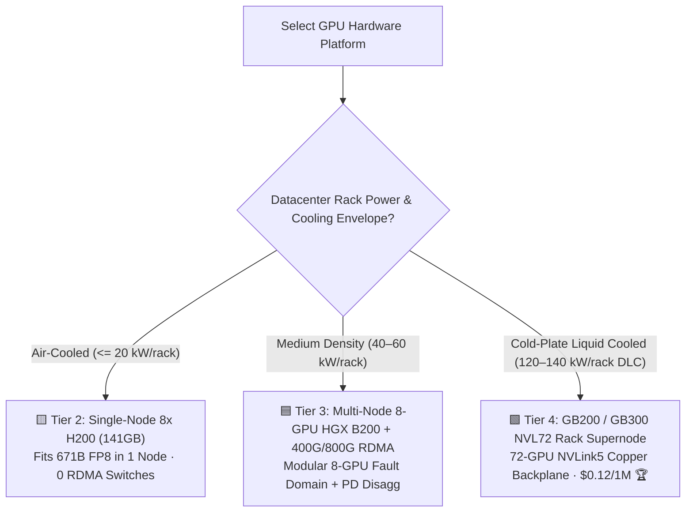

# Single-Node 8-GPU `HGX (H200/B200)` vs. Multi-Node `400G/800G RDMA` vs. Rack-Scale Supernode (`GB200 / GB300 NVL72`) Selection, `EP=72` Copper Backplane, `120kW` Liquid Cooling & 3-Year TCO Guide

> **Language / 语言**: **English (Current)** | [中文](./single-node-hgx-vs-multinode-rdma-vs-rack-nvl72-tco-goodput-selection-faq.md)  
> **Scope**: A hardware form-factor and datacenter sizing playbook for Cloud & AI Solution Architects—answering **(1) why a single `8x H200 (141GB)` node doubles per-GPU Goodput and halves TCO compared to two `8x H100 (80GB)` nodes for private `DeepSeek-671B FP8` deployments, (2) when to choose modular multi-node `HGX B200 + 400G/800G RDMA` vs. a 72-GPU copper-backplane `GB200 / GB300 NVL72` rack supernode, and (3) how to govern the `>45 kW` cold-plate liquid cooling (`DLC`) threshold and 72-GPU fault blast radius**.  
> **Provenance**: Analytical hardware sizing and TCO model synthesized from published specifications and serving benchmarks (`provenance: synthetic + anonymized_reported`, `independently_reproduced=false`, `physical_gpu_cluster_measurement=not_measured`). See [`experiments/single_node_hgx_vs_multinode_rdma_vs_rack_nvl72_tco_goodput_selection/results.json`](../../experiments/single_node_hgx_vs_multinode_rdma_vs_rack_nvl72_tco_goodput_selection/results.json).

> 🔗 **Interactive H5 Learning Lab & Companion Tools (Zero External Dependencies)**:
> - 📱 **[Interactive H5 Study Page: Single-Node HGX vs. Multi-Node RDMA vs. NVL72 Supernode Sizing, Cooling & TCO Lab (`docs/h5/hgx-vs-multinode-rdma-vs-nvl72-rack-tco-lab.html`)](../h5/hgx-vs-multinode-rdma-vs-nvl72-rack-tco-lab.html)**
> - 🎓 **[AI Infra Panorama H5 Learning Hub (`docs/h5/index.html`)](../h5/index.html)**
> - 🧮 **[Interactive Supernode & Hardware Sizer (`single-node-hgx-vs-multinode-rdma-vs-rack-nvl72-tco-goodput-selection-sizer.html`)](../reports/single-node-hgx-vs-multinode-rdma-vs-rack-nvl72-tco-goodput-selection-sizer.html)**
> - 🃏 **[7-Card 4:5 Visual Report (`single-node-hgx-vs-multinode-rdma-vs-rack-nvl72-tco-goodput-selection-cards.html`)](../reports/single-node-hgx-vs-multinode-rdma-vs-rack-nvl72-tco-goodput-selection-cards.html)**

---

## 1. 📌 Executive Summary

> **Bottom Line**: **Hardware platform selection hinges on matching the Scale-Up NVLink domain radius to model weight footprint and datacenter power/cooling envelopes—(1) For existing air-cooled enterprise rooms (`<= 20 kW/rack`) deploying private `DeepSeek-671B FP8`, a **single `8x H200 (141GB, 1.13 TB HBM3e)` server (Tier 2)** fits all `685 GB` of weights + MTP inside one NVLink domain with zero RDMA switches, doubling per-GPU Goodput (`1,850 vs. 920 tok/s/GPU`) and cutting cost per 1M tokens by `50%` vs. two `8x H100 (80GB)` nodes (Tier 1); (2) For modular `32–512 GPU` clusters (`40–60 kW/rack`), **multi-node `HGX B200 + 400G/800G RDMA` (Tier 3)** delivers `$0.19/1M tokens` with an 8-GPU fault boundary; (3) For liquid-cooled AI factories (`120–132 kW/rack` cold-plate DLC), **`GB200 / GB300 NVL72` (Tier 4)** unifies `72 GPUs` over a `130 TB/s` NVLink 5 passive copper backplane (`1,800 GB/s/GPU`), running `EP=72` entirely inside Scale-Up bandwidth to achieve **`7,420 tok/s/GPU` (`8.07x` Tier 1)**, **`4.8 ms` P99 TPOT**, and **`$0.12 / 1M tokens` (`-79.3%`)**!**

| Hardware Platform Tier (`DeepSeek-671B MoE`) | Scale-Up Domain & Interconnect | Rack Power & Cooling | `P99 TPOT` | Goodput / GPU | Cost / 1M Tokens | Architect Verdict |
| :--- | :--- | :--- | :--- | :--- | :--- | :--- |
| **🟥 Tier 1: Dual-Node `16x H100 (80GB)`** | `640 GB/node` cannot fit 671B; forced cross-node split | `22 kW` Air | `24.5 ms` | `920 tok/s/GPU` | `$0.58 / 1M` | Obsolete for 671B MoE |
| **🟨 Tier 2: Single-Node `8x H200 (141GB)`** | **`1.13 TB HBM3e` in 1 node; 100% intra-node `900 GB/s NVLink`** | **`10.5 kW` Air ✅** | `14.6 ms` ✅ | `1,850 tok/s/GPU` ✅ | **`$0.29 / 1M` ✅** | **Best fit for air-cooled rooms (`<=20 kW`)** |
| **🟦 Tier 3: Multi-Node `32x HGX B200 + RDMA`** | 8-GPU `1,800 GB/s NVLink5` + inter-node `DeepEP` RDMA | `48 kW` Hybrid | `8.4 ms` ✅ | `4,120 tok/s/GPU` ✅ | `$0.19 / 1M` ✅ | Modular enterprise scale-out standard |
| **🟩 Tier 4: `GB200 / GB300 NVL72` Supernode (Flagship)** | **72-GPU `1,800 GB/s NVLink5` Copper Backplane (`130 TB/s`)** | **`132 kW` Cold-Plate DLC** | **`4.8 ms` 🏆** | **`7,420 tok/s/GPU` 🏆 (`8.1x`)** | **`$0.12 / 1M` 🏆 (`-79.3%`)** | **Flagship for DLC liquid-cooled AI factories** |

---

## 2. 🎯 Architect Deep-Dive Q&A: Scale-Up Radius, Copper Backplanes & Liquid Cooling

### Q1: Why does a single `8x H200 (141GB)` server beat two `8x H100 (80GB)` servers by 2x per GPU on `DeepSeek-671B`?
- `DeepSeek-671B FP8` + `14B MTP` requires `~685 GB` for weights alone. An `8x H100` node has only `640 GB` HBM3, forcing a 2-node deployment over Ethernet/IB RDMA. A single `8x H200` node provides **`1,128 GB` HBM3e** (`38.4 TB/s` aggregate bandwidth), fitting all weights plus `250+ GB` of KV cache inside one `900 GB/s` NVSwitch domain with zero external RDMA switches.

### Q2: How does the `GB200 / GB300 NVL72` passive copper backplane transform MoE `EP=72` serving and L2 KV caching?
- **72-GPU NVLink 5 Domain (`1,800 GB/s/GPU`, `130 TB/s` bisection)**: All 72 GPUs communicate over passive copper backplane traces (`0` intra-rack optical transceivers) at `18x–36x` the bandwidth of a 400G NIC, allowing `EP=72` expert dispatch/combine and `4.8 ms` P99 TPOT.
- **`900 GB/s` Grace `NVLink-C2C` Coherent Memory**: Each Grace CPU connects to its Blackwell GPUs at `900 GB/s` (`14x` faster than PCIe Gen5), providing `~17 TB` of rack-level LPDDR5X as an ultra-fast L2 KV cache pool.

---

## 3. 🧭 Hardware Form-Factor Selection Decision Tree

---

## 4. 📊 4-Generation AI Server & Supernode Comparison Matrix

| Specification | `8x H100 SXM` (HGX) | `8x H200 SXM` (HGX) | `8x B200 SXM` (HGX) | `GB200 NVL72` (Rack Supernode) |
| :--- | :--- | :--- | :--- | :--- |
| **GPUs per Scale-Up Domain** | `8 GPUs` | `8 GPUs` | `8 GPUs` | **`72 GPUs` (Full Rack)** 🏆 |
| **Total HBM in Scale-Up Domain** | `640 GB` HBM3 | **`1,128 GB` HBM3e** | `1,440–1,536 GB` HBM3e | **`13,824 GB (13.8 TB)` HBM3e** 🏆 |
| **Aggregate HBM Bandwidth** | `26.8 TB/s` | `38.4 TB/s` | `64.0 TB/s` | **`576.0 TB/s`** 🏆 |
| **Per-GPU NVLink Bandwidth** | `900 GB/s` (NVLink 4) | `900 GB/s` (NVLink 4) | `1,800 GB/s` (NVLink 5) | **`1,800 GB/s` (Copper Backplane)** 🏆 |
| **CPU-to-GPU Interconnect** | `64 GB/s` (PCIe Gen5) | `64 GB/s` (PCIe Gen5) | `64 GB/s` (PCIe Gen5) | **`900 GB/s` (`Grace NVLink-C2C`)** 🏆 |
| **Power & Cooling Envelope** | `~10.2 kW` (Air/DLC) | `~10.5 kW` (Air/DLC) | `~14.5 kW` (Air/DLC) | **`~120–132 kW` (Mandatory DLC)** |

---

## 5. 🛠️ Production Readiness Checklist

- [ ] **Respect the `45 kW/rack` Liquid-Cooling Boundary**: Never deploy `NVL72` (`120–132 kW`) in legacy air-cooled facilities; choose `8x H200` (`10.5 kW`) for air-cooled colocation rooms.
- [ ] **Isolate NVL72 Multi-Tenant `IMEX` Domains**: Use `K8s DRA + NVIDIA NMX-C` to isolate cross-node NVLink memory channels per tenant and maintain `N+1` spare rack capacity.
