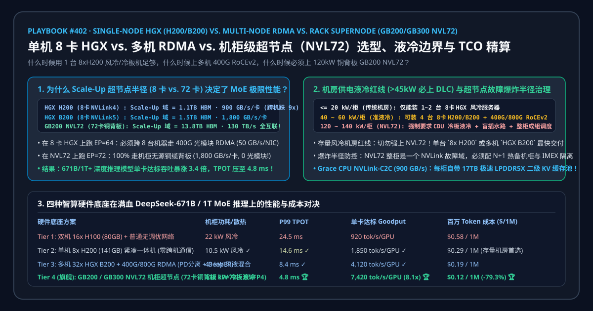
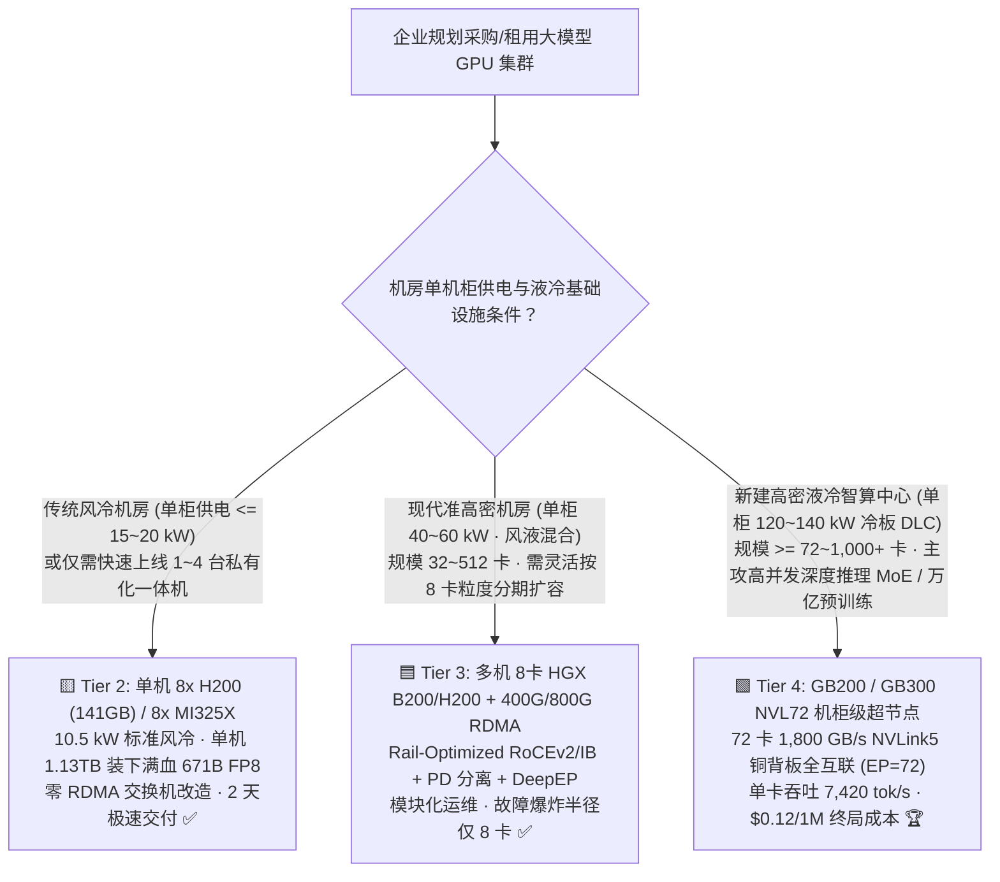

# 单机 8 卡 `HGX (H200/B200)` vs. 多机 `400G/800G RDMA` 集群 vs. 机柜级超节点（`GB200 / GB300 NVL72`）全尺度选型、`EP=72` 铜背板红利、`120kW` 液冷边界与 3 年 TCO 精算指南

> **语言 / Language**: **中文 (当前)** | [English](./single-node-hgx-vs-multinode-rdma-vs-rack-nvl72-tco-goodput-selection-faq.en.md)  
> **文档定位**：面向 Cloud & AI Solution Architect 的智算中心硬件底座与超节点（Supernode）拍板指南——明确回答客户采购时最纠结的三个问题：**“私有化部署满血 DeepSeek-671B，买 2 台 8xH100 (80GB) 还是买 1 台 8xH200 (141GB)？”、“什么时候传统的 8 卡 HGX + 400G/800G RDMA 形态足够用，什么时候必须上 72 卡铜缆背板全互联的 `GB200 / GB300 NVL72` 超节点？”、“机房没有 120kW 冷板液冷（DLC）能不能上 NVL72？超节点单柜故障爆炸半径怎么防？”**。  
> **标定声明**：本文所引用的机柜功耗、P99 TPOT、单卡达标有效吞吐（Goodput）与每百万 Token 成本基于公开硬件规格与智算集群架构基准构建的合成定量模型（`provenance: synthetic + anonymized_reported`, `independently_reproduced=false`, `physical_gpu_cluster_measurement=not_measured`），详见 [`experiments/single_node_hgx_vs_multinode_rdma_vs_rack_nvl72_tco_goodput_selection/results.json`](../../experiments/single_node_hgx_vs_multinode_rdma_vs_rack_nvl72_tco_goodput_selection/results.json)。

> 🔗 **关联交互式 H5 精读页与工具（点击即开，零外部依赖）**：
> - 📱 **[交互式 H5 精读页：单机 HGX vs. 多机 RDMA vs. NVL72 超节点容量、液冷与 3 年 TCO 沙盘 (`docs/h5/hgx-vs-multinode-rdma-vs-nvl72-rack-tco-lab.html`)](../h5/hgx-vs-multinode-rdma-vs-nvl72-rack-tco-lab.html)**
> - 🎓 **[AI Infra 全景可视化精学馆首页 (`docs/h5/index.html`)](../h5/index.html)**
> - 🧮 **[交互式硬件底座与超节点 TCO 计算器 (`single-node-hgx-vs-multinode-rdma-vs-rack-nvl72-tco-goodput-selection-sizer.html`)](../reports/single-node-hgx-vs-multinode-rdma-vs-rack-nvl72-tco-goodput-selection-sizer.html)**
> - 🃏 **[7-Card 4:5 视觉评测报告 (`single-node-hgx-vs-multinode-rdma-vs-rack-nvl72-tco-goodput-selection-cards.html`)](../reports/single-node-hgx-vs-multinode-rdma-vs-rack-nvl72-tco-goodput-selection-cards.html)**

---

## 1. 📌 核心选型结论速览（Executive Summary）

> **一句话结论**：**智算硬件底座选型的第一性原理是“把模型权重与高频通信锁进尽可能大的 Scale-Up 高速域，同时匹配机房真实供电与液冷能力”——① 如果企业是存量风冷机房（单柜供电 `<= 15~20 kW`）且目标是私有化部署满血 `DeepSeek-671B FP8`，**首选单台 `8x H200 (141GB, 共 1.13TB HBM3e)` 一体机（Tier 2）**，1 台机器无需任何跨机 RDMA 交换机即可装下 `671B + 14B MTP + 192 并发会话`，比跨两台 `8x H100 (80GB)`（Tier 1）单卡吞吐翻倍（`1,850 vs. 920 tok/s/GPU`）、成本直降 `50%`；② 如果是 `32 ~ 512 卡` 标准智算中心（支持 `40~60 kW/柜`），采用 **多机 `HGX B200 + 400G/800G RoCEv2/IB RDMA`（Tier 3）** 兼具模块化维护与高性价比（`$0.19 / 1M`）；③ 如果新建具备 **`120 ~ 140 kW/柜` 冷板液冷（DLC）** 的大规模 AI Factory 且主攻高并发深度推理 MoE（`671B ~ 2T` 参数），**`GB200 / GB300 NVL72` 机柜级超节点（Tier 4）** 将 72 张 GPU 通过无源铜缆背板织成 **`130 TB/s` 全互联 NVLink 5 巨型域**，让 `EP=72` 100% 在 `1,800 GB/s/GPU` 铜缆内完成，单卡达标吞吐飙至 **`7,420 tok/s/GPU`（Tier 1 的 `8.07 倍`）**，`P99 TPOT` 压至 **`4.8 ms`**，每百万 Token 成本探底至 **`$0.12 / 1M`（立省 `79.3%`）**！**

| 硬件底座档位（运行满血 `DeepSeek-671B MoE`） | Scale-Up 域半径与互联带宽 | 单柜功耗与散热要求 | `P99 TPOT` | 单卡达标 Goodput | 每百万 Token 成本 | 架构师拍板结论 |
| :--- | :--- | :--- | :--- | :--- | :--- | :--- |
| **🟥 Tier 1：双机 `16x H100 (80GB)`** | 单机 640GB 装不下 671B，被迫跨 2 机通信 | `22 kW` 风冷 | `24.5 ms` | `920 tok/s/GPU` | `$0.58 / 1M` | 80GB 卡跑 671B 性价比已被 H200 淘汰 |
| **🟨 Tier 2：单机 `8x H200 (141GB)` 紧凑底座** | **单机 `1.13 TB HBM3e`，100% 机内 `900 GB/s NVLink`** | **`10.5 kW` 标准风冷 ✅** | `14.6 ms` ✅ | `1,850 tok/s/GPU` ✅ | **`$0.29 / 1M` ✅** | **存量风冷机房私有化 671B 唯一首选** |
| **🟦 Tier 3：多机 `32x HGX B200 + 400G/800G RDMA`** | 机内 8 卡 `1,800 GB/s NVLink5` + 跨机 `DeepEP` RDMA | `48 kW` 风液混合 | `8.4 ms` ✅ | `4,120 tok/s/GPU` ✅ | `$0.19 / 1M` ✅ | 中大型企业模块化扩缩容标准主力 |
| **🟩 Tier 4：`GB200 / GB300 NVL72` 机柜超节点 (旗舰)** | **整柜 72 卡全互联 `1,800 GB/s NVLink5` 铜缆背板 (`130 TB/s`)** | **`132 kW` 冷板液冷 (DLC)** | **`4.8 ms` 🏆** | **`7,420 tok/s/GPU` 🏆 (`8.1x`)** | **`$0.12 / 1M` 🏆 (`-79.3%`)** | **新建液冷智算中心与超大规模推理终局** |

---

## 2. 🎯 架构师灵魂拷问与超节点第一性原理手算 Q&A

### Q1：为什么同样是跑 `DeepSeek-671B FP8`，1 台 `8x H200 (141GB)` 比 2 台 `8x H100 (80GB)` 单卡吞吐高出整整 2 倍？
* **第一道显存水位线导致的“单机闭环 vs. 被迫跨机”分水岭**：
  - `DeepSeek-V3/R1 671B FP8` 主权重约 `671 GB`，加上 `14B MTP` 投机头约 `685 GB`。
  - **在 `8x H100 (80GB)` 上**：单机总显存仅 $8 \times 80 = \mathbf{640\text{ GB}}$，**连静态权重都装不下**！必须买 2 台机器（16 张卡，`1,280 GB`）并配置跨机 400G RDMA 交换机。
  - **在 `8x H200 (141GB)` 上**：单机总显存高达 $8 \times 141 = \mathbf{1,128\text{ GB}}$！按 `/0.85` 安全水位扣除后，装下 `685 GB` 权重和 `24 GB` 激活图缓冲后，**单机还剩整整 `250+ GB` HBM3e 显存可同时容纳 `192 个` 32K 并发会话**！而且所有 `EP=8 / TP` 通信 100% 在机内 `900 GB/s NVSwitch` 完成，**省掉所有跨机 RDMA 光模块与交换机采购费**，HBM3e 带宽还比 H100 高 `43%`（`4.8 vs. 3.35 TB/s`）！

### Q2：`GB200 / GB300 NVL72` 机柜级超节点到底贵在哪、强在哪？为什么说它把 MoE 的 `EP=72` 通信墙彻底夷平了？
* **三大物理架构质变**：
  1. **Scale-Up 域半径从 `8 卡` 跃升 `9 倍` 至 `72 卡`（`130 TB/s` 铜缆背板）**：
     - 在传统 8 卡服务器集群中，要做 `EP=64` 专家并行，每个 Token 的 All-to-All 分发必须离开服务器、穿过 `400G/800G` 光模块与 ToR 交换机（带宽跌至 `50~100 GB/s`）。
     - 而在 `NVL72` 中，18 个计算托盘（Compute Trays，共 36 颗 Grace CPU + 72 颗 Blackwell GPU）和 9 个 NVLink Switch 托盘通过机柜背部 **5,000+ 根无源高速铜缆（Passive Copper Backplane）** 直连——**72 张 GPU 之间任意两张卡都拥有完整的 `1,800 GB/s` NVLink 5 带宽**！
     - 这使得 **72 卡可以像“1 块拥有 `13.8 TB HBM3e`、`576 TB/s` 总显存带宽的超级巨型 GPU”一样运行 `EP=72`**，将每层专家切得极细且每卡只读 $1/72$ 的路由专家权重，把 `P99 TPOT` 直接压进惊人的 **`4.8 ms`（单流 `>200 tok/s`）**！
  2. **无源铜缆替代柜内光模块（省电 `20 kW/柜` + 故障率降 `10x`）**：柜内 72 卡互连 `0` 光模块（全部是高可靠无源铜背板），彻底消除了柜内光模块热闪断（Flapping）顽疾。
  3. **`Grace CPU NVLink-C2C (900 GB/s)` 自带 `17 TB` 超高速二级 KV 池**：每颗 Grace CPU 与相连的 Blackwell GPU 之间通过 `900 GB/s` 一致性总线直连（比 PCIe Gen5 `64 GB/s` 快 **`14 倍`**！），整柜自带十几个 TB 的 LPDDR5X 内存，天然就是毫秒级零拷贝 L2 KV Cache 池！

---

## 3. 🧭 直观可视化图解（硬件底座选型决策树与机柜液冷供电边界）

---

## 4. 📊 四代主流 AI 服务器与机柜超节点硬件规格与 TCO 横向对比表

| 核心指标 | `8x H100 SXM` (HGX) | `8x H200 SXM` (HGX) | `8x B200 SXM` (HGX) | `GB200 NVL72` (机柜超节点) |
| :--- | :--- | :--- | :--- | :--- |
| **Scale-Up 域内 GPU 卡数** | `8 GPUs` | `8 GPUs` | `8 GPUs` | **`72 GPUs`（整柜全互联）** 🏆 |
| **Scale-Up 域总 HBM 容量** | `640 GB` HBM3 | **`1,128 GB` HBM3e**（装得下 671B） | `1,440 ~ 1,536 GB` HBM3e | **`13,824 GB (13.8 TB)` HBM3e** 🏆 |
| **Scale-Up 域总 HBM 带宽** | `26.8 TB/s` | `38.4 TB/s` | `64.0 TB/s` | **`576.0 TB/s`** 🏆 |
| **单卡 NVLink 双向带宽** | `900 GB/s` (NVLink 4) | `900 GB/s` (NVLink 4) | `1,800 GB/s` (NVLink 5) | **`1,800 GB/s` (NVLink 5 铜背板)** 🏆 |
| **CPU↔GPU 互连带宽** | `64 GB/s` (PCIe Gen5) | `64 GB/s` (PCIe Gen5) | `64 GB/s` (PCIe Gen5) | **`900 GB/s` (`Grace NVLink-C2C`)** 🏆 |
| **单节点 / 单柜峰值功耗与散热** | `~10.2 kW`（风冷/DLC） | `~10.5 kW`（风冷/DLC） | `~14.5 kW`（风液/DLC） | **`~120–132 kW`（强制冷板液冷 DLC）** |
| **故障爆炸半径（Blast Radius）** | `8 GPUs`（单台服务器） | `8 GPUs`（单台服务器） | `8 GPUs`（单台服务器） | **`72 GPUs`**（需配 `N+1` 热备柜与 `Kueue TAS`） |

---

## 5. 🛠️ 生产落地核对清单（SA Production Readiness Checklist）

- [ ] **存量风冷机房（`<=20 kW/柜`）严禁盲目签单 `NVL72`**：若机房无一次侧冷水机组与 `>100 kW/柜` 母线槽改造条件，果断选择 **单机 `8x H200` 或多机 `8x H200/B200` 风冷/风液一体柜**。
- [ ] **`>45 kW/柜` 强制切换冷板式液冷（Direct-to-Chip DLC）**：部署高密 B200 或 NVL72 时，验收 CDU（冷量分配单元）冗余度（`N+1`）、漏液检测绳与快速盲插接头（UQDB）。
- [ ] **NVL72 超节点成组调度与安全隔离**：在 K8s 中启用 **`Kueue Topology-Aware Scheduling (TAS)`** 将 `EP=72` 作业完整对齐在单个 NVL72 机柜内，并通过 **`NVIDIA NMX-C + K8s DRA IMEX Channel`** 严格隔离多租户跨节点显存访问权限。
